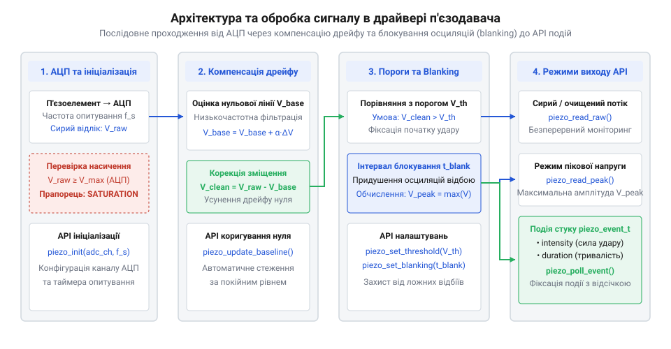
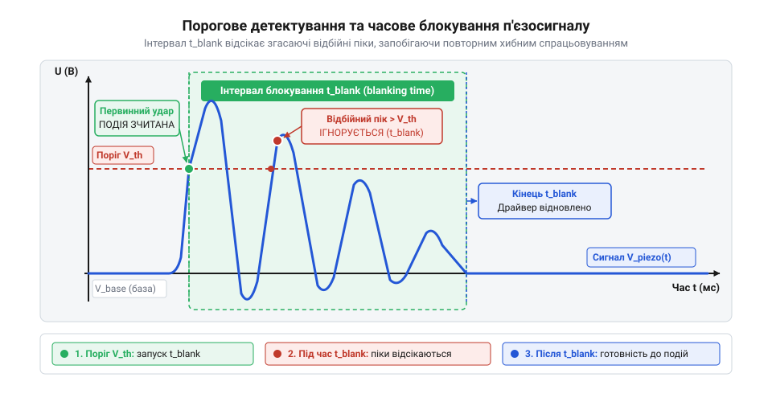

# Програмний інтерфейс драйвера обробки сигналу п'єзодавача

<preknowlist>
- [KY-031 — давач стуку](root:cat-hw-sensors/ky-031-knock) — Принципи реєстрації механічних ударів та відмінність дискретної фіксації від аналогової обробки.
- [KY-002 — давач вібрації (SW-18020P)](root:cat-hw-sensors/ky-002-vibration) — Механіка імпульсних вібраційних відгуків та явище згасання механічних осциляцій.
</preknowlist>

## Проблема осциляцій та обробка п'єзосигналу

Коли на п'єзодавач діє зовнішня механічна сила, п'єзоелектричний ефект генерує миттєвий сплеск електричного заряду. Проте прямолінійне опитування аналогового входу мікроконтролера призводить до нестабільної роботи: після первинного імпульсу п'єзоелемент продовжує коливатися під дією пружної деформації матеріалу. Ці згасаючі відбійні осциляції створюють серію затухаючих сплесків напруги, які звичайне тригерне порівняння приймає за кілька послідовних ударів.

Порівняно з простими дискретними рішеннями, де [давач вібрації KY-002](root:cat-hw-sensors/ky-002-vibration) видає хаотичні замикання контактів, а [давач стуку KY-031](root:cat-hw-sensors/ky-031-knock) лише переключає цифровий вихід, п'єзоелемент надає повний аналоговий профіль впливу. Однак вихідний сигнал спотворюється дрейфом базової лінії через температурні зміни та статичні напруження пластини. Якщо програмний інтерфейс (@@en|API@@) оброблятиме сирий сигнал без попередньої фільтрації, застосунок отримуватиме пропущені події або хибні тригери.

Щоб перетворити нестабільний аналоговий потік на надійні події, драйвер обробки сигналу реалізує чотириетапну цифрову обробку. Первинна потреба у фільтрації виникає через електричну модель п'єзодавача. П'єзоелемент поводиться як джерело заряду з власною ємністю `Cₚ` та високим вихідним імпедансом (від лат. *impedire* — перешкоджати). Така ємнісна структура робить коло вкрай чутливим до електромагнітних наведень та високочастотних резонансних коливань (від лат. *resonare* — відгукуватися) керамічної пластини. Ці шумні сплески випереджають корисний механічний сигнал і спричиняють хибні спрацьовування. Для їх придушення драйвер застосовує цифровий фільтр низьких частот (@@en|low-pass filter@@). Програмний алгоритм виконує експоненційне згладжування послідовних відліків АЦП, пригнічуючи частоти поза спектром механічного удару. Така фільтрація усуває високочастотні завади, проте вносить незначну затримку сигналу (@@en|group delay@@). Занадто сильне згладжування зрізає амплітудні піки реальних ударів, а занадто слабке — пропускає шум на вхід порівняння. Послідовний тракт цифрової обробки аналогового сигналу реалізує такі етапи:


*Алгоритмічний тракт обробки показує компенсацію нульового дрейфу, порівняння з порогом та розрахунок пікової амплітуди.*

Драйвер безперервно стежить за базовим рівнем спокою, відсікає високочастотні шуми, порівнює сигнал із динамічним порогом та блокує повторні відклики на час згасання механічних осциляцій. Така архітектура відокремлює апаратний збір даних від високорівневої логіки застосунку.

## Ініціалізація АЦП та частота опитування

Первинна умова надійної обробки п'єзосигналу — забезпечення високої швидкості та часової стабільності аналогово-цифрового перетворення (@@en|ADC@@). Тривалість фронту наростання п'єзоімпульсу під час удару становить одиниці мікросекунд. Якщо частота дискретизації занадто низька, драйвер пропустить короткий пік амплітуди або виміряє його спотвореним.

Для фіксації швидких механічних ударів оптимальна частота опитування становить від 5 кГц до 20 кГц. Опитування в головному циклі (@@en|polling@@) створює часове тремтіння (@@en|jitter@@), тому драйвер налаштовує таймерні переривання або прямий доступ до пам'яті (@@en|DMA@@) для точного збору відліків у кільцевий буфер (@@en|ring buffer@@). За потреби винести апаратні деталі в окремий матеріал використовується [дискретизація через DMA](root:hw-arch/adc-dma-sampling).

Ініціалізаційний виклик API драйвера конфігурує аналоговий канал, розрядність АЦП (наприклад, 10 або 12 біт) та задає період таймерних переривань, синхронізованих із вимірювальним трактом. Для забезпечення високої частоти дискретизації без перевантаження процесора обробкою кожного окремого відліку функція ініціалізації покроково розгортає апаратну інфраструктуру прямого доступу до пам'яті. На першому кроці драйвер виділяє в оперативній пам'яті суцільний масив під кільцевий буфер (@@en|ring buffer@@) і записує його початкову адресу в регістр призначення контролера @@en|DMA@@. Далі функція переводить модуль @@en|DMA@@ у циклічний режим (@@en|circular mode@@), за якого кожне завершене АЦП-перетворення від апаратного тригера таймера автоматично зберігається в наступний осередок буфера із циклічним поверненням покажчика на початок. На завершальному кроці функція конфігурує переривання половини та повного заповнення масиву (@@en|half-transfer interrupt@@ та @@en|full-transfer interrupt@@), реалізуючи подвійне буферування (@@en|double buffering@@): це дозволяє драйверу безпечно зчитувати й обробляти одну половину накопичених відліків п'єзосигналу в той час, коли контролер @@en|DMA@@ апаратно заповнює другу, що упереджує втрату швидких амплітудних піків.

:::tabs
:::code api-piezo-software-interface/c/esp-idf/piezo-driver-init.c
:::code api-piezo-software-interface/cpp/arduino/piezodriver.cpp
:::

## Динамічний поріг та часове блокування

Після налаштування потокового вимірювання виникає задача селекції корисного сигналу від шуму та згасаючих осциляцій. Фіксований поріг порівняння не забезпечує надійності: при слабкому ударі сигнал не досягає порогу, а при сильному ударі згасаючі відбійні хвилі неодноразово перетинають межу детектування.

Драйвер розв'язує цю проблему поєднанням динамічного порогу та інтервалу блокування (@@en|blanking time@@). Динамічний поріг розраховується як сума поточного базового рівня спокою `V_baseline` та відносного зсуву `V_delta`:

```
V_thresh = V_baseline + V_delta
= 100 + 250                      [додавання відносного зсуву порогу]
= 350                            [підсумкова межа спрацьовування]
```

Коли аналогове значення перевищує `V_thresh`, драйвер фіксує початок події та миттєво активує таймер блокування на заданий час `T_blank` (наприклад, 30 мс). Протягом цього вікна всі повторні перетини порогу ігноруються, що повністю відсікає механічні реверберації:


*Згасаючі осциляції п'єзодавача відсікаються інтервалом блокування для запобігання повторним хибним спрацьовуванням.*

Методика розрахунку зсуву порогу `V_delta` базується на вимірюванні пікового амплітудного шуму базової лінії `V_noise` у стані спокою: значення `V_delta` задають у 2–3 рази вищим за шум для запобігання хибним спрацьовуванням від завад. Інтервал блокування `T_blank` (@@en|blanking time@@) обирають відповідно до власної частоти осциляцій механічної системи `f_osc`: тривалість вікна повинна охоплювати час згасання огинаючої реверберації до рівня нижче `V_thresh`, що зазвичай відповідає `(2...5) / f_osc`. Занадто мале значення `V_delta` або коротке вікно `T_blank` призводять до того, що залишковий відбійний сплеск перетинає поріг і створює повторну хибну подію, тоді як надмірний інтервал `T_blank` блокує реєстрацію швидких повторних ударів. Алгоритмічний захист ламається, коли частота зовнішніх дій перевищує `1 / T_blank`, що відрізняє цей динамічний підхід від простішого апаратного відсікання у [дискретних давачах стуку](root:cat-hw-sensors/ky-031-knock). Конфігурування цих параметрів здійснюється через відповідні функції @@en|API@@:

:::tabs
:::code api-piezo-software-interface/c/esp-idf/piezo-set-threshold.c
:::code api-piezo-software-interface/cpp/arduino/piezofilter.cpp
:::

## Режими повернення даних та подій

Різні вбудовані застосунки потребують різного рівня деталізації інформації від п'єзодавача. Одному пристрою достатньо знати факт наявності стуку, як це гарантує простий [дискретний сенсор стуку](root:cat-hw-sensors/ky-031-knock), тоді як іншому потрібен розрахунок енергії механічного імпульсу. Драйвер підтримує три режими повернення даних: від зчитування сирої напруги `piezo_read_raw` для моніторингу до фіксації пікових амплітуд та формування завершених подій. Оскільки високочастотна обробка сигналу виконується в перериванні, основний цикл програми може не встигнути обробити швидкі послідовні удари й втратити виміри. Для усунення цієї проблеми драйвер під час фіксації імпульсу зберігає структури даних у FIFO-чергу подій (від англ. @@en|FIFO@@, @@en|First-In, First-Out@@ — «першим прийшов, першим вийшов», @@en|event queue@@) на основі кільцевого буфера (від англ. @@en|ring buffer@@, від старофранцузького *buffe* — удар), звідки застосунок зчитує їх функцією `piezo_poll_event` або отримує через асинхронний зворотний виклик (@@en|callback@@). Такий механізм потребує заздалегідь виділеної пам'яті під фіксовану кількість елементів, тому при затримках обробки черга переповнюється й нові події втрачаються. Для оцінки сили удару драйвер виконує масштабування (@@en|scaling@@) сирого пікового значення АЦП у відносну інтенсивність від `0` до `100%`: від максимальної напруги віднімається динамічний поріг детектування, після чого залишок ділиться на робочий діапазон між порогом і верхньою межею вимірювання. Віднімання порогу забезпечує стартовий відлік інтенсивності точно з `0%` без початкового стрибка, однак при надмірно сильному механічному впливі виникає апаратне насичення (@@en|saturation@@) АЦП, через що обчислена інтенсивність впирається в верхнє значення `100%` і втрачає чутливість до подальшого зростання амплітуди.

1. **Режим сирої напруги** (`piezo_read_raw`): Повертає поточне значення АЦП без обробки для осцилографічного моніторингу та калібрування.
2. **Обчислення пікового значення** (`piezo_get_peak`): Під час активного вікна удару драйвер відстежує максимальну амплітуду `V_max` для оцінки сили механічного впливу.
3. **Подієвий режим** (`piezo_poll_event` або зворотний виклик `on_knock`): Згенерована подія повертає структуру з часовою міткою та інтенсивністю удару.

:::tabs
:::code api-piezo-software-interface/c/esp-idf/piezo-read-raw.c
:::code api-piezo-software-interface/cpp/arduino/knockevent.cpp
:::

## Компенсація дрейфу та крайові стани

У реальних умовах експлуатації спокійний рівень напруги п'єзоелемента повільно зміщується через механічні релаксації, температурні коливання та зміну орієнтації пристрою. Якщо пристрій закріплено на рухомому конструктиві, де постійні кутові зміщення реєструє [давач нахилу SW-520D](root:cat-hw-sensors/sw-520d) або [давач нахилу KY-020](root:cat-hw-sensors/ky-020-tilt), статичні напруження п'єзопластини викличуть довготривалий зсув нуля.

Для підтримання точності детектування драйвер застосовує фільтр експоненційного ковзного усереднення (@@en|exponential moving average@@) у стані спокою:

```
V_baseline(t) = alpha * V_raw + (1 - alpha) * V_baseline(t-1)
```

Коефіцієнт `alpha` обирається малим (наприклад, 0.001), щоб базова лінія відстежувала повільний температурний дрейф, але не спотворювалася під час швидких корисних імпульсів.

Крім того, драйвер обробляє крайові стани сигналу:
- **Насичення АЦП** (@@en|clipping@@): При сильному ударі напруга перевищує верхню межу вимірювання АЦП (наприклад, 4095 для 12 біт). Драйвер запобігає переповненню змінних та виставляє прапорець перевантаження `saturation_flag`. Оскільки зрізання амплітуди спотворює оцінку енергії удару, прапорець працює як липкий (@@en|sticky flag@@) і залишається встановленим протягом усього імпульсу. Його скидання відбувається автоматично після завершення часового інтервалу блокування (@@en|blanking time@@) та повернення сигналу до базового рівня або примусово через функцію `piezo_clear_saturation()`, що готує драйвер до фіксації наступних перевантажень.
- **Збої каналу опитування**: У разі відсутності оновлення відліків АЦП драйвер повертає код помилки `PIEZO_ERR_TIMEOUT`, запобігаючи зацикленню вбудованого ПЗ. Після фіксації помилки драйвер виконує процедуру відновлення: перезапускає периферійний блок АЦП, очищує кільцевий буфер та заново прив'язує фільтр базової лінії до свіжого зчитування напруги. Якщо повторні спроби перезапуску не відновлюють потік даних, драйвер переводить канал у захисний стан `PIEZO_STATE_ERROR` для безпечного оброблення збою основними алгоритмами системи.

Для аналізу низькорівневого аналогового тракту перед АЦП розглядається окрема [схемотехніка узгодження п'єзодавачів](root:cat-hw-sensors/piezo-sensor/api-piezo-hardware-interface.md).
