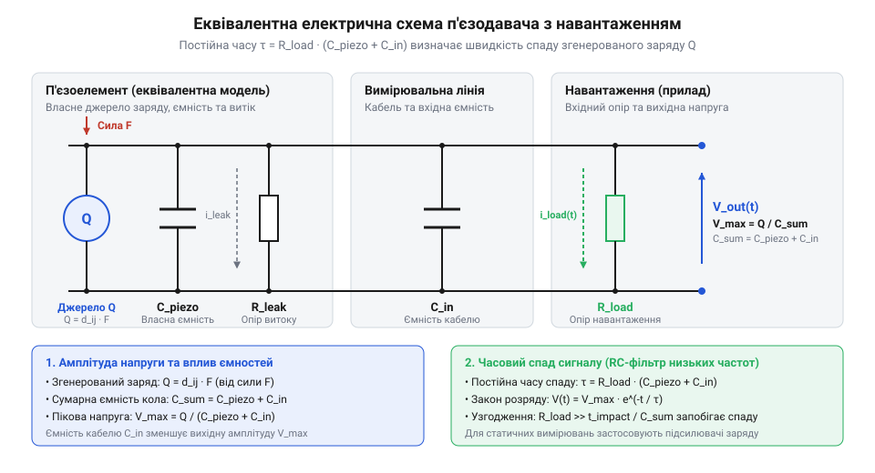

# Електрична модель п'єзоелемента та постійна часу згасання заряду

## Таємниця швидкого згасання п'єзосигналу

Під час спроби виміряти тривалий механічний тиск або статичне навантаження за допомогою звичайного підключення п'єзоелемента (англ. @@en|piezoelectric element@@; від грец. *piezein* — тиснути та *elektron* — бурштин) до входу вимірювального приладу спостерігається аномалія: у момент прикладання сили напруга короткочасно зростає, але потім швидко спадає до нуля, хоча механічне зусилля продовжує діяти з тією ж силою. Якщо інженер сприймає п'єзокристал як класичне джерело постійної напруги (подібно до батарейки чи гальванічного елемента), таку поведінку неможливо пояснити, і спроба зняти статичний сигнал призводить до хибних розрахунків та повної втрати вимірювальних даних.

Причина такого згасання полягає у фізичній природі згенерованого сигналу. Під дією механічної деформації кристалічна ґратка матеріалу не створює постійного електрорушійного струму, а лише розділяє внутрішні електричні заряди, перетворюючись на еквівалентне джерело заряду (англ. @@en|charge source@@; від англ. *charge* — заряд та *source* — джерело). Накопичені на обкладках кристала заряди утворюють різницю потенціалів лише доти, доки вони залишаються ізольованими на власній ємності давача. Проте будь-який реальний вимірювальний пристрій чи з'єднувальний кабель має скінченний опір витоку (англ. @@en|leakage resistance@@; від англ. *leakage* — витік та *resistance* — опір), через який розділені заряди починають негайно стікати й нейтралізувати один одного.

На відміну від пристроїв дискретної комутації, таких як [контактні давачі стуку](root:cat-hw-sensors/ky-031-knock), де механічний контакт замкнений протягом усього часу утримання важеля, п'єзоелемент зберігає напругу тільки в динаміці — під час зміни прикладеного зусилля. Як детальніше описано в [окремому нарисі про кристал](root:ph-condensed/crystal-symmetry-piezo), статична сила залишає заряди нерухомими, а за наявності замкненого електричного кола потенціал на виході неминуче спадає до нуля. Для точного обчислення часових та амплітудних характеристик п'єзосигналу необхідно відмовитися від спрощеної моделі джерела напруги й перейти до аналізу зосередженої RC-моделі з урахуванням ємностей та опорів кола.

## Генерація заряду та амплітуда напруги

Кількість згенерованого заряду `Q` при механічному стисненні або розтягуванні п'єзоелемента прямо пропорційна прикладеній силі `F`. Коефіцієнтом пропорційності виступає п'єзомодуль (англ. @@en|piezoelectric coefficient@@; від лат. *modus* — міра) `d₃₃`, який визначає ефективність перетворення механічного напруження в електричний заряд уздовж осі поляризації. Згенерований заряд обчислюють за співвідношенням:

        Q = d₃₃ · F

Згенерований заряд `Q` локалізується на власній ємності п'єзокристала `C_piezo` (англ. @@en|piezoelectric capacitance@@). Однак при підключенні давача до вимірювального тракту паралельно до власної ємності приєднується паразитна ємність (англ. @@en|parasitic capacitance@@; від грец. *parasitos* — нахлібник та лат. *capacitas* — місткість) з'єднувального кабелю та вхідного каскаду приладу `C_in`. Оскільки обидва конденсатори увімкнені паралельно, сумарна ємність вимірювального вузла `C_total` дорівнює їхній алгебраїчній сумі `C_total = C_piezo + C_in`.

Пікова амплітуда вихідної напруги `V_peak` визначається співвідношенням розділеного заряду до сумарної ємності кола:

        V_peak
        = Q / C_total                                                  [означення напруги на ємності]
        = (d₃₃ · F) / (C_piezo + C_in)                                [підстановка виразу заряду Q = d₃₃ · F]

З отриманого виразу видно, що паразитна ємність вимірювальної лінії `C_in` безпосередньо зменшує амплітуду корисного сигналу. При використанні довгих кабелів величина `C_in` може значно перевищувати власну ємність сенсора `C_piezo`, що призводить до суттєвого розмивання заряду й падіння вихідної напруги.

**Обчислення пікової напруги для механічного удару сили 50 Н**

        Q = d₃₃ · F
          = 300 × 10⁻¹² × 50                                          [підстановка d₃₃ = 300 пКл/Н та сили F = 50 Н]
          = 15 × 10⁻⁹ Кл                                               [розрахований заряд Q = 15 нКл]

        V_peak = Q / (C_piezo + C_in)
               = 15 × 10⁻⁹ / (1.0 × 10⁻⁹ + 0.2 × 10⁻⁹)                  [підстановка C_piezo = 1 нФ та C_in = 200 пФ]
               = 15 × 10⁻⁹ / (1.2 × 10⁻⁹)                              [сумування ємностей C_total = 1.2 нФ]
               = 12.5 В                                                [пікова амплітуда вихідного сигналу]

У результаті розрахунку видно, що при силі удару 50 Н п'єзоелемент із п'єзомодулем 300 пКл/Н генерує заряд 15 нКл, який на сумарній ємності 1.2 нФ створює пікову напругу 12.5 В.

## Еквівалентна схема та постійна часу

Для математичного опису часової динаміки розряду накопиченого заряду п'єзоелемент подають у вигляді еквівалентної електричної схеми заміщення.

*Еквівалентна схема п'єзодавача демонструє паралельне з'єднання джерела заряду, ємностей C_piezo та C_in і опорів R_leak та R_load.*

У цій схемі джерело заряду `Q` шунтується власною ємністю кристала `C_piezo`, внутрішнім опором витоку діелектрика `R_leak` (який зазвичай становить понад 10⁹ Ом), паразитною ємністю лінії `C_in` та опором навантаження `R_load` (англ. @@en|load resistor@@; від англ. *load* — навантаження) вимірювального пристрою. Оскільки опір витоку кристала `R_leak` значно перевищує опір вхідного каскаду `R_load` (`R_leak >> R_load`), паралельне з'єднання опорів `R_eq = (R_leak · R_load) / (R_leak + R_load)` з високою точністю визначається опором навантаження: `R_eq ≈ R_load`.

Утворене коло являє собою еквівалентний фільтр верхніх частот (англ. @@en|high-pass filter@@). Швидкість спаду вихідної напруги під час розряду ємності `C_total` через опір `R_load` описується експоненційним законом:

        V(t) = V_peak · e^-(t / τ)

Швидкість втрати заряду задається постійною часу (англ. @@en|time constant@@; від лат. *constans* — постійний) `τ` цього RC-кола:

        τ
        = R_eq · C_total                                               [загальна формула постійної часу RC-кола]
        = R_load · (C_piezo + C_in)                                   [спрощення за умови R_leak >> R_load]

Фізично постійна часу `τ` вказує проміжок часу, за який вихідна напруга спадає в `e ≈ 2.718` раза (тобто до 36.8% від початкового пікового значення `V_peak`), втрачаючи 63.2% накопиченого заряду. Через інтервал `t = 3 · τ` залишкова напруга становить менше ніж 5% від початкової.

**Обчислення залишкової напруги через 1 мс після удару**

        τ = R_load · (C_piezo + C_in)
          = 1.0 × 10⁶ × (1.0 × 10⁻⁹ + 0.2 × 10⁻⁹)                    [підстановка R_load = 1 МОм та C_total = 1.2 нФ]
          = 1.0 × 10⁶ × 1.2 × 10⁻⁹                                    [сумування ємностей]
          = 1.2 × 10⁻³ с                                              [розрахована постійна часу τ = 1.2 мс]

        V(1 мс) = V_peak · e^-(t / τ)
                = 12.5 × e^-(0.001 / 0.0012)                           [підстановка t = 1 мс та τ = 1.2 мс]
                = 12.5 × e^-0.8333                                     [обчислення показника експоненти]
                = 12.5 × 0.4346                                        [значення експоненційного згасання]
                = 5.43 В                                               [залишкова напруга сигналу]

На відміну від статичних сенсорів, таких як [давач нахилу SW-520D](root:cat-hw-sensors/sw-520d), п'єзодавач за наявності стандартного навантаження 1 МОм втрачає понад 56% амплітуди сигналу вже за 1 мс після удару.

## Вибір опору навантаження під удар

Знаючи постійну часу `τ`, можна сформулювати умови для точного вимірювання механічного імпульсу тривалістю `T`. Якщо тривалість удару `T` порівняна з постійною часу `τ` або перевищує її, згенерований заряд розряджається безпосередньо під час механічної дії. Це призводить до викривлення форми імпульсу, зрізання низькочастотної складової сигналу та виникнення від'ємного просідання напруги (англ. @@en|undershoot@@) після завершення удару.

Для збереження амплітуди й форми імпульсу з допустимою відносною похибкою `ε` (наприклад, `ε = 0.05`, що відповідає 5% спаду верхівки імпульсу) необхідно забезпечити виконання умови:

        τ >> T

При малій відносній тривалості `T / τ << 1` експоненційний спад можна розкласти в ряд Тейлора:

        V(T) / V_peak
        = e^-(T / τ)
        ≈ 1 - (T / τ)                                                 [лінійна апроксимація Тейлора при T << τ]

Відносна похибка вимірювання верхівки імпульсу наприкінці впливу `ε` дорівнює:

        ε = (V_peak - V(T)) / V_peak = T / τ

Звідси отримуємо математичну вимогу до мінімальної постійної часу `τ ≥ T / ε`. Підставляючи вираз для постійної часу `τ = R_load · (C_piezo + C_in)`, виводимо формулу розрахунку необхідного опору навантаження `R_load`:

        R_load ≥ T / (ε · (C_piezo + C_in))                           [розрахунок мінімального опору навантаження]

**Розрахунок мінімального опору навантаження для імпульсу 10 мс із похибкою до 5%**

        R_load ≥ T / (ε · (C_piezo + C_in))
               = 0.010 / (0.05 × 1.2 × 10⁻⁹)                          [підстановка T = 10 мс, ε = 0.05, C_total = 1.2 нФ]
               = 0.010 / (6.0 × 10⁻¹¹)                                [обчислення знаменника]
               = 1.667 × 10⁸ Ом                                       [мінімальний опір R_load = 166.7 МОм]

Розрахунок показує, що для вимірювання удару тривалістю 10 мс із похибкою не більше 5% опір навантаження має становити не менше 166.7 МОм. Звичайний вхід осцилографа з опором 1 МОм дасть похибку понад 99%.

У вимірювальних трактах для досягнення опору в сотні мегаом або гігаом застосовують високоомні повторювачі напруги на польових транзисторах або [підсилювачі заряду на ОУ](root:hw-analog/charge-amplifier), які інваріантні до ємності лінії. Для задач спрощеної реєстрації факту удару без збереження точної форми імпульсу використовують готові [давачі вібрації KY-002](root:cat-hw-sensors/ky-002-vibration) або [давачі нахилу KY-020](root:cat-hw-sensors/ky-020-tilt).
