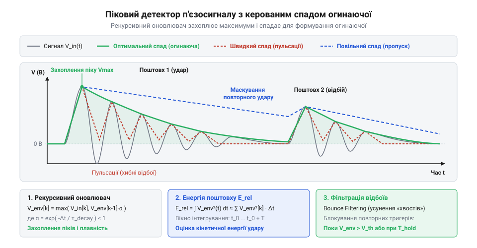
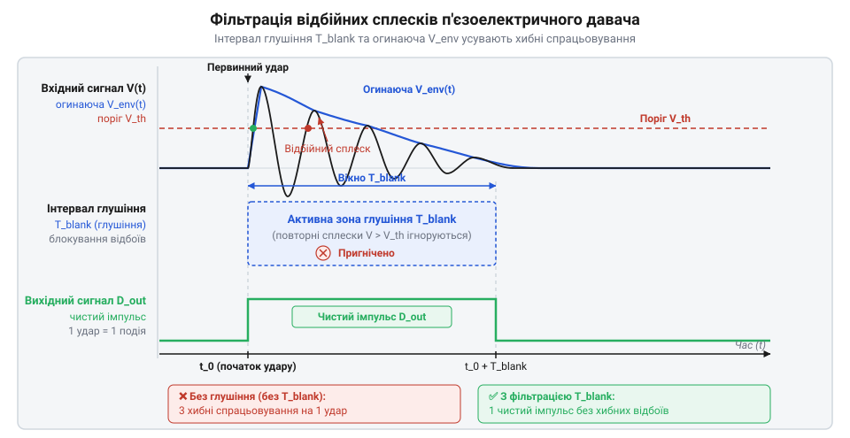

# Алгоритми обробки сигналу згасаючих коливань та оцінки енергії поштовху

<preknowlist>
- [KY-002 — давач вібрації (SW-18020P)](root:cat-hw-sensors/ky-002-vibration) — Принципи реєстрації механічних коливань пружинним контактом та обмеження двопозиційних датчиків без вимірювання енергії.
- [KY-031 — давач стуку](root:cat-hw-sensors/ky-031-knock) — Механізм реєстрації ударних подій розмиканням контактів та проблеми механічного дребезгу.
</preknowlist>

## Хибні спрацьовування та згасаючі резонансні коливання

Пряме підключення п'єзоелектричного елемента до аналогового входу мікроконтролера створює ілюзію простого детектування ударних подій: здається, що для виявлення поштовху достатньо зчитувати аналогово-цифровий перетворювач (англ. @@en|ADC@@, від англ. @@en|Analog-to-Digital Converter@@) та порівнювати значення з фіксованим порогом напруги. Проте під час механічного удару п'єзоелектричний давач (англ. @@en|piezoelectric sensor@@, від грецького *piezein* — тиснути, стискати та *elektron* — бурштин) генерує не поодинокий прямокутний імпульс, а тривалий згасаючий коливальний процес. На відміну від ситуації з [простими давачами стуку](root:cat-hw-sensors/ky-031-knock) чи [пружинними давачами вібрації](root:cat-hw-sensors/ky-002-vibration), які замикають або розмикають механічні контакти, п'єзокераміка перетворює механічну деформацію на електричний заряд безперервно.

Оскільки п'єзоелемент володіє власною пружністю та масою, механічний поштовх збуджує в ньому власний резонанс (англ. @@en|resonance@@, від латинського *resonare* — відгукуватися, лунати). Почергове стискання та відновлення форми п'єзокераміки під час коливань генерує електричні заряди протилежних знаків, утворюючи двополярний сигнал (англ. @@en|bipolar signal@@, від латинського *bis* — двічі та *polus* — полюс). Оскільки вхід @@en|ADC@@ мікроконтролера зазвичай оцифровує лише додатну напругу, від'ємні напівхвилі (англ. @@en|half-wave@@) безпосередньо зрізаються до нуля, втрачаючи половину інформації про коливання. Щоб виміряти обидві фази руху, у коло вводять аналогове зміщення нуля (англ. @@en|DC offset@@, від англ. @@en|Direct Current@@ — постійний струм та *offset* — зсув), яке зсуває лінію спокою в серединну точку робочого діапазону. Схемотехнічно це реалізують резистивним дільником напруги (англ. @@en|resistive divider@@) з двох однакових резисторів `R₁` та `R₂`, підключених між опорною напругою `V_ref` та землею, що формує постійний рівень `V_bias = V_ref / 2`. Змінну напругу згасаючих коливань п'єзоелемента подають через розділювальний конденсатор (англ. @@en|coupling capacitor@@) C, який відсікає постійну складову та накладає динамічні коливання на це постійне зміщення. Таке рішення захищає вхід від від'ємного потенціалу, проте вдвічі звужує динамічний діапазон вимірювання для кожної напівхвилі. Крім того, технологічний розкид опорів та нестабільність живлення спричиняють дрейф лінії спокою, утворюючи статичну похибку відліків. У математичній моделі оцифрованого сигналу це зміщення враховують як постійний доданок `V_bias` до добутку експоненціально спадної амплітуди та високочастотної гармонійної хвилі: `x[n] = V_bias + V_peak × exp(-n × Δt / τ) × cos(ω_0 × n × Δt)`. Тому для виділення чистого динамічного сигналу `v[n]` та подальшої оцінки його енергії алгоритм мусить програмно віднімати сталу `V_bias` від кожного сирого відліку: `v[n] = x[n] - V_bias`.

    x[n] = V_bias + V_peak × exp(-n × Δt / τ) × cos(ω_0 × n × Δt)

Де `x[n]` — значення відліку @@en|ADC@@ під номером `n`, `V_peak` — пікова напруга первинного удару, `Δt` — період дискретизації, `τ` — стала часу згасання коливальної системи, а `ω_0` — власна резонансна частота п'єзодиска.

Якщо обробка сигналу зводиться до порівняння кожного миттєвого значення `x[n]` із порогом `V_th`, високовольтний «хвіст» згасаючих коливань багаторазово перетинає порівняльний рівень при кожній напівхвилі. У результаті один фізичний удар обчислювальне ядро фіксує як серію із десятків хибних повторних спрацьовувань. Спроби усунути ці хибні відгуки простим програмним затримуванням (паузою) блокують систему та позбавляють її можливості реєструвати наступні справжні поштовхи. Сирі аналогові відліки п'єзосигналу є непридатними для прямої бінарної логіки; для надійного детектування необхідно виділити огинаючу (англ. @@en|envelope@@, від французького *envelopper* — обгортати) згасаючого процесу.

## Виявлення екстремумів та побудова огинаючої

Виділення огинаючої (англ. @@en|envelope@@) згасаючого резонансного сигналу базується на локалізації його верхніх амплітудних піків у часовому ряді (англ. @@en|time series@@) відліків @@en|ADC@@. Замість аналізу кожної миттєвої пульсації алгоритм відстежує точкові екстремуми (англ. @@en|extremum@@, від латинського *extremus* — крайній) — моменти, коли швидкість зміни напруги змінює свій знак з додатного на від'ємний.

Математичним критерієм пошуку локального максимуму в дискретному потоці є аналіз першої різниці (англ. @@en|first difference@@) між сусідніми відліками сигналу. За своєю математичною суттю перша різниця є дискретним аналогом похідної. Ця операція природно підсилює високочастотні складові сигналу. Через це навіть дрібний високочастотний шум (англ. @@en|high-frequency noise@@) @@en|ADC@@ створює хаотичні коливання між сусідніми відліками. Без попередньої цифрової фільтрації (англ. @@en|digital filtering@@) такі завади викликають постійну зміну знаку різниці й утворюють фальшиві локальні екстремуми (англ. @@en|false extrema@@). Для попереднього згладжування відліків застосовують алгоритми ковзного середнього (англ. @@en|moving average@@) або рекурсивні фільтри низьких частот (англ. @@en|low-pass filter@@). Просте ковзне середнє обчислює середнє значення у вікні з кількох відліків, але вимагає збереження буфера в пам'яті та вносить часову затримку (англ. @@en|latency@@), яка зміщує точний момент піку. Однополюсний рекурсивний ФНЧ обчислює згладжене значення за формулою `y[n] = α · x[n] + (1 - α) · y[n - 1]`, де `α` — коефіцієнт згладжування (англ. @@en|smoothing factor@@) у діапазоні від 0 до 1. Цей метод вимагає пам'яті лише для одного попереднього значення `y[n - 1]`, проте вимагає точного налаштування `α`: занадто малий коефіцієнт розмиває гострі амплітудні фронти удару, а занадто великий — пропускає шум і залишає хибні екстремуми. Після попереднього згладжування сигналу саму першу різницю обчислюють за формулою:

    Δx[n] = x[n] - x[n - 1]

Де `x[n]` — поточний відлік, а `x[n - 1]` — попередній відлік часового ряду. Локальний максимум знаходиться в точці `x[n - 1]`, якщо виконується подвійна умова зміщення знаку:

    Δx[n - 1] > 0  і  Δx[n] ≤ 0      [критерій локального максимуму]

Це означає, що до точки `n - 1` сигнал зростав, а на кроці `n` почав спадати. Для двополярного п'єзосигналу перед обчисленням першої різниці застосовують модуль значення `|x[n]|` (повноперіодне випрямлення), що дозволяє враховувати як додатні, так і від'ємні напівхвилі резонансу (англ. @@en|resonance@@).

З'єднання послідовно знайдених екстремумів `(n_k, x[n_k])` прямолінійними відрізками або експоненціальними лініями формує дискретну криву огинаючої верхньої межі. Вона описує реальну динаміку затухання енергії удару, ігноруючи високу частоту внутрішнього заповнення. Проте явне збереження та інтерполяція екстремумів у буфері пам'яті вимагають значних обчислювальних ресурсів мікроконтролера. Для роботи у реальному часі алгоритм виявлення екстремумів трансформують у компактний рекурсивний піковий детектор.

## Піковий детектор із керованим спадом

Для виділення огинаючої (англ. @@en|envelope@@) в реальному часі без збереження масивів відліків застосовують алгоритм пікового детектора (англ. @@en|peak detector@@, від англ. @@en|peak@@ — вершина). Його робота імітує аналоговий колаж із діода та конденсатора: при появі високого рівня напруги стан детектора миттєво зростає до значення сигналу, а за відсутності нових піків — повільно спадає із заданою швидкістю.

Рекурсивне рівняння пікового детектора оновлює внутрішнє значення `y[n]` на кожному кроці дискретизації @@en|ADC@@:

    y[n] = max(|x[n]|, α × y[n - 1])      [рівняння пікового детектора]

Де `|x[n]|` — модуль поточного аналогового відліку, `y[n - 1]` — попередній стан огинаючої, а `α` — безрозмірний коефіцієнт спаду (англ. @@en|decay factor@@, від англ. @@en|decay@@ — згасання, розпад) у діапазоні `0 < α < 1`.

Фізичний зміст коефіцієнта `α` визначається сталою часу спаду `τ_d` та періодом дискретизації `Δt`, який на практиці задається частотою дискретизації (англ. @@en|sampling frequency@@, від англ. @@en|sample@@ — вибірка, відлік та латинського *frequentia* — частота) @@en|ADC@@ `f_s = 1 / Δt`. Підстановка цього співвідношення визначає коефіцієнт спаду безпосередньо через частоту оцифрування: `α = exp(-1 / (f_s × τ_d))`. Проте обчислення дробового множення `α × y[n - 1]` у форматі з плаваючою крапкою на мікроконтролерах без апаратного модуля обчислень (англ. @@en|Floating-Point Unit@@, скорочено @@en|FPU@@, від англ. @@en|floating@@ — плаваючий, @@en|point@@ — крапка та @@en|unit@@ — блок) вимагає значних витрат процесорного часу в кожному перериванні @@en|ADC@@. Для оптимізації розрахунків застосовують арифметику з фіксованою крапкою (англ. @@en|fixed-point arithmetic@@, від англ. @@en|fixed@@ — фіксований та @@en|point@@ — крапка): дробовий коефіцієнт `α` заздалегідь масштабують у ціле число `A_q = round(α × 2^k)` за допомогою множника `2^k`, де `k` визначає розрядність дробової частини. Завдяки цьому рекурсивний спад огинаючої обчислюється через цілочисельне множення та швидкий побітовий зсув (англ. @@en|bit shift@@, від англ. @@en|bit@@ — біт та @@en|shift@@ — зсув) праворуч: `(A_q × y[n - 1]) >> k`, що виконується всього за один-два такти процесора без втрати точності.

    α = exp(-Δt / τ_d)

Якщо коефіцієнт `α` обрано занадто близьким до `1` (наприклад, `0.999`), огинаюча спадає надто повільно, через що повторний поштовх після першого розпізнається як продовження попереднього. Якщо ж `α` занадто малий (наприклад, `0.5`), крива огинаючої провалюється між сусідніми напівхвилями резонансу (англ. @@en|resonance@@), залишаючи високочастотні пульсації. Оптимальне значення `τ_d` обирають більшим за період резонансних коливань п'єзоелемента, але меншим за мінімальний інтервал між очікуваними фізичними ударами.


*Порівняння сирого аналогового сигналу п'єзоелемента з вихідною кривою пікового детектора демонструє усунення високочастотних пульсацій при оптимальному коефіцієнті спаду.*

Нижче наведено програмну реалізацію пікового детектора з керованим спадом для вбудованих систем.

:::tabs
:::code math-piezo-signal-processing-algorithms/c/esp-idf/piezo-peak-detector-init.c
:::code math-piezo-signal-processing-algorithms/cpp/arduino/piezopeakdetector.cpp
:::

Програмний піковий детектор перетворює ревучий резонансний сплеск на гладку монотонну криву огинаючої. Це дозволяє встановити єдиний порівняльний поріг для точної фіксації амплітуди удару та підготувати сигнал для оцінки кінетичної енергії поштовху.

## Інтегрування напруги та обчислення енергії

Проста фіксація амплітудного максимуму п'єзосигналу не дає уявлення про справжню силу механічного впливу: короткий поштовх і тривала вібрація з однаковим піковим значенням передають принципово різну енергію. На відміну від схем, де застосовують простий бинарний [давач стуку KY-031](root:cat-hw-sensors/ky-031-knock), оцифрований п'єзоелектричний сигнал дозволяє обчислити відносну кінетичну енергію події через інтегрування електричної потужності.

Електрична потужність, яка виділяється на навантаженні, пропорційна квадрату напруги `V²(t)`. Повна відносна енергія `E_rel` механічного поштовху пропорційна інтегралу квадрата напруги за часом. Оскільки мікроконтролер отримує дискретні відліки `V[k]` з періодом дискретизації `Δt`, неперервний процес замінюється чисельним інтегруванням (лат. *integratio* — відновлення, поповнення) @@en|numerical integration@@.

Сумування за методом прямокутників розраховує енергію `E_rel` з відліків `V[k]` та інтервалу `Δt`:

```
E_rel = ∑ (V[k]² · Δt)      [метод прямокутників]
```

Тут `V[k]` — поточний аналоговий відлік напруги, `Δt` — крок дискретизації в секундах, а `∑` означає сумування по всіх відліках у межах часового вікна.

Високу точність дає метод трапецій, який враховує лінійну зміну сигналу між сусідніми відліками `V[k-1]` та `V[k]`:

```
E_rel = ∑ (((V[k]² + V[k-1]²) / 2) · Δt)      [метод трапецій]
```

Кожна трапеція усереднює квадрат напруги на інтервалі `Δt`, зменшуючи похибку під час стрімких змін амплітуди.

Неперервне сумування квадрата напруги призводить до накопичення шуму АЦП у період спокою, тому для точного розрахунку застосовують алгоритм адаптивного обрання часового вікна. Перед обчисленням квадрата напруги кожен дискретний відлік АЦП `N[k]` необхідно перевести у фізичне значення напруги `V[k] = (N[k] · V_ref) / N_max`, де `V_ref` — опорна напруга, а `N_max` — максимальний код АЦП. Якщо підносити до квадрата сирі цілочисельні відліки `N[k]`, масштабувальний коефіцієнт квадрується, що спотворює фізичну величину та може призвести до переповнення змінної. Програмно чисельне інтегрування реалізують через змінну-накопичувач (англ. *accumulator*, від лат. *accumulare* — нагромаджувати) `@@en|accumulator@@` `E_rel`, яку обнуляють перед початком події. Обчислення починається в момент, коли миттєва напруга або огинаюча перевищує порогове значення початку `V_th_start`: у кожному циклі збору даних з інтервалом дискретизації `Δt` розраховане значення `V[k]` підносять до квадрата і додають добуток `V[k]² · Δt` до `E_rel`. Сумування триває до повернення огинаючої сигналу нижче порогу зупинки `V_th_stop`, визначеного на рівні фонових шумів, що локалізує розрахунок у межах тривалості механічної події та дає підсумкове значення `E_rel` для класифікації сили удару.

## Фільтрація відбійних сплесків та детектування

Після первинного удару п'єзоелемент здійснює згасаючі резонансні коливання. Окремі сплески огинаючої у «хвості» процесу повторно перевищують порогові рівні, викликаючи серію хибних спрацьовувань. Прості [двопозиційні давачі вібрації](root:cat-hw-sensors/ky-002-vibration) фіксують будь-який контактний дребезг, тоді як для п'єзосигналу застосовують фільтрацію відбійних сплесків (англ. @@en|bounce filtering@@, від англ. *bounce* з середньоангл. *bounsen* — бити, вдавати).

Для надійного детектування поодинокої події алгоритм поєднує енергетичний поріг E_min та часове глушіння (англ. @@en|blanking time@@, від англ. *blank* з давньофр. *blanc* — білий, порожній). *blanc* — білий, порожній). Коли значення `E_rel` перевищує поріг `E_min`, детектується удар і запускається таймер глушіння на час `T_blank`. Протягом цього інтервалу повторні сплески огинаючої ігноруються, а нове вікно інтегрування не відкривається.


*Діаграма часових співвідношень аналогового сигналу, огинаючої, енергетичного порогу та інтервалу глушіння для детектування поодинокого удару.*

Для завершення блокування та повернення алгоритму в стан очікування використовують динамічні пороги адаптивного скидання: повторний аналіз дозволяється лише після закінчення `T_blank` за умови, що огинаюча опустилася нижче порогу шумів. Перевірка саме огинаючої, а не миттєвої напруги, усуває ризик хибного скидання через перетин нуля (англ. @@en|zero crossing@@). Оскільки п'єзосигнал здійснює змінні коливання, його миттєва напруга регулярно проходить через нуль. Якщо після вичерпання `T_blank` порівнювати з порогом шумів сирий відлік АЦП, то у момент перетину нуля напруга короткочасно стає меншою за поріг, навіть коли амплітуда резонансного «хвоста» все ще висока. Це викликає передчасний вихід зі стану глушіння й повторне хибне детектування того самого удару на наступній півхвилі. Використання огинаючої згладжує високочастотні переходи через нуль і гарантує повернення алгоритму в стан очікування лише після повного згасання механічних коливань.

:::tabs

:::code math-piezo-signal-processing-algorithms/c/c/piezo-process-sample.c

:::code math-piezo-signal-processing-algorithms/cpp/cpp/piezostate.cpp

:::
