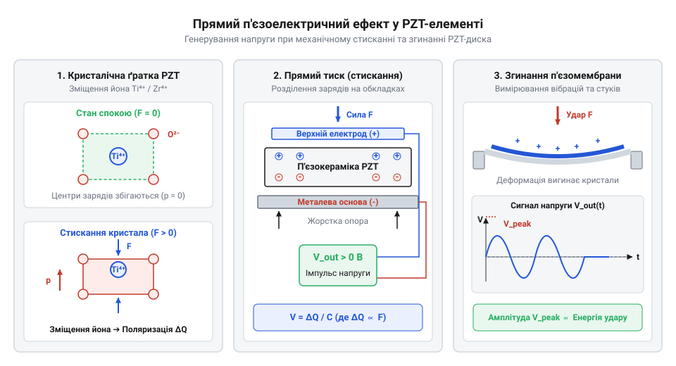
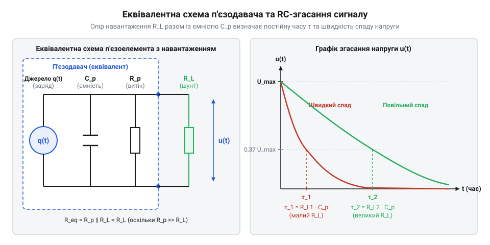
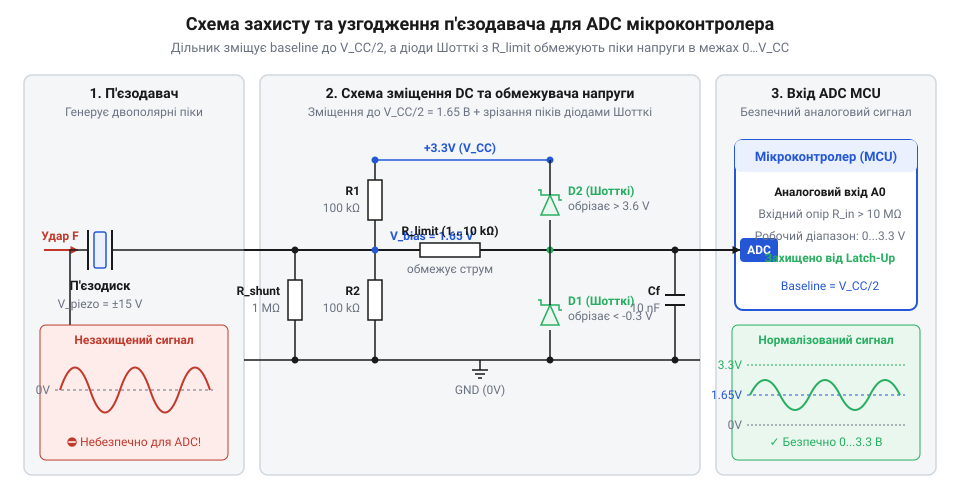
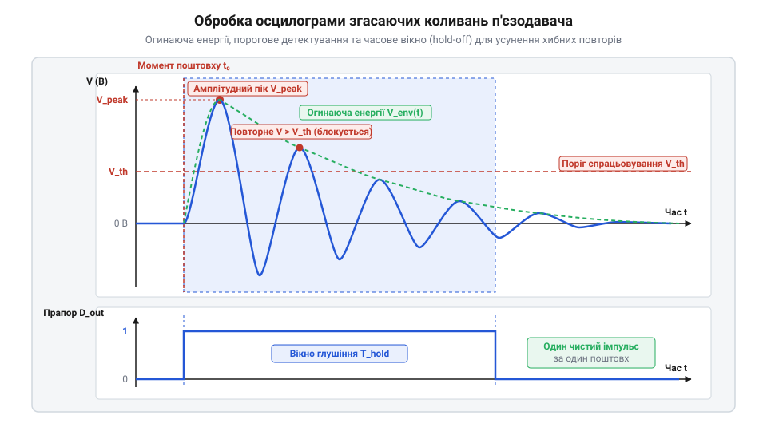

# Аналоговий п'єзоелектричний давач

<preknowlist>
- [KY-002 — давач вібрації (SW-18020P)](root:cat-hw-sensors/ky-002-vibration) — Принципи двопозиційного виявлення вібрацій пружинним контактом та обмеження розмикальних датчиків без оцінки сили поштовху.
- [KY-031 — давач стуку](root:cat-hw-sensors/ky-031-knock) — Механізм реєстрації ударних подій замкненим контактом та проблеми дребезгу й відсутності градації амплітуди.
</preknowlist>

## Проблема оцифрування швидкоплинних механічних поштовхів

Під час побудови систем виявлення ударів або вібрацій спроба застосувати звичайний @@la|дискретний давач@@ (лат. *discretus* — розділений), як-от [дискретний давач вібрації](root:cat-hw-sensors/ky-002-vibration) або [перемикач стуку](root:cat-hw-sensors/ky-031-knock), наштовхується на дві принципові перешкоди. По-перше, механічний контакт фізично не встигає зреагувати на короткочасне імпульсне навантаження тривалістю в мікросекунди або створює хибні спрацьовування через @@en|дребезг контактів@@. По-друге, двопозиційна кнопка принципово позбавлена градації: вона фіксує лише факт замикання, але не передає силу чи кінетичну енергію поштовху.

Коли система має відрізняти легкий дотик від руйнівного удару, цифрового входу мікроконтролера стає недостатньо. Виникає потреба в аналоговому сенсорі, який перетворює механічну деформацію на пропорційний електричний сигнал у реальному часі. Для аналізу таких швидкоплинних процесів потрібен первинний перетворювач, що генерує сплеск напруги безпосередньо в момент механічного впливу, дозволяючи @@en|аналогово-цифровому перетворювачу@@ (англ. *Analog-to-Digital Converter*, @@en|АЦП@@) виміряти його амплітуду, вивчаючи [принципи вимірювання ударів](root:hw-sensing/mechanical-vibration-and-shock-measurement). Проте наявність аналогового сигналу висуває жорсткі фізичні вимоги до самого оцифрування. Механічний удар створює сплеск напруги тривалістю всього в кілька десятків мікросекунд із крутим фронтом наростання, що формує широкий частотний спектр. Згідно з @@en|теоремою Котельникова — Найквіста@@ (англ. *Nyquist–Shannon sampling theorem*), для повного відтворення форми сигналу @@en|частота дискретизації@@ (англ. *sampling rate*) має щонайменше вдвічі перевищувати найвищу частоту цього спектра. Однак для фіксації саме @@en|пікового значення@@ (англ. *peak value*) короткочасного поштовху суто теоретичної межі недостатньо: потрібна висока @@en|часова роздільна здатність@@ (англ. *time resolution*) — тобто малий крок між суміжними вибірками. Якщо інтервал між відліками перевищує тривалість зростання сплеску, @@en|АЦП@@ здійснює вимірювання в паузі між імпульсами або на глибокому спаді напруги, повністю пропускаючи реальну амплітуду удару. Розрахунковий зв'язок між параметрами сигналу та оцифруванням визначається @@en|тривалістю наростання імпульсу@@ (англ. *pulse rise time*) `t_r` — часом, за який напруга зростає від нуля до вершини сплеску. Для вимірювання @@en|пікового значення@@ з амплітудною похибкою не більше ніж 5% на фронт наростання має припадати принаймні `N` відліків (практично `N ≥ 5`). Це задає обмеження на період вибірки `T_s ≤ t_r / N`. Оскільки @@la|частота дискретизації@@ `f_s` є оберненою величиною до періоду вибірки `T_s = 1 / f_s`, мінімальна необхідна швидкодія @@en|АЦП@@ обчислюється через співвідношення:

```
f_s = 1 / T_s
    ≥ N / t_r                  [підстановка граничного періоду вибірки]
```

З формули видно, що мінімальна @@la|частота дискретизації@@ `f_s` зростає прямо пропорційно кількості необхідних відліків `N` та обернено пропорційно тривалості наростання `t_r`.

**Обчислення мінімальної частоти дискретизації для фронту 20 мкс**
```
f_s = 5 / (20 · 10⁻⁶ с)
    = 250 000 Гц
    = 250 кГц                  [переведення в кілогерці]
```

Таким чином, для надійного оцифрування короткочасного поштовху з часом наростання `t_r = 20 мкс` та отримання принаймні 5 відліків на фронті потрібна @@la|частота дискретизації@@ @@en|АЦП@@ не менше ніж 250 кГц.

## Прямий п'єзоелектричний ефект у сенсорах

В основі миттєвого перетворення механічної енергії на електричний сигнал лежить @@el|п'єзоелектричний ефект@@ (грец. *πιέζειν* — стискати). На мікроскопічному рівні кристал п'єзоелектрика не має центру симетрії в елементарній комірці. Під дією зовнішнього стискання або зсуву позитивні та негативні іони зміщуються один відносно одного, створюючи електричний @@en|дипольний момент@@. У полікристалічній @@en|PZT-кераміці@@ (англ. *Lead Zirconate Titanate*) цей ефект впорядковують попередньою поляризацією в сильному електричному полі, яка задає головну кристалографічну вісь (вісь 3). Векторний напрямок механічної деформації відносно цієї осі безпосередньо визначає орієнтацію викликаного вектора поляризації D. При поздовжньому стисканні вздовж осі 3 вектор D виникає паралельно їй, формуючи заряд на торцевих обкладках. При поперечному вигині пластини вздовж осі 1 механічне напруження розтягує кристал у площині, але вектор D все одно орієнтується вздовж осі 3 до верхнього та нижнього електродів. Ця @@el|анізотропія@@ (грец. *άνισος* — нерівний + *τρόπος* — напрямок) гарантує, що така @@en|поляризація@@ викликає накопичення вільних зарядів саме на металізованих обкладках пластини відповідно до напрямку прикладеного зусилля.

Генерований електричний @@en|заряд@@ `q` обчислюють за залежністю від прикладеної сили `F` та властивостей матеріалу:

```
q = d · F
```

де `d` — п'єзоелектричний модуль матеріалу в кулонах на ньютон (Кл/Н), а `F` — механічне напруження. З цього виразу видно, що збільшення сили деформації призводить до пропорційного зростання вихідного @@en|заряду@@ `q`. Однак вимірювальне коло реєструє не заряд, а напругу. Оскільки металізовані обкладки п'єзоелемента розділені діелектриком, кристал утворює @@lat|конденсатор@@ (лат. *condensare* — згущувати) із власною ємністю `Cₚ`. Згенерований @@en|заряд@@ накопичується на цих обкладках і створює різницю потенціалів. Обчислимо @@lat|амплітуду@@ (лат. *amplitudo* — велич) вихідної напруги `U` через залежність заряду від прикладеної сили `F` та власної ємності `Cₚ`:

```
U = q ÷ Cₚ               [зв'язок напруги із зарядом та ємністю]
  = (d · F) ÷ Cₚ         [підстановка виразу для згенерованого заряду]
```

З отриманого виразу видно, що амплітуда вихідного сплеску напруги `U` прямо пропорційна прикладеній силі `F` та обернено пропорційна власній ємності `Cₚ`. Оскільки власна ємність керамічного диска мала і становить від кількох одиниць до десятків нанофарад, навіть мікроскопічний @@en|заряд@@ від швидкого удару генерує пікову напругу в десятки вольт. Жорстка @@en|PZT-кераміка@@ (англ. *Lead Zirconate Titanate*) видає високу напругу при мінімальних зсувах під великим навантаженням, тоді як гнучкі полімерні плівки реагують на вигин, що вивчають [п'єзоелектричні матеріали](root:ph-condensed/piezoelectric-materials-and-physics). Електричні параметри цього сигналу описує [модель п'єзоелемента](root:cat-hw-sensors/piezo-sensor/math-piezo-equivalent-circuit.md).


*Генерація електричного заряду на електродах PZT-диска під дією механічного стискання та згинання.*

Явище п'єзоелектрики відкрили брати Жак та П'єр Кюрі у 1880 році на кристалах кварцу та сегнетової солі, а Габріель Ліппман математично довів існування зворотного ефекту. У Першу світову війну Поль Ланжевен створив на їхній основі перші ультразвукові випромінювачі для гідролокаторів. Технологічний прорив 1950-х років із синтезом сегнетокераміки титанату барію та цирконату-титанату свинцю (PZT) зробив п'єзоелементи масовими, дешевими й надійними компонентами для сенсорів вібрацій, удару та акустичних випромінювачів.

У реальних конструкціях сенсорів механічне зусилля прикладають під різними кутами до осі попередньої поляризації, тому для точного опису генерації електричного @@en|заряду@@ єдиний коефіцієнт розбивають на векторні компоненти з двома індексами. Перший індекс показує напрямок викликаної @@en|поляризації@@ та накопичення носіїв (уздовж осі 3, перпендикулярно до електродів), а другий — напрямок прикладеного механічного напруження. Коли зовнішня сила стискає @@en|PZT-кераміку@@ безпосередньо вздовж осі 3, ефективність перетворення визначає поздовжній @@lat|п'єзомодуль@@ (лат. *modulus* — міра) `d₃₃`. Оскільки суцільний керамічний диск має високу жорсткість на стискання, таке пряме навантаження вимагає значних ударних зусиль для отримання помітного сигналу. Якщо ж диск закріпити на гнучкій мембрані та піддати вигину, керамічний шар розтягується в площині вздовж осі 1, спонукаючи вектор поляризації орієнтуватися до обкладок через поперечний @@lat|п'єзомодуль@@ `d₃₁`. Хоча за абсолютною величиною `d₃₁` менший за `d₃₃` і має протилежний знак, механічний вигин працює як важіль: навіть мікроскопічний прогин створює великі внутрішні напруження розтягу, генеруючи високі піки напруги від легких стуків чи коливань, що важливо враховувати, вивчаючи [принципи вимірювання механічних вібрацій](root:hw-sensing/mechanical-vibration-and-shock-measurement) та ударів.

## Еквівалентна схема та часова константа

Без розуміння електричної природи сигналу спроба виміряти постійне зусилля п'єзоелементом призведе до хибного висновку про несправність датчика. Електрична модель компонента являє собою генератор заряду, включений паралельно з власною ємністю `Cₚ` та внутрішнім опором витоку `Rᵢ`. Коли пластина деформується, на її поверхнях виникає електричний заряд, що миттєво заряджає внутрішню ємність. Проте через наявність опору витоку та зовнішнього навантаження утворюється паралельне `@@en|RC-коло@@` (англ. *resistor-capacitor circuit*), крізь яке генерований заряд неминуче стікає.


*Еквівалентна електрична схема п'єзоелемента та процес експоненціального стікання заряду через шунтувальний резистор.*

Саме через це стікання при постійній механічній силі напруга на виходах швидко спадає до нуля. Оскільки постійне деформування не створює нового заряду, `@@grc|п'єзоелемент@@` (грец. *piezein* — тиснути) працездатний виключно в динамічному режимі, коли сила змінюється в часі. Більше того, коли прикладене навантаження стрімко зникає, пружні сили керамічної матриці повертають кристалічну ґратку до початкового стану. Цей зворотний механічний рух зміщує диполі ґратки в протилежний бік і породжує на електродах заряд від'ємного знака. Оскільки згенерований під час стиснення заряд уже встиг повністю стікти через опір, це відновлення пластини заряджає внутрішню ємність `Cₚ` у зворотному напрямку, формуючи короткий сплеск напруги від'ємної `@@lat|полярності@@` (лат. *polaris* — полюсний). Чим швидше зникає механічне зусилля порівняно з постійною часу `τ`, тим більшою стає амплітуда цього зворотного сплеску. При миттєвому знятті навантаження амплітуда від'ємного піку дорівнює первинному позитивному сплеску. Накопичений від'ємний заряд на ємності `Cₚ` запускає повторний процес експоненціального розряду через опір кола, що подовжує час повернення системи до стану електричної рівноваги ще на одну постійну часу `τ`. Внутрішній опір витоку `Rᵢ` визначається ізоляційними властивостями кераміки та поверхневого шару, які суттєво залежать від зовнішніх чинників. Зі зростанням `@@lat|температури@@` (лат. *temperatura* — помірність) підвищується рухливість носіїв заряду в діелектрику, що спричиняє нелінійне падіння опору `Rᵢ`. Якщо коло розряду покладається лише на власну ізоляцію, термічний дрейф опору `Rᵢ` робить постійну часу `τ` нестабільною, змінюючи тривалість імпульсу під час нагрівання чи зміни вологості. Щоб зафіксувати швидкість згасання сигналу й нівелювати вплив дрейфу `Rᵢ`, паралельно давачу підключають зовнішній `@@en|шунт@@` (англ. *shunt* — відгалуження) `Rₛ` з опором, набагато меншим за `Rᵢ`. Назвемо власну ємність `Cₚ`, опір витоку `Rᵢ` та опір зовнішнього резистора `Rₛ`. Знайдемо постійну часу розряду `τ` для паралельного з'єднання цих елементів.

```
τ = Cₚ × (Rᵢ × Rₛ ÷ (Rᵢ + Rₛ))    [формула постійної часу для паралельних опорів]
  ≈ Cₚ × Rₛ                        [спрощення за умови Rₛ набагато менше Rᵢ]
```

Отриманий вираз показує, що еквівалентний опір визначається найменшим резистором, тому зовнішній `@@en|шунт@@` прямим чином задає швидкість стікання заряду з ємності. Паралельне з'єднання ємності та опору утворює @@lat|фільтр@@ (лат. *filtrum* — повсть) високих частот. Такий фільтр послаблює повільні зміни напруги та відсікає низькочастотні складники сигналу. Нижню граничну частоту `f_c`, нижче якої `@@lat|амплітуда@@` напруги починає спадати, обчислюють через постійну часу `τ`.

```
f_c = 1 ÷ (2 × π × τ)             [визначення граничної частоти через постійну часу]
    = 1 ÷ (2 × π × Rₛ × Cₚ)       [підстановка спрощеного виразу для τ]
```

З отриманої формули випливає критерій вибору опору: для вимірювання вібрацій без спотворення амплітуди частота `f_c` мусить бути нижчою за найменшу частоту вимірюваного `@@lat|спектра@@` (лат. *spectrum* — образ) механічних коливань. Збільшення опору `Rₛ` знижує граничну частоту `f_c`, розширюючи вимірювальний діапазон у бік повільних поштовхів. Однак високий опір робить коло вразливим до зовнішніх завад і подовжує час відновлення сигналу. Натомість занадто малий опір `Rₛ` надмірно підвищує частоту `f_c`. У цьому разі давач працює як диференціювальне коло та повністю зрізає низькочастотні коливання.

**Розрахунок тривалості імпульсу для ємності 10 нФ та шунта 1 МОм:**
```
τ = 10 × 10⁻⁹ Ф × 1 × 10⁶ Ом
  = 0.01 с                        [постійна часу становить 10 мілісекунд]
```

Висновок: за 10 мс `@@lat|амплітуда@@` (лат. *amplitudo* — величина) напруги згасає в `e` разів (приблизно на 63%), формуючи імпульс, придатний для аналізу. Для докладного розбору [математичного опису розряду](root:cat-hw-sensors/piezo-sensor/math-piezo-equivalent-circuit.md) передбачено окремий матеріал.

## Захист АЦП та узгодження імпедансу

Різкий механічний удар по п'єзодиску здатен згенерувати короткий сплеск напруги амплітудою в десятки вольт, що безпосередньо загрожує пробоєм вхідних кіл мікроконтролера. Вхідний аналогово-цифровий перетворювач, або `@@en|АЦП@@` (аналогово-цифровий перетворювач), розрахований на суворо обмежений діапазон напруги від 0 до значення живлення. Щоб запобігти виходу з ладу входу, який має `@@en|мікроконтролер@@` (англ. *microcontroller*), необхідно застосувати комплексну апаратну обв'язку захисту та узгодження.


*Принципова схема захисної обв'язки п'єзодавача з діодним обмеженням та узгодженням імпедансу для входу АЦП.*

Для захисту від перенапруги паралельно давачу ставлять @@lat|стабілітрон@@ (лат. *stabilis* — стабільний) чи зустрічно-паралельні @@de|діоди Шотткі@@ (названі на честь фізика Вальтера Шотткі), які зрізають піки, вищі за рівень живлення, та відсікають негативну напругу. Однак під час відмикання захисного діода високовольтний сплеск напруги `V_peak` створює небезпечний імпульс струму, тому послідовно перед діодами вмикають обмежувальний резистор `R_s`. Його мінімальний опір розраховують виходячи з максимально допустимого струму захисту діодів `I_clamp` за формулою `R_s ≥ (V_peak - V_D) ÷ I_clamp`, де `V_D` — пряме падіння напруги на діоді. Разом із сумарною вхідною ємністю кола `C_in` цей резистор формує фільтр низьких частот із верхньою граничною частотою `f_h = 1 ÷ (2 × π × R_s × C_in)`. Вибір опору `R_s` є компромісом: занадто велике значення надмірно звужує смугу пропускання, згладжуючи круті фронти ударних сигналів і зрізаючи високочастотні вібрації, а занадто мале — наражає діоди на струмове перевантаження під час сильних поштовхів. Оскільки механічні коливання створюють двополярний змінний сигнал, від'ємні півхвилі напруги без додаткових заходів спадали б нижче нуля й відсікалися б діодами. Однополярний `@@en|АЦП@@` `@@en|мікроконтролера@@` розрахований лише на додатну напругу від 0 до значення живлення `V_CC`. Щоб виміряти обидві півхвилі без спотворень, застосовують резистивний дільник напруги, який зміщує постійну складову сигналу до середини робочого діапазону.

Дільник будують із двох однакових резисторів `R₁` та `R₂` (де `R₁ = R₂ = R`), підключених між шиною живлення `V_CC` та землею `GND`. Обчислимо потенціал постійного зміщення `V_bias` у середній точці дільника та його еквівалентний опір `R_bias` для змінного сигналу.

```
V_bias = V_CC × (R₂ ÷ (R₁ + R₂))    [формула дільника напруги]
       = V_CC × (R ÷ (2 × R))        [підстановка рівності опорів R₁ = R₂ = R]
       = V_CC ÷ 2                    [зсув робочої точки до середини діапазону]

R_bias = R₁ × R₂ ÷ (R₁ + R₂)        [еквівалентний опір паралельних резисторів]
       = R × R ÷ (2 × R)             [підстановка R₁ = R₂ = R]
       = R ÷ 2                       [опір еквівалентного шунта для змінного струму]
```

Отриманий еквівалентний `@@lat|імпеданс@@` (лат. *impedio* — перешкоджати) `R_bias` підключений паралельно до власної ємності давача `Cₚ` і разом із нею формує фільтр високих частот. Нижня гранична частота цього фільтра визначається як `f_c = 1 ÷ (2 × π × R_bias × Cₚ)`. Якщо обрати опір `R` занадто малим, зсунуте коло матиме високу граничну частоту `f_c` і зріже корисні низькочастотні коливання, тому резистори дільника беруть високомними.

**Розрахунок зміщення та граничної частоти для V_CC = 3.3 В, R₁ = R₂ = 1 МОм та Cₚ = 10 нФ:**
```
V_bias = 3.3 В ÷ 2
       = 1.65 В                      [напруга зміщення нульової лінії АЦП]

R_bias = 1 × 10⁶ Ом ÷ 2
       = 500000 Ом                   [еквівалентний опір дільника для змінного сигналу]

f_c = 1 ÷ (2 × π × 500000 Ом × 10 × 10⁻⁹ Ф)
    = 1 ÷ (2 × π × 0.005)            [обчислення добутку опору та ємності]
    = 31.83 Гц                       [нижня гранична частота пропускання]
```

Висновок: завдяки зміщенню `V_bias = 1.65 В` коливання амплітудою до `±1.65 В` симетрично оцифровуються АЦП без зрізання від'ємних півхвиль, а гранична частота `f_c = 31.83 Гц` забезпечує пропускання вимірюваного спектра вібрацій.

З огляду на високий вихідний `@@lat|імпеданс@@` джерела та мегаомний опір дільника зміщення `R_bias`, безпосереднє підключення кола до входу `@@en|АЦП@@` спотворює результати оцифрування. Під час запуску перетворення внутрішня `@@en|схема вибірки-зберігання@@` (англ. *sample-and-hold circuit*) `@@en|АЦП@@` підключає свій накопичувальний конденсатор до вхідного виводу лише на короткий проміжок часу вибірки. За ці частки мікросекунди струм заряджання вхідної ємності має встигнути підняти напругу на конденсаторі до точного значення вимірюваного сигналу. Проте високий опір дільника `R_bias` критично обмежує цей струм, через що вхідна ємність не встигає повністю зарядитися до закриття ключа вибірки, викликаючи значну похибку вимірювання амплітуди. Для розв'язання цієї проблеми застосовують `@@en|буферний операційний підсилювач@@` (англ. *operational amplifier*) у режимі повторювача напруги, який забезпечує надвисокий вхідний і низький вихідний опір, миттєво віддаючи необхідний струм заряджання для ємності `@@en|АЦП@@`. Однак вибір конкретної мікросхеми для цього каскаду вимагає врахування двох критичних чинників: постійного струму витоку на вході та фізичного розведення друкованої плати. Звичайні біполярні підсилювачі мають відчутний `@@en|вхідний струм зсуву@@` (англ. *input bias current*), який, протікаючи крізь мегаомні резистори дільника зміщення `R_bias`, створює додаткове падіння напруги. Навіть незначний струм витоку здатен змістити розраховану нульову лінію `V_bias` на сотні мілівольт, що зрізає динамічний діапазон `@@en|АЦП@@`. Тому для буфера обирають підсилювачі з польовими транзисторами на вході (JFET або CMOS), у яких `@@en|вхідний струм зсуву@@` становить лише частки пікоампер і не спотворює точку зміщення. Другою загрозою є `@@en|паразитна ємність@@` (грец. *parasitos* — той, що їсть поруч, у значенні небажаного побічного елемента; англ. *parasitic capacitance*) монтажних доріжок і вхідних виводів плати. Оскільки власна ємність п'єзодиска `C_p` невелика, паразитна ємність доріжки утворює з нею небажаний ємнісний дільник сигналу та формує додатковий полюс низькочастотної фільтрації з опором `R_bias`, викликаючи загасання високих частот і фазові зсуви. Для збереження точності вимірювань `@@en|буферний операційний підсилювач@@` розміщують якомога ближче до давача, мінімізуючи довжину високоомного провідника та оточуючи його захисним земляним кільцем. Детальні електричні параметри наведено в [довіднику підключення та обв'язки](root:cat-hw-sensors/piezo-sensor/api-piezo-hardware-interface.md). Готові [схеми узгодження вхідних сигналів](root:hw-sensing/adc-protection-and-conditioning-circuits) дозволяють будувати надійні вимірювальні канали, а приклад розробки [детектора моніторингу вібрації](root:cat-hw-sensors/piezo-sensor/proj-piezo-vibration-monitor.md) показує практичну реалізацію вузла.

## Механічний монтаж і знімання енергії

Передача кінетичної енергії удару до керамічного диска залежить від жорсткості механічного контакту. Якщо п'єзоелемент закріплено на м'якій або гнучкій основі, виникає згасання механічної хвилі, і вихідний електричний сигнал втрачає амплітуду. Щоб вимірювати [механічні вібрації та удари](root:hw-sensing/mechanical-vibration-and-shock-measurement), п'єзодиск монтують на тверду поверхню за допомогою тонкого шару цианакрилатного клею або жорсткого притискного фланця. Для забезпечення стабільного електричного контакту з мікроконтролером використовують [спеціальний механічний інтерфейс](root:cat-hw-sensors/piezo-sensor/api-piezo-hardware-interface.md), який визначає параметри монтажу.

Під час інтенсивної вібрації або повторюваних поштовхів металева основа мембрани та керамічний диск деформуються з різною амплітудою. На межі контактного шару виникають циклічні зсувні напруження (@@en|shear stress@@), які спричиняють механічну втому (@@en|mechanical fatigue@@) матеріалу. У результаті [крихкі п'єзоелектричні матеріали](root:ph-condensed/piezoelectric-materials-and-physics) вкриваються мікротріщинами або зазнають розшарування (від лат. *lamina* — пластина, @@en|delamination@@) від металевої основи, втрачаючи здатність генерувати заряд. Тонкий ціанакрилатний клей (від грец. *kyanos* — темно-синій, *akris* — гострий, @@en|cyanoacrylate adhesive@@) утворює жорстке з'єднання для передачі високочастотних хвильових коливань, але тріскається при сильних поштовхах. Двокомпонентна епоксидна смола (від грец. *epi* — над, *oxys* — кислий, @@en|epoxy resin@@) формує міцніший в'язкопружний шов, що рівномірно розподіляє точкові навантаження й захищає керамічний диск. Товщину епоксидного шару роблять мінімальною, адже товсте покриття діє як демпфер (від нім. *Dämpfer* — глушник, @@en|damper@@), поглинаючи кінетичну енергію та гасячи амплітуду вихідного сигналу.

Коли треба реєструвати прискорення корпуса без прямого удару по дисках, до центру мембрани прикріплюють додаткове тіло — інерційну масу (від грец. *seismos* — поштовх, лат. *massa* — маса, @@en|seismic mass@@). Під час вібрації @@en|seismic mass@@ чинить опір зміні руху, створюючи механічну деформацію (від лат. *deformatio* — спотворення, @@en|mechanical strain@@) п'єзокераміки. Сила деформації пропорційна прискоренню, що забезпечує максимальну чутливість давача у вимірювальному колі. Прикріплена маса разом із гнучким п'єзодиском жорсткістю `k` утворює механічну коливальну систему з власною резонансною частотою (від лат. *resono* — лунаю у відповідь, @@en|resonant frequency@@) `fᵣ`. Частоту `fᵣ` обчислюють із жорсткості `k` та сумарної маси `m`:

```
fᵣ = 1 ÷ (2 × π) × √(k ÷ m)      [власна резонансна частота]
```

Залежність амплітуди електричного сигналу від частоти зовнішнього збурення `f` описує амплітудно-частотна характеристика (від лат. *amplitudo* — велич, *frequentia* — повторюваність, @@en|amplitude-frequency characteristic@@) `K(f)`, яка визначає відношення динамічної чутливості до статичної:

```
K(f) = 1 ÷ √((1 - (f ÷ fᵣ)²)² + (2 × ζ × (f ÷ fᵣ))²)      [амплітудно-частотна характеристика]
```

де `ζ` — відносний коефіцієнт демпфування (від нім. *Dämpfung* — гасіння, @@en|damping ratio@@), що характеризує швидкість розсіювання кінетичної енергії коливань. На низьких частотах (`f << fᵣ`) співвідношення `f ÷ fᵣ ≈ 0`, тому `K(f) ≈ 1`, що забезпечує лінійну пропорційність між прискоренням і згенерованою напругою. На частоті резонансу (`f = fᵣ`) інерційний член `1 - (f ÷ fᵣ)²` дорівнює нулю, і коефіцієнт передачі сягає пікового значення `K(fᵣ) = 1 ÷ (2 × ζ)`. За малого демпфування (`ζ < 0.1`), властивого чистій п'єзокераміці, амплітуда вихідного сигналу зростає в десятки разів, спотворюючи результати вимірювання та створюючи ризик механічного руйнування диска. Для запобігання резонансному сплеску та збереження широкої робочої смуги здійснюють вибір коефіцієнта демпфування `ζ` у діапазоні `0.6`–`0.707` (оптимальне демпфування, @@en|optimal damping@@). За значення `ζ ≈ 0.707` амплітудний пік придушується (`K(fᵣ) ≈ 0.707`), а характеристика залишається пласкою з похибкою до 5% у діапазоні аж до `0.5 × fᵣ`. Оскільки кристалічна структура кераміки практично не розсіює енергію, потрібні коефіцієнти досягаються через спеціальні методи механічного демпфування. Для цього між @@en|seismic mass@@ та корпусом або п'єзоелементом розміщують тонкий в'язкопружний еластомерний шар (від лат. *viscosus* — клейкий, *elastikos* — гнучкий, @@en|viscoelastic damping layer@@) із силікону чи поліуретану, внутрішнє молекулярне тертя якого перетворює кінетичні зсувні деформації на теплову енергію. У прецизійних датчиках застосовують рідинне демпфування стискуваним шаром (від англ. *squeeze* — стискати, @@en|squeeze-film damping@@), заповнюючи герметичну порожнину навколо інерційної маси високов'язким силіконовим гелем, де опір витісненню рідини створює стабільне в'язке гасіння коливань. Також використовують конструкційне демпфування затиснутим шаром (@@en|constrained layer damping@@), у якому демпфувальний полімер затискають між керамічним диском і жорсткою металевою обкладкою. Сукупність цих механічних заходів усуває високочастотний звон та забезпечує достовірну передачу сигналу на кола [узгодження вхідних сигналів АЦП](root:hw-sensing/adc-protection-and-conditioning-circuits).

```
fᵣ = 1 ÷ (2 × π) × √(k ÷ m)      [власна резонансна частота]
```

```
K(f) = 1 ÷ √((1 - (f ÷ fᵣ)²)² + (2 × ζ × (f ÷ fᵣ))²)      [амплітудно-частотна характеристика]
```

де `ζ` — відносний коефіцієнт демпфування (від нім. *Dämpfung* — гасіння, @@en|damping ratio@@), що характеризує швидкість розсіювання кінетичної енергії коливань. На низьких частотах (`f << fᵣ`) співвідношення `f ÷ fᵣ ≈ 0`, тому `K(f) ≈ 1`, що забезпечує лінійну пропорційність між прискоренням і згенерованою напругою. На частоті резонансу (`f = fᵣ`) інерційний член `1 - (f ÷ fᵣ)²` дорівнює нулю, і коефіцієнт передачі сягає пікового значення `K(fᵣ) = 1 ÷ (2 × ζ)`. За малого демпфування (`ζ < 0.1`), властивого чистій п'єзокераміці, амплітуда вихідного сигналу зростає в десятки разів, спотворюючи результати вимірювання та створюючи ризик механічного руйнування диска. На частотах `f > fᵣ` коефіцієнт `K(f)` стрімко прямує до нуля, пригнічуючи високочастотні складові. Для запобігання резонансному сплеску та збереження широкої робочої смуги здійснюють вибір коефіцієнта демпфування `ζ` у діапазоні `0.6`–`0.707` (оптимальне демпфування, @@en|optimal damping@@). За значення `ζ ≈ 0.707` амплітудний пік придушується (`K(fᵣ) ≈ 0.707`), а характеристика залишається пласкою з похибкою до 5% у діапазоні аж до `0.5 × fᵣ`, що забезпечує достовірну передачу сигналу на кола [узгодження вхідних сигналів АЦП](root:hw-sensing/adc-protection-and-conditioning-circuits).

```
fᵣ = 1 ÷ (2 × π) × √(k ÷ m)      [частота власних коливань]
```

Збільшення `m` за рахунок додавання @@en|seismic mass@@ зменшує `fᵣ`, що зміщує робочий частотний діапазон (від лат. *frequentia* — повторюваність, @@en|frequency range@@) у бік нижчих частот і підвищує амплітуду електричного сигналу при повільних струсах. Проте таке зміщення звужує верхню межу вимірювань, а на частотах поблизу `fᵣ` виникає механічний резонанс (@@en|mechanical resonance@@). У режимі резонансу амплітуда коливань різко зростає, спотворюючи пропорційність між прискоренням і напругою, а вище за `fᵣ` сигнальний відгук стрімко згасає.

## Обробка сигналу та оцінка поштовху

Механічний удар викликає в п'єзоелементі згасаючі коливання (від лат. *oscillatio* — розгойдування, @@en|damped oscillations@@), амплітуда яких експоненційно зменшується в часі. Аналогово-цифровий перетворювач (від лат. *analogus* — пропорційний, *digitus* — палець, @@en|ADC@@) зчитує ці коливання з високою частотою вибірки. На відміну від [простого сенсора стуку](root:cat-hw-sensors/ky-031-knock), який дає лише бінарний відгук, аналоговий сигнал дозволяє обчислити амплітудний пік та повну енергію поштовху.


*Форма аналогового сигналу згасаючих коливань п'єзоелемента з виділеним амплітудним піком та лінією огинаючої.*

Для визначення сили поштовху програма фіксує максимальне значення напруги в часовому вікні вибірки (@@en|sampling window@@). Тривалість цього вікна визначається механічною динамікою п'єзосистем: під час [вимірювання механічних вібрацій](root:hw-sensing/mechanical-vibration-and-shock-measurement) та ударів п'єзодиск коливається на власній резонансній частоті (від лат. *resono* — лунаю у відповідь, @@en|resonant frequency@@) `f_res`, утворюючи згасаючі хвилі з періодом `T = 1 / f_res`. Наростання амплітуди від моменту контакту до досягнення справжнього максимуму потребує кількох періодів коливань. Занадто коротке вікно, менше за один період `T`, призводить до пропуску справжнього піку через вибірку відліків @@en|ADC@@ поблизу нульової фази або під час початкового розгону кристала. Занадто довге вікно затримує детектування події та охоплює вторинні механічні відбиття (від лат. *reflecto* — повертаю назад, @@en|mechanical reflections@@), які виникають від меж монтажної поверхні. Тому тривалість вікна обирають такою, щоб вона охоплювала від трьох до п'яти повних періодів резонансної частоти п'єзодиска — це забезпечує гарантоване фіксування піку до початку вираженого згасання. Ці вторинні хвилі утворюють ревербераційні відбитки (від лат. *reverberatio* — відбивання, @@en|reverberation reflections@@) — повторні сплески напруги, які без спеціальної обробки викликають хибні спрацьвування. Щоб відсіяти такі завади, алгоритм обчислює коефіцієнт згасання (від лат. *coefficiens* — що сприяє, @@en|damping factor@@) `α` коливального процесу. Для цього мікроконтролер вимірює амплітуди двох послідовних піків `U_k` та `U_k₊₁`, розділених періодом `T`, і розраховує логарифмічний декремент (від лат. *decrementum* — зменшення, @@en|logarithmic decrement@@) `δ = ln(U_k / U_k₊₁)`, після чого визначає `α = δ / T`. Отримане значення дозволяє сформувати адаптивний поріг `U_peak · e^(-α · t)`: крива згасання слугує динамічною лінією відсікання, нижче якої будь-який ревербераційний відбиток вважається механічною луною й ігнорується, а новий поштовх реєструється тільки при перетині цієї лінії знизу вгору. Обчислення такої експоненціальної межі вимагає додаткових ресурсів процесора або використання програмних таблиць апроксимації, а у випадках серії швидких повторних поштовхів слабшої амплітуди поріг `U_peak · e^(-α · t)` може тимчасово маскувати реальні події. Проте перед обчисленням огинаючої (від фр. *envelopper* — обгортати, @@en|envelope@@) сигналу сирі відліки інтегрувати не можна: повільний температурний дрейф нуля накопичує хибну статичну складову, а високочастотні електричні наводки створюють паразитичні сплески. Для їх видалення застосовують алгоритми цифрової смугової фільтрації (від пізньолат. *filtrum* — цідильна повсть, @@en|bandpass filtering@@), які залишають лише спектр навколо резонансу п'єзодиска. Алгоритм поєднує фільтр відсікання постійної складової (від англ. *direct current* — постійний струм, @@en|DC-blocker@@) та цифровий фільтр нижніх частот (@@en|low-pass filter@@) для глушіння високочастотного шуму. Така обробка вимагає обчислювальних ресурсів мікроконтролера й додає фазову групову затримку (@@en|group delay@@) сигналу. Занадто вузька смуга пропускання (@@en|bandwidth@@) фільтра викликає паразитичне дзвоніння (від англ. *ring* — дзвонити, @@en|ringing@@) і викривляє амплітудний пік, а надто широка — пропускає перешкоди в обчислення. Після фільтрації повну енергію поштовху `E_approx` обчислюють шляхом інтегрування абсолютних значень амплітуди над порогом шуму `U₀`:

```
E_approx
= ∑ |U[i] - U₀| · Δt      [дискретизація інтеграла огинаючої]
```

Де `E_approx` — енергія поштовху, `U[i]` — поточний аналоговий відлік @@en|ADC@@, `U₀` — поріг шуму, `Δt` — інтервал вибірки. З виразу видно, що сумування оцифрованих амплітуд дає оцінку енергії удару незалежно від фази коливань. Значення порогу `U₀` не може бути фіксованою константою, оскільки рівень фонових завад у цифрових відліках напряму залежить від розрядності перетворювача. У 10-бітному @@en|ADC@@ із діапазоном 1024 відліки електричний шум у кілька мілівольт займає 1–2 найменші розряди, а в 12-бітному перетворювачі на 4096 відліків той самий шум охоплює 8–15 дискретних рівнів. Для автоматичного вибору `U₀` застосовують калібрування (від араб. *qālib* — еталонна форма, @@en|calibration@@) у стані спокою: мікроконтролер вимірює фонові наводки, обчислює їхню пікову амплітуду й додає коефіцієнт запасу. Занадто високий поріг зрізає згасаючі хвости коливань і штучно зменшує обчислену енергію `E_approx`, а вибір `U₀` під час механічних вібрацій робить сенсор нечутливим до слабких поштовхів.

Щоб уникнути хибних спрацьвувань через дребезг (від англ. *bounce* — відскок, @@en|contact bounce@@) чи повторні відбиття хвилі, застосовують [математичний аналіз згасання](root:cat-hw-sensors/piezo-sensor/math-piezo-signal-processing-algorithms.md) із програмним блокуванням повторних відліків. Готові алгоритми детектування стуку описано в [практичному детекторі стуку](root:cat-hw-sensors/piezo-sensor/proj-piezo-knock-detector.md), а специфікацію методів містить [готовий програмний драйвер](root:cat-hw-sensors/piezo-sensor/api-piezo-software-interface.md).
