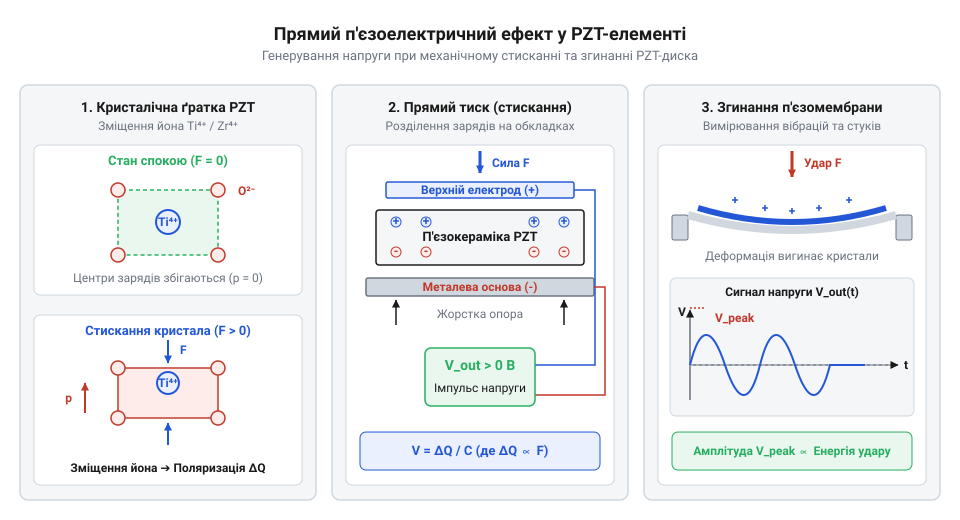
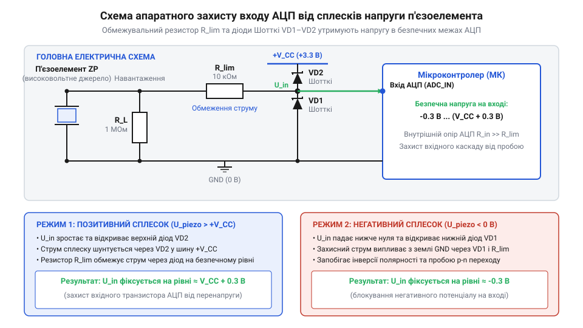
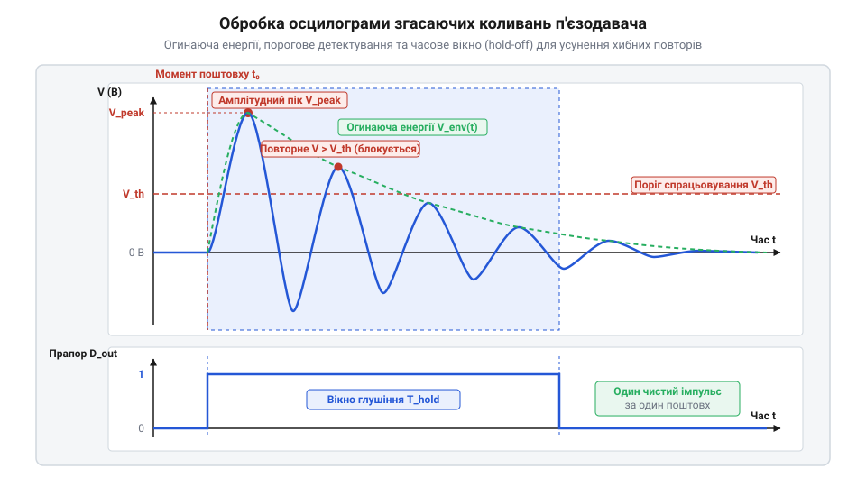

# Аналоговий п'єзоелектричний давач

<preknowlist>
- [KY-002 — давач вібрації (SW-18020P)](root:cat-hw-sensors/ky-002-vibration) — Концепція пружинного комутатора вібрації, принцип роботи бінарних контактних сенсорів та їхні обмеження при вимірюванні амплітуди поштовху.
- [KY-031 — давач стуку](root:cat-hw-sensors/ky-031-knock) — Принцип фіксації механічних ударів за допомогою пружинного контакту та відмінність бінарного спрацьовування від аналогового вимірювання сили удару.
</preknowlist>

## Обмеження бінарних давачів при ударах

Механічні давачі вібрації та [прості давачі стуку](root:cat-hw-sensors/ky-031-knock) базуються на пружинних контактах. Рухома маса має інерційність: вона реагує із затримкою й не фіксує мікросекундні поштовхи. Зіткнення контактів викликає контактний дребезг (англ. @@en|contact bounce@@) — серію хибних перемикань.

Дискретний сигнал показує лише факт події, але не дає інформації про амплітуду й енергію удару. Для вимірювання динамічних навантажень потрібен твердотільний перетворювач (англ. @@en|solid-state transducer@@, від латинського *solidus* — міцний та *transducere* — переводити) без рухомих мас, здатний генерувати аналоговий сигнал, пропорційний прикладеному зусиллю. При механічному деформуванні п'єзоелектричного кристала (англ. @@en|piezoelectric crystal@@, від грецького *piezein* — тиснути) міжатомна ґратка зсувається, зміщуючи центри позитивних і негативних зарядів усередині іонних комірок. Це мікроскопічне відхилення створює електричний диполь і виводить на поверхневі електроди некомпенсований заряд `Q`, пропорційний прикладеній силі `F` та величині деформації. Оскільки сигнал формується безпосередньо пружною деформацією твердого тіла на атомарному рівні, перетворювач реагує миттєво й вимірює амплітуду поштовху без інерційної затримки, хоча надмірне навантаження ризикує незворотно зруйнувати крихку кераміку.

## П'єзоефект та ємнісна модель диска

Прямий п'єзоелектричний ефект (англ. @@en|piezoelectric effect@@, від грецького *piezein* — тиснути та *elektron* — бурштин) розділяє заряди `Q` у ґратці при деформації, генеруючи пропорційний потенціал.

*При деформації кристалічної ґратки розділені заряди формують напругу на еквівалентній ємності п'єзодиска.*

Еквівалентна схема п'єзодиска — джерело заряду паралельно власній еквівалентній ємності (англ. @@en|equivalent capacitance@@, від латинського *capacitas* — місткість) `C`. Через малу ємність за формулою `U = Q / C` удар створює високовольтний сплеск (англ. @@en|voltage spike@@). Проте діелектричний матеріал диска має скінченний внутрішній опір витоку (англ. @@en|leakage resistance@@, від англійського *leak* — протікати) `R_leak`. Коли прикладений тиск стає постійним, генерація нових зарядів припиняється, а заряд `Q` на ємності `C` починає стікати через цей опір витоку. У результаті напруга швидко спадає до нуля навіть за незмінної механічної сили, тому пристрій вимірює лише швидкість зміни тиску `dp / dt` і непридатний для стаціонарної ваги.

## Схема узгодження та захисту АЦП

Високий внутрішній імпеданс (англ. @@en|impedance@@, від латинського *impedire* — перешкоджати) та сплески напруги п'єзодиска небезпечні для аналогово-цифрового перетворювача (англ. @@en|ADC@@, далі @@en|АЦП@@) мікроконтролера.

*Паралельний резистор задає час розряду ємності, а зустрічно-паралельні діоди Шотткі обмежують напругу вхідного сигналу.*

Паралельний резистор `R` разом із ємністю `C` створює фільтр високих частот зі зрізною частотою (англ. @@en|cutoff frequency@@) `f_c = 1 / (2 · π · R · C)` для розряду ємності. Зовнішні діоди Шотткі (англ. @@en|Schottky diodes@@, від імені розробника Вальтера Шотткі) відкриваються при `0.3 V` — раніше за захист чипа, безпечно шунтуючи перенапругу.

## Програмна порогова обробка сигналу

Сигнал п'єзоелемента містить загасаючі осциляції (лат. *oscillatio* — коливання), а рівень тиші дрейфує.

*Програмне вікно блокування запобігає повторному спрацьовуванню від згасаючих коливань після первинного удару.*

Цифровий фільтр забезпечує відстеження базової лінії (англ. @@en|baseline tracking@@). Порогова детекція (англ. @@en|threshold detection@@) виявляє удар на тлі шумів. Щоб відсікти повторні сплески та зафіксувати пікову амплітуду, запускається вікно блокування (англ. @@en|blanking window@@), яке ігнорує згасаючі коливання.
