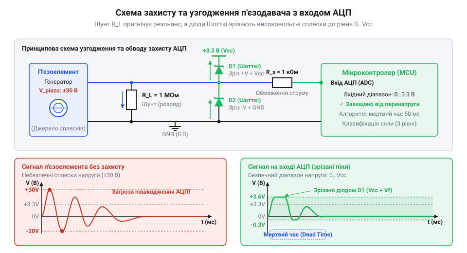
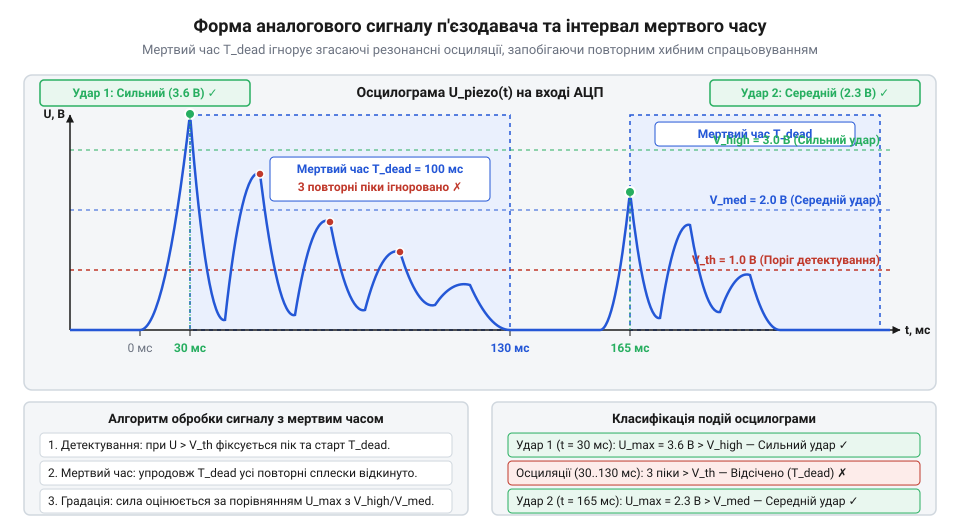
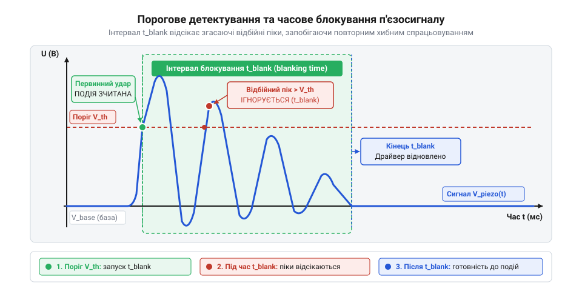

# Аналоговий детектор стуку з градацією сили удару на мікроконтролері

<preknowlist>
- [KY-031 — давач стуку](root:cat-hw-sensors/ky-031-knock) — принцип роботи двійкового детектора стуку та обмеження порогового виходу
- [KY-002 — давач вібрації (SW-18020P)](root:cat-hw-sensors/ky-002-vibration) — механіка контактного спрацьовування та проблема деренчання
</preknowlist>

## Проблема хибних спрацьовувань та перенапруги

Спроба зафіксувати струс чи удар за допомогою простих кулькових або пружинних контактних елементів, які застосовують [дискретні давачі вібрації](root:cat-hw-sensors/ky-002-vibration) та [прості давачі стуку](root:cat-hw-sensors/ky-031-knock), швидко виявляє їхні принципові обмеження. Механічна контактна група працює як ззвичайний двопозиційний вимикач. Вона видає лише двійковий цифровий сигнал — наявність або відсутність замикання контактів. Через це пристрій принципово не здатний розрізнити легкий дотиковий поштовх від сильного механічного удару, адже в обох випадках вихідний рівень змінюється однаково. Крім того, механічні контакти викликають @@en|брязкіт контактів@@ (англ. *contact bounce*) та спричиняють хибні спрацьовування від акустичних завад чи вібрацій корпусу.

Для вимірювання сили поштовху потрібен аналоговий перетворювач без рухомих механічних частин. П'єзоелектричний керамічний диск перетворює механічну деформацію на електричний потенціал, амплітуда якого пропорційна прикладеному зусиллю. Проте прямо підключати п'єзоелемент до виводів мікроконтролера категорично заборонено.

При механічному ударі п'єзопластина генерує короткі @@en|високовольтні сплески напруги@@ (англ. *voltage spikes*), амплітуда яких на високому внутрішньому опорі кристала може сягати десятків і навіть сотень вольт. Входи @@en|аналогово-цифрового перетворювача@@ (англ. *Analog-to-Digital Converter*, @@en|АЦП@@) мікроконтролера розраховані на напругу в межах живлення чипа (наприклад, `0...3.3 V` або `0...5 V`). Вбудовані @@en|ESD-діоди захисту@@ (англ. *ESD protection diodes*) мікросхеми розраховані лише на наносекундні статичні розряди й витримують струм не більше `1...2 mA`.

Позначимо електричні параметри захисного елемента: допустима енергія сплеску `E_max`, прямий спад напруги на відкритому діоді `U_clamp`, граничний струм `I_max` та тривалість розряду `Δt`. Гранична енергія, яку вбудований @@en|ESD-діод захисту@@ здатний поглинути без руйнування, обчислюється через добуток цих величин:

```
E_max = U_clamp · I_max · Δt
= 0.7 V · 0.002 A · 10⁻⁶ s [допустима енергія статичного розряду]
= 1.4 · 10⁻⁹ J             [перемноження величин]
= 1.4 nJ                   [переведення в наноджоулі]
```

Отриманий рівень `1.4 nJ` визначає межу енергії, вище якої кремнієвий p-n-перехід не може розсіяти тепло. Натомість енергія сплеску від механічного удару по п'єзопластині ємністю `C_piezo = 10 nF` при напрузі `U = 50 V` становить `E_piezo = 0.5 · C_piezo · U² = 12.5 µJ`, що майже в десять тисяч разів перевищує значення `E_max`. Коли ця високовольтна хвиля перевищує рівень живлення, прямо зміщений @@en|ESD-діод захисту@@ відкривається й пропускає струм у десятки міліампер через мікроскопічну ділянку напівпровідника. Виділена потужність викликає миттєвий локальний перегрів p-n-переходу понад температуру плавлення кремнію, що спричиняє @@en|тепловий пробій@@ (англ. *thermal breakdown*, від грец. *θερμός* — теплий) — необоротне спекання кристала на коротке замикання. Крім того, інжекція носіїв заряду в підкладку мікросхеми провокує @@en|защіпку@@ (англ. *latch-up*, від англ. *latch* — засувка) — паразитно-тиристорне коротке замикання шин живлення, яке викликає фізичне знищення @@en|АЦП@@ або зависання мікроконтролера.

Тому створення надійного аналогового детектора стуку вимагає двох послідовних рішень: розробки пасивної схеми узгодження та захисту аналогового входу від перенапруги, а також налаштування безперервного оцифрування сигналу для програмного вимірювання амплітуди поштовху.

## Схема захисту та узгодження п'єзодавача

Фізична основа роботи п'єзодиска спирається на @@el|п'єзоелектричний ефект@@ (грец. *πιέζειν* — тиснути), за якого механічний тиск зміщує іони в кристалічній ґратці кераміки й створює електричний заряд `Q` на металізованих обкладках. У схемотехніці п'єзоелемент заміщують джерелом заряду, підключеним паралельно до власної ємності диска `C_piezo` та внутрішнього опору витоку діелектрика `R_leak`. Докладніше про фізичний механізм генерації заряду при механічній деформації кристала читайте у статті про [п'єзоелектричний ефект](root:ph-condensed/crystal-symmetry-piezo).

Напруга на обкладках п'єзоелемента в момент деформації прямо залежить від накопиченого заряду. Перед розрахунком захисного кола позначимо електричні величини: амплітудна напруга `U`, згенерований заряд `Q` та власна ємність п'єзоелемента `C_piezo`.

Напруга на клемах п'єзодиска без зовнішнього навантаження визначається базовою формулою ємності:

```
U = Q / C_piezo
```

Оскільки власна ємність тонкого керамічного диска `C_piezo` становить лише `10...30 nF`, навіть незначний механічний поштовх із зарядом у кілька мікрокулонів створює сплеск напруги `U` понад `50 V`.

Щоб безпечно скинути цей заряд і встановити стабільний опір входу, паралельно п'єзоелементу підключають @@en|шунтуючий резистор@@ (англ. *shunt resistor*) `R_shunt` номіналом від `100 kΩ` до `1 MΩ`. Резистор разом із ємністю `C_piezo` утворює @@en|фільтр верхніх частот@@ (англ. *high-pass filter*, від англ. *high* — високий, *pass* — пропускати; ФВЧ) із постійною часу розряду `τ = R_shunt · C_piezo`, яка забезпечує швидке повернення напруги до нульового рівня після завершення поштовху. Позначимо електричні величини кола: нижня @@en|частота зрізу@@ (англ. *cutoff frequency*, від англ. *cut off* — відрізати) `f_c`, константа `π ≈ 3.14159`, опір `R_shunt` та власна ємність п'єзоелемента `C_piezo`. Нижню граничну частоту зрізу `f_c` розраховують через постійну часу розряду `τ` за формулою:

```
f_c = 1 / (2 · π · τ)
    = 1 / (2 · π · R_shunt · C_piezo)    [підстановка значення постійної часу τ = R_shunt · C_piezo]
```

Отриманий вираз показує обернену залежність між номіналом резистора `R_shunt` та граничною частотою `f_c`: збільшення опору знижує частоту зрізу, а зменшення — зміщує її у бік вищих частот. За вибору занадто малого опору (менше `10 kΩ`) частота зрізу зростає понад `100 Hz`, через що фільтр пригнічує низькочастотний спектр механічного поштовху й заряд стікає занадто швидко, позбавляючи сигнал амплітуди до моменту оцифрування в @@en|АЦП@@. За надто великого опору (понад `10 MΩ`) частота `f_c` опускається нижче `1 Hz`, а постійна часу `τ` зростає до сотень мілісекунд, що викликає тривалий паразитний дрейф базової лінії та накладання послідовних ударів один на один. Опір у діапазоні від `100 kΩ` до `1 MΩ` при типовій ємності диска `C_piezo = 10...30 nF` задає частоту зрізу в межах `5...160 Hz`, що забезпечує збереження пікової амплітуди акустичного імпульсу стуку та швидке відновлення нульового рівня.

Для жорсткого обмеження амплітуди напруги на рівні живлення АЦП застосовують обмежувальне коло на двох діодах. Зовнішні @@en|діоди Шотткі@@ (англ. *Schottky diodes*, від імені Вальтера Шотткі) відкриваються при напрузі `0.3 V`, що значно менше за поріг відкривання вбудованих ESD-діодів мікроконтролера. Діод між сигнальною лінією та землею `GND` зрізає від'ємні напівхвилі, а діод між сигнальною лінією та шиною живлення `V_CC` скидає надлишковий струм позитивного сплеску в лінію живлення, утримуючи напругу на вході АЦП у безпечній зоні `0...V_CC`.


*Принципова схема пасивного узгодження п'єзодиска із шунтуючим резистором та обмежувальними діодами Шотткі.*

## Налаштування АЦП та зчитування осциляцій

Після пасивного узгодження аналоговий сигнал від п'єзоелемента подається на аналоговий вхід мікроконтролера. Проте механічний удар по керамічному диску не створює поодинокого гладкого імпульсу. Через пружність конструкції та механічний резонанс виникають згасаючі @@en|резонансні осциляції@@ (англ. *resonant oscillations*). Сигнал має вигляд серії синусоїдальних коливань, де перший первинний пік має максимальну амплітуду, пропорційну силі удару, після чого амплітуда експоненціально спадає протягом десятків мілісекунд.

Головне завдання АЦП — точне вимірювання амплітуди саме первинного піку. Тривалість наростання цього піку від нуля до максимуму `t_r` становить лише `20...50 µs`.

Позначимо параметри оцифрування: необхідна @@en|частота дискретизації@@ `f_s`, кількість відліків АЦП на фронті наростання `N` та тривалість наростання імпульсу `t_r`.

Мінімальна частота дискретизації АЦП для фіксації пікового значення обчислюється через співвідношення:

```
f_s = N / t_r
```

Щоб гарантовано отримати принаймні `N = 5` відліків на фронті наростання тривалістю `t_r = 25 µs`, АЦП повинен працювати з частотою дискретизації не менше ніж `f_s = 200 kHz` (період вибірки `5 µs`). За нижчої частоти оцифрування вибірка АЦП може припасти на момент спаду імпульсу, що призведе до суттєвого заниження виміряної сили удару. Більше про теорію та практичний розрахунок часових параметрів оцифрування швидкоплинних імпульсів ви знайдете у матеріалі про [частоту дискретизації АЦП](root:hw-analog/sampling-quantization).

Модуль АЦП налаштовують на безперервний режим перетворення або циклічний запуск від таймера із @@en|частотою дискретизації@@ `200 kHz`. За такої швидкості новий відлік з'являється кожні `5 µs`, тому спроба зчитувати результати програмою через опитування прапорців або звичайні @@en|переривання@@ (англ. *interrupt*, від лат. *interruptus* — перерваний) повністю заблокує процесор через колосальну частоту викликів. Для збереження вибірок без блокування процесора застосовують @@en|прямий доступ до пам'яті@@ (англ. *direct memory access*, DMA) або виділений @@en|обробник переривань@@ (англ. *interrupt service routine*, ISR). Контролер DMA автоматично копіює кожне виміряне значення з регістру АЦП у @@en|кільцевий буфер@@ (англ. *ring buffer*) в оперативній пам'яті, минаючи ядро процесора. За це доводиться платити виділенням ділянки оперативної пам'яті під буфер і додатковим навантаженням на системну шину. Якщо головний цикл не встигає прочитати вибірки до перезапису буфера по колу, старі дані втрачаються і форма первинного піку спотворюється. Накопичений у буфері потік сирих оцифрованих значень передається в обробник для виявлення початкового перетину @@en|порогу шуму@@ та подальшої аналогової градації поштовху.


*Часова діаграма згасаючих осциляцій п'єзоелемента та оцифрування первинного піку за допомогою АЦП.*

## Алгоритм детектування з мертвим часом

Механічний поштовх викликає в п'єзоелементі первинний високовольтний пік, після якого слідує тривалий @@en|акустичний дзвін@@ — згасаючі осциляції на власній резонансній частоті диска. Якщо зчитувати значення аналогово-цифрового перетворювача в прямому циклі, один удар створить десяток хибних спрацьовувань поспіль. На відміну від пристроїв, де застосовуються [прості давачі стуку](root:cat-hw-sensors/ky-031-knock) з пороговим виходом або механічні [давачі вібрації пружинного типу](root:cat-hw-sensors/ky-002-vibration), аналоговий сигнал дає змогу виділити сплеск програмно.

Для виділення єдиного поштовху застосовують @@en|піковий детектор@@ (від @@en|peak detector@@ — алгоритм виділення максимального значення) із часовою затримкою. Алгоритм порівнює кожен відлік із базовим значенням: якщо сигнал перевищує @@en|поріг шуму@@, мікроконтролер фіксує початок поштовху та зберігає максимальну амплітуду. Одразу після цього система вмикає @@en|мертвий час@@ (від @@en|dead time@@ — інтервал нечутливості) — фіксований проміжок (зазвичай 50–100 мс), упродовж якого всі наступні відліки АЦП повністю ігноруються.


*Форма сигналу п'єзоелемента під час удару: інтервал мертвого часу блокує повторні згасаючі піки.*

Тривалість інтервалу нечутливості визначається різницею між поточним часом `t_now` та моментом реєстрації піку `t_knock`:

```
t_elapsed
= t_now - t_knock    [обчислення часу від початку удару]
```

Якщо значення `t_elapsed` менше за встановлений @@en|мертвий час@@ `t_dead`, програма відкидає поточний відлік АЦП як @@en|акустичний дзвін@@. Після завершення інтервалу `t_dead` алгоритм скидає прапорець блокування та повертається в стан очікування нового поштовху.

Значення `t_dead` підбирають експериментально під конкретну механічну конструкцію, оскільки тривалість згасання осциляцій залежить від жорсткості корпусу та механічного @@en|демпфування@@ (англ. *damping*, від нім. *Dämpfung* — згасання) п'єзоелемента. Для вимірювання часу згасання на п'єзодиск наносять серію тестових ударів максимальної робочої сили. Підключивши @@en|осцилограф@@ (англ. *oscilloscope*, від лат. *oscillo* — гойдаюся та грец. *γράφω* — пишу) або логуючи відліки АЦП у послідовний порт, вимірюють інтервал `t_decay` від первинного сплеску до моменту, коли згасаючі піки остаточно опускаються нижче @@en|порогу шуму@@. Величина `t_dead` обчислюється з урахуванням коефіцієнта запасу:

```
t_dead
= 1.3 · t_decay      [урахування тридцятивідсоткового запасу безпеки]
```

Запас у `30%` гарантує блокування хибних повторних спрацьовувань при механічних резонансах. Якщо обрати `t_dead` меншим за `t_decay`, остаточний @@en|акустичний дзвін@@ спровокує серію помилкових відгуків. Якщо ж перевищити `t_dead` понад `150...200 ms`, система втратить здатність фіксувати швидкі повторні поштовхи.

t_elapsed
= t_now - t_knock    [обчислення часу від початку удару]

:::tabs
@tab C++ (Arduino)
:::code proj-piezo-knock-detector/cpp/arduino/setup.cpp
@tab C (ESP-IDF)
:::code proj-piezo-knock-detector/c/esp-idf/detect-knock.c
:::

## Градація сили та калібрування порогів

Після фільтрації осциляцій мікроконтролер отримує амплітуду чистого піку, яку необхідно перетворити на зрозумілу @@en|градацію сили@@ удару: слабкий, середній або сильний. Оскільки механічні властивості корпусу та поверхні кріплення суттєво змінюють амплітуду сигналу, граничні значення аналогового відліку не можна визначати теоретично.

Для вибору меж виконується експериментальна @@en|гістограма ударів@@ (від @@grc| histos@@ — щогла і @@grc| gramma@@ — запис). На серії із 20–30 тестових поштовхів кожної категорії вимірюють пікові значення АЦП. Отримані значення групуються у три кластери, між якими обирають два граничних @@en|порогових значення@@: нижнє `T_low` та верхнє `T_high`. Проте стаціонарні пороги не враховують змін акустичного фону, температурного дрейфу п'єзоелемента та механічного натягу корпусу при затисканні. Для адаптації пристрою ручні межі поєднують із @@en|автокалібруванням@@ (від @@grc| autos@@ — сам і @@fr| calibrer@@ — вимірювати калібр) під час старту мікроконтролера. Упродовж перших кількох сотень мілісекунд після вмикання живлення алгоритм зчитує серію відліків у стані спокою, обчислює середній рівень @@en|фонового шуму@@ `N_noise` і динамічно додає його зміщення до @@en|порогових значень@@. Така адаптація вимагає паузи перед початком роботи пристрою та додаткових обчислювальних ресурсів для накопичення відліків. Утім, механізм ламається, якщо в момент @@en|автокалібрування@@ по корпусу завдати поштовху: сплеск від удару алгоритм помилково сприйме за базовий шум середовища, через що @@en|порогові значення@@ `T_low` та `T_high` завищаться і пристрій перестане реагувати на реальні стуки.


*Розподіл амплітуд тестових ударів: пороги T_low та T_high поділяють сигнал на три рівні, а зона гістерезису усуває брязкіт на межах.*

Поштовхи з амплітудою біля самих меж `T_low` або `T_high` викликають @@en|межеве деренчання@@ — хаотичне перемикання класифікації через мікроскопічні шуми. Для стабілізації межі додають @@en|гістерезис@@ (від @@grc| hysteresis@@ — запізнення) — захисну смугу `H`.

Перехід між рівнями амплітуди `A` з урахуванням ширини @@en|гістерезису@@ `H` обчислюється за виразом:

A_effective
= A ± H    [коригування порогового значення на ширину гістерезису]

Якщо поточний рівень був слабким, перехід у середній відбувається лише при перевищенні суми `T_low + H`, а повернення назад — при падінні нижче `T_low - H`. Про класичну апаратну та програмну реалізацію захисної смуги для усунення межевого деренчання читайте в огляді про [тригер Шмітта](root:hw-analog/schmitt-trigger).

:::tabs
@tab C++ (Arduino)
:::code proj-piezo-knock-detector/cpp/arduino/classifyknock.cpp
@tab C (ESP-IDF)
:::code proj-piezo-knock-detector/c/esp-idf/classify-knock.c
:::
