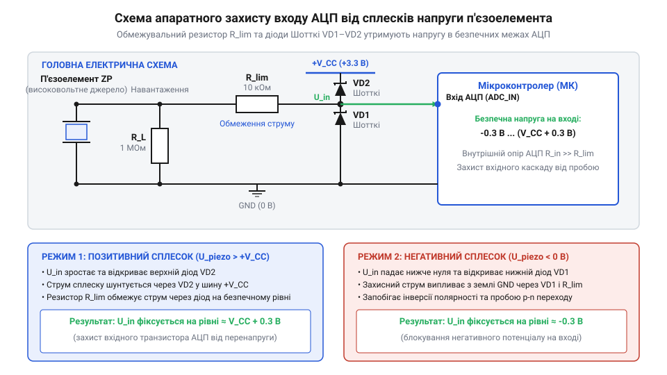
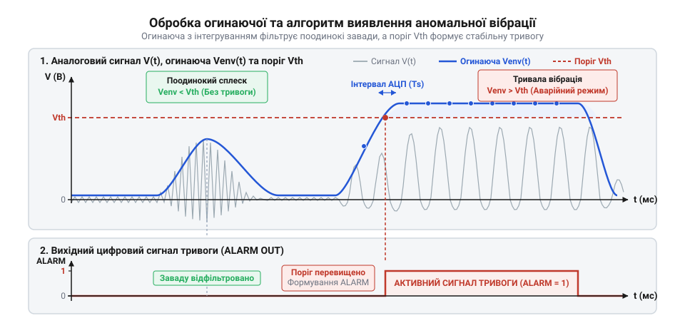

# Монітор безпеки вібрацій обладнання з апаратним захистом АЦП

<preknowlist>
- [KY-002 — давач вібрації (SW-18020P)](root:cat-hw-sensors/ky-002-vibration) — принцип дискретного розмикання пружинного контакту при вібрації та обмеження дискретних давачів порівняно з аналоговими
- [SW-520D — давач нахилу/вібрації](root:cat-hw-sensors/sw-520d) — принцип роботи кулькового вимикача та відмінність фактів механічного зсуву від вимірювання неперервної амплітуди коливань
</preknowlist>

## Небезпека вібрацій та ризики АЦП

Під час роботи роторного обладнання — електродвигунів, помпових агрегатів чи вентиляторів — механічний знос підшипників та розбалансування вала неминуче викликають вібраційні коливання. Якщо ці коливання вчасно не виявити, амплітуда зсуву зростає експоненціально, що призводить до заклинювання ротора або руйнування статора. Прості [дискретні давачі вібрації](root:cat-hw-sensors/ky-002-vibration) та [кульковий вимикач](root:cat-hw-sensors/sw-520d) фіксують лише сам факт поштовху при замкненні чи розмкненні контактів. Вони не здатні виміряти поступове зростання амплітуди коливань, тому для раннього виявлення предаварійного стану необхідний безперервний вимірювальний сигнал. Детальний розрахунок характерних частот для визначення локальних пошкоджень елементів ротора наведено в матеріалі про [діагностику дефектів підшипників кочення](root:hw-sensing/bearing-fault-diagnostics).

Для зйому коливань використовують @@el|п'єзоелектричний ефект@@ (від грецького *piezein* — тиснути), коли механічна деформація керамічного матеріалу зсуває іони кристалічної ґратки та породжує електричний заряд. Оскільки ненавантажений п'єзодиск має високий внутрішній опір і поводиться як конденсатор малої ємності `C`, згенерований заряд `Q` не має шляху для витоку, а напруга на виводах обчислюється як `U = Q / C`. При різкому механічному ударі або резонансі ця деформація відбувається миттєво, утворюючи короткі сплески напруги амплітудою в десятки вольт. Коли ж п'єзоелемент після стискання пружно повертається або розтягується, напрямок зсуву іонів змінюється на протилежний, що змінює знак заряду та формує імпульси зворотної полярності.

Пряме підключення п'єзоелемента до входу, на якому працює @@en|аналогово-цифровий перетворювач@@ (скорочено @@en|АЦП@@), смертельно небезпечне для мікроконтролера. Вхідні каскади АЦП розраховані на суворо обмежений діапазон напруги — від 0 до напруги живлення `V_CC` (зазвичай 3.3 В або 5 В). Імпульс напруги понад `V_CC` або від'ємний сплеск нижче 0 В пробиває внутрішні захисні діоди кристалічного виводу, викликає струмовий пробій та незворотне вигоряння аналогового периферійного модуля.

Для побудови надійної системи моніторингу вібрацій висуваються три базові технічні вимоги:
1. Механічне узгодження давача для перетворення вібрації корпусу в пропорційний електричний сигнал відповідної амплітуди.
2. Апаратне обмеження напруги сплесків та полярності в безпечних межах живлення АЦП.
3. Програмна обробка вибірок АЦП для виділення огинаючої сигналу та порогового захисного вимкнення обладнання.

## Механічне монтування та інерційний вантаж

Якщо пластину @@en|п'єзодиска@@ просто приклеїти всією площиною до поверхні механізму, під час вібрації вся конструкція рухатиметься як єдине ціле. Без відносного механічного зсуву або вигину кераміка не деформується, і згенерований заряд залишається близьким до нуля. Для ефективного перетворення вібрацій у напругу до вільного центра пластини кріплять додатковий @@la|інерційний вантаж@@ (поняття інерція походить від латинського *inertia* — бездіяльність). У вимірювальній техніці цей вантаж називають @@en|сейсмічною масою@@.

Коли корпус роторної установки коливається з прискоренням `a`, інерційний вантаж масою `m` через власну інертність протидіє миттєвому зсуву. На п'єзокерамічний шар діє деформуюча сила `F`:

```
F = m · a
Q = d · F
= d · m · a      [комбінація закону Ньютона та п'єзоефекту]
```

У цих виразах `F` — сила механічного стиску чи вигину п'єзокераміки, `m` — маса інерційного вантажу, `a` — прискорення вібрації корпусу установки, `Q` — вигенерований на електродах заряд, а `d` — п'єзоелектричний модуль матеріалу.

Збільшення маси `m` підвищує електричну чутливість давача: навіть слабкі вібраційні коливання генерують достатній заряд для фіксації АЦП. Однак зростання маси знижує власну @@en|резонансну частоту@@ всієї механічної системи:

```
f_r ≈ (1 / (2 · π)) · √(k / m)
```

де `k` — жорсткість керамічної пластини. Занадто важкий вантаж спричиняє механічний розлом кераміки при сильному ударі й обмежує верхню робочу частоту вимірювань. Для промислових моторів (3000 об/хв, тобто 50 Гц) оптимальна маса вантажу на п'єзодиску діаметром 27 мм становить від 2 до 5 грамів (наприклад, металева гайка або латунне осердя).

Механічний монтаж вимагає жорсткої передачі коливань від агрегату. П'єзоелемент фіксують на латунній або сталевій основі за допомогою епоксидного компаунда або нарізного шпилькового з'єднання. Використання м'яких двосторонніх скотчів чи силікону неприпустиме, оскільки еластичний матеріал поглинає високочастотні вібрації та спотворює спектр коливань.

## Схемотехніка апаратного захисту аналогового входу

Згенерований п'єзоелементом електричний сигнал має змінну полярність і високу пікову напругу. Для подачі цього сигналу на вхід АЦП мікроконтролера необхідно розробити схемотехнічний вузол узгодження рівнів та апаратного обмеження сплесків.


*Схема апаратного захисту АЦП мікроконтролера, що показує з'єднання п'єзоелемента, паралельного навантажувального резистора, струмообмежувального резистора та діодів Шотткі між землею і шиною живлення.*

Першим елементом схеми є паралельний навантажувальний резистор `R_load` опором 1...10 МОм, підключений безпосередньо до виводів п'єзодиска. Оскільки п'єзоелемент має власну ємність `C_piezo`, резистор `R_load` формує @@en|RC-ланцюг@@ розряду, який стікає статичний заряд та визначає нижню межу частотного діапазону вимірювання.

Для захисту ніжці АЦП від перенапруги застосовують послідовний струмообмежувальний резистор `R_limit` опором 1...10 кОм та дві зустрічно-паралельні обмежувальні лінії на діодах. Діоди підключають за схемою @@en|клемпування@@ (від англійського *clamping* — затискання, фіксація):
- Діод `D1` увімкнений між землею `GND` та входом АЦП (анод до `GND`, катод до АЦП).
- Діод `D2` увімкнений між входом АЦП та шиною живлення `V_CC` (анод до АЦП, катод до `V_CC`).

У цій схемі використовують @@de|діод Шотткі@@ (названий на честь німецького фізика Вальтера Шотткі, нім. *Schottky*). На відміну від стандартних кремнієвих діодів з падінням напруги 0.7 В, діоди Шотткі мають мале @@en|падіння прямої напруги@@ (лише 0.2...0.3 В) та високу швидкодію. Якщо п'єзоелемент генерує додатній сплеск напруги понад `V_CC`, діод `D2` відкривається і скидає надлишковий струм у шину живлення, фіксуючи потенціал виводу на безпечному рівні `V_CC + 0.3` В. При від'ємному сплеску відкривається діод `D1`, утримуючи напругу входу не нижче `-0.3` В.

Резистор `R_limit` обмежує максимум струму через діоди Шотткі до безпечних кількох мікроампер:

```
I_spike ≤ (U_piezo - V_CC) / R_limit
```

Оскільки однополярний АЦП мікроконтролера вимірює напругу лише в діапазоні від 0 до `V_CC`, для зчитування симетричних змінних коливань на вхід додатково подають @@en|зміщення постійної складової@@ `V_CC / 2` за допомогою @@en|резистивного дільника напруги@@. Дільник складається з двох послідовно увімкнених резисторів `R_1` (підключений до шини живлення `V_CC`) та `R_2` (підключений до землі `GND`). Щоб отримати потенціал точно посередині шкали, опори обирають однаковими: `R_1 = R_2 = R_bias`. У результаті стан спокою відповідає середині шкали АЦП (наприклад, 2048 LSB для 12-бітного перетворювача, де `2¹² ÷ 2 = 2048`), а додатні та від'ємні коливання вібрації симетрично відхиляють відлік вгору і вниз. Однак вибір величини опору `R_bias` вимагає компромісу між струмом споживання та вимогами аналогового входу. З точки зору змінного сигналу обидва резистори увімкнені паралельно відносно землі та шини живлення, формуючи @@fr|еквівалентний опір Тевеніна@@ (від імені французького інженера Леона Тевеніна, фр. *Thévenin*) `R_eq` дільника. Щоб визначити еквівалентний вихідний опір дільника `R_eq`, який «бачить» вхідний каскад АЦП, обчислюємо паралельне з'єднання двох однакових резисторів `R_bias`:

```
R_eq = (R_1 × R_2) ÷ (R_1 + R_2)        [паралельне з'єднання двох резисторів дільника]
     = (R_bias × R_bias) ÷ (2 × R_bias) [умова симетрії дільника R_1 = R_2 = R_bias]
     = R_bias ÷ 2                       [скорочення виразу на R_bias]
```

З вираженої рівності видно, що еквівалентний опір дільника `R_eq` становить половину опору одного резистора `R_bias`. Цей опір безпосередньо впливає на точність оцифрування. Всередині АЦП послідовного наближення розташований перемикач та @@en|вхідна ємність@@ вибірки та утримання `C_sample` (типово 10...20 пФ). Під час вимірювання перемикач замикається, і ємність `C_sample` починає заряджатися через опір дільника `R_eq`, утворюючи RC-ланцюг із @@en|сталою часу@@ `τ`. Значення сталої часу `τ` заряджання вхідної ємності `C_sample` через еквівалентний опір дільника `R_eq` розраховують як їхній добуток:

```
τ = R_eq × C_sample                     [визначення сталої часу RC-кола]
  = 500000 Ом × 15 × 10⁻¹² Ф             [підстановка R_eq = 500 кОм та C_sample = 15 пФ]
  = 7.5 × 10⁻⁶ с                         [обчислення сталої часу в секундах]
```

З отриманого значення видно, що за високого опору дільника (наприклад, `R_bias = 1 МОм`, що дає `R_eq = 500 кОм`) стала часу становить `7.5 мкс`. Для того щоб 12-бітний АЦП зарядив ємність `C_sample` з точністю до 1 LSB, потрібний @@en|час вибірки@@ `t_sample` має перевищувати `ln(4096) × τ ≈ 8.3 × τ`, тобто становити не менше `62 мкс`. Якщо мікроконтролер опитує вхід із типовим часом вибірки 1...2 мкс, ємність `C_sample` не встигне зарядитися до реальної напруги сигналу, що призведе до заниження амплітуди та спотворення піків вібрації. Щоб узгодити дільник із вхідною ємністю АЦП без використання додаткових операційних підсилювачів, опори `R_bias` обирають у межах 10...100 кОм (що забезпечує `R_eq = 5...50 кОм`), або шунтують нижнє плече керамічним конденсатором ємністю 10...100 нФ, який слугує джерелом швидкого заряду для ємності вибірки.

## Дискретизація сигналу та виділення амплітуди

Сигнал п'єзоелектричного елемента після проходження захисного навантажувального кола потрапляє на аналоговий вхід мікроконтролера у вигляді змінної напруги зі зміщеною нульовою лінією. На відміну від [простих давачів вібрації](root:cat-hw-sensors/ky-002-vibration), що дають лише два дискретні стани, аналогово-цифровий перетворювач видає числове значення, яке вимагає періодичної @@la|дискретизації@@ (від латинського @@la|discretus@@ — розділений).

Пряме використання миттєвих відліків напруги для моніторингу неможливе через високочастотні коливання та переходи через нуль. Механічний удар спричиняє швидкі коливання, де напруга постійно перетинає нульовий рівень. Для оцінки реальної сили струсу потрібна @@en|огинаюча@@ (від англійського @@en|envelope@@ — обгортка) сигналу, яка відстежує пікові значення амплітуди.

Спочатку кожні виміряні відліки приводять до центрування відносно постійної складової зміщення. Поточне абсолютне відхилення напруги від нульової лінії розраховують за різницею між виміряним відліком та базовим значенням:

D = |S_ADC - S_baseline|      [абсолютне вихилення від нульової лінії]

Де `S_ADC` — поточне значення відліку, а `S_baseline` — середина постійної складової шкали.

Для обчислення огинаючої використовують асиметричне @@en|експоненційне згладжування@@ (від англійського @@en|exponential smoothing@@) із різними коефіцієнтами підняття та згасання. При виявленні сплеску, який перевищує поточний рівень огинаючої, застосовують високий коефіцієнт атаки для негайного захоплення піку:

E_new = E_prev + a_attack × (D - E_prev)      [швидке наростання огинаючої]

Де `E_prev` — попереднє значення огинаючої, `D` — модуль поточного відхилення, а `a_attack` — коефіцієнт швидкості адаптації.

Коли миттєвий сигнал падає нижче огинаючої, огинаюча поступово згасає з меншим коефіцієнтом, забезпечуючи плавну паузу між коливаннями.


*Часова діаграма аналогового сигналу вібрації разом із виділеною огинаючою амплітудою та заданим пороговим рівнем спрацьовування.*

Якщо аналізувати лише амплітуду занадто складно, для додаткової оцінки інтенсивності обчислюють накопичену енергію вібраційного впливу. Повний складний [спектральний аналіз Фурьє](root:com-signal/fft-vibration-analysis) вимагає значних обчислювальних ресурсів МК, тому в реальному часі обмеження амплітудного профілю виконують програмним драйвером.

Програмний модуль обробки відліків та розрахунку огинаючої реалізовано мовами C та C++:

:::tabs
@tab C
:::code proj-piezo-vibration-monitor/c/piezo_sensor.h 1-38
:::code proj-piezo-vibration-monitor/c/piezo_sensor.c 28-54
@tab C++
:::code proj-piezo-vibration-monitor/cpp/vibration_monitor.hpp 1-37
:::code proj-piezo-vibration-monitor/cpp/vibration_monitor.cpp 16-34
:::

## Пороговий аналіз та аварійне вимкнення

Виділена огинаюча амплітуди слугує основою для прийняття рішення про безпеку роботи механічного обладнання. Пряме порівняння огинаючої з одним фіксованим пороговим рівнем призводить до проблеми: якщо вібрація коливається поблизу цього рівня, вихідний тривожний сигнал починає хаотично вмикатися й вимикатися. Цей @@en|брязкіт@@ (від англійського @@en|chatter@@ — лопотіння) спричиняє прискорене зношення виконавчих реле.

Для стабільного перемикання застосовують @@el|гістерезис@@ (від грецького @@el|hysteresis@@ — запізнення). Логіка використовує два окремі рівні: верхній поріг спрацьовування `T_high` та нижній поріг відновлення `T_low`. Сигнал тривоги активується лише тоді, коли @@en|огинаюча@@ перевищує `T_high`, і лишається активним доти, доки значення не впаде нижче `T_low`.

Для захисту від поодиноких короткочасних імпульсів, які схожі на випадкове зачіпання корпусу або розмикання контакту як у [механічних кулькових вимикачах](root:cat-hw-sensors/sw-520d), у схему керування додають часові затримки. Їх реалізують через @@en|скінченний автомат@@ (від англійського @@en|finite state machine@@).

Автомат послідовно переходить між чотирма станами: нормальний стан (`NORMAL`), затримка підтвердження аварії (`TRIP_DELAY`), стан тривоги (`ALARM`) та затримка відновлення (`RECOVERY_DELAY`). Якщо підвищена вібрація утримується довше за встановлений інтервал затримки, автомат переводить вихідне реле в стан аварійного зупину.

Повноцінне [діагностування дефектів підшипників](root:hw-motion/bearing-defect-diagnostics) вимагає тривалого накопичення статистики, але для захисного вимкнення достатньо локальної порогової логіки. Якщо пристрій інтегрований у загальну мережу, [бездротова передача даних](root:com-protocol/iot-vibration-telemetry) надсилає сповіщення оператору паралельно з спрацьовуванням реле.

Повний вихідний код монітора вібрації, що включає обробку суперциклу та керування станами реле:

:::tabs
@tab C
:::code proj-piezo-vibration-monitor/c/piezo_sensor.c 55-68
:::code proj-piezo-vibration-monitor/c/main.c 1-113
@tab C++
:::code proj-piezo-vibration-monitor/cpp/vibration_monitor.cpp 36-98
:::code proj-piezo-vibration-monitor/cpp/vibration_monitor.hpp 38-80
:::code proj-piezo-vibration-monitor/cpp/main.cpp 1-104
:::
