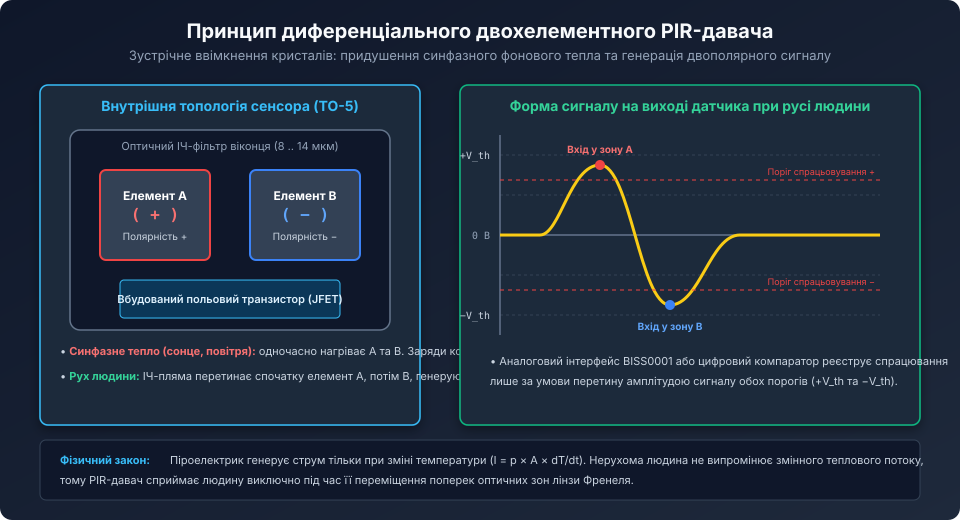
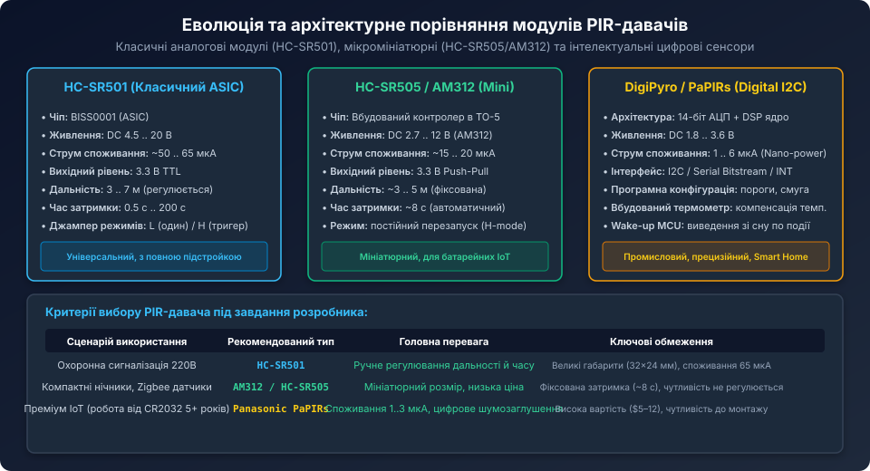
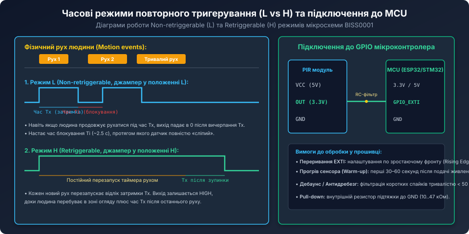

# Поглиблений фізико-математичний аналіз та цифрова обробка сигналів PIR-давачів

<preknowlist>
- [Огляд пасивних інфрачервоних давачів руху (PIR)](root:cat-hw-sensors/pir-motion-sensors-overview) — базова будова диференціального сенсора, режими роботи L/H та лінзи Френеля.
- [HC-SR501 — класичний модуль PIR-давача руху](root:cat-hw-sensors/hc-sr501) — аналоговий тракт на базі BISS0001.
- [HC-SR505 — мініатюрний модуль PIR-давача руху](root:cat-hw-sensors/hc-sr505) — схемотехніка компактних PIR-детекторів.
</preknowlist>

## Фізика піроелектричного перетворювача: тепловий та електричний еквіваленти

Піроелектрики належать до підкласу сегнетоелектриків із несиметричною полярною кристалічною ґраткою. У стані термодинамічної рівноваги кристал володіє спонтанною електричною поляризацією `P_s`, вектор якої орієнтований вздовж полярної осі кристала. Поверхневий зв'язаний заряд нейтралізується вільними іонами та електронами з навколишнього середовища.



Коли кристал поглинає інфрачервоне випромінювання, його температура `T` зростає. Теплове коливання іонів зменшує спонтанну поляризацію `P_s`, викликаючи звільнення поверхневого заряду.

Поведінка піроелемента описується двома взаємопов'язаними фізичними доменами — тепловим та електричним:

### 1. Тепловий домен (Thermal Domain)
При поглинанні змінного теплового потоку потужністю `W_in(t)` температура пластини описується диференціальним рівнянням теплового балансу:

```text
H * (dT(t) / dt) + G_th * delta_T(t) = eta * W_in(t)
```

де:
- `H = c_p * m` — теплоємність кристала (Дж/К);
- `G_th` — теплова провідність зв'язку пластини з основою та повітрям (Вт/К);
- `eta` — коефіцієнт поглинання ІЧ-випромінювання чорненим шаром кристала (близько 0.85 .. 0.95);
- `delta_T(t) = T(t) - T_env` — перевищення температури кристала над навколишнім середовищем.

Звідси визначається теплова стала часу:

```text
tau_th = H / G_th
```

Для типових пластин танталату літію (товщиною 20..50 мкм) `tau_th` становить від 0.1 до 1.5 секунди.

### 2. Електричний домен (Electrical Domain)
Генерований струм `i_p(t) = p * A * (dT / dt)` протікає через власну паразитну ємність кристала `C_p` та високоомний резистор витоку затвора `R_g` (зазвичай вбудований у кристал гіпер-резистор опором 10..100 ГОм, тобто 10^10 .. 10^11 Ом):

```text
tau_e = R_g * C_p
```

Оскільки ємність кристала `C_p` становить 20..50 пФ, електрична стала часу `tau_e` знаходиться у межах 0.5 .. 5.0 секунд.

### 3. Результуюча частотна характеристика (Вольт-ватна чутливість)
Комплексна амплітудно-частотна характеристика чутливості `R_v(omega) = V_out(omega) / W_in(omega)` являє собою класичний смуговий фільтр другого порядку:

```text
R_v(omega) = (eta * p * A * omega * R_g) / ( G_th * sqrt(1 + (omega * tau_th)^2) * sqrt(1 + (omega * tau_e)^2) )
```

На низьких частотах (`omega << 1/tau_e`, тобто нижче 0.05 Гц) коефіцієнт передачі падає до нуля через витік заряду через `R_g`. На високих частотах (`omega >> 1/tau_th`, вище 10 Гц) чутливість спадає через теплову інерцію маси кристала.

Пік чутливості припадає на діапазон **0.3 .. 3.0 Гц**, що ідеально відповідає кутовій швидкості переміщення людини (близько 0.5 .. 1.5 м/с) через сектори огляду лінзи Френеля на відстанях 2..10 метрів.

## Чотирьохелементні сенсори (Quad-Element) та алгоритми захисту від тварин (Pet Immunity)

У професійних охоронних сповіщувачах замість двох кристалів використовують матрицю з чотирьох піроелементів (Quad-Element PIR), з'єднаних за схемою шахового поля (квадрат 2х2):

```text
+---+---+
| + | - |
+---+---+
| - | + |
+---+---+
```



Переваги 4-елементної схеми:
1. **Повна 2D-симетрія:** усуває хибні спрацьовування як від горизонтальних протягів повітря, так і від вертикальних конвективних потоків над обігрівачами.
2. **Алгоритм ігнорування домашніх тварин (Pet Immunity):**
   - Домашня тварина (кіт або невеликий собака вагою до 20 кг) має низький зріст і малу площу тіла. Її ІЧ-випромінювання потрапляє лише в нижні оптичні фасетки лінзи та збуджує лише одну пару кристалів.
   - Людина зростом понад 1.5 м одночасно перетинає верхній і нижній оптичні яруси, викликаючи узгоджений двополярний відгук на обох діагоналях Quad-матриці.
   - Цифровий процесор аналізує кореляцію між вертикальними та горизонтальними парами сигналів, відсікаючи події з низькою просторовою енергією.

## Архітектура сучасних цифрових сенсорів (Excelitas DigiPyro / PYD 1688)

У пристроях преміум-класу та автономних бездротових датчиках (Zigbee, Thread, LoRaWAN) аналогова мікросхема BISS0001 повністю витіснена інтегрованими смарт-сенсорами, такими як **Excelitas DigiPyro (PYD 1688 / PYD 1598)** або **Panasonic PaPIRs**:



Внутрішня структура чіпа DigiPyro містить:
- Два або чотири піроелементи на кремнієвій підкладці;
- Вбудований малошумливий диференціальний підсилювач (PGA);
- Вбудований датчик температури кристала для термокомпенсації;
- 14-бітний сигма-дельта АЦП (частота вибірок ~100 Гц);
- Апаратний цифровий сигнальний процесор (DSP) з програмованими смуговими фільтрами, компаратором порогів та лічильником імпульсів;
- Енергоспоживання: типово 3 мкА при напрузі 3.0 В.

Прилад має двопровідний інтерфейс (Direct Link / Serial Output), де по лінії `SERIN` мікроконтролер записує конфігураційний регістр, а по лінії `DIRECT LINK` зчитує 14-бітний сирий сигнал піроелемента або приймає імпульс переривання `INT` при перевищенні запрограмованого порогу.

## Програмний драйвер опитування цифрового PIR-давача на C

Нижче наведено модульний C-драйвер для роботи з цифровим сенсором з послідовним інтерфейсом, що реалізує зчитування 14-бітного АЦП та алгоритм ковзного віконного інтегрування:

```c
#include <stdint.h>
#include <stdbool.h>
#include <stdlib.h>

#define DIGIPYRO_PULSE_WINDOW_SIZE  16
#define DIGIPYRO_MOTION_THRESHOLD   250  // Відхилення від нуля в кодах 14-бітного АЦП

typedef struct {
    int16_t adc_history[DIGIPYRO_PULSE_WINDOW_SIZE];
    uint8_t history_index;
    int32_t baseline_zero;
    uint32_t trigger_events_count;
    bool motion_alarm;
} digital_pir_t;

void digital_pir_init(digital_pir_t *dev) {
    for (int i = 0; i < DIGIPYRO_PULSE_WINDOW_SIZE; i++) {
        dev->adc_history[i] = 0;
    }
    dev->history_index = 0;
    dev->baseline_zero = 8192; // Середня точка 14-бітного АЦП (2^13)
    dev->trigger_events_count = 0;
    dev->motion_alarm = false;
}

// Функція оновлення вибірки (викликається з частотою ~50-100 Гц)
void digital_pir_process_sample(digital_pir_t *dev, uint16_t raw_14bit_sample) {
    // 1. Адаптивне оновлення нульової лінії (фільтр ковзного середнього з малим кроком)
    dev->baseline_zero = (dev->baseline_zero * 63 + (int32_t)raw_14bit_sample) / 64;

    // 2. Обчислення відхилення від динамічного нуля
    int16_t deviation = (int16_t)((int32_t)raw_14bit_sample - dev->baseline_zero);

    // 3. Збереження в кільцевий буфер
    dev->adc_history[dev->history_index] = deviation;
    dev->history_index = (dev->history_index + 1) % DIGIPYRO_PULSE_WINDOW_SIZE;

    // 4. Пошук позитивного та негативного напівхвиль (детектор біполярного перетину)
    int16_t max_val = 0;
    int16_t min_val = 0;
    for (int i = 0; i < DIGIPYRO_PULSE_WINDOW_SIZE; i++) {
        if (dev->adc_history[i] > max_val) max_val = dev->adc_history[i];
        if (dev->adc_history[i] < min_val) min_val = dev->adc_history[i];
    }

    // Справжній рух людини викликає розмах амплітуди в обидва боки
    if ((max_val > DIGIPYRO_MOTION_THRESHOLD) && (min_val < -DIGIPYRO_MOTION_THRESHOLD)) {
        dev->motion_alarm = true;
        dev->trigger_events_count++;
    } else {
        dev->motion_alarm = false;
    }
}

// Запит стану тривоги
bool digital_pir_is_motion_detected(const digital_pir_t *dev) {
    return dev->motion_alarm;
}
```

Використання передових фізичних моделей теплового перенесення, чотирьохелементної просторової оптики та прямої цифрової обробки сигналу дозволяє створювати автономні сенсори присутності найвищого класу надійності, захищені від помилкових спрацьовувань та оптимізовані для багаторічної роботи від компактних хімічних джерел струму.
