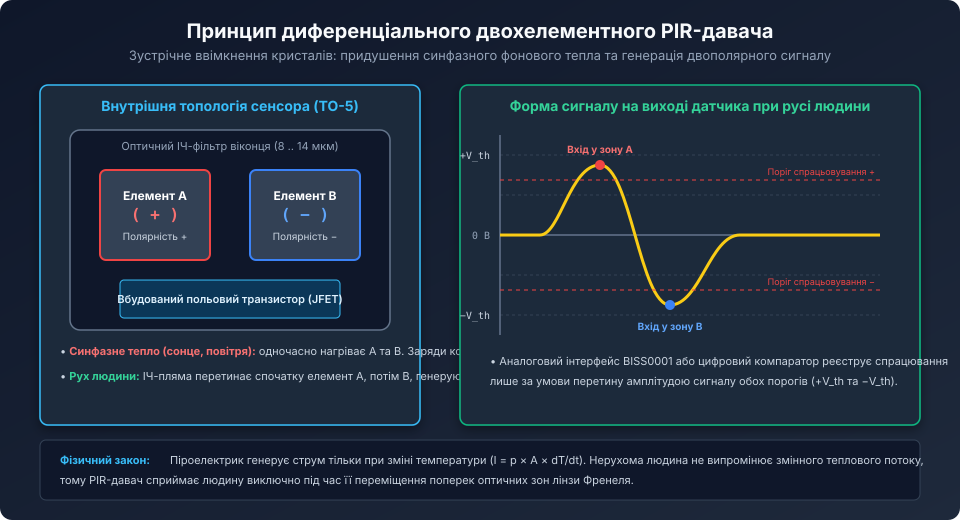
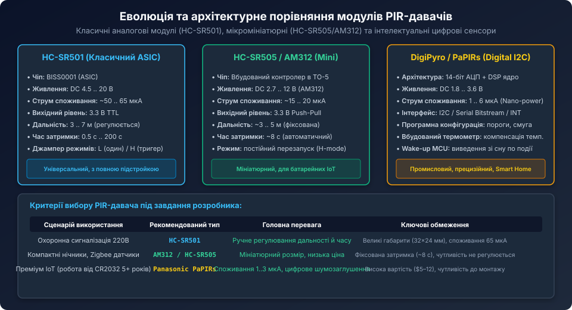
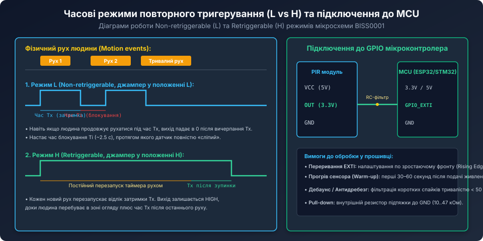

# Огляд пасивних інфрачервоних давачів руху (PIR)

<preknowlist>
- [HC-SR501 — класичний модуль PIR-давача руху](root:cat-hw-sensors/hc-sr501) — практична схемотехніка, регулювання чутливості та часу затримки модуля.
- [HC-SR505 — мініатюрний модуль PIR-давача руху](root:cat-hw-sensors/hc-sr505) — будова компактного автономного датчика руху.
- [Спеціалізована мікросхема BISS0001](root:cat-hw-sensors/biss0001-asic) — внутрішня архітектура аналогового тракту підсилення та віконного компаратора.
</preknowlist>

## Фізичні основи піроелектричного ефекту та закон зміщення Віна

Пасивні інфрачервоні давачі (PIR — Passive Infrared Sensors) є найпоширенішими детекторами присутності та переміщення теплих об'єктів у системах охоронної сигналізації, розумного освітлення та домашньої автоматизації. Слово «пасивний» означає, що пристрій сам нічого не випромінює у простір (на відміну від ультразвукових, мікрохвильових або лідарних датчиків), а лише реєструє природне теплове випромінювання об'єктів.

Згідно із законом зміщення Віна, довжина хвилі, на яку припадає максимум спектральної густини випромінювання абсолютно чорного тіла, обернено пропорційна його абсолютній температурі:

```text
lambda_max = b / T
```

де константа Віна `b ≈ 2898 мкм·К`. 

Для температури поверхні людського тіла (близько 34..36 °C, або 307..309 К) пік теплового випромінювання припадає на довжину хвилі:

```text
lambda_max = 2898 / 308 ≈ 9.4 мкм
```

Людське тіло випромінює довге інфрачервоне світло у діапазоні від 8 до 14 мкм. Для його фіксації використовується піроелектричний ефект — властивість кристалів з несиметричною кристалічною ґраткою (танталат літію LiTaO3, титанат цирконату свинцю PZT, полівініліденфторид PVDF) генерувати макроскопічну електричну поляризацію при зміні температури.

Критично важливо розуміти, що піроелектрик виробляє електричний заряд `Q` лише тоді, коли його температура динамічно змінюється у часі:

```text
I = dQ / dt = p * A * (dT / dt)
```

де:
- `p` — піроелектричний коефіцієнт матеріалу кристала;
- `A` — площа поверхні пластини;
- `dT / dt` — швидкість зміни температури.

Якщо людина стоїть абсолютно нерухомо, температура кристала стабілізується, похідна `dT/dt` стає рівною нулю, і струм падає до нуля. Саме тому PIR-давач сприймає виключно рух і не здатний працювати як статичний детектор присутності без застосування додаткових затворів (оптичних модуляторів / чоперів).

## Диференціальна будова сенсора (Dual-Element) та компенсація теплових завад

Якщо помістити у герметичний корпус TO-5 лише одну пластину піроелектрика, датчик буде фіксувати не лише рух людей, але й будь-які перепади температури в приміщенні: протяг від відчинених дверей, увімкнення кондиціонера, роботу нагрівальних радіаторів або нагрів сонячними променями.



Для вирішення цієї проблеми у сучасних PIR-давачах застосовується диференціальна двохелементна (Dual-Element) або чотирьохелементна (Quad-Element) топологія:
1. Всередині корпусу паралельно розміщуються дві однакові пластини піроелектричного кристала (елементи A та B), що мають протилежну кристалічну орієнтацію та з'єднані послідовно-зустрічно.
2. При зміні фонової температури приміщення сонячне світло або гаряче повітря прогрівають обидва кристали одночасно. Внаслідок зустрічного ввімкнення однакові за величиною позитивний і негативний заряди компенсують один одного, і вихідна напруга залишається нульовою (синфазне придушення теплового дрейфу).
3. Коли перед датчиком рухається людина, її сфокусоване теплове зображення спочатку падає на елемент A (формується позитивний сплеск напруги), потім на коротку мить потрапляє у проміжок між кристалами (сигнал перетинає нуль), а далі переходить на елемент B (формується дзеркальний негативний сплеск).

На виході датчика виникає характерна двополярна хвиля напруги низької частоти (0.1 .. 10 Гц) з амплітудою в кілька мілівольт, яку наступні каскади підсилювача надійно відрізняють від монотонного фонового шуму.

## Порівняльний огляд популярних модулів PIR-давачів



На сучасному ринку вбудованих систем представлено три основні класи PIR-модулів:

### 1. Класичні аналогові модулі на базі ASIC BISS0001 (HC-SR501)
Модуль HC-SR501 є еталоном для макетування та побутової автоматики. Він містить класичний сенсор у металевому корпусі TO-5, двокаскадний смуговий підсилювач на спеціалізованій мікросхемі BISS0001, стабілізатор живлення 3.3 В (7133) та два підрядкові резистори:
- Резистор чутливості (Sensitivity): регулює коефіцієнт підсилення та дальність виявлення від 3 до 7 метрів.
- Резистор часу затримки (Time Delay): задає тривалість високого рівня на виході після спрацьовування (від 0.5 с до 200 с).
- Перемикач режимів (Jumper L/H): дозволяє обирати між одноразовим (Non-retriggerable) та повторним (Retriggerable) спрацьовуванням.

### 2. Мініатюрні модулі (HC-SR505, AM312)
Модулі нового покоління створені для компактних корпусів і пристроїв з батарейним живленням. В AM312 мікросхема обробки інтегрована безпосередньо всередину металевого корпусу TO-5. 
- Робоча напруга: від 2.7 В до 12 В;
- Струм споживання: лише 15..20 мкА (утричі менше за HC-SR501);
- Фіксований час утримання імпульсу (близько 8 секунд) без додаткових потенціометрів.

### 3. Цифрові смарт-сенсори (Panasonic PaPIRs, Excelitas DigiPyro)
Повністю цифрові датчики нового покоління (наприклад, PYD 1598, PYD 1688 або Panasonic EKMB/EKMC), які містять вбудований 14-бітний сигма-дельта АЦП та цифровий сигнальний процесор (DSP):
- Наднизьке споживання струму: від 1 до 6 мкА у режимі сну (робота від дискової літієвої батарейки CR2032 протягом понад 5 років);
- Цифровий інтерфейс I2C або прямий послідовний протокол передачі оцифрованої амплітуди піросигналу;
- Вбудована температурна компенсація чутливості та апаратний поріг переривання для негайного пробудження (Wake-up) сплячого мікроконтролера.

## Оптична сегментація лінзою Френеля

Сам по собі піроелектричний кристал має дуже широку діаграму спрямованості, через що різниця освітленості кристалів A та B на відстані кількох метрів стає нікчемно малою.

Для фокусування теплових променів перед датчиком встановлюється опукла пластикова лінза Френеля (Fresnel Lens), виготовлена з поліетилену високої густини (HDPE), прозорого для інфрачервоного світла з довжиною хвилі 10 мкм:
1. Лінза розділена на десятки окремих мініатюрних лінзових сегментів (фасеток), кожен з яких фокусує світло з певної дискретної конічної зони простору.
2. Простір перед датчиком перетворюється на чергування вузьких зон високої оптичної чутливості та проміжних "сліпих" зон.
3. Коли людина іде через кімнату, її теплове зображення почергово з'являється у фокусі різних фасеток і зникає в сліпих зонах. Це перетворює рівномірний рух людини на високочастотні оптичні спалахи світла, які піроелектрик перетворює у виразний електричний сигнал.

Крім того, вхідне віконце сенсора покрито шаром кремнію з інтерференційним напиленням (Silicon Filter Window), який пропускає лише хвилі 7..14 мкм і надійно блокує сонячне випромінювання видимого та ультрафіолетового спектрів.

## Схемотехніка інтерфейсу з мікроконтролером та алгоритми фільтрації



### Режими повторного тригерування (L vs H)

Модулі на базі BISS0001 мають два принципові режими роботи, що обираються джампером:
- **Режим L (Non-retriggerable / Одноразовий запуск):** при появі руху вихід переходить у високий рівень на час `Tx`. Навіть якщо людина продовжує безперервно рухатися перед датчиком, після закінчення `Tx` вихід обов'язково падає в нуль і настає час блокування `Ti` (близько 2.5 с), протягом якого датчик повністю глухий.
- **Режим H (Retriggerable / Постійне продовження):** кожен новий рух під час активного високого рівня перезапускає таймер `Tx`. Вихід залишається у стані HIGH неперервно доти, доки людина знаходиться в кімнаті, і вимикається лише через час `Tx` після повного припинення руху. Для систем освітлення завжди обирають режим H.

### Програмна обробка переривання на C/C++

Підключення виходу `OUT` датчика до мікроконтролера виконується на лінію дискретного вводу, сконфігуровану як зовнішнє переривання по зростаючому фронту (EXTI Rising Edge):

```c
#include <stdint.h>
#include <stdbool.h>

#define PIR_WARMUP_TIME_MS      45000   // Час прогріву сенсора після ввімкнення (45 с)
#define PIR_MIN_PULSE_WIDTH_MS  80      // Фільтр від коротких RF-завад (мінімум 80 мс)

typedef struct {
    uint32_t system_boot_ms;
    uint32_t last_trigger_ms;
    bool motion_detected;
    bool sensor_ready;
} pir_detector_t;

void pir_init(pir_detector_t *pir, uint32_t now_ms) {
    pir->system_boot_ms = now_ms;
    pir->last_trigger_ms = 0;
    pir->motion_detected = false;
    pir->sensor_ready = false;
}

// Викликається у циклі або за таймером для перевірки готовності
void pir_update_status(pir_detector_t *pir, uint32_t now_ms) {
    if (!pir->sensor_ready) {
        if ((now_ms - pir->system_boot_ms) >= PIR_WARMUP_TIME_MS) {
            pir->sensor_ready = true; // Сенсор прогрівся, пірозаряд врівноважено
        }
    }
}

// Обробник переривання EXTI або фронту на вході GPIO
void pir_gpio_exti_handler(pir_detector_t *pir, bool pin_state, uint32_t now_ms) {
    // Ігнорувати події під час фази калібрування сенсора
    if (!pir->sensor_ready) {
        return;
    }

    if (pin_state) {
        // Зафіксовано фронт початку руху
        pir->last_trigger_ms = now_ms;
        pir->motion_detected = true;
    } else {
        // Спад сигналу: перевірка мінімальної тривалості імпульсу для відсікання завад
        uint32_t pulse_len = now_ms - pir->last_trigger_ms;
        if (pulse_len < PIR_MIN_PULSE_WIDTH_MS) {
            pir->motion_detected = false; // Фальшивий короткий імпульс (наприклад, пакет від Wi-Fi)
        }
    }
}
```

Грамотне поєднання диференціальної оптичної схеми, сегментованої лінзи Френеля та алгоритмічного відсікання завад дозволяє реалізовувати високонадійні, автономні та енергоефективні системи виявлення руху для побутової та промислової автоматизації.
