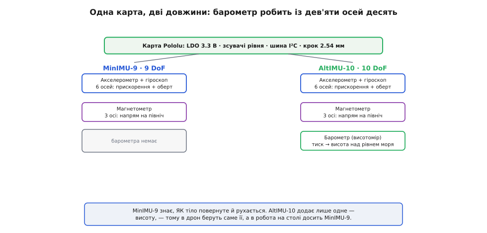
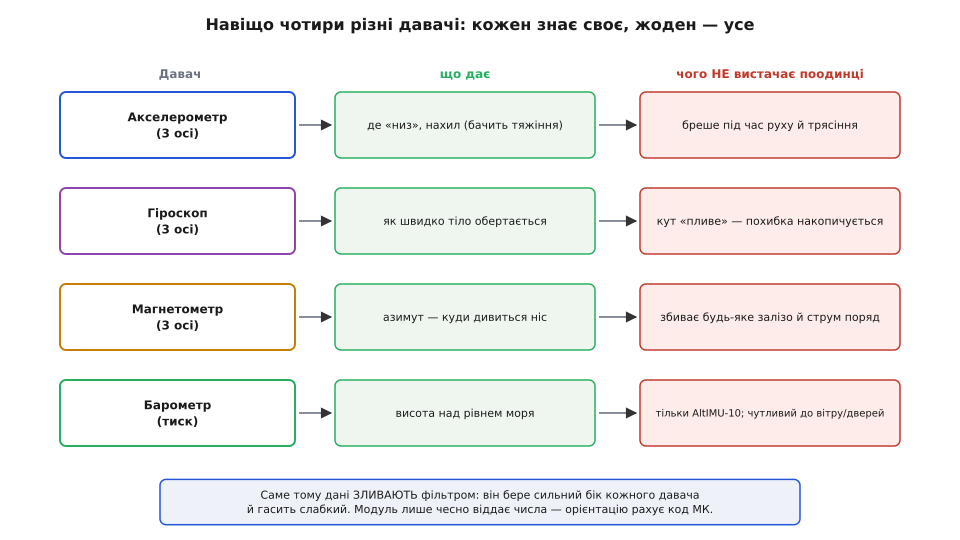
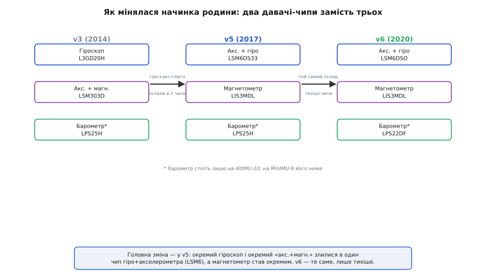
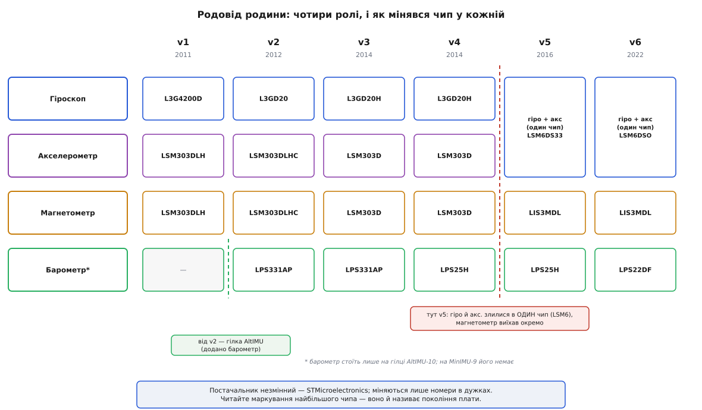

# Родина Pololu IMU (MinIMU-9 / AltIMU-10)

Серія модулів Pololu MinIMU-9 та AltIMU-10 є еталонною родиною компактних плат-носіїв (Carrier Boards) для високопродуктивних інерційних давачів компанії STMicroelectronics. Замість розрізненого набору плат, Pololu реалізує уніфіковану концепцію: найкращі сучасні мікросхеми орієнтації інтегруються на єдиний стандартний формфактор з вбудованим стабілізатором напруги, перетворювачами рівнів та спільним розташуванням контактів.

## 1. Концепція уніфікованої плати-носія

Сучасні інерційні мікросхеми випускаються у мініатюрних корпусах поверхневого монтажу (LGA з кроком контактів 0.5 мм), живляться суворо від напруги 3.3 В і не витримують 5-вольтових сигналів. Компанія Pololu розв'язує цю проблему створенням надійних плат-носіїв:

Спільна анатомія плат усієї родини включає:
- **Уніфікований роз'єм з кроком 2.54 мм:** модуль легко встановлюється на безпайкові макетні плати або з'єднується стандартними шлейфами.
- **Вбудований лінійний стабілізатор 3.3 В (LDO):** приймає вхідну напругу від 2.5 В до 5.5 В на контакт VIN, гарантуючи безпечне живлення кремнієвих кристалів.
- **Двонапрямні зсувачі логічних рівнів шини I2C:** лінії SCL та SDA безпечно транслюють сигнальні рівні відповідно до напруги живлення мікроконтролера (будь то класичний 5 В AVR чи 3.3 В STM32/ESP32).
- **Спільна шина та вивід вибору адреси SA0:** зміщує внутрішні адреси мікросхем на запасні, дозволяючи підключати два однакових модулі до однієї фізичної шини I2C.

## 2. Дві функціональні гілки: MinIMU-9 проти AltIMU-10

Родина чітко розділена на дві спеціалізовані гілки залежно від вимог цільової системи до вимірювання вертикальної координати:

- **MinIMU-9 (9 DoF — 9 ступенів вільності):** об'єднує 3 осі акселерометра, 3 осі гіроскопа та 3 осі магнітного поля. Цей набір забезпечує повне просторове відстеження поворотів: нахилу (крен та тангаж) і абсолютного компасного курсу (азимут). Ідеально підходить для колісних та крокуючих роботів, трекерів рухів голови (VR) та стабілізаторів камер.
- **AltIMU-10 (10 DoF — 10 ступенів вільності):** містить усі компоненти MinIMU-9 і додатково несе високоточний цифровий барометричний датчик тиску (альтиметр). Барометр дозволяє визначати абсолютну барометричну висоту та вертикальну швидкість (варіометр). Ця плата є базовим вибором для мультикоптерів, літаків та ракетних моделей, де необхідно утримувати висоту польоту.

## 3. Еволюція кремнієвої начинки STMicroelectronics (v1–v6)

За роки розвитку лінійки фірма Pololu послідовно оновлювала кремнієве серце модулів у міру виходу нових поколінь MEMS-чіпів ST:

- **v1 та v2 (2011–2012):** використовували роздільну конфігурацію: окремий тривісний гіроскоп (L3G4200D у v1, L3GD20 у v2) та комбінований компас «акселерометр + магнетометр» LSM303.
- **v3 та v4 (2014–2015):** оновлення до малошумних чипів L3GD20H та однокристального компаса LSM303D. У версії AltIMU-10 v4 встановлено точніший барометр LPS25H.
- **v5 (2016):** революційна зміна внутрішньої компоновки: гіроскоп об'єднали з акселерометром в один комбінований чип **LSM6DS33**, а магнетометр виділили в окремий кристал **LIS3MDL**. Барометр оновили до LPS25HB.
- **v6 (сучасне покоління):** перехід на флагманські малошумні чипи з ультранизьким дрейфом нуля — 6-осьовий IMU **LSM6DSO**, магнетометр **LIS3MDL** та барометр **LPS22DF**.

## 4. Хронологія розвитку та спадкоємність коду

Зміна чипів у кожному поколінні вимагала адаптації адрес I2C та бітових регістрів конфігурації.

Спадкоємність програмного забезпечення забезпечується фірмовими бібліотеками Pololu для Arduino та MicroPython:
- Для поколінь v5/v6 використовуються бібліотеки `LSM6` (або `LSM6DSO` для v6), `LIS3MDL` та `LPS`.
- Бібліотека злиття сенсорів `MinIMU9AHRS` використовує алгоритми фільтрації Маджвіка та Махоні, автоматично абстрагуючи різницю в шкалах і чутливості між різними поколіннями плат.

## 5. Практичні рекомендації щодо вибору та застосування

При проектуванні пристрою вибір конкретного модуля визначається наступними факторами:

1. **Потреба у висоті:** якщо проект не літає (наземний робот, ручний маніпулятор, стабілізатор підвісу камери), додатковий барометр не потрібен — раціонально обирати компактніший та дешевший модуль **MinIMU-9**.
2. **Авіоніка та БПЛА:** для дронів критично важлива зміна висоти з точністю до десятків сантиметрів, тому обов'язковим є вибір **AltIMU-10**.
3. **Вибір покоління (v5 проти v6):** якщо проект розробляється з нуля, обирають актуальну версію v6 на базі LSM6DSO завдяки суттєво меншому температурному дрейфу гіроскопа та підтримці швидкісних режимів I2C і I3C.
4. **Захист від магнітних завад:** при монтажі будь-якого модуля родини поруч із силовими проводами акумуляторів або безколекторними моторами необхідно виносити плату на немагнітній стійці мінімум на 5–10 см для запобігання спотворенню показань компаса.
