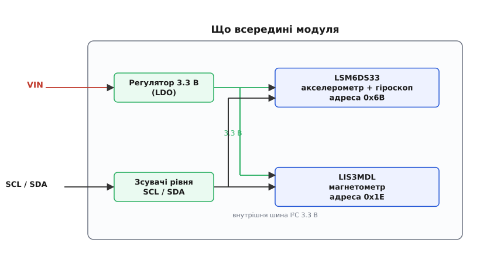
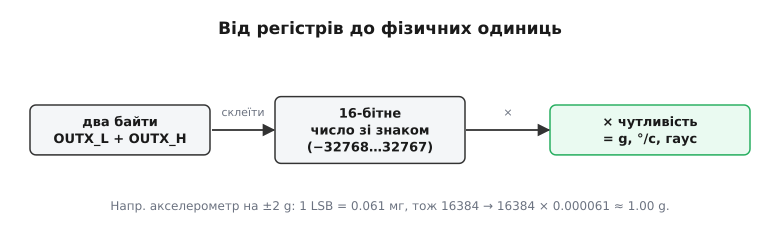
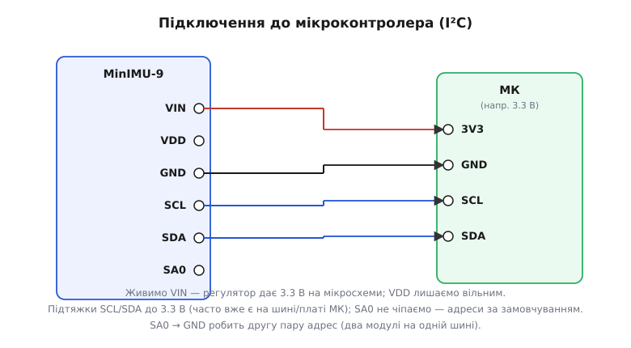

# Pololu IMU (LSM6DS33 / MinIMU-9)

Модуль Pololu MinIMU-9 v5 — це компактний та високоточний інерційний блок вимірювання просторової орієнтації (IMU) з 9 ступенями вільності (9 DoF — Degrees of Freedom). Плата поєднує 6-осьовий комбінований сенсор LSM6DS33 (3-осьовий акселерометр + 3-осьовий гіроскоп) та 3-осьовий магнетометр LIS3MDL від компанії STMicroelectronics, забезпечуючи повне визначення положення об'єкта в просторі: нахилу, кутової швидкості та азимута відносно магнітної півночі.

## 1. Архітектура 9 DoF та переваги модуля Pololu

Класичні 6-осьові системи (акселерометр та гіроскоп) здатні надійно відстежувати лише два кути нахилу: тангаж (Pitch) та крен (Roll). Вони не можуть визначити абсолютний кут повороту навколо вертикальної осі (Yaw / Heading), оскільки вектор земного тяжіння спрямований суворо вниз і не має горизонтальної проєкції. Без додаткового орієнтира кут курсу неминуче спливає через дрейф інтегратора гіроскопа.

Модуль Pololu MinIMU-9 додає третій критично важливий компонент — магнетометр LIS3MDL, що вимірює вектор геомагнітного поля Землі та виконує роль цифрового компаса. Об'єднання дев'яти осей дозволяє:
- Отримувати абсолютний напрямок у просторі без накопичення дрейфу.
- Створювати повноцінні системи орієнтації та курсовказування (AHRS — Attitude and Heading Reference System).
- Забезпечувати надійну стабілізацію безпілотних літальних апаратів, роботів та стабілізаторів камер.

## 2. Функціональний розподіл сенсорів: LSM6DS33 та LIS3MDL

На платі встановлено дві незалежні мікросхеми виробництва STMicroelectronics, кожна з яких оптимізована під свої фізичні завдання:

1. **LSM6DS33 (6 осей руху):**
   - **Акселерометр:** міряє лінійне прискорення по осях X, Y, Z у діапазонах ±2, ±4, ±8, ±16 g. У стані спокою визначає вектор земної гравітації.
   - **Гіроскоп:** вимірює кутову швидкість обертання в діапазонах ±125, ±245, ±500, ±1000, ±2000 °/s. Забезпечує миттєву та гладку реакцію на динамічні повороти.
   - Мікросхема містить вбудований апаратний буфер FIFO ємністю 8 КБ та виділені блоки детектування вільного падіння, подвійного тапу та крокоміра.
2. **LIS3MDL (3 осі магнітного поля):**
   - Вимірює напруженість магнітного поля в діапазонах ±4, ±8, ±12, ±16 Гаус.
   - Визначає магнітний курс об'єкта, прив'язуючи систему координат до магнітних полюсів планети.

Обидва сенсори використовують прецизійні 16-бітні сигма-дельта АЦП та підтримують спільну внутрішню шину I2C.

## 3. Схема живлення та вбудовані перетворювачі рівнів

Оригінальні чіпи STMicroelectronics працюють від напруги 1.71–3.6 В і виходять з ладу при прямому контакті з 5-вольтовими сигналами. Компанія Pololu інтегрувала на плату спеціальні схеми узгодження, що роблять модуль повністю сумісним як з 3.3 В, так і з 5 В мікроконтролерами.

Схемотехніка носія Pololu включає:
- **Лінійний стабілізатор 3.3 В (LDO):** приймає вхідну напругу живлення від 2.5 В до 5.5 В на контакт VIN та видає стабільні 3.3 В для живлення сенсорів (струм до 150 мА).
- **Двонапрямні зсувачі логічних рівнів (Level Shifters):** польові MOSFET-транзистори на лініях SCL та SDA транслюють напругу шини відповідно до вхідної напруги на VIN. Якщо VIN підключено до 5 В, лінії I2C безпечно працюють з 5-вольтовою логікою Arduino AVR; якщо VIN підключено до 3.3 В — з STM32 або ESP32.
- **Захисний контакт VDD:** дозволяє подавати вже стабілізовані 3.3 В безпосередньо в обхід вбудованого LDO в ультранизькоспоживаючих батарейних пристроях.

## 4. Підключення модуля та адреси шини I2C

Плата Pololu MinIMU-9 має компактний ряд контактних майданчиків з кроком 2.54 мм, що дозволяє легко встановлювати її на безпайкові макетні плати.

Призначення виводів:
- **VIN:** вхід живлення (від 2.5 В до 5.5 В).
- **GND:** спільна земля системи.
- **SCL / SDA:** лінії синхронізації та даних шини I2C з апаратними зсувачами рівня.
- **SA0:** контакт вибору молодшого біта адреси I2C.
  - За замовчуванням (SA0 не підключено або підтягнуто до 3.3 В): LSM6DS33 має адресу `0x6B`, LIS3MDL має адресу `0x1E`.
  - При замиканні SA0 на GND: адреси перемикаються на `0x6A` (LSM6DS33) та `0x1C` (LIS3MDL).
  - *Увага:* пін SA0 живиться від внутрішньої шини 3.3 В і не має зсувача рівня; подача на нього напруги 5 В заборонена!

## 5. Обробка сирих даних та калібрування компаса

Обидва чіпи видають дані у форматі 16-бітних двійкових чисел із доповняльним кодом (тип `int16_t` у C/C++). Отримані відліки множаться на чутливість обраного діапазону:
- Для акселерометра при шкалі ±2 g коефіцієнт становить `0.061 мг/LSB`.
- Для гіроскопа при шкалі ±245 °/s коефіцієнт становить `8.75 м°/с/LSB`.
- Для магнетометра при шкалі ±4 Гаус коефіцієнт становить `0.14 мГаус/LSB`.

Для точної роботи магнетометра критично важливе **калібрування спотворень магнітного поля**:
1. **Hard Iron (постійні магніти та намагнічені гвинти поряд):** створюють постійне зміщення сфери показань. Усувається знаходженням зміщення нуля по осях `(max + min) / 2`.
2. **Soft Iron (феромагнітні метали, що викривляють лінії поля):** перетворюють сферу вимірювань на еліпсоїд. Усувається масштабуванням напівосей.

Після програмного калібрування бібліотеки злиття сенсорів (наприклад, фільтр Маджвіка або фільтр Махоні) об'єднують усі 9 осей у стабільний кватерніон просторової орієнтації, забезпечуючи точну навігацію без затримок та дрейфу.
