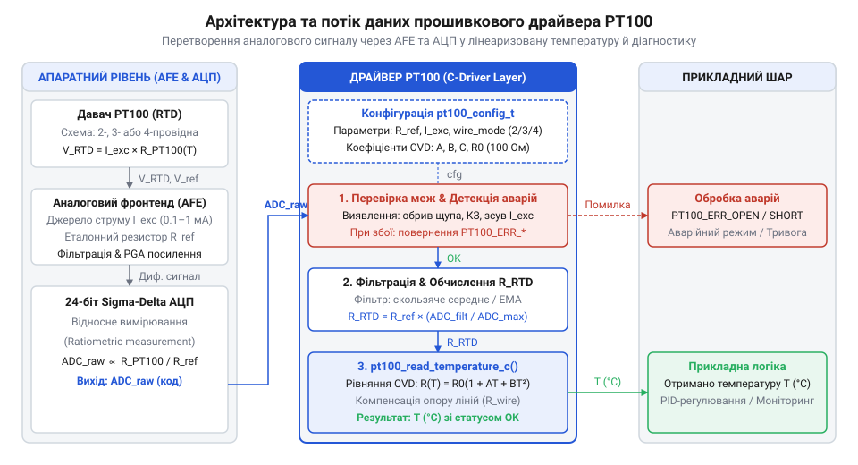
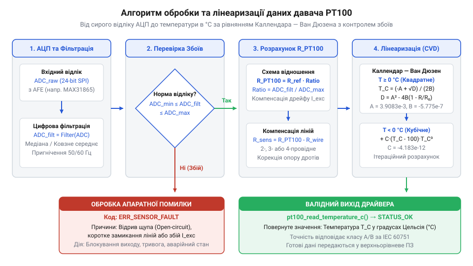

# Програмний інтерфейс драйвера зчитування та лінеаризації даних PT100

## Проблема вимірювання та архітектура драйвера

Вимірювання температури у промислових та відповідальних мікроконтролерних системах за допомогою платинового термоопору @@en|PT100@@ (англ. @@en|RTD@@, від @@en|Resistance Temperature Detector@@, від *resist* — чинити опір, *temperature* — температура та *detect* — виявляти) натрапляє на серйозні фізичні обмеження. На відміну від [цифрових давачів DS18B20](root:cat-hw-sensors/ds18b20) чи [аналогових датчиків LM35DZ](root:cat-hw-sensors/lm35), які видають готовий цифровий код або напругу з високим рівнем сигналу, платиновий сенсор змінює свій опір всього на `0.385` Ом при зміні температури на 1 °C. Базовий опір при 0 °C становить строго 100 Ом. Через це навіть мізерний опір з'єднувальних мідних дротів у `1` Ом створює систематичну похибку вимірювання понад `2.6` °C. Крім того, проходження струму через сенсор зумовлює @@en|самонагрів@@ (англ. @@en|self-heating@@), а залежність опору від температури є нелінійною.

Для компенсації цих спотворень у мікроконтролерних пристроях застосовують спеціалізований аналоговий фронтенд @@en|AFE@@ (англ. @@en|Analog Front-End@@, від *analog* — аналоговий та *front-end* — передня межа), такий як [перетворювач MAX31865](root:cat-hw-sensors/max31865-rtd-converter), разом із розширеним аналогово-цифровим перетворювачем @@en|АЦП@@ (англ. @@en|ADC@@, від @@en|Analog-to-Digital Converter@@, від *analog* — аналоговий, *digital* — цифровий та *convert* — перетворювати). Прошивковий драйвер виступає проміжним містком між цим апаратним забезпеченням та прикладною логікою програми.


*Схема проходження даних від аналогового термодатчика PT100 через AFE та АЦП до прошивкового драйвера і прикладної логіки.*

Архітектура драйвера розділена на два чіткі рівні з суворим розмежуванням відповідальності. Нижній рівень формує шар апаратного абстрагування @@en|HAL@@ (англ. @@en|Hardware Abstraction Layer@@, від *hardware* — апаратне забезпечення, *abstraction* — абстракція та *layer* — шар) і абстрагує апаратний шинний інтерфейс @@en|SPI@@ (англ. @@en|Serial Peripheral Interface@@, від *serial* — послідовний, *peripheral* — периферійний, *interface* — інтерфейс) або @@en|I2C@@ (англ. @@en|Inter-Integrated Circuit@@, від *inter* — між та *integrated circuit* — інтегральна схема). Для ізоляції драйвера від конкретної периферії мікроконтролера цей шар використовує конфігураційну структуру з вказівниками на функції читання та запису сирих регістрів @@en|AFE@@. Нижній шар відповідає виключно за надійність шинних транзакцій і передачу байтів, не володіючи жодною інформацією про фізичні параметри сенсора. Верхній рівень приймає перевірені відліки і відповідає за первинне фільтрування цифрових даних, обчислення фактичного опору давача відносно еталонного резистора та його лінеаризацію за рівнянням @@en|Каллендара — Ван Дюзена@@ (англ. @@en|Callendar–Van Dusen equation@@). Опосередковане звернення до шини через вказівники створює незначні накладні витрати процесорного часу на виклики функцій, що є некритичним для низькочастотних вимірювань. Основний ризик такої схеми полягає у непоміченій втраті шинної помилки: при поверненні сміттєвого байта замість коду збою математичний шар обчислює хибну температуру за валідну. Завдяки такій структурі прикладний код отримує градуси Цельсія без необхідності вручну враховувати апаратні деталі обв'язки.

## Конфігурація апаратної обв'язки та параметрів

Точність перетворення опору в температуру безпосередньо залежить від правильного опису фізичного підключення сенсора в коді. Оскільки спотворення виникають ще в кабельно-провідниковій лінії, драйвер має знати схему з'єднання дротів та параметри вимірювального кола.

Для цього використовується структура конфігурації `pt100_config_t`. Вона задає схему підключення через перелічення `pt100_wire_mode_t`: 2-провідну (@@en|2-wire@@), 3-провідну (@@en|3-wire@@) або 4-провідну (@@en|4-wire@@). У 2-провідній схемі опір дротів додається до опору сенсора. У 3-провідній схемі драйвер та @@en|AFE@@ використовують два узгоджені джерела струму `I₁` та `I₂` для математичного віднімання падіння напруги на лініях зв'язку. Перший струм `I₁` проходить через перший дріт із опором `R_line1` та сенсор з опором `R_pt100`, створюючи спад напруги `V₁ = I₁ × (R_pt100 + R_line1)`, а другий струм `I₂` протікає через другий дріт з опором `R_line2` до спільної точки, формуючи спад напруги `V₂ = I₂ × R_line2`. Різниця між цими виміряними напругами `V_diff = V₁ - V₂ = I₁ × R_pt100 + I₁ × R_line1 - I₂ × R_line2` за умови однакового опору ліній (`R_line1 = R_line2 = R_line`) та рівних струмів (`I₁ = I₂ = I`) взаємознищує паразитний доданок `I × R_line`, залишаючи чистий сигнал `I × R_pt100`. Проте за наявності залишкової неузгодженості (англ. @@en|mismatch@@, від *mis-* — хибний та *match* — збіг) джерел струму `ΔI = I₁ - I₂` виникає некомпенсована напруга похибки `ΔV = ΔI × R_line`, що перераховується у хибний опір `ΔR = (ΔI ÷ I) × R_line` та спотворює виміряну температуру. У 4-провідній схемі (підключення @@en|Кельвіна@@, англ. @@en|Kelvin connection@@) струм збудження подається окремою парою дротів, а вимірювання напруги здійснюється іншою парою з високим вхідним опором, що повністю виключає вплив опору ліній.

Структура конфігурації також визначає номінал еталонного резистора `r_ref_ohms` (типово 400 Ом або 4000 Ом з точністю 0.1%), вибір струму збудження `excitation_current_ua` (наприклад, 250 мкА для мінімізації @@en|самонагріву@@), базовий опір `r_0_ohms` (100.0 Ом) та коефіцієнти лінеаризації.

Нижче наведено визначення конфігураційних структур драйвера:

:::tabs
@tab C
:::code api-pt100-driver-firmware-api/c/snippet-1.c
@tab C++
:::code api-pt100-driver-firmware-api/cpp/pt100wiremode.cpp
:::

Правильне заповнення полів конфігурації гарантує, що драйвер розраховуватиме відношення напруг та лінійну компенсацію строго під наявну фізичну обв'язку плати.

## Ініціалізація аналогового фронтенду та АЦП

Перед початком вимірювань прошивковий драйвер має перевірити цілісність апаратних зв'язків та завантажити налаштування в регістри аналогового фронтенду. Цю задачу виконує функція ініціалізації `pt100_init()`.

Під час виклику `pt100_init()` драйвер виконує наступну послідовність дій:
1. Запитує ідентифікаційний регістр чипа @@en|AFE@@ через шину @@en|SPI@@ або @@en|I2C@@ для підтвердження наявності мікросхеми.
2. Подає команду програмного скидання (@@en|software reset@@) для переведення регістрів @@en|АЦП@@ у початковий відомий стан.
3. Записує значення конфігурації: вмикає внутрішнє джерело струму збудження відповідного номіналу, обирає вхідні аналогові канали згідно з вибраною 2-, 3- чи 4-провідною схемою та налаштовує режекторний фільтр мережевих завад (50 Гц або 60 Гц).
4. Перевіряє відсутність прапорців апаратних збоїв у статусних регістрах.

Нижче наведено приклад виклику та реалізації процедури ініціалізації:

:::tabs
@tab C
:::code api-pt100-driver-firmware-api/c/pt100-init.c
@tab C++
:::code api-pt100-driver-firmware-api/cpp/pt100driver.cpp
:::

У разі успішного повернення коду `PT100_OK` мікроконтролер гарантує, що @@en|AFE@@ налаштовано, струм збудження подано і АЦП готовий до регулярного зчитування відліків.

## Зчитування та лінеаризація за Каллендаром

Отримання точно визначеної температури з платинового давача відбувається за допомогою регулярного виклику функції `pt100_read_temperature_c()`. Процес обчислення складається з трьох послідовних етапів: ратіометричного визначення опору, цифрової фільтрації та поліноміальної лінеаризації.


*Блок-схема алгоритму зчитування сирих кодів АЦП, їх первинної фільтрації та математичного розрахунку температури за рівнянням Каллендара — Ван Дюзена.*

Першим кроком є @@en|ратіометричне вимірювання@@ (англ. @@en|ratiometric measurement@@, від лат. *ratio* — відношення та грец. *metreo* — вимірюю). Оскільки струм збудження протікає послідовно через сенсор @@en|PT100@@ та еталонний резистор `R_ref`, вихідний код @@en|АЦП@@ визначається співвідношенням їхніх опорів і не залежить від точної величини або дрейфу струму.

Визначення опору датчика `R_rtd` із сирого коду АЦП `Code_adc` для 24-бітного перетворювача виконується за формулою:

```
R_rtd = R_ref × (Code_adc ÷ (2²³ - 1))
= 400.0 × (2097152 ÷ 8388607)    [обчислення при Code_adc = 2097152 та R_ref = 400 Ом]
= 100.0                          [отриманий опір сенсора в Ом]
```

Отримане значення `R_rtd` пропускається через @@en|цифровий експоненційний нижньочастотний фільтр@@ (англ. @@en|exponential low-pass filter@@, від лат. *exponere* — виставляти та *filtrum* — повсть) `S_k = α × R_rtd + (1 - α) × S_{k-1}` для приглушення високочастотних завад і шуму @@en|АЦП@@. У цій формулі символ `S_k` означає відфільтрований опір на поточному кроці `k`, `S_{k-1}` — збережений стан фільтра з попереднього вимірювання `k - 1`, а `R_rtd` — сире значення опору сенсора @@en|PT100@@. Параметр `α` визначає @@en|коефіцієнт згладжування@@ (англ. @@en|smoothing factor@@) `filter_alpha` у діапазоні `0 < α ≤ 1`. Зменшення `α` (наприклад, до `0.1` або ступеня двійки `1 ÷ 8 = 0.125` для швидкого бітового зсуву) сильніше приглушує випадкові сплески напруги, але створює @@en|фазовий зсув@@ (англ. @@en|phase shift@@, від грец. *phasis* — поява) і затримує реакцію драйвера на стрімку зміну температури. Після фільтрації опір `S_k` перетворюється на температуру, але для від'ємних температур (`t < 0 °C`) рівняння Каллендара — Ван Дюзена стає поліномом четвертого степеня `R(t) = R_0 × (1 + A × t + B × t² + C × (t - 100) × t³)`, чий аналітичний розв'язок занадто громіздкий для обчислення на мікроконтролері. Для швидкого розв'язку рівняння `f(t) = R_0 × (1 + A × t + B × t² + C × (t - 100) × t³) - S_k = 0` застосовують чисельний @@en|метод Ньютона — Рафсона@@ (англ. @@en|Newton–Raphson method@@). Нове наближення температури `t_{n+1}` обчислюють із попереднього значення `t_n` за відношенням функції до її похідної.

```
t_{n+1} = t_n - (f(t_n) ÷ f'(t_n))
= t_n - ((R_0 × (1 + A × t_n + B × t_n² + C × (t_n - 100) × t_n³) - S_k) ÷ (R_0 × (A + 2 × B × t_n - 300 × C × t_n² + 4 × C × t_n³)))    [ітерація методом Ньютона — Рафсона]
```

Тут `f(t_n)` показує різницю між розрахованим і відфільтрованим опором `S_k`, а `f'(t_n)` є @@en|похідна@@ (англ. @@en|derivative@@, від лат. *derivativus* — відведений) функції опору за температурою. За початкове наближення `t_0` беруть значення температури з квадратичної формули, після чого виконують послідовні @@en|ітерації@@ (англ. @@en|iteration@@, від лат. *iteratio* — повторення) до досягнення умови `|t_{n+1} - t_n| < ε` з точністю `ε = 0.001 °C`, що завдяки квадратичній швидкості збіжності методу потребує лише 2–3 кроків.

Наступним кроком відфільтроване значення опору перетворюється в температуру `t` у °C за рівнянням Каллендара — Ван Дюзена. Для додатних температур (t ≥ 0 °C) залежність описується квадратним рівнянням `R(t) = R_0 × (1 + A × t + B × t²)`, де `A = 3.9083 × 10⁻³`, `B = -5.775 × 10⁻⁷`.

Розв'язок цього квадратного рівняння відносно `t` здійснюється за формулою:

```
t = (-A + √(A² - 4 × B × (1 - R_rtd ÷ R_0))) ÷ (2 × B)
= (-3.9083×10⁻³ + √((3.9083×10⁻³)² - 4 × (-5.775×10⁻⁷) × (1 - 100.0 ÷ 100.0))) ÷ (2 × (-5.775×10⁻⁷))    [підстановка R_rtd = 100 Ом]
= 0.0                                                                                                     [значення температури в °C]
```

Для від'ємних температур (t < 0 °C) у рівняння додається член четвертого степеня `C × (t - 100) × t³` (де `C = -4.183 × 10⁻¹²`), і розрахунок виконується поліноміальним наближенням або кількома ітераціями методу @@en|Ньютона — Рафсона@@ (англ. @@en|Newton–Raphson method@@).

## Обробка помилок та апаратний захист

У промислових умовах вимірювальна лінія піддається механічним навантаженням, вібраціям та температурним розширенням, що може призвести до апаратних збоїв. Надійний прошивковий драйвер повинен постійно діагностувати стан вимірювального кола та повертати специфічні коди помилок.

Драйвер аналізує обчислений опір та статусні регістри @@en|AFE@@ для виявлення таких аварійних ситуацій:
- **Відрив щупа або лінії** (`PT100_ERR_OPEN_CIRCUIT`): виникає при механічному обриві дротів. Опір `R_rtd` прямує до нескінченності, а код @@en|АЦП@@ досягає верхнього порогу насичення.
- **Коротке замикання лінії** (`PT100_ERR_SHORT_CIRCUIT`): виникає при замиканні жил кабелю між собою. Опір падає нижче фізичного мінімуму (наприклад, менше 18 Ом, що відповідає нижче -200 °C).
- **Збій джерела струму** (`PT100_ERR_EXCITATION_FAULT`): вихід напруги генератора струму за допустимий діапазон комплаєнсу (@@en|compliance voltage@@).
- **Вихід температури за межі** (`PT100_ERR_OUT_OF_RANGE`): розраховане значення вийшло за стандартний діапазон від -200 °C до +850 °C.

Нижче наведено приклад виклику вимірювання із безпечною обробкою помилок:

:::tabs
@tab C
:::code api-pt100-driver-firmware-api/c/pt100-read-temperature-c.c
@tab C++
:::code api-pt100-driver-firmware-api/cpp/snippet-6.cpp
:::

Реакція системи на коди помилок передбачає переведення виконавчих механізмів (наприклад, нагрівачів) у безпечний вимкнений стан та відключення струму збудження для запобігання пошкодженню мікросхеми.
