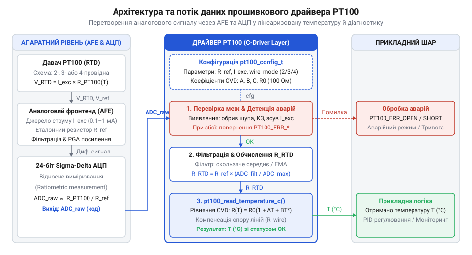
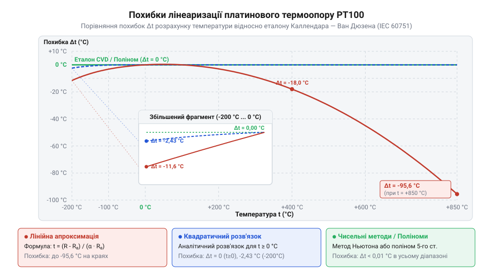

# Програмний інтерфейс драйвера зчитування та лінеаризації PT100

<preknowlist>
- [KY-013 — аналоговий давач температури (термістор)](root:cat-hw-sensors/ky-013-thermistor) — Принципи перетворення зміни опору термочутливого елемента у напругу та оцифрування її аналогово-цифровим перетворювачем.
</preknowlist>

## Небезпека лінійного вимірювання опору PT100

Підключення платинового терморезистора `@@en|PT100@@` (англ. @@en|Resistance Temperature Detector@@, `@@en|RTD@@`) до мікроконтролера вимагає врахування фізичних властивостей матеріалу. На відміну від [аналогових терморезисторів](root:cat-hw-sensors/ky-013-thermistor), опір `@@en|PT100@@` за температури 0 °C становить точно 100 Ом, а його температурний коефіцієнт становить приблизно 0.385 Ом/°C. Якщо розробник спрощує обчислення й застосовує лінійну формулу перетворення значень аналогово-цифрового перетворювача (`@@en|АЦП@@`) у температуру, це призводить до значних похибок у вимірювальному тракті.

Нелінійність платини описується зміною крутизни характеристичної кривої: за високих температур опір зростає повільніше, ніж за низьких.

Приклад обчислення похибки лінійного наближення:
**Умова:** За температури 200 °C реальний опір `@@en|PT100@@` становить 175.86 Ом. Лінійна модель припускає приріст 0.385 Ом на кожен градус Цельсія від 100 Ом.

```
T_lin = (R - 100) ÷ 0.385
      = (175.86 - 100) ÷ 0.385    [підстановка реального опору 175.86 Ом]
      = 75.86 ÷ 0.385              [обчислення різниці опору]
      = 197.04 °C                  [розрахунок лінійної температури]
```

Похибка вимірювання становить:

```
ΔT = 200 - 197.04
   = 2.96 °C                       [абсолютне відхилення від реальної температури]
```

Другим джерелом системної похибки є паразитний опір з'єднувальних дротів. Будь-який металевий провідник володіє власним питомим опором, тому довгі з'єднувальні лінії послідовно додають свій опір до вимірювального елемента. За двопровідного підключення виникає ключове схемне обмеження: та сама пара дротів одночасно подає струм збудження на `@@en|PT100@@` і знімає з нього вимірювану напругу. Спад напруги утворюється не лише на платиновій спіралі, а й уздовж всієї довжини провідників. Наприклад, пара мідних дротів завдовжки 10 метрів додає до вимірювального кола додатково близько 1.5 Ом. Оскільки `@@en|АЦП@@` зчитує сумарний спад напруги з усієї лінії, лінійна система сприймає цей додатковий опір як підвищення температури на майже +4 °C. Ситуація ускладнюється тим, що цей паразитний опір не є постійною величиною: метал дротів змінює свій опір під впливом коливань температури довкілля вздовж всієї траси. Що довша вимірювальна лінія, то більший її початковий опір і то сильнішою є абсолютна варіація цього опору при зміні зовнішньої температури. Внаслідок цього похибка вимірювання динамічно плаває разом із погодними чи технологічними умовами навколо кабелю, тому її неможливо відкоригувати простим відніманням фіксованого значення в програмі.

Для усунення цих похибок виникає потреба в розробці програмного драйвера. Програмний інтерфейс драйвера повинен гнучко адаптуватися під апаратну схему підключення та виконувати нелінійне математичне коригування даних.

## Апаратна конфігурація вимірювального каналу PT100

Апаратний тракт зчитування `@@en|PT100@@` може використовувати двопровідну, трипровідну або чотирипровідну схему включення, а також різні величини струму збудження для запобігання самонагріванню елемента. Щоб уніфікувати налаштування вимірювального каналу, драйвер надає конфігураційну структуру `@@en|pt100_config_t@@`.


*Схема структури pt100_config_t та її зв'язок із вимірювальним трактом.*

Структура `@@en|pt100_config_t@@` містить поля для вибору схеми підключення, розрядності `@@en|АЦП@@`, величини опорного резистора та класу точності давача (наприклад, `@@en|Class A@@` або `@@en|Class B@@`). На основі цих параметрів функція `@@en|pt100_init@@` здійснює перевірку вихідних даних і налаштовує канальний драйвер.

:::tabs
:::code api-pt100-driver-interface/c/esp-idf/pt100-init.c
:::code api-pt100-driver-interface/cpp/arduino/pt100wiremode.cpp
:::

Передані параметри конфігурації визначають, який саме алгоритм обробки первинних даних буде застосовано на етапі зчитування.

Проходження вимірювального струму через платиновий елемент @@en|PT100@@ генерує теплову потужність і нагріває давач вище температури вимірюваного середовища. Цей ефект самонагрівання створює систематичну похибку, тому струм збудження обмежують малим значенням — зазвичай у межах від 100 до 500 мкА. Зменшення струму мінімізує теплове спотворення, але знижує амплітуду сигнальної напруги на вході @@en|АЦП@@. Параметр класу точності визначає допустиме заводське відхилення опору від номіналу: @@en|Class A@@ забезпечує вужчу похибку (±0.15 °C при 0 °C) для прецизійних задач, тоді як @@en|Class B@@ має ширший допуск (±0.30 °C при 0 °C) для загального промислового моніторингу. Зазначений у конфігурації клас дозволяє драйверу розраховувати граничну невизначеність вимірювання та розпізнавати допустимі межі відхилень.

## Зчитування оцифрованих даних та опору

Для вимірювального каналу драйвер виконує зчитування первинних аналогових даних за допомогою двох основних функцій: `@@en|pt100_read_raw@@` та `@@en|pt100_read_resistance@@`. Функція `@@en|pt100_read_raw@@` запитує сирий цифровий код безпосередньо з `@@en|АЦП@@`.

Отриманий оцифрований код перетворюється у фактичний опір терморезистора з урахуванням вимірювального опорного резистора та роздільної здатності `@@en|АЦП@@`:

```
R_rtd = (ADC_code ÷ ADC_max) × R_ref
      = (ADC_code ÷ (2ⁿ - 1)) × R_ref    [формула перетворення коду АЦП у опір]
```

де `ADC_code` — зчитане значення з регістра `@@en|АЦП@@`, `n` — кількість бітів розрядності, a `R_ref` — відомий опорний опір вимірювального містка чи логометричної схеми. АЦП@@ | Принципи побудови та розрахунку моста Уітстона для давачів детально розкрито у матеріалі про [мостові вимірювальні схеми для терморезисторів](root:hw-sensing/rtd-bridge-amplifier).

У разі використання трипровідної схеми драйвер додатково зчитує опір третього компенсаційного провідника та віднімає його від загального виміряного опору. Для апаратного вимірювання цього значення аналогова периферія @@en|АЦП@@ за допомогою @@en|мультиплексора@@ (з @@la|multiplex@@ — багаторазовий) перемикає вимірювальні входи на третій провідник або пропускає через нього узгоджений струм збудження й оцифровує спад напруги. Таке зчитування спирається на @@en|симетрію@@ (з @@gr|συμμετρία@@ — сорозмірність) ліній зв'язку: всі три провідники повинні мати однакові матеріал, переріз, довжину та тотожні температурні умови вздовж лінії. Якщо симетрію порушено через різну довжину дротів, температурний градієнт чи дефект контакту, опір компенсаційного провідника відрізняється від опору робочих дротів, і віднімання не усуває паразитної похибки повністю:

```
R_rtd_true = R_measured - R_line        [компенсація опору дротів у трипровідній схемі]
```

Результатом роботи функції `@@en|pt100_read_resistance@@` є обчислений точний опір у Омах, виражений числом із плаваючою крапкою. Отримане значення є очищеним від паразитного опору ліній і готовим для подальшої математичної лінеаризації.

## Математична лінеаризація та обчислення температури

Отримане значення сирого опору `@@en|PT100@@` необхідно перетворити у фактичну температуру. Для цього драйвер надає два методи лінеаризації: аналітичний розрахунок за `@@en|рівнянням Каллендара — Ван Дюзена@@` (англ. @@en|Callendar — Van Dusen equation@@, функція `@@en|pt100_process_cvd@@`) та швидкий пошук за `@@en|LOOKUP-таблицею@@` (англ. @@en|lookup table@@, таблиця пошуку, функція `@@en|pt100_process_lut@@`).


*Графік порівняння математичної моделі Каллендара — Ван Дюзена та табличного методу LOOKUP.*

Залежність опору від температури для діапазону від 0 °C до +850 °C описується рівнянням Каллендара — Ван Дюзена:

```
R(T) = R₀ × (1 + A × T + B × T²)        [рівняння Каллендара — Ван Дюзена для T ≥ 0 °C]
```

де `R₀` = 100 Ом, `A` = 3.9083 × 10⁻³ °C⁻¹, `B` = -5.775 × 10⁻⁷ °C⁻². Для від'ємних температур у діапазоні від -200 °C до 0 °C нелінійність опору платини зростає. Через це модель доповнюється членом четвертого ступеня з коефіцієнтом `C` = -4.183 × 10⁻¹² °C⁻⁴:

```
R(T) = R₀ × (1 + A × T + B × T² + C × (T - 100) × T³)    [рівняння Каллендара — Ван Дюзена для T < 0 °C]
```

Через наявність члена `T⁴` вираз втрачає квадратну форму і не має аналітичного розв'язку відносно температури `T`. Обчислення від'ємних температур вимагає чисельних методів або використання `@@en|LOOKUP-таблиць@@`. Для додатних температур член з `C` дорівнює нулю, і розв'язок квадратного рівняння відносно `T` має аналітичний вигляд:

```
T = (-A + √(A² - 4 × B × (1 - R(T) ÷ R₀))) ÷ (2 × B)    [розв'язок квадратного рівняння для T ≥ 0 °C]
```

Для додатних температур обчислення за цією формулою забезпечує високу точність. Проте виконання операції добування квадратного кореня потребує значних ресурсів процесора. Якщо мікроконтролер не має апаратного модуля вирахувань з плаваючою крапкою (`@@en|FPU@@`), доцільно використовувати функцію `@@en|pt100_process_lut@@`.

Метод `@@en|LOOKUP-таблиць@@` базується на таблиці із заздалегідь обчисленими вузлами опору та лінійній інтерполяції між двома сусідніми значеннями. Це дозволяє зменшити час виконання процедури у 5–10 разів із незначною втратою точності.

Обчислена температура передається на етап діагностичного контролю.

## Автокалібрування та діагностика позаштатних режимів

Остаточним етапом обробки даних у драйвері є компенсація системних зсувів вимірювального тракту та виявлення апаратних несправностей.

Функція автокалібрування `@@en|pt100_calibrate_zero@@` використовується під час ініціалізації або калібрування системи. Вона визначає початкове зміщення опору та зберігає його в пам'яті драйвера для автоматичного віднімання під час кожного зчитування.

Апаратна діагностика виконується функцією оцінки стану вимірювального каналу і виявляє такі аварійні ситуації:
1. **Обрив вимірювальної лінії (`@@en|PT100_ERR_OPEN_CIRCUIT@@`):** опір прямує до нескінченності, а код `@@en|АЦП@@` досягає максимального значення насичення.
2. **Коротке замикання (`@@en|PT100_ERR_SHORT_CIRCUIT@@`):** опір наближається до 0 Ом, а код `@@en|АЦП@@` падає до мінімуму.
3. **Вихід за межі діапазону (`@@en|PT100_ERR_OUT_OF_RANGE@@`):** розрахована температура виходить за межі робочого діапазону давача (від -200 °C до +850 °C).

:::tabs
:::code api-pt100-driver-interface/c/esp-idf/pt100-get-temperature.c
:::code api-pt100-driver-interface/cpp/arduino/pt100status.cpp
:::

Як і в [цифрових давачах температури](root:cat-hw-sensors/ds18b20), перевірка статусів помилок дозволяє захистити систему від прийняття хибних рішень у реальному часі.

Процес автокалібрування нульового зсуву усуває системну похибку аналогового тракту, коли через розкид параметрів підсилювача та власний опір провідників виміряний опір `@@en|PT100@@` при 0 °C відхиляється від номінальних 100.0 Ом. Оскільки зміщення всього на 0.385 Ом спричиняє похибку вимірювання температури в 1 °C, перед введенням системи в експлуатацію давач занурюють у танучу суміш води й льоду із температурою 0 °C або замінюють прецизійним еталонним (з @@fr|étalon@@ — зразок виміру) резистором на 100.0 Ом. Під час виклику `@@en|pt100_calibrate_zero@@` драйвер здійснює серію зчитань сирого опору через `@@en|pt100_read_resistance@@`, обчислює їхнє середнє значення `R_raw` і розраховує нульовий зсув `R_offset`:

```
R_offset = R_raw - 100.0    [обчислення системного зміщення відносно номіналу при 0 °C]
```

Знайдена величина записується у внутрішнє поле структури пристрою `dev->zero_offset` і може бути збережена в енергонезалежному сховищі `@@en|NVS@@` для відновлення після перезавантаження мікроконтролера.

Під час кожного робочого вимірювання у функції `@@en|pt100_get_temperature@@` збережене значення зсуву віднімається від оцифрованого опору перед обчисленням температури. Зчитаний сирий опір `R_raw` спочатку проходить діагностичну перевірку на обрив та коротке замикання, що дозволяє зафіксувати фізичні аварії лінії зв'язку без спотворення калібрувальними поправками. Після успішного контролю драйвер вираховує скориговане значення опору `R_corrected`:

```
R_corrected = R_raw - dev->zero_offset    [компенсація системного зсуву вимірювального тракту]
```

Саме скоригований опір `R_corrected` передається надалі у функцію лінеаризації за рівнянням Каллендара — Ван Дюзена. Такий порядок обробки гарантує, що лінеаризація оперує реальним опором платинової спіралі, звільненим від початкового зміщення аналогової обв'язки та `@@en|АЦП@@`.
