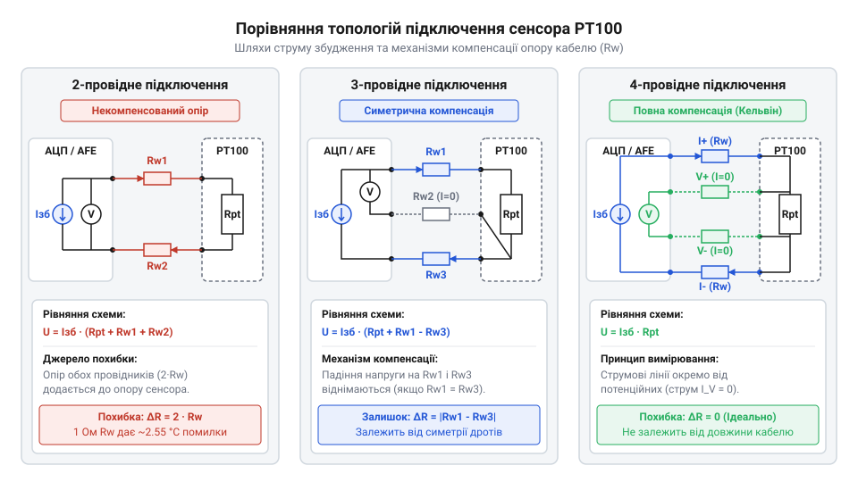
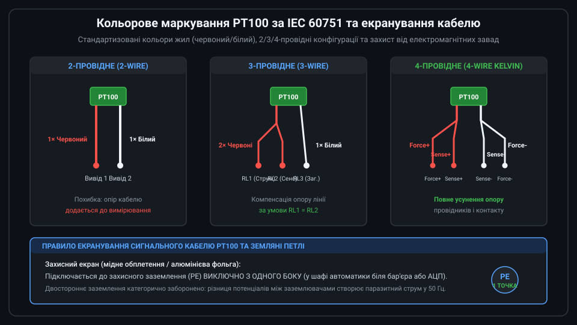

# Залізний інтерфейс, схемотехніка підключення та електричні межі PT100

<preknowlist>
- [KY-013 — аналоговий давач температури (термістор)](root:cat-hw-sensors/ky-013-thermistor) — базові принципи вимірювання температури через зміну електричного опору давача.
</preknowlist>

## Вплив опору дротів на точність

Коли вимірювальний модуль розташований на відстані кількох метрів від об'єкта, з'єднувальний кабель стає активним учасником електричного кола. В основі роботи платинового датчика опору @@en|RTD@@ (від англ. @@en|Resistance Temperature Detector@@ — вимірювач температури опором) типу @@en|PT100@@ (від англ. @@en|Platinum@@ — платина, з опором 100 Ом при 0 °C) лежить зміна опору платинової спіралі залежно від температури. Оскільки платина має високу стабільність, її опір змінюється строго за нормованою характеристикою із чутливістю близько 0.385 Ом/°C.

Проблема виникає через те, що мідні жили кабелю також мають власний електричний опір. На відміну від [аналогових напівпровідникових термісторів](root:cat-hw-sensors/ky-013-thermistor), де високий власний опір робить вплив кабелю непомітним, @@en|PT100@@ має опір лише 100 Ом при 0 °C. Загальний опір `R_meas`, який бачить вимірювальний прилад на кінцях двопровідного кабелю, дорівнює сумі власного опору платини `R_sensor` та опорів першого `R_wire1` і другого `R_wire2` з'єднувальних провідників. За умови одинакової довжини та перерізу дротів їхні опори рівні `R_wire1 = R_wire2 = R_wire`:

```
R_meas = R_sensor + R_wire1 + R_wire2
       = R_sensor + 2 · R_wire        [при рівності опорів провідників]
```

З виразу видно, що опір лінії додається до опору сенсора як постійне додаткове значення. Кожен Ом паразитного опору кабелю сприймається вимірювачем як підвищення температури платини на `1 ÷ 0.385 ≈ 2.6` °C.

**Обчислення похибки двопровідної лінії завдовжки 10 метрів при температурі 0 °C**

```
R_meas = 100.0 + 2 · 0.8
       = 101.6                         [сума номінального опору PT100 та двох дротів]

T_error = 1.6 ÷ 0.385
        = 4.156                        [ділення сумарного паразитного опору на чутливість]
```

Отримане значення показує, що без компенсації вимірювальна система покаже температуру 4.16 °C замість 0 °C. Якби цей опір залишався незмінним, його можна було б усунути одноразовим програмним відніманням сталого зсуву. Проблема ускладнюється тим, що мідні жили кабелю мають власний температурний коефіцієнт опору @@en|TCR@@ (від англ. @@en|Temperature Coefficient of Resistance@@ — температурний коефіцієнт опору), який для міді становить `α_Cu ≈ 0.00393` 1/°C, тобто опір міді зростає приблизно на 0.393% на кожен градус нагріву. При зміні температури навколишнього середовища на `ΔT` опір дротів лінії змінюється на додаткове значення `ΔR_wire`, що створює плаваючий температурний дрейф показів `ΔT_drift`.

**Розрахунок плаваючої похибки кабелю завдовжки 10 метрів при зміні температури довкілля на 40 °C**

```
ΔR_wire = 1.6 · 0.00393 · 40        [множення початкового опору дротів на температурний коефіцієнт міді та зміну температури]
        = 0.2515                    [додатковий паразитний опір кабелю при нагріві, Ом]

ΔT_drift = 0.2515 ÷ 0.385
         = 0.653                    [ділення додаткового опору кабелю на чутливість PT100, °C]
```

Як видно з розрахунку, зміна температури кабелю на 40 °C спричиняє додатковий плаваючий дрейф показів на 0.653 °C. Оскільки температура довкілля коливається впродовж доби та сезонів, цю похибку неможливо компенсувати статичним калібруванням. Це робить компенсацію опору ліній обов'язковою умовою точних вимірювань.

## Двопровідна, трипровідна й чотирипровідна схеми

Для подолання впливу опору з'єднувальних дротів використовують три класичні топології підключення сенсора @@en|PT100@@.


*Схемотехніка підключення PT100: двопровідна схема накопичує опір ліній, трипровідна компенсує однакові провідники, а чотирипровідна повністю виключає опір дротів завдяки вимірюванню напруги безструмовим колом.*

Двопровідна схема є найпростішою, але вона не має механізму компенсації. Вона застосовується виключно тоді, коли кабель має довжину до 0,5 метра або вимоги до точності вимірювання не перевищують 2–3 °C.

Трипровідна схема використовує третій провідник як сигнальний потенціальний вивід для вирахування й компенсації падіння напруги на з'єднувальних дротах. При використанні симетричного кабелю вимірювальна схема мосту @@en|Wheatstone bridge@@ (міст Вітстона, на честь науковця Чарльза Вітстона) або схемотехніка з @@en|dual current source@@ (подвійне джерело струму, від латинського @@la|dualis@@ — подвійний) вираховує різницю напруг між вимірювальними гілками. У варіанті з подвійним джерелом струму перший струм збудження `I_ex1` подається через перший дріт опором `R_wire1`, проходить через платинову спіраль `R_sensor` та повертається через третій дріт `R_wire3`. Другий струм `I_ex2` подається через другий дріт опором `R_wire2` і також повертається через третій дріт `R_wire3`. Аналогово-цифровий перетворювач вимірює різницю потенціалів `V_meas` між першим і другим дротами:

```
V_meas = I_ex1 · (R_wire1 + R_sensor) + (I_ex1 + I_ex2) · R_wire3 - [I_ex2 · R_wire2 + (I_ex1 + I_ex2) · R_wire3]
       = I_ex1 · R_sensor + I_ex1 · R_wire1 - I_ex2 · R_wire2    [віднімання потенціалу другого провідника]
```

За умови ідеального узгодження джерел струму `I_ex1 = I_ex2 = I_ex` та однакового опору симетричних провідників `R_wire1 = R_wire2 = R_wire` падіння напруги на дріт `R_wire2` повністю нейтралізує вплив дроту `R_wire1`:

```
V_meas = I_ex · R_sensor + I_ex · (R_wire1 - R_wire2)    [винесення струму за дужки]
       = I_ex · R_sensor                                 [за умови R_wire1 = R_wire2]
```

Проте ця компенсація ламається через @@en|current mismatch@@ (неузгодженість струмів, від англійського @@en|mismatch@@ — невідповідність). Якщо через технологічний допуск або температурний дрейф джерела струму відрізняються на абсолютну величину `ΔI_ex = I_ex1 - I_ex2`, у виміряній напрузі з'являється некомпенсований залишок:

```
V_meas = I_ex1 · R_sensor + I_ex1 · R_wire - I_ex2 · R_wire    [підстановка однаковості опору R_wire1 = R_wire2 = R_wire]
       = I_ex1 · R_sensor + (I_ex1 - I_ex2) · R_wire             [винесення різниці струмів за дужки]
       = I_ex1 · R_sensor + ΔI_ex · R_wire                       [похибка через неузгодженість ΔI_ex = I_ex1 - I_ex2]
```

Паразитний доданок `ΔI_ex · R_wire` створює похибку вимірювання опору `R_err = (ΔI_ex / I_ex1) · R_wire`. Оскільки датчик @@en|PT100@@ має чутливість близько `0.385 Ом/°C`, неузгодженість струмів лише у `0.5%` при опорі кабелю `10 Ом` дає похибку опору `0.05 Ом`. Це зміщує результат вимірювання температури на `0.13 °C` і спотворює клас точності приладу, що змушує високоточні аналогові передні краї (@@en|analog front-end@@) застосовувати динамічне перемикання джерел струму для вилучення `ΔI_ex`.

```
V_meas = I_ex · (R_sensor + R_wire1) - I_ex · R_wire2
       = I_ex · R_sensor + I_ex · (R_wire1 - R_wire2)    [розкриття дужок]
       = I_ex · R_sensor                                 [за умови R_wire1 = R_wire2]
```

Отже, якщо провідники мають одинаковий опір `R_wire1 = R_wire2`, падіння напруги на провіднику `R_wire2` повністю компенсує паразитичний опір провідника `R_wire1`. Ця схема є стандартом для промислових систем.

Чотирипровідна схема вимірювання @@en|Kelvin connection@@ (підключення Кельвіна, на честь фізика Вільяма Томсона, лорда Кельвіна) розділяє кола живлення та вимірювання напруги. Струм збудження `I_ex` подається окремою парою токових дротів, а падіння напруги `V_sense` знімається парою сигнальних дротів. Оскільки вхідний опір підсилювача `R_in` прямує до нескінченності, струм у сигнальних дротах `I_sense` практично дорівнює нулю:

```
V_sense = I_sense · R_wire_s1 + I_ex · R_sensor + I_sense · R_wire_s2
        = 0 · R_wire_s1 + I_ex · R_sensor + 0 · R_wire_s2    [оскільки I_sense ≈ 0]
        = I_ex · R_sensor                                     [напруга лише на платиновому елементі]
```

Вираз доводить, що опір токових та сигнальних провідників взагалі не входить у підсумкову формулу вимірювання. Чотирипровідне підключення забезпечує найвищу точність і не залежить від несиметрії дротів.

## Маркування IEC 60751 та екранування

Щоб уникнути помилок під час монтажу, фізичне підключення виводів @@en|PT100@@ регламентується стандартом @@en|IEC 60751@@.


*Стандартне кольорове маркування провідників PT100 відповідно до IEC 60751 та схемотехніка заземлення захисного екрана в одній точці з боку приймального вимірювального модуля.*

Стандарт @@en|IEC 60751@@ визначає позначення виводів платинового елемента: один кінець резистора позначається як вивід A, а інший — як вивід B. Для кольорової ідентифікації провідників застосовуються такі правила:

- Двопровідне підключення: один червоний дріт (вивід A) та один білий дріт (вивід B).
- Трипровідне підключення: два червоних дроти (приєднані до виводу A) та один білий дріт (приєднаний до виводу B).
- Чотирипровідне підключення: два червоних дроти (виводи A1 і A2) та два білих дроти (виводи B1 і B2).

Сигнал з @@en|PT100@@ є низькорівневим аналоговим сигналом. При струмі збудження 1 мА зміна температури на 1 °C викликає зміну напруги лише на `385` мкВ. Для захисту від електромагнітних завад використовується кабель типу @@en|shielded twisted pair@@ (екранована кручена пара).

Критичною вимогою при монтажі є одноточкове заземлення екрана кабелю з боку вимірювального модуля або шафи керування. Якщо заземлити екран з обох кінців, різниця потенціалів між заземлювачами спричинить протікання струму через екран. Це явище утворює контур @@en|ground loop@@ (земляна петля), який наводить високочастотні завади безпосередньо на сигнальні жили.

## Струм збудження та межі самонагріву

Оскільки @@en|PT100@@ є пасивним резистивним елементом, для зчитування напруги через нього необхідно пропустити струм збудження `I_ex`.

Проходження струму через опір платини викликає виділення електричної потужності. Це явище описується як @@en|self-heating effect@@ (ефект самонагріву), який призводить до штучного нагрівання чутливого елемента відносно вимірюваного середовища. Теплова потужність `P_diss`, яка виділяється на платиновому елементі опором `R_sensor` під дією струму `I_ex`, підвищує температуру сенсора на `ΔT_self` відповідно до коефіцієнта теплового розсіювання `E_h` (виражається в мВт/°C):

```
P_diss = I_ex² · R_sensor

ΔT_self = P_diss ÷ E_h
        = (I_ex² · R_sensor) ÷ E_h     [підстановка виразу потужності]
```

З цієї залежності випливає, що похибка самонагріву зростає пропорційно квадрату струму збудження.

**Обчислення самонагріву PT100 струмом 1 мА та 5 мА у нерухомому повітрі**

```
P_diss_1mA = (0.001)² · 100
           = 0.0001 W                  [потужність при струмі 1 мА]
           = 0.1 mW                    [переведення у мілівати]

ΔT_self_1mA = 0.1 ÷ 2.0
            = 0.05 °C                  [температурний зсув при 1 мА]

P_diss_5mA = (0.005)² · 100
           = 0.0025 W                  [потужність при струмі 5 мА]
           = 2.5 mW                    [переведення у мілівати]

ΔT_self_5mA = 2.5 ÷ 2.0
            = 1.25 °C                  [температурний зсув при 5 мА]
```

Як видно з розрахунку, збільшення струму всього в 5 разів підвищує похибку самонагріву в 25 разів, виводячи її за межі припустимого допуску. Для вимірювань у рідинах коефіцієнт розсіювання вищий (`E_h ≈ 10–20` мВт/°C), проте в газах та повітрі рекомендується обирати струм збудження в межах від 0,1 мА до 1,0 мА.

Для порівняння, [напівпровідникові аналогові датчики](root:cat-hw-sensors/lm35) формують значно вищий вихідний сигнал 10 мВ/°C, тоді як вихідна напруга @@en|PT100@@ при струмі 1 мА становить від 18,5 мВ (при -200 °C) до 390 мВ (при +850 °C). Сучасні [спеціалізовані вимірювальні перетворювачі](root:cat-hw-sensors/max31865-rtd-converter) інтегрують точні джерела струму 0,4–0,8 мА, а нелінійність платини описується через [рівняння Каллендера — Ван Дузена](root:hw-sensing/callendar-van-dusen-equation).

## Діагностика несправностей та джерел похибок

У реальних експлуатаційних умовах коло вимірювання температури піддається механічним та електричним впливам.

Найпоширенішими апаратними несправностями сенсора @@en|PT100@@ є:

1. Обрив вимірювальної лінії або платинової спіралі: опір кола прямує до нескінченності (`R -> ∞`), а напруга на вході підсилювача зростає до напруги живлення.
2. Коротке замикання провідників або елемента: опір прямує до нуля (`R -> 0` Ом).
3. Порушення ізоляції та наведення мережевої завади 50 Гц від силових кабелів.

Діапазон вимірюваного опору @@en|PT100@@ у робочому інтервалі температур від -200 °C до +850 °C становить строго від `18.52` Ом до `390.48` Ом. Будь-які значення поза цими межами свідчать про аварійний стан вимірювального тракту. Для захисту систем автоматики програмне забезпечення реалізує перевірку порогових значень опору:

:::tabs
:::code api-pt100-hardware-interface/c/pt100-validate-resistance.c
:::code api-pt100-hardware-interface/cpp/pt100status.cpp
:::

Якщо вимоги до системи дозволяють перейти на [цифрові шинні датчики](root:cat-hw-sensors/ds18b20), обробка сигналів виноситься безпосередньо в корпус сенсора, проте для високих температур та жорстких промислових умов аналоговий інтерфейс @@en|PT100@@ з апаратною діагностикою залишається незамінним рішенням.
