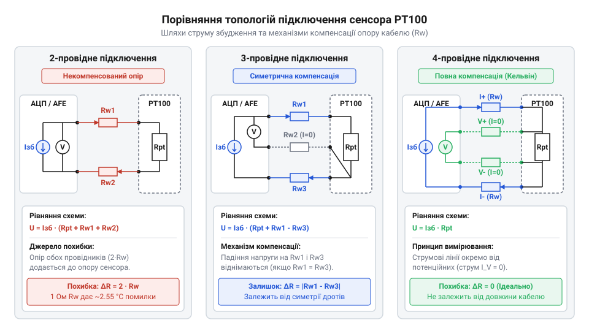
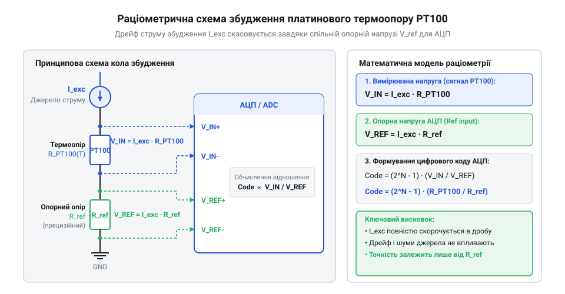

# Специфікація апаратного підключення, колірного маркування та схем з'єднання PT100

## Джерела похибок та опір ліній зв'язку

При вимірюванні температури за допомогою резистивного сенсора будь-який додатковий опір у вимірювальному колі сприймається вимірювальним приладом як зміна температури самого датчика. Платиновий термоопір @@en|PT100@@ (від @@en|Platinum@@ — платина та 100 Ом при 0 °C), який є різновидом резистивного датчика температури @@en|RTD@@ (від @@en|Resistance Temperature Detector@@ — резистивний детектор температури), має номінальний опір 100 Ом при температурі 0 °C та температурний коефіцієнт близько 0.385 Ом/°C. На відміну від пристроїв на кшталт [аналогових термісторних сенсорів](root:cat-hw-sensors/ky-013-thermistor) або [напівпровідникових давачів LM35DZ](root:cat-hw-sensors/lm35), які мають високий базовий опір або вихідну напругу великого рівня, малий питомий опір платини робить вимірювальне коло надзвичайно чутливим до опору з'єднувальних провідників.

Якщо датчик віддалений від вимірювального модуля на кілька десятків метрів, власний опір вимірювального кабелю `R_L` додається послідовно до опору сенсора `R_PT100`. Сумарний опір кола викликає хибне зміщення виміряної температури `ΔT`:

ΔT = R_L ÷ α_PT100
   = 1.0 ÷ 0.385       [ділення опору ліній на температурний коефіцієнт]
   ≈ 2.6 °C            [абсолютна похибка від опору кабелю 1 Ом]

Опір з'єднувальної лінії всього в 1 Ом створює систематичну похибку вимірювання понад 2.6 °C. До того ж опір мідних жил кабелю змінюється при коливаннях температури довкілля, що робить похибку нестабільною та унеможливлює її просте програмне віднімання без застосування спеціальних апаратних топологій підключення.

Математично компенсувати цю похибку програмним відніманням неможливо, оскільки вимірювальний модуль повинен знати точну довжину траси та середню температуру кабелю по всій її протяжності. Наприклад, двожильний кабель із перерізом мідних жил 0.22 мм² (@@en|AWG@@ 24, від @@en|American Wire Gauge@@ — американський калібр проводів) має опір петлі близько 0.16 Ом на кожен метр довжини. Для лінії завдовжки 10 м зміна температури довкілля на 20 °C викликає додаткове коливання опору R_L приблизно на 0.13 Ом через температурний коефіцієнт міді. У вимірювальному колі @@en|PT100@@ це створює нестабільний дрейф показів на 0.33 °C, який прилад сприймає як зміну температури самого об'єкта. Принципова нездатність вимірювального модуля відрізнити зміну опору ліній від зміни опору датчика робить апаратну компенсацію єдиним шляхом збереження точності.

## Маркування та ідентифікація виводів PT100

Двопровідний або багатопровідний батіг датчика @@en|PT100@@ містить виводи, призначені для подачі струму живлення та знімання вимірюваного потенціалу. Щоб уникнути помилок під час монтажу на промислових об'єктах, колірне маркування ізоляції жил стандартизовано міжнародними нормативами @@en|IEC 60751@@ та @@en|DIN 43760@@. Стандарт визначає чіткий розподіл кольорів залежно від кількості провідників. У двопровідній схемі використовуються один червоний та один білий провідник. У трипровідній конфігурації підключаються два червоних провідники до одного виводу платинованого елемента та один білий — до іншого. У чотирипровідному виконанні застосовують пару червоних і пару білих провідників.

Перед підключенням до вимірювальних клем цілісність кіл та відповідність провідників перевіряють цифровим мультиметром у режимі вимірювання опору. Перевірка виконується за чіткими критеріями:

виміряний опір між одноколірними виводами (червоний-червоний або білий-білий) дорівнює опору кабельної петлі та становить близьке до 0 Ом значення;
виміряний опір між різноколірними виводами (червоний-білий) показує поточний опір чутливого елемента @@en|PT100@@, що при кімнатній температурі 25 °C становить близько 109.7 Ом.

Така фізична ідентифікація дозволяє чітко розрізнити струмові виводи живлення та потенційні виводи знімання сигналу перед їх фіксацією у клемних блоках.

## Топології 2-, 3- і 4-провідних схем

Спосіб з'єднання провідників сенсора @@en|PT100@@ з аналоговим фронтендом визначає рівень апаратного приглушення похибки, викликаної опором кабелю. Вибір топології залежить від вимог до точності вимірювального каналу та відстані до датчика.

*Чотирипровідна топологія повністю виключає падіння напруги на вимірювальних лініях завдяки високому вхідному імпедансу АЦП.*

Двопровідне підключення є найпростішим, але опір обох жил кабелю повністю входить до вимірювального кола. Цю схему застосовують лише за коротких ліній (до 1–2 метрів) та низьких вимог до точності. Трипровідна схема компенсує опір ліній за умови однакового опору всіх трьох жил: струм збудження протікає через одну струмову жилу та елемент @@en|PT100@@, а третя жила підключається до диференційного входу вимірювача, дозволяючи віднімати падіння напруги на кабелі. Чотирипровідна схема Кельвіна (@@en|Kelvin connection@@) забезпечує найвищу точність. Через окрему пару провідників подається струм збудження, а через іншу пару вимірюється напруга. Оскільки вхідний опір аналогово-цифрового перетворювача перевищує десятки мегаом, струм у потенційних провідниках практично дорівнює нулю, що повністю усуває похибку від опору ліній. На відміну від датчиків із цифровими інтерфейсами, як-от [цифрові давачі DS18B20](root:cat-hw-sensors/ds18b20) або [давачі температури SHT30](root:cat-hw-sensors/sht30), чистий аналоговий термоопір @@en|PT100@@ потребує саме чотирипровідної топології для лабораторного рівня точності.

## Джерела струму та ратіометричні вимірювання

Для перетворення зміни опору сенсора @@en|PT100@@ у вимірювану напругу через елемент пропускають стабільний струм збудження. Ззвичайне подавання напруги через дільник створює нелінійну залежність вихідного сигналу та робить покази залежними від нестабільності джерела живлення. Для вирішення цієї проблеми застосовують джерело стабільного струму та ратіометричну схему вимірювання (@@en|ratiometric measurement@@).

*Послідовне проходження струму збудження через сенсор та прецизійний резистор R_ref усуває залежність від дрейфу джерела живлення.*

У ратіометричній схемі струм збудження `I_exc` послідовно проходить через платиновий сенсор @@en|PT100@@ та прецизійний референсний резистор `R_ref`. Напруга на сенсорі `V_sensor = I_exc × R_PT100` подається на аналоговий вхід АЦП, а падіння напруги на референсному резисторі `V_ref = I_exc × R_ref` використовується як опорна напруга того самого АЦП. Обчислення цифрового коду N виконується за алгоритмом:

N = (V_sensor ÷ V_ref) × (2ⁿ - 1)
  = (I_exc × R_PT100) ÷ (I_exc × R_ref) × (2ⁿ - 1)    [скорочення струму збудження I_exc]
  = (R_PT100 ÷ R_ref) × (2ⁿ - 1)                      [ратіометричний результат]

З підсумкового виразу видно, що величина струму `I_exc` повністю скорочується. Будь-які пульсації або температурний дрейф струму збудження не впливають на результат перетворення. Номінал референсного резистора `R_ref` обирають близьким до максимального опору сенсора у робочому діапазоні (наприклад, 400 Ом для @@en|PT100@@) із допуском точності не гірше 0.01%.

## Завадозахист та заземлення екрану Guard

Падіння напруги на термоопорі @@en|PT100@@ при нормальних струмах збудження становить від десятків до сотень мілівольт. У промислових умовах такі низькорівневі аналогові сигнали піддаються впливу потужних електромагнітних завад від частотних перетворювачів, силових контакторів та електричних мереж 50 Гц. Для захисту вимірювального каналу використовують екрановану кручену пару.

Правильне підключення захисного екрана кабелю до спеціального виводу завадозахисту @@en|Guard Pin@@ вимагає дотримання суворого апаратного правила: екран повинен заземлюватися лише в одній точці — на стороні вимірювального модуля або АЦП. Заземлення екрана з обох кінців кабелю створює замкнений контур заземлення (@@en|ground loop@@). Через різницю потенціалів між різними точками заземлення будівельних конструкцій усередині екрана починає протікати вирівнювальний змінний струм, який за рахунок індуктивного та ємнісного зв'язку наводить завади на вимірювальні провідники. На відміну від модулів на кшталт [цифрових сенсорів AHT20](root:cat-hw-sensors/aht20-sensor) або [комбінованих модулів AHT20 + BMP280](root:cat-hw-sensors/aht20-bmp280), де цифровий протокол має вбудовану стійкість до завад, слабкострумові аналогові лінії @@en|PT100@@ критично залежать від цілісності одноточкового екранування та високого коефіцінта приглушення синфазних завад аналогового фронтенду.

## Самонагрів, граничні режими та діагностика

Проходження струму збудження через термоопір @@en|PT100@@ викликає виділення теплової потужності на самому елементі, що призводить до додаткового підвищення його температури відносно вимірюваного середовища. Цей ефект називається самонагрівом (@@en|self-heating@@). Розсіювана потужність обчислюється за формулою:

P = I_exc² × R_PT100
  = (0.001)² × 100        [підстановка струму 1 мА та опору 100 Ом]
  = 0.0001 Вт = 0.1 мВт   [розсіювана теплова потужність]

Щоб похибка від самонагріву не перевищувала 0.01 °C у повітряному середовищі, струм збудження обмежено значенням не більше 1 мА (типово від 100 мкА до 500 мкА). Перевищення струму понад 1 мА спотворює покази датчика та може пошкодити аналоговий фронтенд @@en|AFE@@ (від @@en|Analog Front-End@@ — аналогова вхідна частина).

Для захисту та діагностики ліній аналоговий фронтенд виконує апаратне виявлення обриву ліній (@@en|burnout detection@@). При обриві будь-якого з провідників опір кола прямує до нескінченності, і внутрішні струмові джерела зсуву виводят напругу АЦП за верхню межу діапазону. При короткому замиканні жил напруга падає до 0 В. Це дозволяє контролеру миттєво локалізувати аварійний стан лінії. Подальша цифрова обробка сигналу та поліноміальне калібрування за [рівнянням Каллендара — Ван Дюзена](root:cat-hw-sensors/pt100-rtd/math-pt100-callendar-van-dusen-equation.md) виконуються на програмному рівні мікроконтролера.
