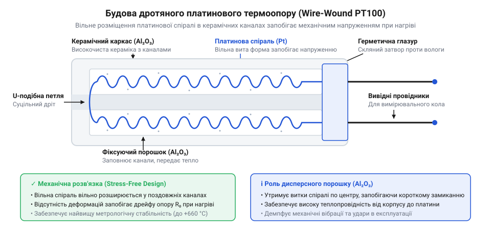
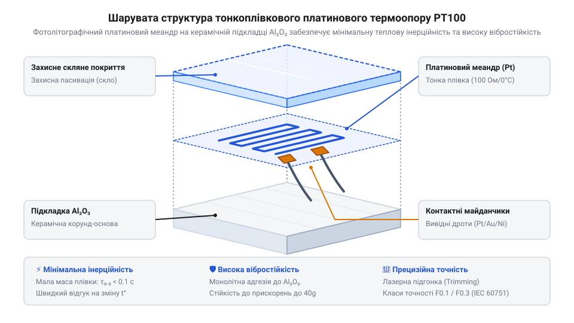

# Історія виникнення та еволюції платинових термометрів опору PT100

## Нестабільність перших платинових датчиків Сіменса

У середині XIX століття бурхливий розвиток металургії та парових машин вимагав точного вимірювання високих температур понад `300 °C`. Традиційні @@en|ртутні термометри@@ (від грец. *therme* — тепло та *metron* — вимірювання) виявлялися непридатними: ртуть закипає при `357 °C`, а скляні колби розм'якшуються й деформуються в печі. У 1871 році німецько-британський інженер @@de|Carl Wilhelm Siemens@@ запропонував вимірювати температуру за зміною електричного опору металів, винайшовши платиновий @@en|пірометр@@ (від грец. *pyr* — вогонь та *metron* — вимірювання). Платина здавалася ідеальним вибором завдяки високій температурі плавлення та хімічній інертності.

Перший @@en|термометр опору@@ мав просту будову: тонкий платиновий дріт намотували на циліндричний каркас із вогнетривкої глини (@@en|шамот@@) і вміщували в залізний @@en|захисний чохол@@. Проте під час вимірювань за температур понад `800 °C` виявився катастрофічний ефект: залізний чохол реагував із кремнеземом каркаса та пічними газами, виділяючи леткі пари кремнію та заліза. Ці пари дифундували в платину, утворюючи крихкі силіциди й сплави. Чужорідні атоми кремнію та заліза заміщували платину у вузлах ґратки або вклинювалися між ними, руйнуючи її періодичність. У чистому металі @@en|електрони провідності@@ (від грец. *ēlektron* — бурштин) вільно проходять крізь впорядковану @@en|кристалічну ґратку@@, але домішки створювали локальні осередки спотворення електричного поля. Зіткнення носіїв заряду з цими дефектами — @@en|домішкове розсіювання електронів@@ — скорочувало довжину їхнього вільного пробігу й створювало додатковий опір. Оскільки дифузія тривала з кожним вимірюванням, кількість і розташування сторонніх атомів у ґратці неперервно змінювалися. Хімічна структура платини порушувалася, викликаючи незворотний @@en|дрейф опору@@ (від нім. *Treiben* — плавати, гнати) — показники сенсора хаотично змінювалися після кожного нагрівання. У 1874 році комісія @@en|British Association for the Advancement of Science@@ відхилила прилад @@de|Carl Wilhelm Siemens@@ через метрологічну нестабільність.

## Математичний прорив та ізоляція Каллендара

Вирішальний прорив у 1887 році здійснив британський фізик @@en|Hugh Longbourne Callendar@@, який усунув фізичні причини хімічного забруднення та механічного напруження дроту. Замість кераміки він використав хрестоподібний каркас із чистої @@en|слюди@@ — мінералу, що зберігає ізоляційні властивості й не реагує з платиною за високих температур. Дріт укладався у вирізи каркаса вільно: таке @@en|безнапружне намотування@@ запобігало виникненню внутрішніх механічних напружень під час термічного розширення металу. Перед збиранням платину піддавали високотемпературному @@en|відпалюванню@@ для усунення деформацій кристалічної ґратки.

@@en|Hugh Longbourne Callendar@@ також створив математичну модель, навчившись розраховувати температуру за опором платини. Опір платинового датчика `Rₜ` за температури `t` визначається через опір `R₀` при `0 °C` та температурні коефіцієнти `A` і `B`. Додатний коефіцієнт `A` відображає основне лінійне зростання опору: під час нагрівання посилюються теплові коливання кристалічної ґратки металу — @@en|фонони@@ (від грец. *phōnē* — звук), які частіше розсіюють електрони провідності. Від'ємний квадратичний коефіцієнт `B` описує фізичну @@en|нелінійність@@ (від лат. *linearis* — лінійний) цієї залежності: із підвищенням температури темп зростання опору поступово сповільнюється порівняно з прямою лінією через скорочення довжини вільного пробігу електронів та термічне розширення ґратки. Підсумкове квадратичне рівняння виражає таку залежність:

```
Rₜ = R₀ × (1 + A × t + B × t²)
```

Для @@en|калібрування@@ (від араб. *qālib* — форма) сенсора застосовували три реперні фізичні точки: танення льоду (`0 °C`), кипіння води (`100 °C`) та кипіння сірки (`444.6 °C`). Поєднання чистої @@en|слюди@@, безнапружного намотування та квадратичного рівняння перетворило платиновий термоопор на первинний еталонний прилад, який став основою для створення [міжнародної температурної шкали](root:hw-sensing/its-90) @@en|ITS-90@@.

## Конструкції класичних дротяних елементів PT100

Лабораторний хрестоподібний каркас зі слюди забезпечував виняткову стабільність, але виявлявся занадто крихким для промислових трубопроводів та агресивного вібраційного середовища. Промисловості потрібен був датчик, який зберігає стабільність платини й водночас витримує механічні навантаження. Розв'язанням цієї суперечності стало створення класичних дротяних елементів `@@en|wire-wound@@` (англ. *wire-wound* від *wire* — дріт, *wound* — намотаний) для термоопору `@@de|PT100@@` (нім. *Platin* — платина та 100 Ом при 0 °C).

Основу класичного дротяного виконання становить циліндричний каркас із високоочищеного оксиду алюмінію. Усередині керамічного блоку виконано поздовжні капілярні канали, у які затягують платиновий дріт, звитий у мікроскопічну спіраль. Головне фізичне завдання цієї конструкції — надати платині свободу розширення під час нагрівання й запобігти виникненню механічних напружень. Для захисту від струсів канали заповнюють тонкодисперсним керамічним порошком, який утримує спіраль і гасить вібрації, але не перешкоджає термічному подовженню дроту. Кінці керамічної трубки герметизують високотемпературним скляним глазуруванням.


*Будова класичного дротяного термоопору PT100 з керамічним каркасом, що пояснює вільне термічне розширення спіралі.*

Альтернативним варіантом дротяного елемента є скляне виконання. У ньому платиновий дріт намотують безпосередньо на скляне осердя та сплавляють із зовнішньою скляною оболонкою. Оскільки коефіціент термічного розширення спеціального скла майже збігається з платиною, така монолітна структура повністю ізолює метал від зовнішніх агресивних газів.

Попри найвищу метрологічну стабільність і широкий температурний діапазон від -200 °C до +850 °C, дротяна технологія має виражені обмеження. Ручне затягування тонких спіралей у мікроскопічні канали вимагає високої трудомісткості, що робить виробництво дорогим. Велика термічна маса керамічного чи скляного каркаса зумовлює повільний термодинамічний відгук — час реакції вимірюється секундами. Крім того, тривала сильна вібрація з часом перетирає платиновий дріт об стінки каналів або призводить до ущільнення керамічного порошку.

## Тонкоплівкова революція у виробництві PT100

Масове впровадження автоматизованих систем управління вимагало мініатюрних і дешевих датчиків, придатних для монтажу на друковані плати та швидкого вимірювання швидкоплинних процесів. Класична дротяна технологія через складність та габарити не могла задовольнити цей попит. Технологічною відповіддю стала тонкоплівкова технологія `@@en|thin-film@@` (англ. *thin-film* від *thin* — тонкий, *film* — плівка), запозичена з мікроелектроніки.

Виробництво тонкоплівкового `@@de|PT100@@` базується на методі `@@gr|фотолітографія@@` (грец. *phos* — світло, *lithos* — камінь, *graphein* — писати). На плоску підкладку з оксиду алюмінію шляхом магнетронного напилення наносять шар чистої платини завтовшки близько 1 мкм. За допомогою фотолітографічного травлення з платинових доріжок формують суцільний провідний `@@gr|меандр@@` (грец. *Maiandros* — звивиста річка). Через технологічні допуски товщини плівки початковий опір травленого меандру свідомо роблять на кілька відсотків нижчим за номінал, адже збільшити опір розрізанням провідників значно простіше, ніж додати платину. Для підганяння значення в топологію меандру закладають паралельні перемички — `@@de|юстувальні містки@@` (нім. *justieren* — точно підганяти, вирівнювати), які початково шунтують частину петлі й зменшують довжину струмового шляху. Під час калібрування автоматизований лазер випалює ці містки по черзі: перерізання кожного з них змушує струм проходити довшим шляхом крізь розгорнуту петлю, що ступенчасто збільшує підсумковий опір. На фінальному етапі лазерний промінь робить мікроскопічні бічні надрізи безпосередньо на платиновій доріжці, звужуючи її переріз під безперервним контролем вимірювального моста, поки опір за температури 0 °C не досягне точно 100.00 Ом. Згори відкалібрований платиновий шар вкривають захисним боросилікатним склом, яке ізолює плівку від хімічного впливу довкілля.


*Шарувата структура тонкоплівкового елемента PT100 на керамічній підкладці, що демонструє мінімальну термічну масу та захисний скляний шар.*

Завдяки атомарному зчепленню платинової плівки з твердою підкладкою тонкоплівкові датчики набули виняткової стійкості до механічних вібрацій і ударів. Відсутність вільних підвішених витків усунула ризик механічного перетирання провідника. Мікроскопічна товщина елемента радикально зменшила його термічну масу, скоротивши час теплового відгуку до часток секунди. Групове фотолітографічне виготовлення сотень елементів на одній керамічній пластині знизило собівартість компонентів у десятки разів.

Головним обмеженням тонкоплівкової технології є різниця коефіцієнтів термічного розширення керамічної підкладки та тонкого шару платини. За високих температур понад +500 °C внутрішній механічний натяг між матеріалами викликає мікродеформації платинової ґратки, що призводить до повільного `@@en|дрейфу опору@@` та обмеження максимальної робочої температури.

## Розвінчання міфів та вибір технології

Розвиток вимірювальної техніки породив кілька сталих оман щодо історії та застосування платинових датчиків. Перший міф стверджує, нібито Вільям Сіменс у 1871 році створив готовий промисловий датчик. Насправді пристрій Сіменса виявився непридатним для тривалої експлуатації через швидке забруднення платини парами заліза та кремнію із шамотної оболонки. Справжнім народженням надійного термометра опору слід вважати дослідження Х'ю Каллендара, який ізолював платину слюдою та створив математичну модель корекції.

Другий поширений міф полягає в тому, що тонкоплівкова технологія `@@en|thin-film@@` повністю витіснила дротяне виконання `@@en|wire-wound@@`. У сучасній метрології кожна конструкція має свою чітко визначену нішу відповідно до стандарту `@@en|IEC 60751@@`.

Стандарт @@en|IEC 60751@@ поділяє елементи @@de|PT100@@ на класи точності (Class AA, Class A, Class B, Class C), математично регламентуючи допустиму похибку вимірювання `Δt` у градусах Цельсія залежно від модуля вимірюваної температури `|t|`. У цьому стандарті граничне відхилення описується виразом `Δt = ±(a + b × |t|)`, де вільний член `a` визначає базову похибку калібрування при `0 °C`, а коефіцієнт `b` відповідає за розширення допуску з віддаленням від нуля через термічні деформації та нелінійність платини. Для найвищого класу AA математична формула допустимої похибки становить `Δt = ±(0.10 + 0.0017 × |t|) °C`, для класу A — `Δt = ±(0.15 + 0.0020 × |t|) °C`, для стандартного промислового класу B — `Δt = ±(0.30 + 0.0050 × |t|) °C`, а для класу C — `Δt = ±(0.60 + 0.0100 × |t|) °C`. Для досягнення прецизійного класу AA з похибкою ±0.10 °C при `0 °C` або створення еталонних термометрів Міжнародної температурної шкали @@en|ITS-90@@ у діапазоні від -200 °C до +850 °C застосовують виключно дротяні елементи, у яких платиновий дріт перебуває в безнапружному стані.

При виборі між двома виконанням керуються фізичними умовами вимірювань. На відміну від [аналогових напівпровідникових давачів](root:cat-hw-sensors/lm35) чи [цифрових датчиків температури](root:cat-hw-sensors/ds18b20), які обмежені вузьким діапазоном, `@@de|PT100@@` забезпечує високу лінійність у широкому вікні температур. Тонкоплівковий `@@de|PT100@@` є оптимальним для компактних приладів, автомобільних вузлів, високодинамічних вимірювань та умов сильної вібрації при температурах від -50 °C до +500 °C. Дротяне виконання обирають тоді, коли критичними є метрологічна стабільність протягом років, робота за температур вище +500 °C або найвищий `@@en|клас точності@@`.
