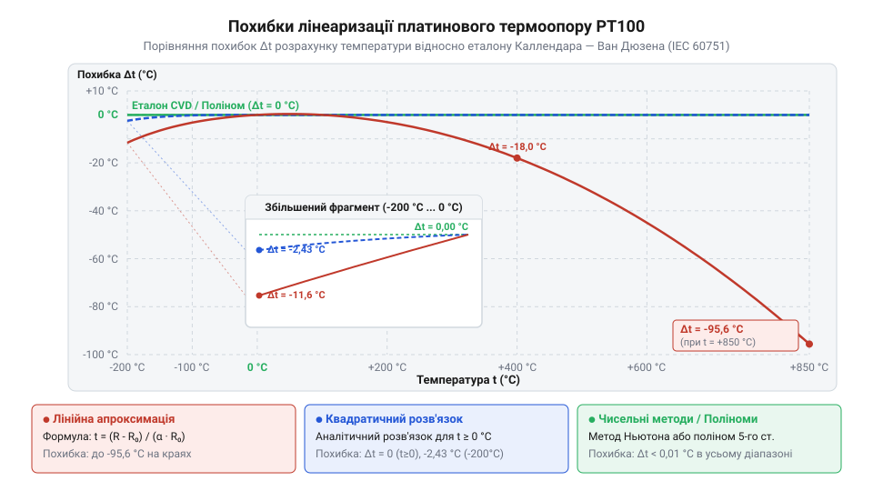

# Математична модель лінеаризації PT100 за рівнянням Каллендара — Ван Дюзена

<preknowlist>
- [KY-013 — аналоговий давач температури (термістор)](root:cat-hw-sensors/ky-013-thermistor) — базові принципи вимірювання температури через зміну електричного опору елемента
</preknowlist>

## Похибка лінійної апроксимації платинового терморезистора

Точне вимірювання температури у промисловості та наукових дослідженнях вимагає сенсорів зі стабільними характеристиками. На відміну від [простих аналогових терморезисторів](root:cat-hw-sensors/ky-013-thermistor), @@en|платиновий терморезистор@@ (від грец. *therme* — тепло та лат. *resisto* — опираюся) @@en|PT100@@ має нормований опір `100.00 Ом` при температурі `0 °C`. Висока чистота платини забезпечує відмінну повторюваність результатів, однак її електричний опір змінюється залежно від температури не строго лінійно.

При нагріванні металу амплітуда теплових коливань кристалічної ґратки платини зростає, що призводить до частішого розсіювання електронної хмари. Через це середня @@en|чутливість@@ давача (похідна опору за температурою `dR/dt`) поступово зменшується з підвищенням температури. Алгебраїчно базовий @@en|температурний коефіцієнт опору@@ `α` визначають через відносний приріст опору між нормованими точками `0 °C` (де опір становить `R_0 = 100.00 Ом`) та `100 °C` (де опір дорівнює `R_100`): за формулою `α = (R_100 - R_0) / (R_0 · 100)`. Значення цього коефіцієнта безпосередньо залежить від чистоти металу: вища чистота платини зменшує статичне розсіювання електронів на домішках і підвищує відношення `R_100 / R_0`. Через це хімічно чиста лабораторна платина має більший коефіцієнт `α ≈ 0.003920 °C⁻¹` (давачі @@en|Pt392@@), тоді як для масових промислових сенсорів використовують платину із нормованим рівнем домішок для досягнення стандартизованого значення `α ≈ 0.003851 °C⁻¹` (давачі @@en|Pt385@@). Якщо припустити, що опір змінюється строго лінійно зі сталим @@en|температурним коефіцієнтом опору@@ `α ≈ 0.003851 °C⁻¹` (де середня чутливість становить `dR/dt ≈ 0.3851 Ом/°C`), пряма залежність описується спрощеною формулою:

```
R_lin(t) = R_0 · (1 + α · t)
```

Така спрощена @@en|лінеаризація@@ (від лат. *linearis* — лінійний) створює помітне відхилення від реальної фізичної поведінки платини.

**Обчислення похибки лінійного наближення при t = 200 °C**
```
R_lin(200) = 100 · (1 + 0.003851 · 200)
           = 100 · (1 + 0.7702)                           [множення коефіцієнта на температуру]
           = 177.02 Ом                                    [обчислення лінійного опору]

ΔR = R_lin - R_real = 177.02 - 175.86 = 1.16 Ом            [різниця з дійсним опором 175.86 Ом]
Δt = ΔR / (dR/dt) = 1.16 / 0.3851 ≈ +3.01 °C              [переведення похибки опору в температуру]
```

При температурі `0 °C` та `100 °C` лінійна модель дає точний опір за визначенням коефіцієнта `α`, але в проміжній точці `50 °C` похибка вимірювання вже становить близько `-0.38 °C`. При підйомі температури до `200 °C` обчислений опір `177.02 Ом` перевищує реальне значення `175.86 Ом`, що дає неприпустиму похибку понад `+3.0 °C`. У високотемпературному діапазоні при `500 °C` похибка прямого лінійного наближення перевищує `+10 °C`, а при `850 °C` досягає майже `+30 °C`. Такий рівень відхилення унеможливлює використання лінійної формули у точних вимірювальних трактах, вимагаючи застосування кривої другого або вищих порядків.

## Пряме рівняння Каллендара — Ван Дюзена

Дійсну математичну залежність опору платинового @@en|RTD@@ (від англ. *Resistance Temperature Detector* — детектор опору від температури) від температури у всьому робочому діапазоні від `-200 °C` до `+850 °C` описує @@en|рівняння Каллендара — Ван Дюзена@@. Британський фізик Х'ю Каллендар у 1887 році запропонував квадратичну модель для додатних температур, а американський фізик Мілтон Ван Дюзен у 1925 році додав член четвертого степеня для точного опису поведінки платини при температурах нижче `0 °C`, де проявляється додатковий квантовий внесок кристалічної ґратки.

Міжнародний стандарт @@en|IEC 60751@@ фіксує стандартизовані коефіцієнти рівняння для платинового елемента @@en|PT100@@ з базовим опором `R_0 = 100.00 Ом`:

```
A = 3.9083 × 10⁻³ °C⁻¹
B = -5.775 × 10⁻⁷ °C⁻²
C = -4.183 × 10⁻¹² °C⁻⁴
```

Для діапазону додатних температур (`t ≥ 0 °C`) рівняння є квадратичною функцією, де коефіцієнт `C` дорівнює нулю:

```
R(t) = R_0 · (1 + A · t + B · t²)
```

У початковій класичній моделі Каллендара залежність опору від температури записували через фізичні параметри платини: базовий опір `R_0`, температуру `t`, @@en|температурний коефіцієнт опору@@ `α`, який визначає відносну зміну опору між `0 °C` та `100 °C`, та @@en|константу Каллендара@@ `δ`, що характеризує відхилення металу від лінійної залежності:

```
R(t) = R_0 · [1 + α · t - α · δ · (t / 100 - 1) · (t / 100)]
     = R_0 · [1 + α · t - α · δ · (t² / 10000 - t / 100)]          [розкриття дужок для температури t]
     = R_0 · [1 + α · (1 + δ / 100) · t - (α · δ / 10000) · t²]    [групування за степенями t]
```

Порівняння отриманого полінома зі стандартизованою квадратичною формою `R(t) = R_0 · (1 + A · t + B · t²)` дає алгебраїчний зв'язок між коефіцієнтами стандарту @@en|IEC 60751@@ та фізичними константами:

```
A = α · (1 + δ / 100)                                           [лінійний коефіцієнт]
B = -α · δ / 10000                                              [квадратичний коефіцієнт]
```

Від'ємний знак коефіцієнта `B` спричиняє від'ємну опуклість графіку опору, компенсуючи зменшення чутливості металу при нагріванні. Оскільки фізичні константи `α ≈ 0.00385 °C⁻¹` та `δ ≈ 1.5` є додатними, добуток `-α · δ / 10000` утворює від'ємне значення `B = -5.775 × 10⁻⁷ °C⁻²`.

Для від'ємного діапазону Ван Дюзен ввів додаткову @@en|константу Ван Дюзена@@ `β`, яка описує квантові ефекти кристалічної ґратки через член четвертого степеня:

```
-α · β · (t / 100 - 1) · (t / 100)³
= -α · β · (t - 100) / 100 · t³ / 1000000                       [винесення знаменника 100⁴]
= -α · β / 100000000 · (t - 100) · t³                           [зведення знаменника]
```

Зіставляючи цей член з виразом `C · (t - 100) · t³`, визначаємо третій коефіцієнт:

```
C = -α · β / 100000000                                          [коефіцієнт четвертого степеня]
```

Знаючи коефіцієнти `A`, `B` і `C`, можна обчислити вихідні фізичні константи:

```
α = A + 100 · B                                                 [температурний коефіцієнт опору]
δ = -10000 · B / (A + 100 · B)                                  [константа Каллендара]
β = -100000000 · C / (A + 100 · B)                               [константа Ван Дюзена]
```

Для діапазону від'ємних температур (`-200 °C ≤ t < 0 °C`) рівняння розширюється поліномом четвертого степеня:

```
R(t) = R_0 · [1 + A · t + B · t² + C · (t - 100) · t³]
```

Обидва вирази узгоджені в точці `t = 0 °C`: вони видають однакове значення `R(0) = 100.00 Ом` та мають однакову першу похідну `dR/dt = R_0 · A`.

**Обчислення точного опору PT100 при t = 200 °C**
```
R(200) = 100 · (1 + 3.9083 × 10⁻³ · 200 - 5.775 × 10⁻⁷ · 200²)
       = 100 · (1 + 0.78166 - 5.775 × 10⁻⁷ · 40000)        [квадрат температури 200² = 40000]
       = 100 · (1 + 0.78166 - 0.02310)                     [множення коефіцієнта B]
       = 100 · 1.75856                                     [сумування коефіцієнтів]
       = 175.856 Ом                                        [підсумковий опір при 200 °C]
```

Пряме рівняння дозволяє з високою точністю розрахувати опір за відомою температурою. Проте у реальних вимірювальних системах виміряною величиною є опір `R`, з якого необхідно відновити температуру `t`.

## Обернене перетворення та алгоритми лінеаризації

Під час роботи з давачем мікроконтролер вимірює падіння напруги й обчислює опір `R`, після чого повинен виконати обернене перетворення `t(R)`. На відміну від [аналогових напівпровідникових давачів](root:cat-hw-sensors/lm35), де напруга прямо пропорційна температурі, розв'язання оберненої задачі для @@en|PT100@@ вимагає вибору оптимального алгоритму з огляду на обчислювальні ресурси.

Для додатного діапазону температур (`t ≥ 0 °C`) рівняння Каллендара — Ван Дюзена є точним квадратичним рівнянням `B · t² + A · t + (1 - R / R_0) = 0`. Точний аналітичний розв'язок отримують через дискримінант квадратного тричлена:

```
t = (-A + √(A² - 4 · B · (1 - R / R_0))) / (2 · B)
```

Оскільки коефіцієнт `B` від'ємний, знаменник від'ємний, а підкореневий вираз набуває вигляду `A² - 4 · |B| · (R/R_0 - 1)`. Ця формула забезпечує точне обчислення температури без математичної похибки для всіх додатних температур.


*Порівняння похибок лінеаризації залежно від обраного алгоритму обчислення.*

Для від'ємного діапазону (`t < 0 °C`) рівняння четвертого степеня не має простого й зручного для обчислень аналітичного розв'язку. У цьому випадку застосовують чисельні алгоритми:

1. @@en|Метод Ньютона — Рафсона@@: ітераційний пошук кореня функції `f(t) = R(t) - R_measured = 0`. Початкове наближення `t_0` беруть із квадратичної формули, після чого уточнюють за ітераційним кроком:

```
t_{k+1} = t_k - f(t_k) / f'(t_k)
```

де похідна `f'(t) = R_0 · [A + 2 · B · t + C · (4 · t³ - 300 · t²)]`. Двох-трьох ітерацій достатньо для досягнення точності кращої за `0.001 °C`.

2. @@en|Поліноміальна апроксимація@@ (від лат. *proximus* — найближчий): обчислення температури за поліномом 3-го чи 5-го степеня від різниці опорів `(R - R_0)` за схемою Горнера, що вимагає лише операцій додавання та множення.

Вибір алгоритму залежить від архітектури процесора. Обчислювальні блоки з @@en|плаваючою крапкою@@ (FPU) 32-бітних мікроконтролерів легко виконують квадратні корені та ітерації Ньютона. Слабкі 8-бітні мікроконтролери без апаратної підтримки виконують програмну емуляцію чисел із плаваючою крапкою сотні циклів, тому для них застосовують обчислення у @@en|фіксованій крапці@@ та @@en|таблиці пошуку@@ (LUT, від англ. *look-up table*) з @@en|лінійною інтерполяцією@@ між вузлами. Заміна нелінійної кривої `R(t)` відрізками прямих між вузлами таблиці створює математичну похибку інтерполяції через ненульову другу похідну `d²R/dt² = 2 · R_0 · B`. Максимальна похибка інтерполяції на кроці температури `Δt` визначається виразом `ε_interp = (1 / 8) · (|d²R/dt²| / S) · (Δt)²`, де чутливість платини становить `S = dR/dt ≈ 0.385 Ω/°C`, а `|d²R/dt²| ≈ 1.155 × 10⁻⁴ Ω/°C²`. Для забезпечення заданої точності обчислень `ε_max ≤ 0.01 °C` граничний крок інтерполяції обчислюють як `Δt ≤ √(8 · ε_max · S / |d²R/dt²|) ≈ 16.3 °C`. Вибір кроку як степеня двійки `Δt = 16 °C` дозволяє замінити затратну операцію ділення під час пошуку індексу вузла та інтерполяції швидкими операціями @@en|порозрядного зсуву@@ `>> 4`. Необхідна кількість вузлів таблиці для всього діапазону від `-200 °C` до `+850 °C` становить `N = (1050 / 16) + 1 = 67` елементів. Збереження 67 вузлів у 16-бітній @@en|фіксованій крапці@@ потребує лише 134 байти у @@en|флеш-пам'яті@@ (PROGMEM), що забезпечує високу точність без перевантаження ресурсів процесора. На відміну від [цифрових давачів із внутрішньою лінеаризацією](root:cat-hw-sensors/ds18b20), математичне навантаження при роботі з платиною покладається безпосередньо на керуючий контролер.

## Граничні допуски та оцінка похибки

Точність вимірювальної системи визначається не лише алгоритмом лінеаризації, а й власним метрологічним допуском елемента @@en|PT100@@. Стандарт @@en|IEC 60751@@ встановлює чотири класи точності (@@en|клас точності@@), які визначають гранично допустиме відхилення температури `Δt` (у градусах Цельсія) залежно від модуля поточної температури `|t|`:

```
Клас AA: Δt = ±(0.10 + 0.0017 · |t|)    [діапазон від -50 °C до +250 °C]
Клас A:  Δt = ±(0.15 + 0.0020 · |t|)    [діапазон від -30 °C до +300 °C]
Клас B:  Δt = ±(0.30 + 0.0050 · |t|)    [діапазон від -190 °C до +600 °C]
Клас C:  Δt = ±(0.60 + 0.0100 · |t|)    [діапазон від -190 °C до +600 °C]
```

Окрім похибки самого сенсора, на підсумкову точність впливає похибка вимірювального тракту — аналогового містка, опорного резистора та АЦП. Щоб оцінити, як відхилення виміряного опору `ΔR` трансформується у похибку обчислення температури `Δt`, використовують диференціальне співвідношення через @@en|чутливість@@ `S(t) = dR/dt`:

```
S(t) = dR/dt = R_0 · (A + 2 · B · t)
```

При `0 °C` чутливість становить `S(0) = 100 · 3.9083 × 10⁻³ = 0.3908 Ом/°C`. При нагріванні до `500 °C` вона знижується до `S(500) = 100 · (3.9083 × 10⁻³ - 2 × 5.775 × 10⁻⁷ · 500) = 0.3331 Ом/°C`.

**Трансформація похибки вимірювання опору ΔR = 0.10 Ом у похибку температури**
```
Δt_0 = ΔR / S(0) = 0.10 / 0.3908 ≈ 0.256 °C                 [похибка температури при 0 °C]
Δt_500 = ΔR / S(500) = 0.10 / 0.3331 ≈ 0.300 °C             [похибка температури при 500 °C]
```

Оскільки чутливість платини з підвищенням температури падає, однакова похибка аналогово-цифрового тракту `ΔR` спричиняє більшу похибку температури `Δt` у високотемпературній зоні. Загальний метрологічний допуск вимірювальної системи обчислюють як суму нормативного допуску давача відповідного класу за @@en|IEC 60751@@ та апаратної похибки перетворення опору.
