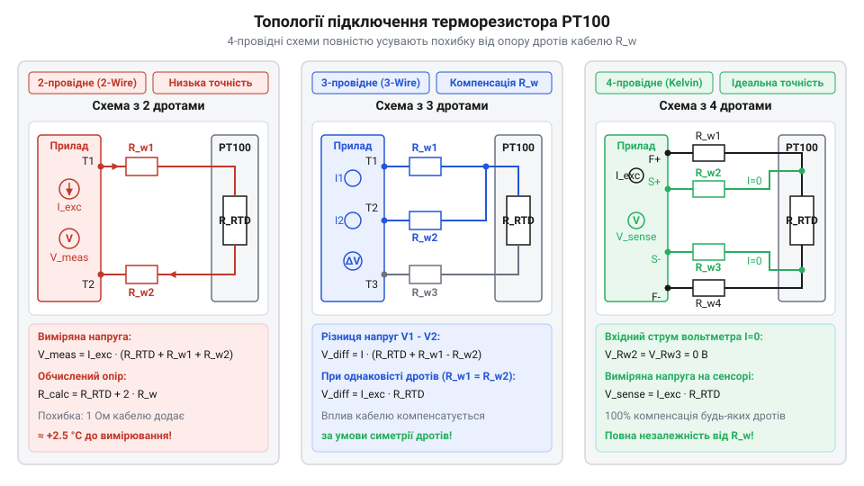

# Математичний аналіз похибок сполучних ліній та ефекту самонагріву PT100

<preknowlist>
- [KY-013 — аналоговий давач температури (термістор)](root:cat-hw-sensors/ky-013-thermistor) — базова концепція резистивного вимірювання температури та аналогового знімання сигналу з дільника напруги
</preknowlist>

## Похибка дводротового підключення через опір кабелю

Вимірювання температури за допомогою платинових датчиків @@en|PT100@@ (від нім. *Platin* — платина та 100 Ом при 0 °C) базується на зміні електричного опору металу від нагріву. Опірний термоперетворювач @@en|RTD@@ (від англ. *Resistance Temperature Detector* — опірний термоперетворювач) має номінальний опір `100 Ом` за температури `0 °C` та середній @@en|температурний коефіцієнт опору@@ (від лат. *coefficiens* — той, що сприяє) `α = 0.00385 °C⁻¹`. На відміну від [аналогових термісторів KY-013](root:cat-hw-sensors/ky-013-thermistor), опір платини змінюється передбачувано й лінійно. Проте при віддаленні сенсора від вимірювального приладу між ними прокладають сполучний кабель, який володіє власним електричним опором. Математичну модель нелінійної залежності опору платини від температури у розширеному діапазоні висвітлено у матеріалі про [рівняння Каллендара-Ван Дюзена](root:cat-hw-sensors/pt100-rtd/math-pt100-callendar-van-dusen-equation.md).

У найпростішому двопровідному підключенні вимірювальний струм протікає через першу жилу кабелю, сенсор та повертається через другу жилу. Власний електричний опір провідника `R_wire` розраховують через @@en|питомий опір@@ міді `ρ` (приблизно `0.0175 Ом · мм² / м` за кімнатної температури), довжину кабелю `L` та площу поперечного перерізу жили `S`. Для монтажної лінії завдовжки `L = 15 м` з мідними жилами перерізом `S = 0.525 мм²` опір однієї лінії визначають за формулою:

```
R_wire = (ρ · L) / S
= (0.0175 · 15) / 0.525                 [підстановка питомого опору міді, довжини 15 м та перерізу 0.525 мм²]
= 0.5 Ом                                [значення опору однієї мідної жили]
```

З виведення видно, що опір провідника зростає лінійно з віддаленням датчика від вимірювального приладу. Оскільки у двопровідній топології струм долає шлях туди й назад, для обчислення загального опору вимірювального кола `R_meas` додають опір датчика `R_t` та паразитний опір обох жил `R_wire`:

```
R_meas = R_t + R_wire1 + R_wire2
= R_t + 2 · R_wire                      [підключення двох однакових жил кабелю]
```

Отриманий вимірювальний опір виявляється більшим за реальний опір сенсора на величину подвійного опору лінії `2 · R_wire`. Щоб перерахувати цей додатковий опір у хибний температурний зсув `ΔT_err`, паразитний опір ділять на температурний коефіцієнт `α`:

```
ΔT_err = (2 · R_wire) / α               [ділення паразитного опору на температурний коефіцієнт]
```

З виведеної залежності видно, що будь-який опір дротів безпосередньо додається до результату й сприймається вимірювачем як підвищення температури середовища.

**Розрахунок похибки для кабелю завдовжки 15 метрів:**
```
R_wire = 0.5
ΔR = 2 · 0.5
= 1.0 Ом                                [сумарний опір двох жил кабелю]
ΔT_err = 1.0 / 0.385
≈ 2.6 °C                                [температурна похибка 2-провідної лінії]
```

Похибка у `2.6 °C` є неприпустимою для прецизійних систем. Це робить двопровідну схему непридатною для точних вимірювань на відстані понад кілька сантиметрів.

## Математичне скасування опору в багатопровідних схемах

Щоб вилучити @@en|паразитний опір@@ (від грец. *parasitos* — нахлібник) кабелю з результатів вимірювання, застосовують багатопровідні топології підключення.


*Схеми підключення ліній живлення та зчитування напруги у 2-, 3- та 4-провідних топологіях.*

Найдосконалішим є чотирипровідне підключення, засноване на @@en|методі Кельвіна@@ (названо на честь лорда Кельвіна, англ. *Lord Kelvin*). У цій схемі струм збудження `I_ex` подається через дві зовнішні струмові жили, а падіння напруги `V_s` знімається через дві внутрішні потенційні жили високоомним вольтметром із вхідним струмом `I_v ≈ 0`. Обчислення напруги на потенційних виводах виконують за законом Ома:

```
V_s = I_ex · R_t + I_v · (R_wire2 + R_wire3)
= I_ex · R_t + 0 · (R_wire2 + R_wire3)  [нехтування струмом вольтметра через високий вхідний опір]
= I_ex · R_t                            [падіння напруги лише на платиновому елементі]
```

Падіння напруги `V_s` залежить виключно від опору сенсора `R_t`, а опір усіх чотирьох дротів повністю скасовується.

Трипровідна схема є дешевшою альтернативою чотирипровідній, де опір дротів компенсується за умови їхньої повної симетрії. Струм подається у дві жили через два тотожних джерела струму або застосовується @@en|міст Вітстона@@ (названо на честь Чарльза Вітстона, англ. *Wheatstone bridge*). У диференційній схемі з двома однаковими струмами збудження `I_ex` перша жила з опором `R_wire1` підключається послідовно з давачем опором `R_t`, створюючи падіння напруги `V_1 = I_ex · (R_t + R_wire1)`. Друга жила з опором `R_wire2` слугує компенсаційною лінією з напругою `V_2 = I_ex · R_wire2`, а третя жила веде до високоомного вимірювача з вхідним струмом `I_v ≈ 0`. Для визначення виміряного опору `R_meas` різницю потенціалів (диференційну напругу) `V_meas = V_1 - V_2` ділять на струм збудження `I_ex`:

```
R_meas = V_meas / I_ex
= (V_1 - V_2) / I_ex                                   [вираження диференційної напруги через напруги плечей]
= (I_ex · (R_t + R_wire1) - I_ex · R_wire2) / I_ex     [підстановка падінь напруги на лініях]
= I_ex · (R_t + R_wire1 - R_wire2) / I_ex              [винесення струму збудження за дужки]
= R_t + (R_wire1 - R_wire2)                            [скорочення струму збудження]
= R_t + ΔR_line                                        [групування асиметрії опорів жил]
```

Із виведеного рівняння видно, що за повної симетрії провідників (`R_wire1 = R_wire2`) їхні @@en|паразитні опори@@ повністю віднімаються і `R_meas = R_t`. Однак якщо виникає @@en|асиметрія ліній@@ `ΔR_line = R_wire1 - R_wire2` (від грец. *asymmetria* — нерозмірність), ця різниця залишається некомпенсованою і напряму додається до результату вимірювання.

```
R_meas = R_t + (R_wire1 - R_wire2)
= R_t + ΔR_line                         [похибка через асиметрію опорів жил]
```

Температурний зсув від асиметрії обчислюють як `ΔT_asym = ΔR_line / α`. Різниця опорів жил усього в `0.1 Ом` створює похибку `0.26 °C`, що робить симетрію дротів критичним фактором трипровідного вимірювання.

## Математичне моделювання ефекту самонагріву платини

Компенсація опору кабелю вирішує проблему ліній, але вимірювальний струм `I_ex`, проходячи через чутливий елемент @@en|PT100@@, виділяє теплову потужність. Цей процес викликає @@en|самонагрів@@ (від англ. *self-heating effect*) сенсора, через що його температура стає вищою за температуру досліджуваного середовища. 

Виділена теплова потужність `P` розраховується за законом Джоуля-Ленца через струм збудження `I_ex` та опір терморезистора `R_t`:

```
P = I_ex² · R_t                         [обчислення виділеної теплової потужності]
```

Виділене тепло розсіюється в довкілля. Підсумковий температурний зсув `ΔT_sh` визначається співвідношенням потужності `P` та @@en|коефіцієнта тепловіддачі@@ (від англ. *dissipation factor*) `E_d`, який показує потужність у міліватах, необхідну для нагріву елемента на `1 °C`:

```
ΔT_sh = P / E_d
= (I_ex² · R_t) / E_d                   [температурний зсув від розсіювання потужності]
```

Значення `E_d` суттєво залежить від теплопровідності середовища: у нерухомому повітрі воно становить близько `2 мВт/°C`, тоді як у проточній воді сягає `20 мВт/°C` і більше. Крім властивостей довкілля, на @@en|коефіцієнт тепловіддачі@@ `E_d` впливає внутрішня конструкція давача. Чутливий елемент поміщають у металеву @@en|захисну гільзу@@ (від англ. *protective sheath* — гільза для захисту від механічних і хімічних впливів), а простір між платиною й гільзою заповнюють термостійким наповнювачем. Сумарний @@en|тепловий опір@@ (від англ. *thermal resistance* — опір проходженню теплового потоку) складається з внутрішнього опору наповнювача та зовнішнього опору на межі гільзи з середовищем. Повітряні зазори всередині гільзи діють як теплоізолятор, зменшуючи `E_d` та збільшуючи перегрів, тоді як щільний керамічний наповнювач або теплопровідна паста покращують відведення тепла й підвищують значення `E_d`. Додатково при оцінці самонагріву слід враховувати зростання опору `R_t` при підвищенні температури. Оскільки опір платини зростає з `100 Ом` при `0 °C` до `175.86 Ом` при `200 °C`, виділювана теплова потужність `P = I_ex² · R_t` за стабільного струму збудження `I_ex` також збільшується. У результаті за вищих температур той самий струм збудження спричиняє більший температурний зсув `ΔT_sh`, що вимагає додаткового запасу точності при розрахунку вимірювального кола.

**Обчислення самонагріву при струмі 1 мА:**
```
P = (0.001)² · 100
= 0.0001 Вт = 0.1 мВт                   [теплова потужність на резисторі 100 Ом]
ΔT_air = 0.1 / 2
= 0.05 °C                               [перегрів платини у нерухомому повітрі]
```

Для збереження похибки самонагріву в межах `0.01 °C` у газах струм збудження `I_ex` обмежують значеннями від `100 мкА` до `500 мкА`. У аналогових кола вибір струму завжди є компромісом між рівнем корисного сигналу та паразитного перегріву.

## Логометричні вимірювання та референсний резистор

Навіть при виборі малого струму збудження його нестабільність або дрейф напруги живлення створює похибку вимірювання. Якщо вимірювати абсолютну напругу на @@en|PT100@@, будь-яка пульсація струму безпосередньо спотворює результат, на відміну від [цифрових давачів SHT30](root:cat-hw-sensors/sht30) з убудованою каліброваною логікою.

Цю проблему вирішують @@en|логометричні вимірювання@@ (від грец. *logos* — відношення та *metron* — міра). У логометричному колі сенсор `R_t` послідовно з'єднують із прецизійним @@en|референсним резистором@@ (від лат. *refero* — відносити, повертати) `R_ref`, і через них пропускають спільний струм `I_ex`. Напруга з `R_ref` подається як опорна напруга `V_ref` на @@en|АЦП@@ (від української абревіатури: аналогово-цифровий перетворювач), а напруга з сенсора `V_s` — на вимірювальний вхід. Обчислення цифрового коду `Code_ADC` для `n`-бітного АЦП має вигляд:

```
Code_ADC = (V_s / V_ref) · (2ⁿ - 1)
= ((I_ex · R_t) / (I_ex · R_ref)) · (2ⁿ - 1)  [підстановка падінь напруги за законом Ома]
= (R_t / R_ref) · (2ⁿ - 1)              [скасування струму збудження I_ex]
```

Визначення опору платинового елемента `R_t` виконують шляхом множення відношення кодів на відомий опір референсного резистора:

```
R_t = R_ref · (Code_ADC / (2ⁿ - 1))     [обчислення опору датчика через відношення кодів]
```

З виведеної формули видно, що струм `I_ex` повністю скорочується. Результат вимірювання залежить виключно від точності `R_ref` та коду АЦП, роблячи систему нечутливою до нестабільності джерела живлення.

Проте усунення похибки струму живлення не робить схему абсолютно ідеальною, оскільки результат обчислення опору `R_t` залишається прямо пропорційним опору `R_ref`. Вимірювальна плата зазвичай розміщена в приладовому корпусі, де температура середовища коливається, через що опір референсного резистора дрейфує відповідно до його власного `@@en|TCR@@` (англ. *Temperature Coefficient of Resistance* — температурний коефіцієнт опору, від латинських *temperatura* — належне змішування, *coefficiens* — той, що сприяє, та *resisto* — протистою). Абсолютна зміна опору `ΔR_ref` при відхиленні температури плати на `ΔT_ref` становить:

```
ΔR_ref = R_ref · α_ref · ΔT_ref          [обчислення абсолютного температурного дрейфу опору R_ref]
```

Тут `α_ref` позначає температурний коефіцієнт опору `R_ref`, який виражають у `@@en|ppm/°C@@` (від англ. *parts per million* — частин на мільйон, де *part* — частина, *million* — мільйон). Оскільки відносна похибка визначення опору датчика `ΔR_t / R_t` точно дорівнює відносній зміні `ΔR_ref / R_ref = α_ref · ΔT_ref`, будь-який дрейф `R_ref` безпосередньо транслюється у вимірювану температуру. Для елемента `@@en|PT100@@` із чутливістю близько `0.385` Ом/°C (відносна зміна опору `3850` `@@en|ppm/°C@@` при `0` °C) використання резистора з `α_ref = 100` `@@en|ppm/°C@@` при зміні температури плати на `10` °C створює відносну похибку `1000` `@@en|ppm@@`, що призводить до температурного зсуву вимірювання близько `0.26` °C. Щоб ця похибка не перевищувала допустимий бюджет, опір `R_ref` обирають серед прецизійних металоплівкових або фольгових резисторів із низьким значенням `α_ref` до `5`–`10` `@@en|ppm/°C@@` або нижче.

## Розрахунок повного бюджету похибок тракту

Для оцінки підсумкової точності вимірювального тракту окремі математичні моделі ліній, самонагріву та вимірювача об'єднують у єдиний @@en|бюджет похибок@@ (від фр. *bougette* — кошель, сумка).

Основними складниками є похибка асиметрії ліній `ΔT_asym`, температурний зсув самонагріву `ΔT_sh`, допуск референсного резистора `ΔT_ref` та похибка квантування АЦП `ΔT_adc`. Оскільки ці чинники є статистично незалежними випадковими величинами, їхній сумарний температурний допуск `ΔT_total` обчислюють через @@en|квадратичне підсумовування@@ (від англ. *root sum squares*):

```
ΔT_total = √(ΔT_asym² + ΔT_sh² + ΔT_ref² + ΔT_adc²)  [квадратичне підсумовування незалежних похибок]
```

Перед підсумовуванням кожен складник зводять до температурного еквівалента в градусах Цельсія.

**Обчислення підсумкового бюджету похибок:**
```
ΔT_total = √(0.02² + 0.05² + 0.03² + 0.01²)
= √(0.0004 + 0.0025 + 0.0009 + 0.0001)  [сума квадратів складників похибки]
= √0.0039
≈ 0.062 °C                              [підсумкова похибка температурного тракту]
```

Складання такого бюджету дозволяє інженеру обґрунтовано балансувати параметри системи: зменшувати струм збудження для зниження `ΔT_sh` або обирати точніший `R_ref` для гарантування заданого допуску вимірювання.
