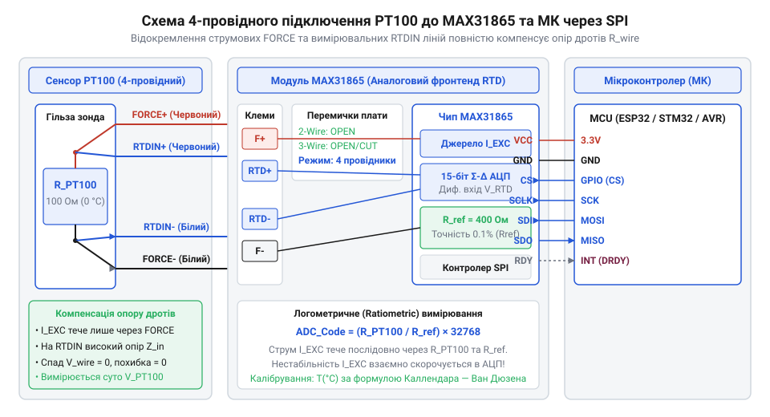
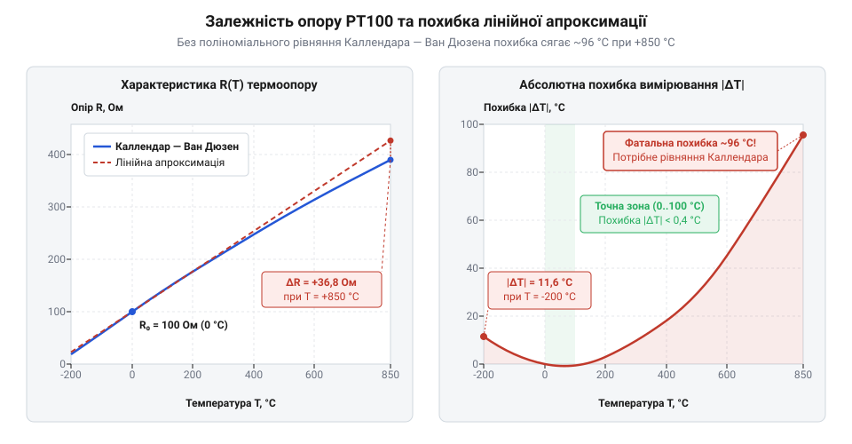
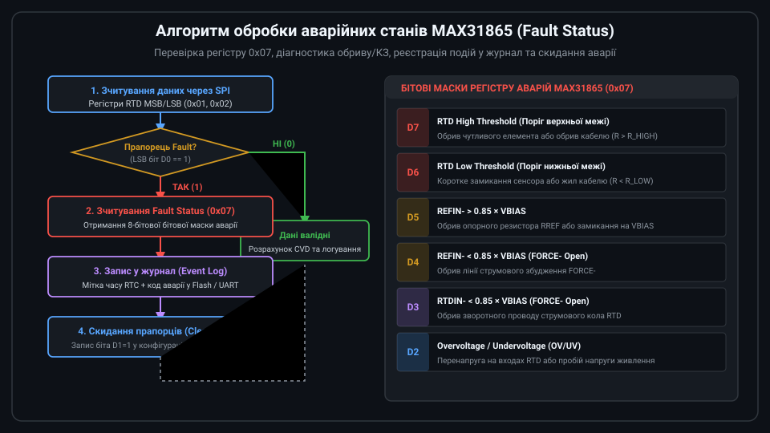

# Практична реалізація прецизійного термометра на базі PT100, MAX31865 та мікроконтролера

<preknowlist>
- [KY-013 — аналоговий давач температури (термістор)](root:cat-hw-sensors/ky-013-thermistor) — принципи вимірювання опору термісторів та їхню високу нелінійність
- [DS18B20 — цифровий давач температури (1-Wire)](root:cat-hw-sensors/ds18b20) — обмеження роздільної здатності й діапазону температур цифрових інтегральних давачів
- [LM35DZ — аналоговий давач температури (10 мВ/°C)](root:cat-hw-sensors/lm35) — уплив спаду напруги й аналогового шуму на точність прямого зчитування напруги
</preknowlist>

## Похибки вимірювання та вибір PT100

Вимірювання температури у промислових процесах чи кліматичних камерах вимагає стабільності показників у широкому діапазоні та протягом тривалого часу. Використання [простих термісторів](root:cat-hw-sensors/ky-013-thermistor) у таких умовах швидко призводить до похибок через їхню високу нелінійність та сильний @@en|термічний дрейф@@. Водночас [цифрові інтегральні давачі](root:cat-hw-sensors/ds18b20) мають обмежену верхню межу вимірювання, а [аналогові вимірювачі напруги](root:cat-hw-sensors/lm35) страждають від падіння напруги в довгих кабелях живлення та аналогових шумах.

Для подолання цих обмежень застосовують платиновий терморезистор @@en|PT100@@ (від англ. *Platinum* — платина та 100 Ом при 0 °C), який належить до класу резистивних детекторів температури (від англ. @@en|RTD@@: *Resistance Temperature Detector*). Платина має хімічну інертність та передбачувану залежність опору від температури у діапазоні від -200 °C до +850 °C.

Головним викликом під час роботи з @@en|PT100@@ є малий температурний коефіцієнт опору, який становить приблизно `0.385 Ом/°C`. Якщо сенсор підключено за допомогою стандартної 2-провідної лінії, вимірювальний прилад фіксує сумарний опір `R_total`:

```
R_total = R_RTD + 2 × R_line    [сума опору сенсора та двох з'єднувальних дротів]
```

де `R_RTD` — реальний опір платинового елемента, а `R_line` — @@en|паразитний опір@@ одного провідника кабелю. Навіть невеликий опір з'єднувальних дротів у `1.0 Ом` утворює систематичну похибку вимірювання температури `ΔT`:

```
ΔT = (2 × R_line) / 0.385    [ділення сумарного паразитного опору на температурний коефіцієнт]
= (2 × 1.0) / 0.385          [підстановка опору 1.0 Ом для кожного провідника]
≈ 5.19 °C                    [систематична похибка від паразитних дротів]
```

Відхилення у понад 5 °C є неприпустимим для прецизійних систем, де кінцева точність залежить від схеми підключення сенсора. Найпростіша @@en|2-провідна схема@@ додає опір обох з'єднувальних дротів безпосередньо до опору терморезистора. @@en|3-провідна схема@@ додає третій провідник для вимірювання спаду напруги й зменшення кількості дротів. Ця конфігурація розроблялася під @@en|мостова компенсація@@ (від англ. *bridge compensation* — компенсація у вимірювальному мості), де опір провідників урівноважується у суміжних плечах моста. Без мостової схеми 3-провідне підключення спирається на гіпотезу про абсолютну рівність опору всіх дротів. Найменша асиметрія провідників через різницю їхньої довжини, температурний градієнт чи якість контактів створює нескомпенсовану похибку, що робить 3-провідну схему недоцільною для прецизійних вимірювань. Щоб повністю усунути вплив `R_line`, використовується @@en|4-провідна схема@@ підключення. У цій конфігурації вимірювальний тракт розділяють на два незалежні кола: через два струмові провідники (Force+ та Force-) подається стабільний вимірювальний струм, а через інші два потенційні провідники (Sense+ та Sense-) знімається спад напруги безпосередньо з виводів терморезистора. Оскільки вхідний опір вимірювального фронтенду становить гігаоми, струм через потенційні дроти практично дорівнює нулю (`I_sense ≈ 0`), що робить спад напруги на них нікчемним і повністю виключає опір лінії з результатів вимірювання.

## Схемотехніка MAX31865 та підключення RTD

Вимірювання мікровольтних змін напруги на терморезисторі @@en|PT100@@ вимагає спеціалізованої аналогової обробки. Для цього застосовують @@en|аналоговий фронтенд@@ (від англ. *front-end* — вхідна вимірювальна схема) @@en|MAX31865@@, який інтегрує прецизійний дельта-сигма @@en|АЦП@@ (аналогово-цифровий перетворювач), джерело вимірювального струму та блок діагностики апаратних помилок.

На вимірювальному модулі зі встановленим чипом @@en|MAX31865@@ конфігурацію підключення визначають апаратні перемички (джампери). Для реалізації @@en|4-провідного підключення@@ сенсора перемичка `2/3 wire` залишається розімкненою, а контактні майданчики `4 wire` з'єднуються припаюванням. Струмові виводи сенсора підключають до клем `F+` (Force+) та `F-` (Force-), а вимірювальні потенційні лінії — до `RTD+` (Sense+) та `RTD-` (Sense-).


*Чотирипровідна схема підключення PT100 до MAX31865 з конфігурацією перемичок та шиною SPI.*

Ключовим елементом вимірювального тракту є @@en|опорний резистор@@ @@en|Rref@@ (від англ. *Reference Resistor*). Для давача @@en|PT100@@ його номінальне значення становить `400.0 Ом` (або `430.0 Ом` на деяких платах). Цей резистор повинен мати допуск точності не гірше `0.1%` та термічний коефіцієнт дрейфу до `15 ppm/°C`, оскільки будь-яка нестабільність номіналу `Rref` напряму спотворює результати обчислення опору RTD.

Обмін даними між мікроконтролером та @@en|MAX31865@@ здійснюється через послідовну шину @@en|SPI@@ (від англ. *Serial Peripheral Interface*). Модуль працює у режимах SPI Mode 1 (`CPOL=0, CPHA=1`) або Mode 3 (`CPOL=1, CPHA=1`) з передачею даних старшим бітом уперед (MSB first). Для опитування перетворювача використовуються стандартні лінії `CS` (вибір чипа), `SCLK` (тактування), `SDI` (вхід даних MOSI) та `SDO` (вихід даних MISO). Ключовим інструментом керування мікросхемою є @@en|конфігураційний регістр@@ (від англ. *Configuration Register*) за адресою `0x00` (для запису використовується адреса `0x80`), який визначає режими оцифрування та апаратні параметри фронтенду. Старший біт 7 (`VBIAS`) керує подачею напруги зсуву @@en|VBIAS@@ (від англ. *Bias Voltage*), без якої вимірювальне коло @@en|RTD@@ та @@en|Rref@@ не створює вхідного сигналу для @@en|АЦП@@; її вмикають перед початком вимірювання, а в режимі поодиноких замірів вимикають для запобігання самонагріву сенсора. Біт 6 (`Conversion Mode`) вибирає режим роботи: значення `1` вмикає автоматичне безупинне перетворення, а `0` переводить чип у режим очікування для поодиноких замірів за командою біта 5 (`1-shot`). Біт 4 (`3-Wire RTD`) визначає конфігурацію дротів: значення `0` задає 2- або 4-провідне підключення, а `1` активує внутрішню компенсацію для 3-провідної схеми. Біти 3:2 контролюють цикл автоматичної діагностики апаратних несправностей (від англ. *Fault Detection*), а біт 1 скидає прапорці помилок у регістрі статусу. Молодший біт 0 налаштовує режекторний фільтр придушення мережевих завад @@en|notch filter@@ (від англ. *notch* — виріз): значення `0` задає фільтрацію наведень частотою `60 Гц`, а `1` перемикає придушення на `50 Гц` промислової мережі живлення.

## Логометричне обчислення опору та калібрування

Пряме вимірювання напруги звичайним @@en|АЦП@@ має суттєвий недолік: будь-яке коливання напруги живлення мікроконтролера чи опорного джерела пропорційно змінює струм збудження давача і створює хибний дрейф показників. Щоб усунути цю залежність, чип @@en|MAX31865@@ реалізує @@en|логометричний метод@@ (від грец. *logos* — відношення) вимірювання, за якого струм збудження `I_bias` послідовно проходить через сенсор @@en|PT100@@ та опорний резистор @@en|Rref@@.

Падіння напруги на терморезисторі `V_RTD` та опорна напруга АЦП `V_ref` визначаються виразами:

```
V_RTD = I_bias × R_RTD    [падіння напруги на вимірювальному терморезисторі]
V_ref = I_bias × R_ref    [падіння напруги на опорному резисторі]
```

Оскільки @@en|АЦП@@ обчислює відношення вимірюваної напруги до опорної, струм `I_bias` у чисельнику та знаменнику повністю скорочується:

```
Code_ADC / 32768 = (I_bias × R_RTD) / (I_bias × R_ref)    [логометричне відношення напруг]
= R_RTD / R_ref                                          [скорочення струму живлення]
```

де `Code_ADC` — 15-бітний цифровий код, зчитаний із регістрів MAX31865 (значення від 0 до 32767), а `32768` відповідає повній шкалі `2¹⁵`. Фізичний опір сенсора `R_RTD` обчислюється за формулою:

```
R_RTD = (Code_ADC × R_ref) / 32768    [розрахунок опору RTD відносно опорного R_ref]
```

Програмна реалізація опитування чипа через @@en|SPI@@ та обчислення опору виглядає так:

:::tabs
@tab ESP-IDF (C)
```c|esp-idf
// Зчитування 15-бітного коду АЦП з регістрів MAX31865 та логометричний розрахунок опору
uint16_t raw_adc = (spi_read_register(MAX31865_REG_RTD_MSB) << 8 | 
                    spi_read_register(MAX31865_REG_RTD_LSB)) >> 1;
float r_rtd = ((float)raw_adc * R_REF_NOMINAL) / 32768.0f;
```
@tab Arduino (C++)
```cpp|arduino
// Отримання 15-бітного коду АЦП через SPI та обчислення опору RTD
uint16_t raw_adc = (read_spi_word(MAX31865_REG_RTD_MSB) >> 1);
float r_rtd = ((float)raw_adc * R_REF_NOMINAL) / 32768.0f;
```
:::

Для компенсації похибки монтування, опору друкованих доріжок та відхилення номіналу еталонного резистора `Rref` (відхилення якого навіть у 0.1% створює систематичну похибку вимірювання) застосовують @@en|двоточкове калібрування@@ (англ. @@en|two-point calibration@@, від фр. *calibre* — калібр та лат. *punctum* — точка) нуля й масштабу шкали. Одноточкове налаштування компенсує лише статичне @@en|зміщення нуля@@ (англ. @@en|zero offset@@), але залишає нескомпенсованим @@en|коефіцієнт підсилення@@ (англ. @@en|gain factor@@) та дрейф чутливості @@en|АЦП@@. Під час процедури двоточкового калібрування замість терморезистора @@en|PT100@@ послідовно підключають два еталонні резистори (або занурюють сенсор у контрольовані середовища при `0 °C` та `100.00 °C`): першим фіксують зчитаний опір `R_zero_meas` для еталона `100.00 Ом` (точка 0 °C), а другим — опір `R_span_meas` для еталона `138.51 Ом` (шкала @@en|span@@ при 100 °C).

```
gain = (R_ref_span - R_ref_zero) ÷ (R_span_meas - R_zero_meas)    [розрахунок коефіцієнта масштабування шкали]
= 38.51 ÷ (R_span_meas - R_zero_meas)                              [підстановка різниці еталонних опорів 138.51 Ом та 100.00 Ом]

R_offset = 100.00 - (R_zero_meas × gain)                           [обчислення зміщення нуля з урахуванням масштабу]
```

Коефіцієнт `gain` компенсує відхилення масштабу як відношення еталонного інтервалу `ΔR_ref = 138.51 - 100.00 = 38.51 Ом` до реально виміряної різниці `ΔR_meas = R_span_meas - R_zero_meas`. Розраховане зміщення `R_offset` та коефіцієнт `gain` додаються до подальших сирих вимірювань `R_raw`, визначаючи відкалібрований опір за формулою `R_cal = (R_raw × gain) + R_offset` (або `R_cal = 100.00 + (R_raw - R_zero_meas) × gain`), що повністю усуває лінійні похибки вимірювального тракту. Програмна реалізація розрахунку калібрувальних коефіцієнтів та обчислення точного опору має вигляд:

:::tabs
@tab ESP-IDF (C)
```c|esp-idf
// Обчислення коефіцієнтів двоточкового калібрування (еталони 100.00 Ом та 138.51 Ом)
float gain = (138.51f - 100.00f) / (r_span_meas - r_zero_meas);
float r_offset = 100.00f - (r_zero_meas * gain);

// Розрахунок відкаліброваного точного опору RTD з урахуванням зміщення та масштабу
float r_cal = (r_raw * gain) + r_offset;
```
@tab Arduino (C++)
```cpp|arduino
// Обчислення коефіцієнтів двоточкового калібрування (еталони 100.00 Ом та 138.51 Ом)
float gain = (138.51f - 100.00f) / (r_span_meas - r_zero_meas);
float r_offset = 100.00f - (r_zero_meas * gain);

// Розрахунок відкаліброваного точного опору RTD з урахуванням зміщення та масштабу
float r_cal = (r_raw * gain) + r_offset;
```
:::


*Відхилення опору PT100 від лінійної апроксимації порівняно з рівнянням Каллендара — Ван Дюзена у діапазоні від -200 °C до +850 °C.*

Отриманий опір `R_RTD` ще потрібно перетворити у температуру. Як видно з графіку, пряма лінійна апроксимація дає суттєву похибку на краях діапазону, тому для високої точності застосовують нелінійне [рівняння Каллендара — Ван Дюзена](root:cat-hw-sensors/pt100-rtd/math-pt100-callendar-van-dusen-equation.md).

## Лінеаризація за рівнянням Каллендара — Ван Дюзена

Спроба вирахувати температуру за лінійною формулою через фіксований коефіцієнт опирається на хибне припущення про постійність чутливості платини. На відміну від компонентів на кшталт [LM35DZ із лінійним](root:cat-hw-sensors/lm35) виходом, чутливість платинового елемента @@en|PT100@@ знижується зі зростанням температури. Набутий опір відхиляється від прямої лінії: при 200 °C похибка лінійного розрахунку сягає кількох градусів Цельсія, що неприпустимо для прецизійних вимірювань.

Фізична залежність опору платинового сенсора @@en|RTD@@ (від англійського Resistance Temperature Detector — опоровий давач температури) від температури `t` описується міжнародним @@en|рівнянням Каллендара — Ван Дюзена@@. У галузі додатних температур (`t ≥ 0 °C`) поліном скорочується до квадратного рівняння:

B · t² + A · t + (1 - R(t) ÷ R₀) = 0
t = (-A + √(A² - 4 · B · (1 - R(t) ÷ R₀))) ÷ (2 · B)      [розв'язок квадратного рівняння для t ≥ 0 °C]

Тут `R₀ = 100` Ом — номінальний опір @@en|PT100@@ при 0 °C, `A = 3.9083 × 10⁻³ °C⁻¹`, а `B = -5.775 × 10⁻⁷ °C⁻²`. Для від'ємних температур (`t < 0 °C`) у рівняння додається четвертий член з коефіцієнтом `C = -4.183 × 10⁻¹² °C⁻⁴`, унаслідок чого залежність перетворюється на поліном 4-го ступеня відносно `t` і аналітично не розв'язується у замкненій формі відносно температури. Щоб отримати пряму обернену функцію `t(R)`, коефіцієнти поліноміальної апроксимації 5-го ступеня виводять шляхом наближення кривої методом найменших квадратів (@@en|least-squares fit@@) або розкладом у ряд Тейлора для точного рівняння Каллендара — Ван Дюзена у діапазоні від -200 °C до 0 °C. Водночас для мікроконтролерів без апаратного блоку обчислень із плаваючою комою (@@en|FPU@@ — від англійського Floating-Point Unit) обчислення ступенів полінома вимагає ресурсоємного програмного емулювання плаваючої коми. Ефективною альтернативою є чисельний @@en|метод Ньютона — Рафсона@@, який шукає корінь рівняння `f(t) = R(t) - R_measured = 0` за ітераційною формулою `tₙ₊₁ = tₙ - f(tₙ) ÷ f'(tₙ)`, де `f'(t)` — перша похідна вихідного рівняння. Завдяки швидкій квадратичній збіжності алгоритм досягає високої точності всього за 3–4 ітерації та легко реалізується у фіксованій комі (@@en|fixed-point arithmetic@@) за допомогою цілочисельних операцій без обчислення високих ступенів полінома.


*Графік нелінійності платинового терморезистора та похибка лінійного розрахунку при віддаленні від нульової позначки.*

Для точного математичного перетворення виміряного опору в значення температури реалізують алгоритм лінеаризації.

:::tabs
:::code proj-pt100-max31865-rtd-logger/cpp/arduino/rtd-to-temperature.cpp
<!-- slide -->
:::code proj-pt100-max31865-rtd-logger/c/esp-idf/rtd-to-temperature.c
:::

## Обробка помилок та побудова логера

У реальних промислових умовах механічні вібрації та термічні навантаження призводять до обриву кабелю, короткого замикання або виходу параметрів АЦП за межі вимірювання. Якщо цифровий сенсор [DS18B20 з фіксованим](root:cat-hw-sensors/ds18b20) інтерфейсом повертає збій контрольної суми, то аналоговий фронтенд @@en|MAX31865@@ фіксує апаратні аварії у спеціальному діагностичному регістрі. Нехтування цими даними спричинить обчислення некоректних температур і хибну поведінку автоматики.

Аналоговий фронтенд @@en|MAX31865@@ містить регістр статусів помилок (@@en|Fault Status Register@@, адреса `0x07`). Під час кожного циклу вимірювання мікроконтролер зчитує цей байт через шину @@en|SPI@@ для аналізу 6 активних бітів аварій:

- Біт 7: перевищення верхньої межі опору (@@en|RTD High Threshold Fault@@).
- Біт 6: перевищення нижньої межі опору (@@en|RTD Low Threshold Fault@@).
- Біт 5: обрив або замкнення опорного входу (@@en|REFIN- > 0.85 × VBIAS@@).
- Біт 4: замикання струмового виводу (@@en|REFIN- < 0.85 × VBIAS@@).
- Біт 3: обрив або замикання лінії сенсора (@@en|RTDIN- < 0.85 × VBIAS@@).
- Біт 2: вихід напруги за межі живлення (@@en|Overvoltage / Undervoltage Fault@@).


*Послідовність опитування аналогового фронтенду, фільтрації апаратних помилок та пакування даних у телеметричний кадр.*

Щоб запобігти хибним спрацьовуванням через імпульсні завади на шині @@en|SPI@@ чи транзієнтні шуми живлення, мікроконтролер виконує процедуру підтвердження апаратних аварій через повторні спроби опитування. Перед аналізом або після виявлення ненульового коду збою мікроконтролер очищує прапорці аварій записом біта `D1` (@@en|Fault Status Clear@@) у конфігураційний регістр `0x00` (записом маски `0x02` за адресою `0x80`). Далі реалізується механізм повторних спроб (наприклад, 3 послідовні зчитування з коротким затриманням у 2–5 мс між ними): після кожного скидання прапорців регістр статусів опитується наново. Якщо помилка була спричинена наведенням на лінії зв'язку, прапорці після скидання не відновлюються, і пристрій повертається до звичайного оброблення показників. Якщо ж несправність є стійкою фізичною аварією (обрив кабелю, замикання або вихід напруги за межі), прапорець знову фіксується фронтендом @@en|MAX31865@@ на кожній спробі. Лише після вичерпання ліміту спроб вимірювання остаточно відкидається, а підтверджений статус збою заноситься у структурований пакет @@en|телеметрії@@.

:::tabs
:::code proj-pt100-max31865-rtd-logger/cpp/arduino/telemetrypacket.cpp
<!-- slide -->
:::code proj-pt100-max31865-rtd-logger/c/esp-idf/read-max31865-fault-esp.c
:::

Сформований пакет телеметрії передається у зовнішній промисловий канал зв'язку — наприклад, через [протокол Modbus RTU](root:com-protocol/modbus) або [мережевий шлюз MQTT](root:com-protocol/mqtt), що забезпечує безперервний автономний моніторинг температури без втрати даних.
