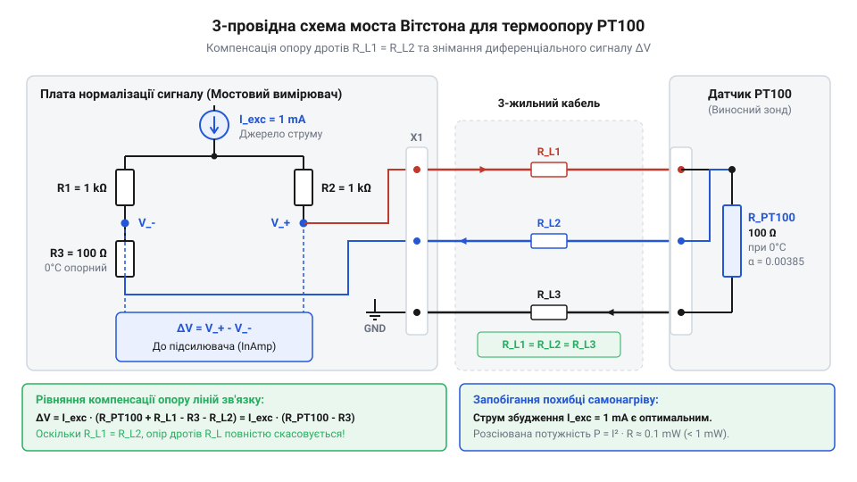
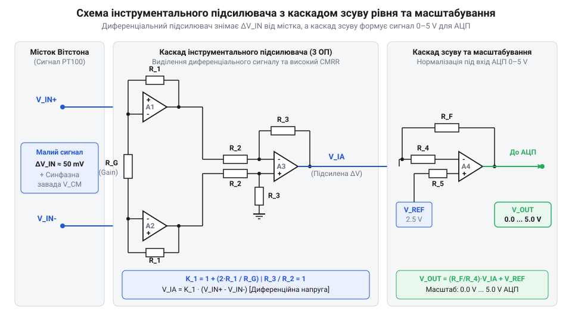

# Спроектування та монтаж аналогового мостового нормалізатора сигналу PT100 з виходом 0–5V

<preknowlist>
- [LM35DZ — аналоговий давач температури (10 мВ/°C)](root:cat-hw-sensors/lm35) — принципи аналогової нормалізації температурних сигналів у діапазони напруги АЦП
- [KY-013 — аналоговий давач температури (термістор)](root:cat-hw-sensors/ky-013-thermistor) — базові поняття вимірювання змін опору резистивних датчиків температури
</preknowlist>

## Проблема точного зчитування термоопору PT100

Платиновий @@en|термоопір@@ (від грец. *therme* — тепло та лат. *resisto* — опиратися) @@en|PT100@@ належить до сімейства резистивних давачів температури @@en|RTD@@ (від англ. *resistance temperature detector*). Фізичний принцип його роботи базується на зміні електричного опору високочистої платини під впливом температури: під час нагрівання амплітуда теплових коливань кристалічної ґратки металу зростає, що підвищує ймовірність розсіювання вільних електронів провідності на фононах і призводить до зростання питомого опору. Його опір при `0 °C` становить точно `100 Ω`, а середній температурний коефіцієнт α дорівнює `0.003851 1/°C` згідно зі стандартом @@en|IEC 60751@@. У першому наближенні це означає, що при зміні температури на `1 °C` опір змінюється лише на `0.3851 Ω`. Однак лінійна модель `R(T) = R_0 · (1 + α · T)` є лише спрощенням: точна характеристика платини описується залежністю Каллендара — Ван Дюзена `R(T) = R_0 · (1 + A · T + B · T²)` для температур вище `0 °C` (з коефіцієнтами `A ≈ 3.9083 · 10⁻³ °C⁻¹` та `B ≈ -5.775 · 10⁻⁷ °C⁻²`), а для від'ємних температур до рівняння додається член `C · (T - 100) · T³`. Наявність від'ємного квадратичного коефіцієнта `B` спричиняє параболічне відхилення реальної характеристики від лінійного наближення, що призводить до систематичної похибки вимірювання при розширенні робочого діапазону без відповідної аналогової чи цифрової корекції.

Якщо спробувати включити @@en|PT100@@ у звичайний дільник напруги з фіксованим резистором, як це роблять для [простих аналогових сенсорів](root:cat-hw-sensors/lm35) чи [нелінійних термісторів](root:cat-hw-sensors/ky-013-thermistor), виникають три фізичні обмеження:

1. **Мала величина корисного сигналу.** У діапазоні `0...100 °C` опір змінюється від `100 Ω` до `138.51 Ω`. На дільнику напруги це створює приріст сигналу в одиниці мілівольтів. Прямий вхід звичайного @@en|АЦП@@ (англ. *analog-to-digital converter*) мікроконтролера з роздільною здатністю 12 біт та опорною напругою `5 V` має крок квантування близько `1.22 mV`, що спричиняє похибку вимірювання у кілька градусів.
2. **Паразитний опір кабельних ліній.** З'єднувальні мідні дроти від давача до плати мають власний опір `R_line` (від `0.1 Ω` до кількох Омів). Оскільки цей опір включений послідовно з @@en|PT100@@, нехтування ним додає систематичну похибку. Опір дротів `0.385 Ω` розцінюється вимірювачем як хибне підвищення температури на цілий `1 °C`.
3. **Ефект самонагріву (@@en|self-heating@@).** Проходження вимірювального струму через платинову спіраль виділяє теплову потужність `P = I² · R`. Якщо струм збудження перевищує `1 mA`, термоопір нагріває сам себе, викривляючи результат вимірювання.

Для точного зчитування @@en|PT100@@ необхідна аналогова схема, яка пропускає стабільний струм `I_exc ≤ 1 mA`, виділяє різницю опору, компенсує опір кабелю та підсилює мікровольтний сигнал до діапазону `0–5 V`.

Математичний розрахунок похибки квантування (@@en|quantization error@@) пояснює, чому пряме непідсилене зчитування @@en|PT100@@ є непридатним для прецизійних вимірювань. Для 12-бітного АЦП (@@en|12-bit ADC@@) з опорною напругою `5.0 V` повна шкала містить `4096` відліків, що визначає крок напруги найменшого значущого розряду (@@en|LSB@@, англ. *least significant bit*) `5.0 V / 4095 ≈ 1.221 mV`. Без підсилення та нормування опір @@en|PT100@@ у діапазоні `0...100 °C` змінюється на `38.51 Ω` (від `100 Ω` до `138.51 Ω`). За безпечного струму збудження `1 mA` падіння напруги на термоопорі зростає лише на `ΔV = 1 mA · 38.51 Ω = 38.51 mV` на весь діапазон `100 °C`, що відповідає чутливості `0.3851 mV/°C`. За такого сигналу один крок АЦП `1.221 mV` відповідає зміні температури `ΔT = 1.221 mV / 0.3851 mV/°C ≈ 3.17 °C`, створюючи похибку квантування в понад `3.17 °C` на дискретний відлік.

## Мостова схема та трипровідна компенсація

Виділення малої зміни опору на тлі базових `100 Ω` при `0 °C` забезпечує мостова схема (англ. *bridge circuit*), побудована як @@en|міст Вітстона@@ (на честь вченого Чарльза Вітстона). Вона перетворює вимірювання абсолютного опору на вимірювання різниці напруг між двома плечима, усуваючи постійну складову `100 Ω` в аналоговому тракті.

Міст живлять прецизійним джерелом струму (англ. *precision current source*) `I_exc = 1 mA`, що гарантує лінійність напруги та запобігає самонагріву.

При трипровідному підключенні (англ. *3-wire connection*) до @@en|PT100@@ під'єднують три однакові жили кабелю з опорами `R_L1`, `R_L2` та `R_L3`.


*Схема вимірювального моста Вітстона з трьохпровідним підключенням PT100 та прецизійним джерелом струму 1 мА.*

Розрахунок номіналів плечей моста виконують з умови балансу при `0 °C`:
- Опорні резистори плечей `R1`, `R2`, `R3` обирають рівними базовому опору давача `R_0 = 100 Ω`.
- Струм `I_exc` ділиться навпіл між гілками моста: `I_branch = I_exc / 2 = 0.5 mA`.

Оскільки мілівольтний вихідний сигнал моста критично чутливий до будь-яких відхилень опорів плечей, до резисторів `R1`, `R2` та `R3` висуваються підвищені вимоги щодо точності та температурної стабільності:
- **Точність номіналу (допуск, @@en|tolerance@@):** Необхідно використовувати прецизійні резистори з допуском `0.1%` або `0.01%`. Звичайні елементи з точністю `1%` створюють початковий розбаланс моста, який перевищує увесь корисний діапазон вимірюваного сигналу.
- **Температурний коефіцієнт опору (@@en|temperature coefficient of resistance@@, @@en|TCR@@):** Для мінімізації температурного дрейфу нуля (@@en|thermal drift@@) обирають металоплівкові (@@en|metal-film resistors@@) або фольгові (@@en|metal foil resistors@@) резистори з ультранизьким дрейфом `5–15 ppm/°C` (або краще). Відхилення опору плечей моста при нагріванні плати викликає дрейф балансу, який сприймається підсилювачем як хибна зміна температури давача.

Диференційна напруга `V_diff` між вузлами моста `V_A` та `V_B` становить:
```
V_A = I_branch · (R3 + R_L1)
V_B = I_branch · (R_pt100 + R_L2)
V_diff = V_B - V_A
= I_branch · (R_0 + ΔR + R_L2 - (R3 + R_L1))      [підстановка R_pt100 = R_0 + ΔR]
= I_branch · ΔR                                  [при R1 = R2 = R3 = R_0 та R_L1 = R_L2]
```

Оскільки струм третього провідника `R_L3` прямує до високоомного входу підсилювача, струм через нього практично відсутній. За умови ідеальної рівності `R_L1 = R_L2` падіння напруги на них взаємно віднімаються у різниці `V_diff`. Проте на практиці кабель створює технологічну асиметрію опорів (англ. *lead resistance asymmetry*, від грец. *asymmetria* — нерозмірність) `ΔR_L = R_L2 - R_L1` через розкид діаметрів жил, опір контактних затискачів чи температурний градієнт уздовж траси. Ця некомпенсована різниця входить безпосередньо у вимірювальне плече й утворює залишкову похибку (англ. *residual error*) `V_err = I_branch · ΔR_L`. Оскільки чутливість @@en|PT100@@ становить лише `0.3851 Ω/°C`, різниця опорів усього в `0.3851 Ω` викликає системний зсув виміряної температури на `1 °C`. Для повного усунення впливу кабельних ліній використовують чотирипровідну схему підключення (англ. *4-wire connection*), також відому як підключення Кельвіна (англ. *Kelvin connection*, на честь фізика Вільяма Томсона, лорда Кельвіна): струм збудження `I_exc` подають через одну пару дротів, а різницю потенціалів знімають окремою парою високоомних вимірювальних жил, де струм дорівнює нулю і опір провідників взагалі не спотворює результат.

При зміні температури від `0 °C` до `100 °C`:
- Опір @@en|PT100@@ зростає від `100 Ω` до `138.51 Ω` (`ΔR = 38.51 Ω`).
- Вихідна диференційна напруга моста `V_diff` змінюється від `0 mV` до:
```
V_diff_max = 0.5 mA · 38.51 Ω
= 19.255 mV                                      [максимальна напруга на виході моста]
```

## Інструментальне підсилення та масштабування сигналу

Диференційний сигнал `0...19.255 mV` узгоджують з вхідним діапазоном `0–5 V` @@en|АЦП@@ каскадом нормування (англ. *signal conditioner stage*).

Основу каскаду складає @@en|інструментальний підсилювач@@ (англ. *instrumentation amplifier*) на прецизійних @@en|операційних підсилювачах@@ (англ. *operational amplifier*, або @@en|op-amp@@). Він забезпечує високий коефіцієнт пригнічення синфазного сигналу @@en|CMRR@@ (англ. *common-mode rejection ratio*), придушуючи синфазні наведення 50 Гц.


*Схема інструментального підсилювача на операційних підсилювачах з каскадом зсуву рівня та масштабування.*

Розрахунок коефіцієнта підсилення `K_g` для діапазону `0...100 °C` (`0...19.255 mV` -> `0...5 V`):
```
K_g = V_out_max / V_diff_max
= 5.0 V / 0.019255 V                             [співвідношення вихідного і вхідного діапазонів]
= 259.67                                         [необхідний коефіцієнт підсилення]
```
Оскільки підсилення @@en|інструментального підсилювача@@ визначається співвідношенням `K_g = 1 + (2 · R_f / R_G)`, величина `K_g` є обернено пропорційною до опору `R_G`. Через це @@en|допуск опору@@ (від лат. *tolerantia* — припустиме відхилення, англ. *resistor tolerance*) резистора `R_G` має вирішальний вплив на підсумкову точність каскаду: відносна зміна `R_G` майже 1:1 трансформується у відносну @@en|похибку підсилення@@ (англ. *gain error*). Наприклад, для `R_f = 24 kΩ` розраховане ідеальне значення `R_G ≈ 185.8 Ω`. Якщо вибрати найближчий стандартний резистор `187 Ω` із прецизійного @@en|ряду номіналів@@ @@en|E96@@ з допуском 1%, підсилення знизиться до `K_g ≈ 257.68`, що спричинить систематичне відхилення виходу близько `-0.77%` (-38.3 мВ при 5 В, або близько 0.8 °C похибки вимірювання). Крім того, температурне дрейфування опору `R_G` через його @@en|температурний коефіцієнт опору@@ (англ. *temperature coefficient of resistance*, або @@en|TCR@@) призводить до плавання шкали під час нагрівання плати, тому для `R_G` слід обирати металоплівкові прецизійні резистори з допуском 0.1% та низьким TCR (до ±15 ppm/°C) або компенсувати відхилення на етапі калібрування.

Коефіцієнт підсилення задають резистором `R_G`:
```
K_g = 1 + (2 · R_f / R_G)
```
Для `R_f = 24 kΩ` розраховане значення `R_G ≈ 185.8 Ω`.

Похибки компонентів компенсують двоточковим калібруванням (англ. *two-point calibration*). Програмне забезпечення зчитує відліки @@en|АЦП@@ та масштабує напругу у температуру за калібрувальними коефіцієнтами `gain` та `offset`.

:::tabs
:::code proj-pt100-opamp-bridge-conditioner/c/pt100.h
:::code proj-pt100-opamp-bridge-conditioner/c/pt100.c
:::code proj-pt100-opamp-bridge-conditioner/c/main.c
:::code proj-pt100-opamp-bridge-conditioner/cpp/Pt100Normalizer.hpp
:::code proj-pt100-opamp-bridge-conditioner/cpp/Pt100Normalizer.cpp
:::code proj-pt100-opamp-bridge-conditioner/cpp/main.cpp
:::

## Фільтрація наведень та монтаж схеми

Високий коефіцієнт підсилення інструментального підсилювача робить аналоговий тракт критично чутливим до мережевих завад частотою 50 Гц від електромережі та високочастотних імпульсних наведень. Оскільки платиновий термоопір є повільнозмінним давачем температури, смуга корисного сигналу не перевищує кількох герц, що дозволяє відфільтрувати всі високочастотні завади.

На відміну від напівпровідникового [аналогового давача LM35DZ](root:cat-hw-sensors/lm35), що видає відфільтрований сигнал із низьким вихідним опором, мікровольтний мостовий сигнал PT100 потребує апаратного захисту. Для пригнічення завад застосовують аналогову фільтрацію (від пізньолатинського *filtrum* — повсть; ФНЧ / @@en|low-pass filter@@). Активний `RC`-фільтр першого порядку інтегрують у зворотний зв'язок операційного підсилювача (ОП / @@en|op-amp@@) або будують як окремий каскад з частотою зрізу `f_c` у діапазоні 10–20 Гц.

Частоту зрізу визначають через опір `R` та ємність `C`:

```
f_c = 1 / (2 · π · R · C)
```

**Приклад розрахунку:** При номіналах `R = 16 kΩ` та `C = 1 µF` отримаємо:

```
f_c = 1 / (2 · 3.14159 · 16000 · 10⁻⁶)
    ≈ 9.95 Hz                            [розрахунок частоти зрізу]
```

Отримана частота пригнічує мережеву заваду 50 Гц понад 14 dB, що усуває флуктуації молодших розрядів аналогово-цифрового перетворювача (АЦП / @@en|ADC@@).

Трасування друкованої плати (@@en|PCB layout@@) вимагає суворого розділення аналогової (AGND) та цифрової (DGND) земель. Їх об'єднують в одній точці біля джерела живлення («зоряна земля» / @@en|star ground@@). Диференціальні лінії від моста Вітстона прокладають симетричними парами мінімальної довжини, а для мінімізації паразитної ємності (від латинського *parasitus* — той, що їсть поруч; @@en|parasitic capacitance@@) високоомних вхідних вузлів видаляють полігон землі безпосередньо під виводами операційного підсилювача та сигнальними трасами. Для частотної фільтрації аналогового сигналу обирають керамічні конденсатори з діелектриком `C0G` (`NP0`, @@en|C0G dielectric@@), які мають нульовий температурний коефіцієнт та не створюють мікрофонного ефекту, а для блокувальних конденсаторів (@@en|decoupling capacitors@@) ємністю 100 nF поряд із виводами живлення кожного підсилювача встановлюють кераміку типу `X7R` (@@en|X7R dielectric@@). Для віддаленого PT100 використовують трипровідний лінійний кабель у спільному екрані (@@en|shielding@@), підключаючи екран до аналогової землі лише з боку нормалізатора для запобігання земляним петлям (@@en|ground loop@@).

## Двоточкове калібрування та налагодження тракту

Навіть при використанні прецизійних резисторів із допуском 0.1% дискретний нормалізатор має технологічний розкид параметрів. Напруга зсуву (@@en|input offset voltage@@) операційних підсилювачів та відхилення струму збудження моста створюють похибку нуля та масштабу. Для усунення цих відхилень застосовують двоточкове калібрування (від арабського *qālib* — форма, матриця; @@en|zero and span calibration@@) нуля та діапазону. Під час процедури повірки замість давача підключають прецизійний магазин опорів (@@en|resistance decade box@@), проте сам еталон також зазнає впливу температури довкілля через власний температурний коефіцієнт опору. Якщо температура у вимірювальній лабораторії відхиляється від нормальної (зазвичай 20 °C), дійсний опір декад зміщується від номінального значення, створюючи приховану похибку еталона. Для її компенсації значення вихідного опору магазина розраховують з урахуванням його паспортного температурного коефіцієнта залежно від виміряної температури `T_lab` або забезпечують термостатування еталона в межах нормованого допуску.

Для проведення вимірювань нормалізатор підключають до прецизійного магазина опорів (@@en|resistance decade box@@) класу точності 0.05% замість давача PT100 (або використовують термостати 0 °C та 100 °C):
1. **Точка нуля (Zero / 0 °C):** Встановлюють опір 100.00 Ом та вимірюють вихідну напругу `V_meas1`.
2. **Точка діапазону (Span / 100 °C):** Встановлюють опір 138.51 Ом та вимірюють вихідну напругу `V_meas2`.

Обчислення коефіцієнтів підсилення (`gain` / @@en|gain@@) та зсуву (`offset` / @@en|offset@@) виконують за рівняннями:

```
gain = (V_ref2 - V_ref1) / (V_meas2 - V_meas1)     [обчислення нахилу прямої]
offset = V_ref1 - (gain · V_meas1)                [обчислення зсуву нуля]
```

Де `V_ref1 = 0.00 V` (для 0 °C), а `V_ref2 = 5.00 V` (для 100 °C). Скориговане значення напруги розраховують як:

```
V_calib = (V_raw · gain) + offset                 [підстановка скоригованого значення]
```

У програмному забезпеченні ця математична модель реалізується у C та C++ модулях нормалізації:

:::tabs
@tab C
:::code proj-pt100-opamp-bridge-conditioner/c/pt100.c 36-61

@tab C++
:::code proj-pt100-opamp-bridge-conditioner/cpp/Pt100Normalizer.cpp 33-58
:::

Розраховані коефіцієнти зберігають в енергонезалежній пам'яті (EEPROM або Flash) мікроконтролера. Це гарантує перетворення аналогового сигналу 0–5 V у фізичну температуру з мінімальною похибкою без використання нестабільних підлаштовувальних резисторів.
