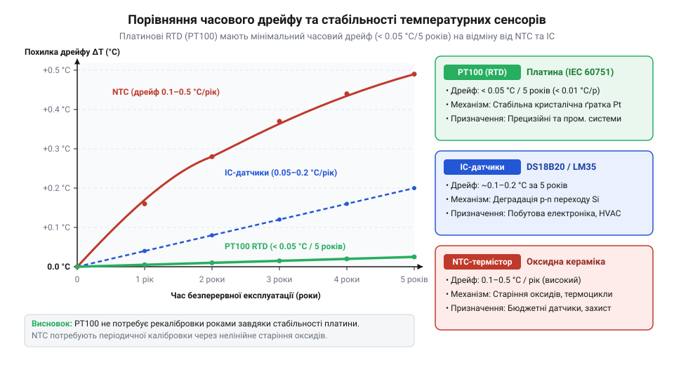
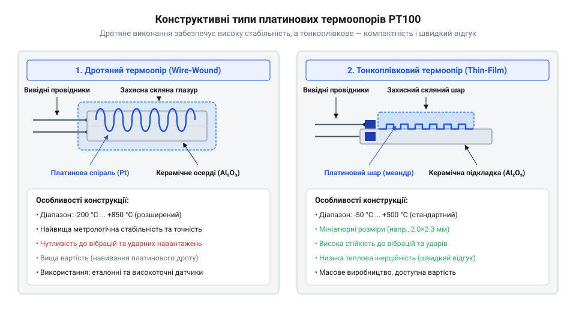
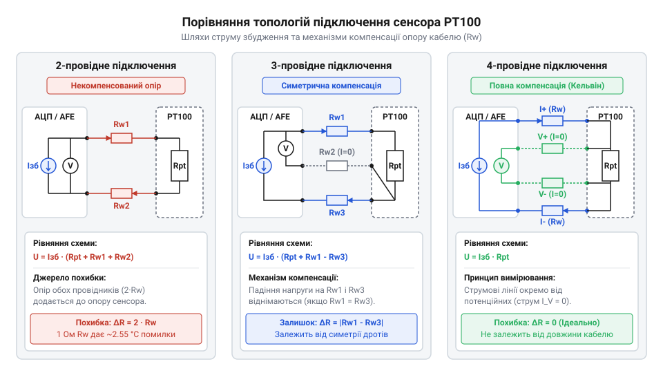
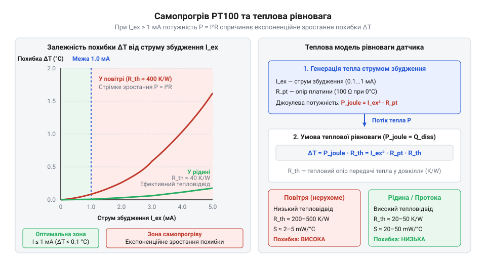
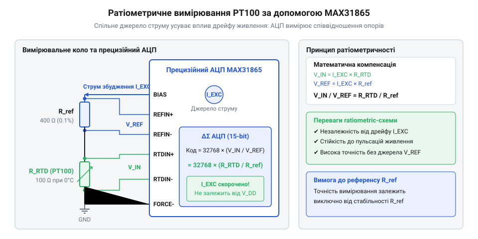

# PT100 — платиновий термоопір

<preknowlist>
- [KY-013 — аналоговий давач температури (термістор)](root:cat-hw-sensors/ky-013-thermistor) — принцип вимірювання температури через зміну опору та нелінійність NTC-характеристик
- [LM35DZ — аналоговий давач температури (10 мВ/°C)](root:cat-hw-sensors/lm35) — обмеження аналогових напівпровідникових датчиків у промислових вимірюваннях
- [DS18B20 — цифровий давач температури (1-Wire)](root:cat-hw-sensors/ds18b20) — відмінності між інтегральними цифровими датчиками та первинними резистивними перетворювачами
</preknowlist>

## Проблема нестабільності та похибок термовимірювання

У критичних технологічних процесах, таких як хімічний синтез, пастеризація харчових продуктів або кріогенне заморожування, відхилення виміряної температури навіть на частку градуса спричиняє псування всієї партії або аварійне зупинення обладнання. Більшість доступних первинних перетворювачів чудово працюють у вузьких побутових діапазонах, але зазнають суттєвої деградації за жорстких експлуатаційних умов. Коли вимірювальна система працює у вузькому діапазоні за кімнатної температури, звичайні [аналогові NTC-термістори демонструють](root:cat-hw-sensors/ky-013-thermistor) достатній рівень чутливості за низької собівартості. Однак при спробі застосувати `@@en|NTC-термістор@@` (англ. @@en|NTC thermistor@@, від @@en|Negative Temperature Coefficient@@ — негативний температурний коефіцієнт) у широкому інтервалі температур розкривається його головний фізичний недолік — крута експоненціальна нелінійність та вразливість до деградації матеріалу.

При постійному нагріванні та регулярних теплових циклах напівпровідникова кераміка термістора зазнає незворотних фізико-хімічних змін: дифузія катіонів перехідних металів між кристалічними зернами та міграція кисневих вакансій змінюють енергію активації провідності. На межі металевого електрода й керамічного тіла через різницю коефіцієнтів теплового розширення виникають суттєві термомеханічні напруження, а міжфазна дифузія атомів металу руйнує омічний контактний перехід. Утворення мікротріщин та окиснення контактного шару змінюють висоту потенціальних бар'єрів і збільшують опір переходу. Крім деградації контактів, у місцях з'єднання металевих виводів із напівпровідником за наявності температурного градієнта виникає паразитне `@@en|термо-ЕРС@@` (англ. @@en|thermo-EMF@@, від грец. *therme* — тепло та лат. *motio* — рух) через `@@en|ефект Зеебека@@` (англ. @@en|Seebeck effect@@). Оскільки напівпровідникові матеріали мають у сотні разів вищий термоелектричний коефіцієнт порівняно з металами, навіть малий перепад температур уздовж корпусу датчика створює паразитну напругу в кілька мілівольтів, що прямо додається до вимірювального сигналу. Ці мікроскопічні деградаційні процеси змінюють питомий опір матеріалу й висоту потенціальних бар'єрів, що викликає `@@en|температурний дрейф@@` (англ. @@en|thermal drift@@, від @@en|drift@@ — зсув) початкового опору, внаслідок чого показання сенсора незворотно зміщуються з часом, а початкове калібрування втрачає чинність. З іншого боку, `@@en|напівпровідникові сенсори@@` (англ. @@en|semiconductor sensor@@), до яких належать [аналогові сенсори LM35DZ](root:cat-hw-sensors/lm35), спрощують схемотехніку завдяки лінійній вихідній напрузі, проте фізична природа електронно-діркових переходів на монокристалі силіцію обмежує робочий діапазон значеннями від `-55 °C` до `+150 °C` і залишає їх чутливими до кристалічної деградації й термо-ЕРС. Якщо ж вимірювач побудовано на базі інтегральних схем, де [цифрові датчики DS18B20](root:cat-hw-sensors/ds18b20) передають готовий цифровий код по шині 1-Wire, виникає аналогічне бар'єрне обмеження за температурою та неможливість занурення пластмасового корпусу в агресивні середовища без додаткового захисту. На відміну від напівпровідникових сенсорів, чиста платина має стабільні атомарні ґрати без потенціальних бар'єрів, утворює однорідні зварні контакти та має нехтовно малу термо-ЕРС, що повністю усуває контактну деградацію й термоелектричний дрейф.


*Порівняльний графік температурного дрейфу та часової нестабільності NTC-термісторів, напівпровідникових датчиків та платинових RTD показує часове зміщення показань напівпровідників на відміну від високої метрологічної стабільності платинових елементів.*

Для усунення цих похибок промисловий контроль вимагає первинного перетворювача, матеріал якого має високу хімічну інертність, високу температуру плавлення та відтворюваний `@@en|позитивний температурний коефіцієнт опору@@` (англ. @@en|Positive Temperature Coefficient@@, скорочено @@en|PTC@@). Серед усіх металів саме чиста платина виявилася найкращим кандидатом: вона не окислюється у широкому діапазоні температур від `-200 °C` до `+850 °C` і має стабільні атомарні ґрати, які забезпечують чітку залежність опору від температури. Пошук матеріалу з незмінними у часі характеристиками спричинив розвиток термометрії опору, що пройшов шлях від досліджень Вільяма Сіменса до [міжнародної стандартизації платини](root:cat-hw-sensors/pt100-rtd/hist-pt100-rtd-evolution.md) у XX столітті. Для подолання цих обмежень у критичних вузлах застосовують елементи з [родини резистивних перетворювачів](root:cat-hw-sensors/rtd-resistance-temperature-detectors-family-overview) температури. Так званий `@@en|RTD@@` (англ. @@en|Resistance Temperature Detector@@, від лат. @@la|resistere@@ — чинити опір) на основі платини стає метрологічним стандартом, на якому будується прецизійне термовимірювальне обладнання.

## Фізичні принципи та конструкції PT100

Платиновий терморезистор `@@en|PT100@@` (від хімічного символу @@en|Pt@@ — платина, та значення 100 Ом) отримує свою назву від базового опору `100 Ω`, який елемент має за температури `0 °C`. Фізична сутність роботи сенсора полягає в розсіюванні електронних хвиль на коливаннях кристалічної ґратки платини. З підвищенням температури амплітуда теплових коливань іонів зростає, що збільшує ймовірність зіткнення носіїв заряду та призводить до впорядкованого зростання електричного опору.

Стандартне значення температурного коефіцієнта для чистої вимірювальної платини становить `α = 0.003851 °C⁻¹`. Вузький діапазон вимірювань дозволяє описати зміну опору від температури за допомогою лінійного співвідношення. Взаємозв'язок між опором платинового сенсора та його температурою описують лінійною залежністю, де підсумковий опір `R(T)` обчислюють на основі базового опору `R_0` при температурах вище `0 °C`:

```
R(T)
= R_0 × (1 + α × T)           [базове лінійне наближення]
```

Для демонстрації пропорційності розрахуємо опір `@@en|PT100@@` за температури `100 °C`:

```
R(100)
= 100 × (1 + 0.003851 × 100)  [підстановка базового опору 100 Ом та α = 0.003851 °C⁻¹]
= 100 × (1 + 0.3851)          [обчислення температурного приросту]
= 138.51                      [підсумкове значення опору в Омах]
```

Отримана величина `138.51 Ω` показує, що з кожним градусом Цельсія опір чистої платини зростає приблизно на `0.3851 Ω`. Однак на ширших інтервалах виявляється слабка квадратична залежність. Для обчислення температури у ширших діапазонах використовують [розрахунок за рівнянням](root:cat-hw-sensors/pt100-rtd/math-pt100-callendar-van-dusen-equation.md) Каллендара — Ван Дюзена.

За залежністю від технології виготовлення платинові сенсори поділяють на два основні типи [родини резистивних перетворювачів](root:cat-hw-sensors/rtd-resistance-temperature-detectors-family-overview). Перший тип — `@@en|дротяний термоопір@@` (англ. @@en|wire-wound RTD@@), у якому найтонший платиновий дріт намотано на керамічний або скляний каркас і вміщено у захисну трубу. Вільне закріплення дроту в керамічних капілярах дозволяє платині безперешкодно розширюватися при нагріванні, що забезпечує найвищу стабільність і широкий температурний діапазон від `-200 °C` до `+850 °C`, однак така конструкція має високу вартість і чутливість до сильної вібрації. Другий тип — `@@en|тонкоплівковий термоопір@@` (англ. @@en|thin-film RTD@@), який створюють шляхом вакуумного напилення тонкої платинової плівки на керамічну підкладку з наступним лазерним підганянням опору. Тонкоплівкові елементи відрізняються компактними розмірами, малим часом теплової відповіді та стійкістю до механічних ударів, але їхній робочий діапазон зазвичай обмежений межами від `-50 °C` до `+500 °C`. Головним фізичним обмеженням тонкоплівкової технології є різниця, яку має `@@en|коефіцієнт теплового розширення@@` металевої платини та оксидокерамічної підкладки. Жорсткий механічний контакт між напиленим шаром і керамікою під час температурних коливань викликає `@@en|термомеханічні напруження@@` (від грец. *therme* — тепло та *mechane* — пристрій) на межі поділу матеріалів. За температур понад `+500 °C` ці напруження спричиняють мікродеформації, рекристалізацію платинової плівки та взаємну дифузію атомів підкладки в метал, що призводить до незворотного дрейфу базового опору `R_0`. При охолодженні нижче `-50 °C` виникають стискаючі зусилля, які деформують кристалічну ґратку платини та створюють паразитну зміну електричного опору поза тепловим розсіюванням носіїв заряду.


*Конструктивне виконання дротяного та тонкоплівкового датчиків PT100 показує різницю у фіксації платинового елемента та чутливості до механічних навантажень.*

Для уніфікації вимірювальних систем `@@en|стандарт IEC 60751@@` (англ. @@en|IEC 60751 standard@@) визначає класи точності, які формулюють максимально припустиме відхилення температури `ΔT`. Припустимі відхилення опору та температурні допуски чітко регламентує [галузевий нормативний стандарт](root:cat-hw-sensors/iec-60751-standard-for-rtd), який класифікує сенсори за кількома категоріями точності:
- Клас AA: `ΔT = ±(0.10 + 0.0017 × |T|) °C`
- Клас A: `ΔT = ±(0.15 + 0.0020 × |T|) °C`
- Клас B: `ΔT = ±(0.30 + 0.0050 × |T|) °C`
- Клас C: `ΔT = ±(0.60 + 0.0100 × |T|) °C`

Оскільки вимірювальні тракти та аналого-цифрові перетворювачі вимірюють безпосередньо опір у вимірювальному колі, інженеру необхідно перераховувати температурний допуск `ΔT` у граничне відхилення опору `ΔR`. Для платини із середньою чутливістю `0.3851 Ω/°C` абсолютний допуск опору визначають як добуток температурного допуску на чутливість: `ΔR = ΔT × 0.3851 Ω`.

**Розрахунок допуску опору для класу A за температури 0 °C:**
```
ΔT(0)
= ±(0.15 + 0.0020 × |0|)      [підстановка T = 0 °C у формулу класу A]
= ±0.15                       [температурний допуск у градусах Цельсія]

ΔR(0)
= ΔT(0) × (R_0 × α)           [формула переведення температурного допуску в опір]
= ±0.15 × (100 × 0.003851)    [підстановка базового опору 100 Ом та α = 0.003851 °C⁻¹]
= ±0.15 × 0.3851              [обчислення чутливості платини 0.3851 Ом/°C]
= ±0.057765                   [отриманий абсолютний допуск опору в Омах]
≈ ±0.058                      [округлене значення припустимого відхилення опору]
```

Для порівняння числових значень допусків за стандартних температур `0 °C` (точка танення льоду, де `R_0 = 100 Ω`) та `100 °C` (точка кипіння води, де `R(100) = 138.51 Ω`) перераховані межі опору для всіх класів мають такий вигляд:
- Клас AA: при `0 °C` температурний допуск `ΔT = ±0.10 °C` відповідає допуску опору `ΔR ≈ ±0.039 Ω` (інтервал `99.961...100.039 Ω`); при `100 °C` маємо `ΔT = ±0.27 °C`, що дає `ΔR ≈ ±0.104 Ω` (інтервал `138.406...138.614 Ω`).
- Клас A: при `0 °C` допуск `ΔT = ±0.15 °C` дає `ΔR ≈ ±0.058 Ω` (`99.942...100.058 Ω`); при `100 °C` допуск `ΔT = ±0.35 °C` відповідає `ΔR ≈ ±0.135 Ω` (`138.375...138.645 Ω`).
- Клас B: при `0 °C` допуск `ΔT = ±0.30 °C` дає `ΔR ≈ ±0.116 Ω` (`99.884...100.116 Ω`); при `100 °C` допуск `ΔT = ±0.80 °C` відповідає `ΔR ≈ ±0.308 Ω` (`138.202...138.818 Ω`).
- Клас C: при `0 °C` допуск `ΔT = ±0.60 °C` дає `ΔR ≈ ±0.231 Ω` (`99.769...100.231 Ω`); при `100 °C` допуск `ΔT = ±1.60 °C` відповідає `ΔR ≈ ±0.616 Ω` (`137.894...139.126 Ω`).

Ці числові значення показують, що для високопрецизійного класу AA вимірювальна система повинна розрізняти відхилення опору менше за `0.04 Ω`, що висуває суворі вимоги до шуму АЦП та паразитного опору дротів.

Дротяні сенсори класу A або AA обирають для прецизійного лабораторного контролю та еталонних вимірювачів, тоді як тонкоплівкові елементи класу B становлять основу масових промислових і автомобільних систем. Для збереження класу точності під час підключення сенсора до вимірювача критично важливо дотримуватися [топології з'єднання провідників](root:cat-hw-sensors/pt100-rtd/api-pt100-hardware-wiring-and-topologies.md).

## Паразитний опір ліній та схемотехніка

Винесення термоопору на відстань 20 або 50 метрів від вимірювального контролера перетворює звичайний кабельний провідник на джерело систематичної вимірювальної похибки. Мідна жила кабелю перерізом 0.5 мм² довжиною 20 метрів має власний електричний опір близько 0.7 Ом. Оскільки струм прямує до сенсора і повертається назад, загальний @@en|паразитний опір@@ (від грец. παράσιτος — той, що живиться за чужий рахунок, завада) двох ліній становить 1.4 Ом. Для платинового первинного перетворювача @@en|PT100@@ з початковим опором `R₀ = 100 Ом` при `0°C` та чутливістю `α ≈ 0.385 Ом/°C` додатковий опір дротів сприймається вимірювальним приладом як помилкове підвищення температури майже на `3.6°C`. На відміну від [аналогових NTC термісторів](root:cat-hw-sensors/ky-013-thermistor), де високий початковий опір у десятки кілоом робить опір дротів непомітним, для низькоомного датчика @@en|RTD@@ опір кабелю стає критичним фактором.

Найпростішим способом з'єднання є @@en|двопровідне підключення@@, у якому двохжильний кабель підключається безпосередньо до виводів платинового резистора. При використанні такої схеми вимірювальний прилад реєструє сумарний опір кола `R_total`, де опір двох провідників `R_line1` та `R_line2` послідовно додається до опору сенсора `R_sensor`.

```
R_total
= R_sensor + R_line1 + R_line2      [підсумовування послідовних опорів]
= R_sensor + 2 × R_line             [за припущення симетрії провідників]
```

З отриманого виразу видно, що вимірювальний прилад не здатний відокремити опір сенсора від опору сполучних ліній. Будь-які температурні коливання вздовж самого кабелю змінюють опір міді й створюють дрейф показань, який неможливо компенсувати простим відніманням константи.

Для усунення впливу довжини кабелю без суттєвого подорожчання монтажу застосовують @@en|компенсаційне трипровідне підключення@@ (від лат. *compensare* — врівноважувати). У цій схемі до одного кінця платинового елемента підключають один провідник, а до другого — два. Під час побудови [мостових вимірювальних кіл](root:hw-sensing/wheatstone-bridge-circuits-in-measurement) один провідник подає струм живлення `I_ex`, а інші два вмикаються у суміжні плечі вимірювального моста з однаковим опорним опором `R_0`, де напруга в діагоналі моста `U_diag` обчислюється як різниця спадів напруги на гілках із вимірювальними провідниками `R_line1` та `R_line2`. У сучасній схемотехніці мостові схеми часто замінюють на активну компенсацію за допомогою двох [прецизійних джерел струму](root:hw-analog/precision-constant-current-sources-for-sensors) `I_ex1` та `I_ex2` однакового номіналу. Перше джерело подає @@en|струм збудження@@ `I_ex1` через перший провідник `R_line1` і сенсор `R_sensor`, а друге — струм `I_ex2` через другий провідник `R_line2`, після чого обидва струми зливаються й повертаються через третій спільний дріт `R_line3`. Вимірювальний підсилювач або @@en|AFE@@ знімає різницю потенціалів між першим та другим провідниками `U_diff = (I_ex1 × R_line1 + I_ex1 × R_sensor + U_line3) - (I_ex2 × R_line2 + U_line3) = I_ex1 × R_sensor + I_ex1 × R_line1 - I_ex2 × R_line2`. За умови суворого узгодження джерел (`I_ex1 = I_ex2 = I_ex`) та симетрії провідників (`R_line1 = R_line2`) спади напруги на дрітах повністю взаємознищуються: `U_diff = I_ex × R_sensor`. Це забезпечує строгу лінійність вихідного сигналу без нелінійності вимірювального моста, проте вимагає прецизійного фабричного узгодження джерел струму у мікросхемі, адже найменша розбіжність джерел `ΔI_ex = I_ex1 - I_ex2` або несиметрія ліній створює некомпенсовану похибку `U_err = ΔI_ex × R_line`.

```
U_diag
= I_ex × (R_sensor + R_line1) - I_ex × (R_0 + R_line2)    [різниця спадів напруги у суміжних плечах моста]
= I_ex × (R_sensor - R_0 + R_line1 - R_line2)              [винесення струму збудження за дужки]
= I_ex × (R_sensor - R_0 + ΔR_line)                        [заміна різниці опорів ліній на несиметрію ΔR_line]
```

З отриманого математичного виразу видно, що за ідеальної симетрії провідників (`R_line1 = R_line2` та `ΔR_line = 0`) спади напруги на дрітах взаємно віднімаються у вимірювальній діагоналі, повністю компенсуючи вплив кабелю. Проте коли виникає @@en|несиметрія ліній@@ (`ΔR_line ≠ 0`), спричинена технологічним допуском перерізу жил, нестабільним контактним опором клемників або нерівномірним впливом @@en|температурного градієнта@@ (від лат. *gradiens* — той, що крокує, зміна температури вздовж траси кабелю, яка по-різному змінює опір жил за температурним коефіцієнтом міді `α_Cu ≈ 0.00393 1/°C`), різниця `ΔR_line` створює некомпенсовану похибку `U_err = I_ex × ΔR_line`. Для первинного перетворювача @@en|PT100@@ із чутливістю `α ≈ 0.385 Ом/°C` навіть незначний перекос опорів `ΔR_line = 0.1 Ом` призводить до систематичного зсуву показань температури `ΔT = ΔR_line ÷ α ≈ 0.26°C`, що робить трипровідну компенсацію непридатною для прецизійних задач за наявності температурних перепадів уздовж кабелю.

Коли ідеальна симетрія опору дротів неможлива або присутні нестабільні контактні опори клемників, найвищу точність забезпечує @@en|чотирипровідне підключення@@ (також відоме як схема Кельвіна, на честь Вільяма Томсона, лорда Кельвіна). У цій топології через дві окремі лінії пропускають вимірювальний струм, а через інші дві вимірюють спад напруги безпосередньо на платиновому елементі. Оскільки вхідний опір вимірювального підсилювача чи АЦП сягає гігаом, струм через вимірювальні провідники практично дорівнює нулю (`I_sense ≈ 0`). Завдяки цьому спад напруги на вимірювальних драх відсутній (`U_drop = 0`), і виміряна напруга `U_sense = I_ex × R_sensor` залежить виключно від опору сенсора.


*Схемотехнічні топології підключення сенсора PT100 і компенсація падіння напруги на вимірювальних лініях.*

Вибір конкретної топології визначається компромісом між вартістю кабелю та вимогами до похибки. Для лабораторних і прецизійних вимірювань використовують виключно чотирипровідне підключення, тоді як у промисловості найпоширенішим є трипровідний стандарт. Здіснити повний [математичний розрахунок похибок](root:cat-hw-sensors/pt100-rtd/math-pt100-errors-and-lead-compensation.md) від паразитного опору кабелю та вивчити детальні [стандарти колірного маркування](root:cat-hw-sensors/pt100-rtd/api-pt100-hardware-wiring-and-topologies.md) виводів можна у відповідних інженерних специфікаціях.

## Ефект самонагріву та струм збудження

Навіть за повного усунення впливу паразитного опору кабелю вимірювальний тракт стикається з фізичним обмеженням первинного перетворювача. Оскільки платиновий датчик @@en|PT100@@ є пасивним резистивним елементом, вимірювання його опору вимагає пропускання електричного струму. Однак проходження струму через омічний провідник неминуче виділяє Джоулеве тепло (на честь Джеймса Прескотта Джоуля). Виділена потужність штучно підвищує температуру самого платинового елемента відносно вимірювального середовища, створюючи систематичний @@en|самонагрів@@ (від англ. *self-heating*).

Явища теплообміну визначаються балансом між електричною потужністю `P` та швидкістю відведення тепла у навколишній простір. Величина температурного зсуву `ΔT` описується через @@en|коефіцієнт розсіювання@@ `E_d` (від лат. *dissipatio* — розвіювання), який показує кількість теплової потужності у міліватах, необхідну для нагріву елемента на `1°C`.

```
ΔT
= P ÷ E_d                  [ділення теплової потужності на коефіцієнт розсіювання]
= (I² × R_sensor) ÷ E_d    [підстановка Джоулевої потужності]
```

З розрахункового виразу видно, що самонагрів зростає пропорційно квадрату вимірювального струму `I` та обернено пропорційно коефіцієнту розсіювання `E_d`. Значення `E_d` суттєво залежить від теплопровідності й швидкості руху вимірювального середовища. У нерухомому повітрі коефіцієнт розсіювання становить всього `2–5 мВт/°C`, у рухомому повітряному потоці зростає до `10–20 мВт/°C`, а у воді чи олії досягає `50–100 мВт/°C`. Якщо через @@en|RTD@@ сенсор у повітрі пропустити струм `5 мА`, виділена потужність `P = (0.005 A)² × 100 Ом = 2.5 мВт` спричинить хибне підвищення показань на `0.5–1.25°C`.

Для мінімізації самонагріву вимірювальний @@en|струм збудження@@ обмежують значенням не більше `1 мА`, а у прецизійних системах — від `100 мкА` до `500 мкА`. Використання [генераторів стабільного струму](root:hw-analog/precision-constant-current-sources-for-sensors) з рівнем `1 мА` знижує Джоулеве виділення до `0.1 мВт`, що утримує температурний зсув в межах `0.02°C` навіть у повітрі. Проте надмірне зменшення струму нижче `100 мкА` пропорційно знижує рівень корисного спаду напруги до мікровольтів: при нормативній чутливості платини `0.385 Ом/°C` струм `100 мкА` дає приріст сигналу лише `38.5 мкВ/°C`, а струм `10 мкА` — критичні `3.85 мкВ/°C`. У малосигнальному тракті корисний відгук починає конкурувати з джерелами аналогових наводок — тепловим шумом самого резистора, низькочастотним шумом підсилювачів, мережевою наводкою `50 Гц` та ємнісними завадами від цифрових ліній. Особливо критичною на малій амплітуді є @@en|паразитна термо-ЕРС@@ (від грец. *therme* — тепло та англ. *EMF*, electromotive force): з'єднання платини з міддю та припоєм утворюють паразитичні термопари, які через температурний градієнт ґенерують постійну напругу зсуву `V_emf` у кілька мікровольтів. Коли амплітуда цих завад наближається до корисного приросту напруги, @@en|співвідношення сигнал/шум@@ (від англ. *signal-to-noise ratio*, SNR) стрімко падає, що спричиняє флуктуації показань АЦП і втрату точності вимірювання. Для усунення постійного зсуву від термопар без збільшення струму застосовують @@en|реверсування струму збудження@@ (від лат. *reversio* — повернення): АЦП робить два послідовних зчитування, змінюючи напрямок струму через сенсор з `+I` на `-I`. У першому такті отримують напругу `V_pos = I × R + V_emf`, а у другому — `V_neg = -I × R + V_emf`. Обчислення половини різниці `(V_pos - V_neg) ÷ 2` дає чисте значення `I × R`, оскільки спад напруги на опорі платини змінює знак разом із струмом, а термо-ЕРС залишається незмінною через залежність лише від різниці температур спаїв. Цей метод дає змогу впевнено виділяти малий корисний сигнал, проте подвоює час вимірювального циклу та вимагає апаратної комутації ключів струмового джерела. Механізм компенсації ламається у разі швидких температурних дрейфів, коли `V_emf` встигає змінитися між тактами, або за виникнення комутаційних завад на високих частотах реверсування.


*Залежність самонагріву елемента PT100 від струму збудження та коефіцієнта розсіювання вимірювального середовища.*

Сучасна схемотехніка вирішує цю суперечність застосуванням імпульсного живлення та раціометричного вимірювання. Спеціалізовані чипи, такі як [аналоговий перетворювач MAX31865](root:hw-sensing/max31865-rtd-to-digital-converter), подають струм у вимірювальне коло лише на кілька мілісекунд під час оцифрування. Для загального ознайомлення з принципами побудови таких систем варто вивчити [огляд родини RTD](root:cat-hw-sensors/rtd-resistance-temperature-detectors-family-overview) перетворювачів. Порівняно з [цифровими датчиками DS18B20](root:cat-hw-sensors/ds18b20), які мають інтегровану обробку, точне аналогове керування струмом збудження @@en|PT100@@ дозволяє досягати максимальної метрологічної стабільності.

## Нормалізація сигналу та спеціалізовані AFE

Малоінтенсивний аналоговий сигнал від платинового елемента `@@en|PT100@@` створює складну інженерну проблему під час передачі на вхід мікроконтролера. При безпечному струмі збудження в `1 мА` спад напруги на сенсорі за температури `0 °C` становить всього `100 мВ`, а при нагріванні до `100 °C` зростає до `138.51 мВ`. Корисна зміна напруги у повному діапазоні `100 °C` складає лише `38.51 мВ`, що дає середню чутливість близько `0.385 мВ/°C`. Якщо подати такий сигнал безпосередньо на вхід аналогово-цифрового перетворювача (`@@en|АЦП@@`) мікроконтролера з опорною напругою `3.3 В` та розрядністю 12 біт, роздільна здатність вимірювання становитиме понад два градуси на один молодший значущий розряд (`@@en|LSB@@` — від англ. @@en|Least Significant Bit@@), а природний шум шини живлення повністю спотворить результат.

Для розширення динамічного діапазону класична аналогова схемотехніка використовує `@@en|міст Уітстона@@`. Збалансований резистивний міст дозволяє відніманням компенсувати початковий спад `100 мВ` за `0 °C`, завдяки чому напруга у вимірювальній діагоналі стає пропорційною виключно відхиленню температури від нуля. Іншим підходом є застосування [прецизійних джерел стабільного струму](root:hw-analog/precision-constant-current-sources-for-sensors), які формують фіксований струм збудження незалежно від опору ліній. Отриману малу диференціальну напругу далі підсилюють інструментальним операційним підсилювачем до рівнів `0–3.3 В` або `0–5 В`. Конструктивну побудову такого тракту викладено в [розробці дискретного мостового нормалізатора](root:cat-hw-sensors/pt100-rtd/proj-pt100-opamp-bridge-conditioner.md). Для глибшого розуміння мостових топологій варто оглянути [вимірювальні мостові схеми Уітстона](root:hw-sensing/wheatstone-bridge-circuits-in-measurement).

Однак класичні підсилювачі та мостові схеми мають фундаментальну вразливість: вихідна напруга прямо пропорційна стабільності напруги живлення. Будь-яке коливання або температурний дрейф напруги живлення `V_CC` спричиняє відповідне зміщення вихідного сигналу, створюючи систематичну похибку, яку неможливо усунути програмними фільтрами.

Для усунення залежності від дрейфу живлення застосовують `@@en|співвідносне вимірювання@@` (англ. @@en|ratiometric measurement@@, від лат. @@la|ratio@@ — співвідношення та @@la|metria@@ — вимірювання). Фізична сутність методу полягає у послідовному з'єднанні сенсора `R_sensor` та прецизійного опорного резистора `R_ref` в один вимірювальний ланцюг, через який протікає єдиний струм збудження `I_ex`. Вимірювальний `@@en|АЦП@@` використовує спад напруги на опорному резисторі `V_ref = I_ex × R_ref` як власну опорну напругу, а спад напруги на платиновому елементі `V_sensor = I_ex × R_sensor` подається на його вимірювальний вхід.

Вихідний цифровий код `@@en|АЦП@@` розраховують через співвідношення напруг:

```
ADC_code
= (V_sensor / V_ref) × (2ⁿ - 1)                      [формула вихідного коду АЦП]
= (I_ex × R_sensor) / (I_ex × R_ref) × (2ⁿ - 1)      [підстановка спадів напруги]
= (R_sensor / R_ref) × (2ⁿ - 1)                      [скорочення струму збудження]
```

З обчисленого виразу випливає, що струм збудження `I_ex` та напруга живлення повністю скорочуються з підсумкового рівняння. Отриманий цифровий код залежить виключно від співвідношення опорів `R_sensor / R_ref`, що робить вимірювальний тракт абсолютним відносно коливань живлення.

Дискретне побудування раціометричного тракту вимагає значної кількості точних компонентів та складного топологічного розведення. Тому у сучасних електронних приладах використовують спеціалізований `@@en|AFE@@` (англ. @@en|Analog Front-End@@, від @@en|front-end@@ — передній край) — чип `@@en|MAX31865@@`, який об'єднує кероване джерело струму збудження, апаратні монітори обриву й короткого замикання ліній та 15-бітний `@@en|дельта-сигма АЦП@@` (англ. @@en|delta-sigma ADC@@, від грец. @@el|δέλτα@@ — різниця та @@el|σίγμα@@ — сума). Ключовою умовою максимізації роздільної здатності такого вимірювання є обґрунтований вибір номіналу зовнішнього опорного резистора `R_ref`, який задає верхню межу цифрової шкали `@@en|АЦП@@`. Зі співвідношення коду `(R_sensor / R_ref) × (2¹⁵ - 1)` випливає, що повний динамічний діапазон 15 біт (`32767` відліків) використовується ефективно лише тоді, коли опір датчика при максимальній робочій температурі наближається до значення `R_ref`. Якщо обрати `R_ref` із надмірним запасом (наприклад, `2 кОм` для `@@en|PT100@@`), то опір платини навіть за межевих `850 °C` (`390.48 Ом`) займатиме менше ніж `20%` шкали `@@en|АЦП@@`, що еквівалентно втраті понад двох бітів корисної розрядності й суттєвому зростанню похибки на кожен градус. Натомість вибір `R_ref`, меншого за максимальний опір датчика, призведе до перевищення співвідношенням одиниці та спричинить цифрове насичення шкали перетворення. Тому для `@@en|PT100@@` обирають прецизійний резистор `400 Ом` (або `430 Ом`) із точністю `0.1%` та температурним дрейфом до `5 ppm/°C`, що розтягує робочий діапазон опорів майже на весь 15-бітний цифровий діапазон. Внутрішня архітектура перетворювача базується на високочастотній `@@en|передискретизації@@` (англ. @@en|oversampling@@), під час якої аналоговий `@@en|модулятор@@` (від лат. @@la|modulator@@ — той, що розміряє) зчитує малу диференціальну напругу датчика з частотою, яка в сотні разів перевищує швидкість вихідних даних, і перетворює її на однобітний потік імпульсів. Під час модуляції механізм `@@en|формування шуму@@` (англ. @@en|noise shaping@@) переміщує основну енергію шуму квантування з низькочастотної робочої смуги у високочастотну область. Отриманий однобітний потік надходить на вбудований цифровий `@@en|децимаційний фільтр@@` (від лат. @@la|decimatio@@ — зменшення кількості), який усереднює вибірки, пригнічує високочастотний шум і формує підсумковий 15-бітний цифровий код. Ключовою функцією цього фільтра є апаратне придушення мережевих завад `50 Гц` та `60 Гц`, що наводяться на довгі вимірювальні дроти від електромережі. Фільтр розраховує час накопичення вибірок так, щоб він був точно кратним періоду напруги мережі (`20 мс` для `50 Гц` або `16.67 мс` для `60 Гц`), через що синусоїдна завада за один або кілька повних циклів інтегрується в нуль. Це створює глибокі нулі амплітудно-частотної характеристики (англ. @@en|notch filter@@, від @@en|notch@@ — виріз) безпосередньо на частотах мережі та їхніх гармоніках без використання громіздких аналогових `RC`-фільтрів. Ціною такого глибокого фільтрування є зростання часу одного перетворення (до `21 мс` у режимі придушення `50 Гц`), що обмежує максимальну частоту опитування датчика, проте забезпечує високу завадозахищеність вимірювального тракту.


*Принципова схема вимірювального тракту на базі AFE MAX31865 із використанням співвідносного вимірювання на референсному резисторі R_ref.*

На принциповій схемі видно, що опорний резистор `R_ref` увімкнено послідовно з датчиком `@@en|PT100@@`, а вимірювальні входи чипа `@@en|MAX31865@@` оцифровують обидва спади напруги. Цифровий інтерфейс `SPI` передає готовий код безпосередньо у мікроконтролер, запобігаючи проникненню цифрових завад в аналогову частину. Детальний аналіз внутрішніх регістрів чипа наведено в [архітектурі перетворювача MAX31865](root:hw-sensing/max31865-rtd-to-digital-converter), а побудову автономного приладу описано в [практичній реалізації цифрового термометра](root:cat-hw-sensors/pt100-rtd/proj-pt100-max31865-rtd-logger.md). Ознайомитися з правилами монтажу клемників можна в [інженерній специфікації підключення](root:cat-hw-sensors/pt100-rtd/api-pt100-hardware-wiring-and-topologies.md).

## Математична лінеаризація та обробка даних

Отримавши значення опору платинового елемента `R_sensor` у мікроконтролері, необхідно перетворити його в значення температури `T`. Пряме використання спрощеної лінійної формули `R(T) = R_0 × (1 + α × T)` створює суттєву похибку при відхиленні від `0 °C`. За температури `200 °C` лінійне наближення помиляється понад ніж на `4 °C`, що неприпустимо для прецизійного контролю.

Для точного опису нелінійності платини застосовують `@@en|рівняння Каллендара — Ван Дюзена@@` (англ. @@en|Callendar-Van Dusen equation@@, на честь Г'ю Каллендара та Мілтона Ван Дюзена). Для додатних температур (`T ≥ 0 °C`) залежність опору від температури описують поліномом другого степеня:

```
R(T)
= R_0 × (1 + A × T + B × T²)                          [квадратичний поліном для T ≥ 0°C]
```

Для від'ємних температур у діапазоні від `-200 °C` до `0 °C` у рівняння додають поліноміальний член четвертого степеня:

```
R(T)
= R_0 × [1 + A × T + B × T² + C × (T - 100) × T³]      [повний поліном для T < 0°C]
```

Згідно зі `@@en|стандартом IEC 60751@@`, числові значення коефіцієнтів становлять `A = 3.9083 × 10⁻³ °C⁻¹`, `B = -5.775 × 10⁻⁷ °C⁻²`, `C = -4.183 × 10⁻¹² °C⁻⁴`.

У прошивці мікроконтролера вирішується зворотна задача: розрахувати температуру `T` за виміряним опором `R`. Для додатних температур квадратне рівняння `B × T² + A × T + (1 - R / R_0) = 0` має точний аналітичний розв'язок через корінь дискримінанта:

```
T
= (-A + √(A² - 4 × B × (1 - R / R_0))) / (2 × B)      [аналітичний розв'язок для T ≥ 0°C]
```

Для від'ємних температур у діапазоні від `-200 °C` до `0 °C` наявність члена `C × (T - 100) × T³` перетворює рівняння Каллендара — Ван Дюзена на поліном четвертого степеня відносно температури `T`, для якого не існує точного і простого аналітичного виразу розв'язку. У прошивках мікроконтролерів цю проблему долають через `@@en|ітераційний метод Ньютона — Рафсона@@` (від лат. @@la|iteratio@@ — повторення; англ. @@en|Newton-Raphson method@@, на честь Ісаака Ньютона та Джозефа Рафсона). Алгоритм бере за початкове наближення `T_0` розв'язок квадратичного рівняння для додатних температур і послідовно уточнює значення за формулою `T_{n+1} = T_n - f(T_n) / f'(T_n)`. Тут `f(T_n) = R(T_n) - R_measured` виражає відхилення розрахованого опору від виміряного значення `R_measured`, а `f'(T_n) = R_0 × (A + 2 × B × T_n - 300 × C × T_n² + 4 × C × T_n³)` є першою похідною опору за температурою. Завдяки мізерному значенню коефіцієнта `C = -4.183 × 10⁻¹² °C⁻⁴` похідна в усьому робочому діапазоні залишається монотонною і не наближається до нуля, що забезпечує швидку збіжність обчислень — за 2–3 ітерації похибка падає нижче `0.001 °C`. Ціною такого підходу є додаткове навантаження на процесор через виконання декількох обчислень із плаваючою крапкою на кожному кроці. Математичне розгортання коефіцієнтів та порівняння похибок наведено в [моделі лінеаризації за рівнянням](root:cat-hw-sensors/pt100-rtd/math-pt100-callendar-van-dusen-equation.md) Каллендара — Ван Дюзена.

Обчислення квадратних коренів та плаваючої крапки подвійної точності на 8-бітних мікроконтролерах без апаратного модуля `@@en|FPU@@` (англ. @@en|Floating-Point Unit@@ — блок обчислень з плаваючою крапкою) значно уповільнює виконання програми. Для систем із обмеженими ресурсами застосовують `@@en|лукап-таблицю@@` (англ. @@en|lookup table@@, від @@en|look up@@ — шукати в таблиці) значень опору з кроком `10 °C`, розміщену у флеш-пам'яті, вмикаючи `@@en|лінійну інтерполяцію@@` (англ. @@en|linear interpolation@@, від лат. @@la|inter@@ — між та @@la|polire@@ — гладити, шліфувати).

Алгоритм інтерполяції знаходить індекс `i`, для якого `R_i ≤ R_measured < R_{i+1}`, після чого розраховує температуру за формулою:

```
T
= T_i + (R_measured - R_i) / (R_{i+1} - R_i) × (T_{i+1} - T_i)  [формула лінійної інтерполяції]
```

Такий підхід забезпечує точність до `0.05 °C` за кілька простих арифметичних операцій.

Окрім лінеаризації, прошивковий драйвер відповідає за діагностику апаратного стану. При обриві кабелю виміряний опір перевищує `400 Ом`, а при короткому замиканні падає нижче `18 Ом`. Драйвер перевіряє ці межі перед обчисленням і при виході за допуск повертає прапор помилки `@@en|FAULT@@`, блокуючи передачу хибних даних у систему керування. Повний опис функцій та структури кодів помилок наведено в [програмному інтерфейсі драйвера PT100](root:cat-hw-sensors/pt100-rtd/api-pt100-driver-firmware-api.md).

Коли через [спеціалізовані вимірювальні перетворювачі](root:hw-sensing/max31865-rtd-to-digital-converter) у мікроконтролер надходять первинні дані, прошивковий алгоритм лінеаризації та обробки апаратних помилок реалізують у вигляді захищеної функції мовами C та C++. На першому кроці функція перевіряє виміряний опір `r_measured` на відповідність апаратним межам: опір понад `400 Ом` свідчить про обрив кабелю, а опір нижче `18 Ом` — про коротке замикання. Виявлення цих станів одразу виконує `@@en|раннє повернення@@` (англ. @@en|early return@@) із кодом помилки `PT100_ERR_OPEN_CIRCUIT` або `PT100_ERR_SHORT_CIRCUIT`, блокуючи зайве навантаження на процесор обчисленнями з плаваючою крапкою. На другому кроці обчислюється `@@en|дискримінант@@` (від лат. @@la|discriminans@@ — той, що розрізняє) полінома, який при завадах АЦП або апаратних збоях може стати від'ємним. Перевірка умови `discriminant < 0.0f` блокує обчислення квадратного кореня `sqrtf()`, що запобігає виникненню недійсного значення `@@en|NaN@@` (англ. @@en|Not a Number@@ — не число) та завистанню арифметичного блока `@@en|FPU@@`. На третьому кроці розраховане значення температури записується у вихідну змінну через `@@en|вказівник@@` (англ. @@en|pointer@@) мовою C або `@@en|посилання@@` (англ. @@en|reference@@) мовою C++ лише після успішного завершення всіх перевірок. Повернення статусу через `@@en|перерахунковий тип@@` (англ. @@en|enum@@, від @@en|enumeration@@ — перелік) ізолює вихідний результат і гарантує, що каскадні алгоритми автоматичного керування отримають лише підтверджені дані:

:::tabs
:::code pt100-rtd-d/c/esp-idf/pt100-calculate-temperature.c

:::code pt100-rtd-d/cpp/arduino/pt100sensor.cpp
:::

У менш відповідальних вузлах, де не вимагається висока точність платини у широких діапазонах, замість складного аналогового тракту застосовують готові [цифрові датчики DS18B20](root:cat-hw-sensors/ds18b20) із безпосереднім цифровим виходом.
