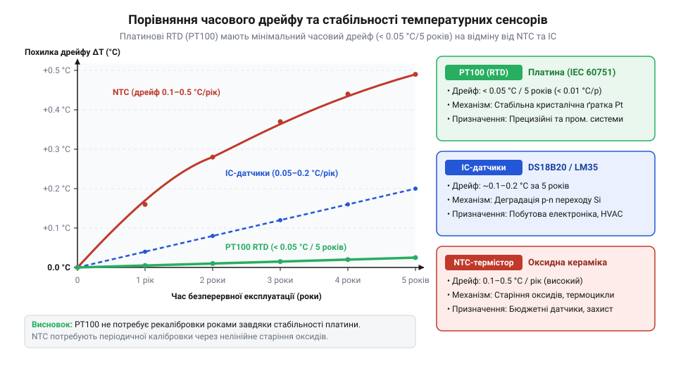
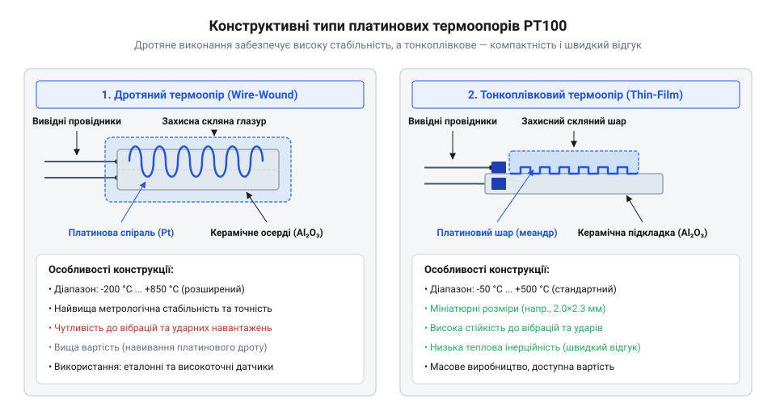
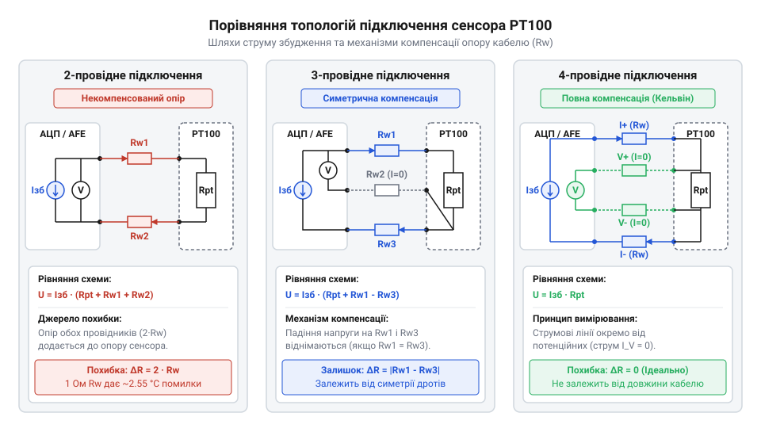
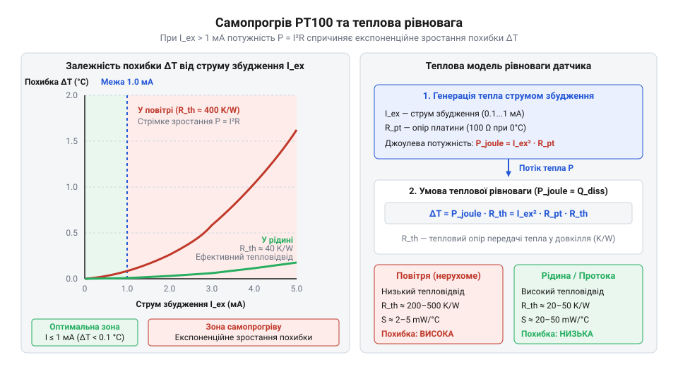
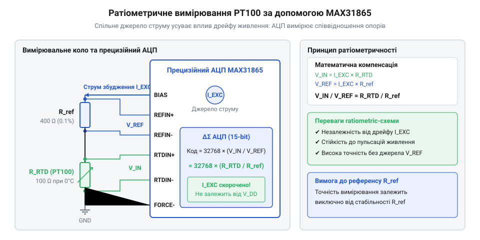

# PT100 — платиновий термоопір

<preknowlist>
- [KY-013 — аналоговий давач температури (термістор)](root:cat-hw-sensors/ky-013-thermistor) — принцип вимірювання температури через зміну опору та нелінійність NTC-характеристик
- [LM35DZ — аналоговий давач температури (10 мВ/°C)](root:cat-hw-sensors/lm35) — обмеження аналогових напівпровідникових датчиків у промислових вимірюваннях
- [DS18B20 — цифровий давач температури (1-Wire)](root:cat-hw-sensors/ds18b20) — відмінності між інтегральними цифровими датчиками та первинними резистивними перетворювачами
</preknowlist>

## Проблема нестабільності та похибок термовимірювання

Вимірювання високих температур у промисловості швидко деградує звичайні [аналогові NTC-термістори KY-013](root:cat-hw-sensors/ky-013-thermistor) та [напівпровідникові датчики LM35DZ](root:cat-hw-sensors/lm35). Під дією нагріву в кристалічних структурах виникає дрейф опору через дифузію домішок та окиснення контактів. На відміну від них, платина є хімічно інертним металом із стабільною атомарною ґраткою. Платиновий @@en|RTD@@ (англ. *Resistance Temperature Detector*, від лат. *resistere* — чинити опір) зберігає лінійний позитивний температурний коефіцієнт опору у діапазоні від -200 °C до +850 °C, гарантуючи відтворюваність показань там, де [цифрові сенсори DS18B20](root:cat-hw-sensors/ds18b20) втрачають точність.

*Порівняння часової стабільності показань платинового термоопору та NTC-термістора під час тривалого вимірювання.*

## Фізичні принципи та конструкції PT100

Принцип дії @@en|PT100@@ (від ісп. *platina* — зменшувальне від *plata* — срібло) ґрунтується на розсіюванні електронів провідності на теплових коливаннях кристалічної ґратки. Опір сенсора становить точно 100 Ом при 0 °C із чутливістю 0.385 Ом/°C. Дротяні елементи намотують на керамічний каркас для високої точності й еталонних вимірювань, тоді як тонкоплівкові @@en|thin-film@@ елементи напилюють на підкладку для компактності. Стандарт IEC 60751 визначає класи точності: Клас A гарантує похибку ±0.15 °C при 0 °C, а Клас B — ±0.3 °C. PT100@@ | Докладно про розрахунок допусків та нормативні вимоги до датчиків розказано в описі [стандарту IEC 60751](root:cat-hw-sensors/iec-60751-standard-for-rtd).

*Внутрішня будова дротяного елемента на керамічному каркасі та тонкоплівкового напилення на підкладці.*

## Паразитний опір ліній та схемотехніка

Оскільки чутливість PT100 становить лише 0.385 Ом/°C, опір мідних дротів кабелю 1 Ом додає систематичну похибку у 2.6 °C. Двопровідна схема непридатна для віддалених вимірювань. Трипровідне підключення компенсує падіння напруги за умови симетрії ліній, але втрачає точність при температурному градієнті вздовж кабелю. Чотирипровідна @@en|Kelvin connection@@ повністю усуває вплив дротів, оскільки вимірювальні лінії не несуть струму.

*Порівняльні топології включення сенсора PT100 для компенсації паразитного опору кабелю.*

## Ефект самонагріву та струм збудження

Струм збудження викликає Джоулів @@en|self-heating effect@@ в елементі PT100. При вимірювальному струмі понад 1 мА локальне підвищення температури сенсора створює хибне відхилення показань, яке залежить від коефіцієнта тепловіддачі середовища. Для мінімізації самонагріву струм обмежують до 100–500 мкА або застосовують короткі вимірювальні імпульси із реверсуванням полярності для придушення паразитної термо-ЕРС.

*Вплив струму збудження на локальне підвищення температури платинового елемента відносно середовища.*

## Нормалізація сигналу та спеціалізовані AFE

Обробка малоінтенсивного аналогового сигналу вимагає захисту від дрейфу живлення. Для цього застосовують @@en|ratiometric measurement@@, де струм збудження послідовно проходить через PT100 та прецизійний референсний резистор R_ref. Спеціалізований @@en|Analog Front-End@@ аналоговий тракт @@en|MAX31865@@ оцифровує співвідношення напруг за допомогою дельта-сигма АЦП із придушенням мережевих завад 50/60 Гц, усуваючи вплив нестабільності джерела струму. Детальніше про схемотехніку та програмне керування перетворювачем читайте у статті про [апаратурний модуль MAX31865](root:cat-hw-sensors/max31865-rtd-converter).

*Функціональна схема раціометричного вимірювального тракту з опорним резистором R_ref.*

## Математична лінеаризація та обробка даних

Для точного обчислення температури лінійне наближення замінюють на @@en|Callendar-Van Dusen equation@@. Для додатних температур використовують квадратичний вираз:

R(T)
= R₀ × (1 + A × T + B × T²)      [рівняння Каллендара — Ван Дюзена для T ≥ 0 °C]

Для від'ємних температур обчислення виконують ітераційним @@en|Newton-Raphson method@@ або табличною інтерполяцією. Прошивка мікроконтролера повинна перевіряти апаратні прапорці обриву та короткого замикання ліній перед розрахунком.
