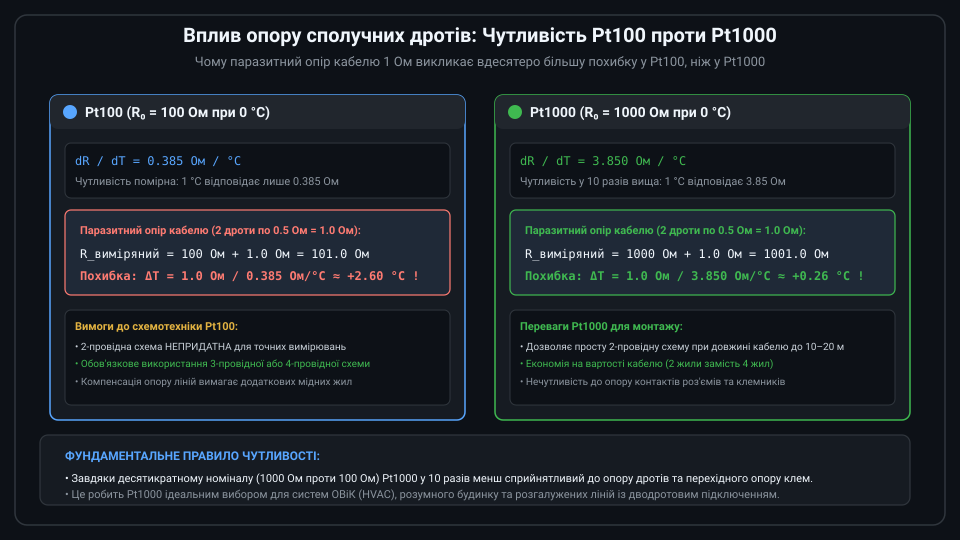
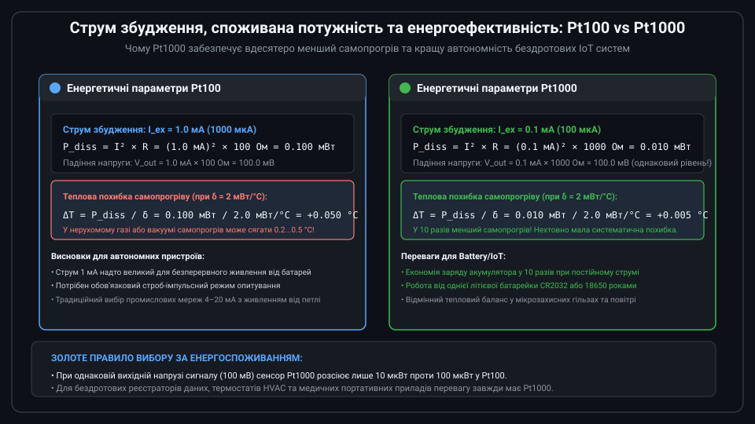
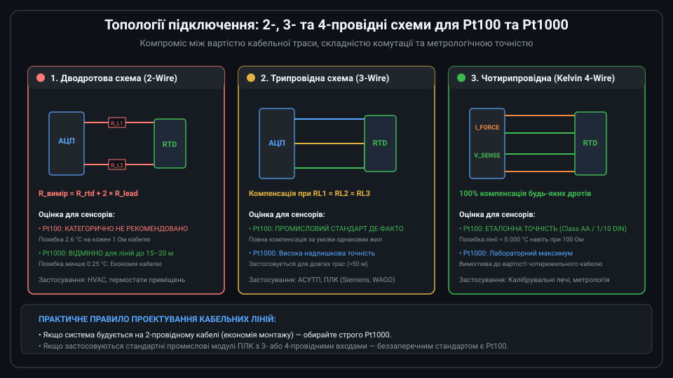
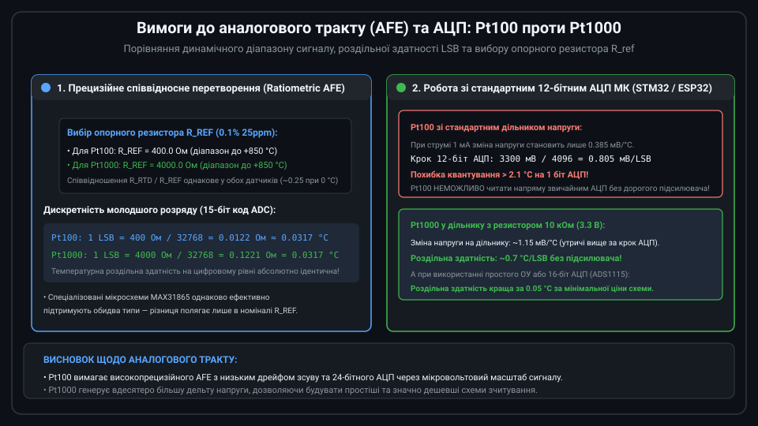

# Поглиблений метрологічний аналіз та проектування систем на базі Pt100 та Pt1000

Вибір між платиновими термометрами опору Pt100 та Pt1000 є ключовим інженерним рішенням на етапі проектування вимірювальних каналів температури. Незважаючи на ідентичність фізичних властивостей платини, десятикратна різниця базового опору фундаментально змінює співвідношення сигнал/шум (SNR), енергетичний баланс самопрогріву, вплив паразитних термо-ЕРС у точках спайки мідь-платина та вимоги до кабельної інфраструктури.



---

## 1. Метрологічний аналіз: порівняння чутливості, шумів Джонсона та SNR

Залежність електричного опору платини від температури стандартизована міжнародним стандартом IEC 60751 (ГОСТ 6651) за рівнянням Каллендара — Ван Дюзена:

```text
Для T >= 0 °C:  R(T) = R0 × (1 + A × T + B × T^2)
Для T < 0 °C:   R(T) = R0 × [1 + A × T + B × T^2 + C × (T - 100) × T^3]
```

де константи стандарту становлять:
* A = 3.9083 × 10^-3 °C^-1;
* B = -5.7750 × 10^-7 °C^-2;
* C = -4.1830 × 10^-12 °C^-4;
* R0 = 100.00 Ом для Pt100 або R0 = 1000.00 Ом для Pt1000.

Диференційна чутливість сенсора S = dR/dT дорівнює:
```text
S(T) = R0 × (A + 2 × B × T)
```

При T = 0 °C:
* Для Pt100:  S = 100 × 3.9083 × 10^-3 ≈ 0.3908 Ом/°C (середнє значення 0.385 Ом/°C у діапазоні 0..100 °C).
* Для Pt1000: S = 1000 × 3.9083 × 10^-3 ≈ 3.9083 Ом/°C (рівно у 10 разів вище).

### Тепловий шум Джонсона — Найквіста
Спектральна густина напруги теплового шуму резистивного елемента визначається формулою:
```text
v_noise = sqrt(4 × k_B × T_abs × R × Delta_f)
```
Оскільки опір Pt1000 у 10 разів більший за Pt100, власна напруга шуму Pt1000 у sqrt(10) ≈ 3.16 раза вища. Однак у типових схемах збудження корисний сигнал Pt1000 перевищує шум значно більше, ніж вплив шуму на Pt100, що забезпечує однакове або вище підсумкове співвідношення сигнал/шум (SNR) при правильно розрахованій смузі пропускання фільтра АЦП Delta_f.

---

## 2. Термодинамічний баланс: тепловий самопрогрів та динамічна похибка

При протіканні постійного струму I_ex у чутливому елементі виділяється потужність Джоуля P = I_ex^2 × R. У стаціонарному стані виникає теплова рівновага між внутрішнім тепловиділенням та відведенням тепла в навколишнє середовище через коефіцієнт розсіювання delta:



```text
P_diss = I_ex^2 × R(T) = delta × Delta_T_self
Delta_T_self = (I_ex^2 × R(T)) / delta
```

Коефіцієнт розсіювання delta залежить від типу середовища та швидкості потоку:
* У проточній воді зі швидкістю 0.4 м/с: delta ≈ 20...50 мВт/°C;
* У спокійному повітрі: delta ≈ 1.5...3.0 мВт/°C;
* У розрідженому газі або термоізоляційній гільзі: delta < 1.0 мВт/°C.

Розрахунок похибки самопрогріву для стандартних струмів збудження:
* **Pt100 (I_ex = 1.0 мА, R = 100 Ом)**:
  `P = (1.0 × 10^-3)^2 × 100 = 0.100 мВт`.
  У спокійному повітрі (delta = 2.0 мВт/°C): `Delta_T = 0.100 / 2.0 = +0.050 °C`.
* **Pt1000 (I_ex = 0.1 мА, R = 1000 Ом)**:
  `P = (0.1 × 10^-3)^2 × 1000 = 0.010 мВт`.
  У спокійному повітрі (delta = 2.0 мВт/°C): `Delta_T = 0.010 / 2.0 = +0.005 °C`.

Десятикратна перевага Pt1000 по самопрогріву дозволяє проводити прецизійні вимірювання температури газів та кондиційованого повітря без необхідності складних алгоритмів компенсації теплового балансу.

---

## 3. Схемотехнічні компроміси топологій кабельних трас

Вплив паразитного опору кабелю R_lead та паразитних термо-ЕРС спаїв різнорідних металів (Seebeck effect на контактах) обумовлює вибір топології:



### Математична похибка 2-провідної схеми
При дводротовому підключенні вимірювальний прилад фіксує суму:
```text
R_meas = R_rtd + R_lead1 + R_lead2 = R_rtd + 2 × R_lead
```
Похибка вимірювання температури:
```text
Delta_T = (2 × R_lead) / (R0 × alpha)
```
Якщо кабель має переріз 0.5 мм^2 (опір однієї жили 0.036 Ом/м), то на відстані 25 метрів опір петлі становить 2 × R_lead = 1.80 Ом:
* Для Pt100 похибка складе: `1.80 Ом / 0.385 Ом/°C = +4.67 °C` (повністю неприпустимо для більшості процесів).
* Для Pt1000 похибка складе: `1.80 Ом / 3.85 Ом/°C = +0.47 °C` (в межах допустимої норми для кліматичних систем HVAC).

### Апаратна компенсація 3-провідної схеми
Трипровідна схема усуває опір кабелю методом мостового або диференційного вимірювання за умови симетрії ліній:
```text
V_diff = I_ex × (R_rtd + R_lead1) - I_ex × R_lead2 = I_ex × R_rtd  (якщо R_lead1 = R_lead2)
```
Якщо через окислення клем або перегин кабелю виникає асиметрія жил Delta R_lead = R_lead1 - R_lead2 = 0.1 Ом:
* У схемі з Pt100 залишковий зсув складе: `0.1 Ом / 0.385 Ом/°C = +0.26 °C`;
* У схемі з Pt1000 залишковий зсув складе: `0.1 Ом / 3.85 Ом/°C = +0.026 °C`.

---

## 4. Співвідносне (Ratiometric) вимірювання в сучасних AFE

Сучасні інтегральні перетворювачі (MAX31865, ADS1220, AD7124) реалізують співвідносний принцип зчитування, де струм збудження I_ex послідовно проходить через прецизійний опорний резистор R_ref та сенсор RTD:



```text
V_ref_adc = I_ex × R_ref
V_rtd_adc = I_ex × R_rtd
ADC_Code = (V_rtd_adc / V_ref_adc) × 2^(N - 1) = (R_rtd / R_ref) × 2^(N - 1)
```

Звідси очевидна ключова перевага співвідносної схеми: струм I_ex повністю скорочується в рівнянні! Його температурний дрейф та абсолютна нестабільність не впливають на результат оцифрування.

Для досягнення максимального динамічного діапазону АЦП значення R_ref вибирається дещо більшим за максимальний опір RTD у діапазоні (R_max при +850 °C становить ~390 Ом для Pt100 та ~3900 Ом для Pt1000):
* Для Pt100:  `R_ref = 400 Ом` (або 430 Ом з допуском 0.1% і TCR 10...25 ppm/°C);
* Для Pt1000: `R_ref = 4000 Ом` (або 4300 Ом з аналогічним класом точності).

---

## 5. Універсальний вбудований драйвер RTD мовою C

Наведений нижче модуль забезпечує високоточний розрахунок температури для обох типів сенсорів (Pt100 та Pt1000). Алгоритм застосовує аналітичне розв'язання квадратного рівняння для температур вище 0 °C та чисельний метод ітерацій Ньютона — Рафсона для від'ємного діапазону, а також виконує програмну компенсацію опору дротів та самопрогріву.

```c
#include <stdint.h>
#include <stdbool.h>
#include <math.h>

// Тип сенсора RTD
typedef enum {
    RTD_TYPE_PT100  = 100,
    RTD_TYPE_PT1000 = 1000
} rtd_type_t;

// Конфігурація вимірювального каналу
typedef struct {
    rtd_type_t type;               // RTD_TYPE_PT100 або RTD_TYPE_PT1000
    float r_ref_ohms;              // Опір еталонного резистора (400.0f або 4000.0f)
    float lead_resistance_ohms;    // Відомий опір лінії для 2-провідних схем (0 для 3/4 дротів)
    float dissipation_const_mw_c;  // Коефіцієнт розсіювання (типово 2.0 мВт/°C)
    float excitation_current_ma;   // Струм збудження (1.0f для Pt100, 0.1f для Pt1000)
} rtd_channel_config_t;

// Константи Callendar-Van Dusen (IEC 60751)
#define CVD_A  (3.9083e-3f)
#define CVD_B  (-5.7750e-7f)
#define CVD_C  (-4.1830e-12f)

// Функція розрахунку температури за 15-бітним кодом АЦП (формат MAX31865)
bool rtd_calculate_temperature(const rtd_channel_config_t *cfg, 
                               uint16_t adc_code_15bit, 
                               float *out_temperature_c) 
{
    if (adc_code_15bit == 0 || adc_code_15bit >= 32768) {
        return false; // Помилка перетворення або обрив
    }

    // 1. Обчислення виміряного опору
    float r_measured = ((float)adc_code_15bit * cfg->r_ref_ohms) / 32768.0f;

    // 2. Віднімання опору сполучних дротів (для 2-провідної схеми)
    float r_rtd = r_measured - cfg->lead_resistance_ohms;
    float r0 = (float)cfg->type;

    if (r_rtd < (0.18f * r0) || r_rtd > (3.90f * r0)) {
        return false; // Вихід за межі діапазону (-200..+850 °C)
    }

    float temp_c = 0.0f;

    // 3. Аналітичний розрахунок для додатних температур (T >= 0 °C, квадратне рівняння)
    if (r_rtd >= r0) {
        // R(T) = R0 * (1 + A*T + B*T^2) => B*T^2 + A*T + (1 - R/R0) = 0
        float discriminant = (CVD_A * CVD_A) - (4.0f * CVD_B * (1.0f - (r_rtd / r0)));
        if (discriminant < 0.0f) {
            return false;
        }
        temp_c = (-CVD_A + sqrtf(discriminant)) / (2.0f * CVD_B);
    } 
    // 4. Чисельний метод Ньютона-Рафсона для від'ємних температур (T < 0 °C)
    else {
        // Початкове наближення за лінійною залежністю
        temp_c = (r_rtd - r0) / (r0 * CVD_A);

        // 4 ітерації Ньютона-Рафсона забезпечують похибку < 0.001 °C
        for (int i = 0; i < 4; i++) {
            float t2 = temp_c * temp_c;
            float t3 = t2 * temp_c;
            float t4 = t3 * temp_c;

            // f(T) = R0 * [1 + A*T + B*T^2 + C*(T - 100)*T^3] - R_rtd
            float f_val = r0 * (1.0f + (CVD_A * temp_c) + (CVD_B * t2) + (CVD_C * (temp_c - 100.0f) * t3)) - r_rtd;
            // Похідна f'(T) = R0 * [A + 2*B*T + 4*C*T^3 - 300*C*T^2]
            float f_deriv = r0 * (CVD_A + (2.0f * CVD_B * temp_c) + (4.0f * CVD_C * t3) - (300.0f * CVD_C * t2));

            if (fabsf(f_deriv) < 1e-6f) {
                break;
            }
            temp_c = temp_c - (f_val / f_deriv);
        }
    }

    // 5. Корекція похибки самопрогріву
    float p_diss_mw = (cfg->excitation_current_ma * cfg->excitation_current_ma * r_rtd);
    float delta_t_self = p_diss_mw / cfg->dissipation_const_mw_c;
    temp_c -= delta_t_self;

    *out_temperature_c = temp_c;
    return true;
}
```

Модуль підтримує автоматичну компенсацію ліній та самопрогріву як для класичного важкого стандарту Pt100, так і для енергоефективного стандарту Pt1000.
