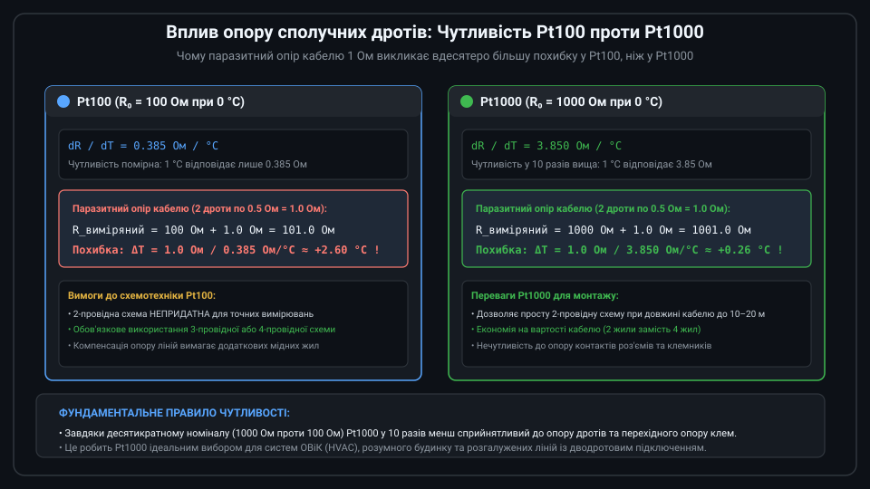
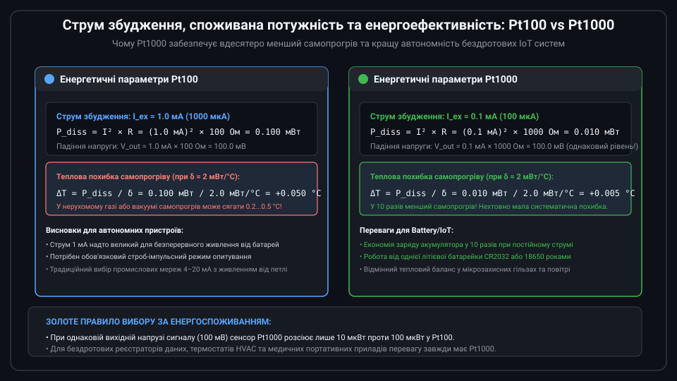
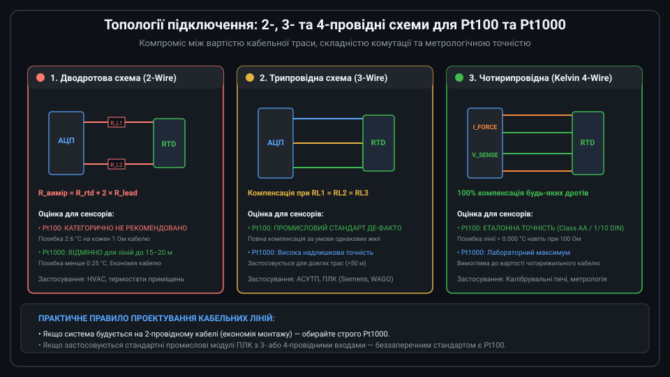
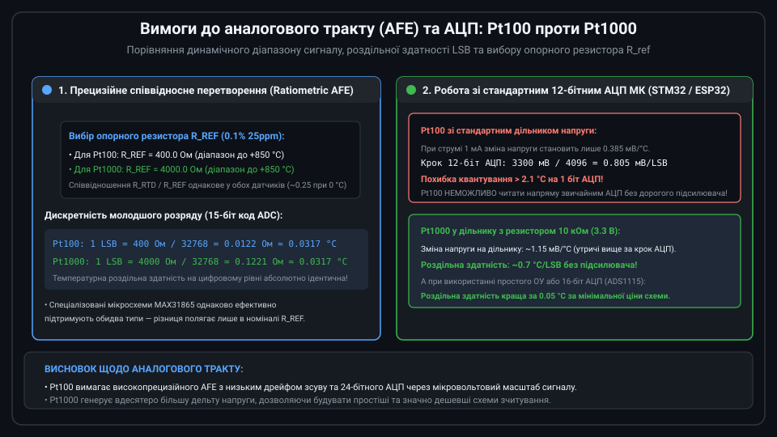
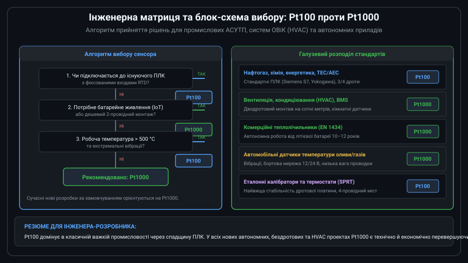

# Порівняльний аналіз та критерії вибору термоопорів Pt100 та Pt1000

Платинові термометри опору (RTD) є світовим еталоном точного вимірювання температури в діапазоні від -200 °C до +850 °C завдяки винятковій стабільності, повторюваності та стандартизованій характеристиці стандарту IEC 60751. Найпоширенішими типами платинових сенсорів є Pt100 та Pt1000. Незважаючи на однаковий температурний коефіцієнт платини (alpha = 0.00385 1/°C), десятикратна різниця базового опору суттєво змінює вимоги до схемотехніки, довжини кабельних ліній та енергоспоживання.

---

## 1. Фізичні та електричні відмінності: чутливість та вплив кабелю

Головна відмінність між сенсорами полягає в номінальному електричному опорі при температурі 0 °C:
* **Pt100**: R0 = 100 Ом. Абсолютна крутість зміни опору становить приблизно dR/dT = 0.385 Ом/°C.
* **Pt1000**: R0 = 1000 Ом. Абсолютна крутість зміни опору становить dR/dT = 3.85 Ом/°C (рівно у 10 разів вища).

### Чутливість до паразитного опору сполучних дротів
У реальних промислових установках датчик віддалений від вимірювального приладу на відстань від 5 до 100 метрів. Мідний дріт перерізом 0.22 мм^2 має власний опір близько 0.08 Ом на метр довжини (два дроти довжиною 10 м дають опір петлі R_lead ≈ 1.6 Ом).

* Для **Pt100** паразитний опір лінії 1.0 Ом додається до опору сенсора і викликає систематичну похибку:
  `Delta_T = 1.0 Ом / 0.385 Ом/°C ≈ +2.60 °C`.
  Це робить використання простого 2-провідного підключення неприпустимим для точних вимірювань.
* Для **Pt1000** той самий опір лінії 1.0 Ом спричиняє похибку:
  `Delta_T = 1.0 Ом / 3.85 Ом/°C ≈ +0.26 °C` (у 10 разів менше!).
  Завдяки цьому Pt1000 дозволяє застосовувати недорогі двожильні кабелі без складної апаратної компенсації.

---

## 2. Струм збудження, потужність та самопрогрів

Платинові RTD є пасивними резистивними елементами і вимагають протікання вимірювального струму збудження I_ex для формування вихідної напруги V = I_ex × R(T):

* **Pt100**: Стандартний струм збудження становить 1.0 мА (рідше 0.5 мА). При цьому теплова потужність розсіювання на сенсорі дорівнює:
  `P_diss = (1.0 мА)^2 × 100 Ом = 0.100 мВт (100 мкВт)`.
* **Pt1000**: Стандартний струм збудження становить 0.1 мА (100 мкА). Теплова потужність розсіювання дорівнює:
  `P_diss = (0.1 мА)^2 × 1000 Ом = 0.010 мВт (10 мкВт)`.

### Наслідки для самопрогріву та автономності
1. **Зниження самопрогріву в 10 разів**: При типовому коефіцієнті розсіювання гільзи delta = 2 мВт/°C самопрогрів Pt100 становить Delta T = 0.05 °C, тоді як для Pt1000 він не перевищує 0.005 °C. Це критично важливо при вимірюванні температури нерухомих газів і повітря.
2. **Енергоефективність у батарейних IoT-пристроях**: При однаковому рівні корисного вихідного сигналу (100 мВ при 0 °C) сенсор Pt1000 споживає вдесятеро менше енергії, подовжуючи термін служби літієвої батареї автономного реєстратора до 10–12 років.

---

## 3. Топології підключення: 2-, 3- та 4-провідні схеми

Вибір між Pt100 та Pt1000 безпосередньо впливає на топологію кабельного підключення:

* **2-провідна схема (2-Wire)**: Застосовується виключно з сенсорами **Pt1000** при довжині траси до 15–20 метрів (наприклад, у системах вентиляції та опалення ОВіК / HVAC). Використання Pt100 за дводротовою схемою допускається лише в разі калібрування з фіксованим проводом або невисоких вимог до точності (похибка 2–5 °C).
* **3-провідна схема (3-Wire)**: Промисловий стандарт для **Pt100**. Третій провід передає падіння напруги на лінії у вимірювальний міст або диференційний АЦП, повністю усуваючи вплив кабелю за умови однакового опору всіх жил.
* **4-провідна схема (4-Wire Кельвін)**: Забезпечує повне апаратне розділення струмових (Force) та потенційних (Sense) провідників. Застосовується як для Pt100, так і для Pt1000 у лабораторній практиці, метрології та еталонних калібраторах найвищого класу точності (Class AA, 1/10 DIN).

---

## 4. Вимоги до аналогового тракту AFE та мікроконтролерного АЦП

Різниця в номіналі сенсорів визначає складність та вартість вхідного аналогового тракту (Analog Front-End, AFE):

* **Спеціалізовані перетворювачі (MAX31865, ADS1220)**: Працюють за співвідносним (ratiometric) принципом, де напруга на сенсорі ділиться на напругу прецизійного опорного резистора R_ref. Для Pt100 використовується R_ref = 400 Ом (дискретність 1 LSB ≈ 0.0317 °C), а для Pt1000 — R_ref = 4000 Ом (дискретність та сама 1 LSB ≈ 0.0317 °C). Обидва типи сенсорів підтримуються мікросхемою з однаково високою точністю.
* **Підключення до стандартного АЦП мікроконтролера (STM32, ESP32)**:
  * Сигнал Pt100 (0.385 мВ/°C) губиться в шумах 12-бітного АЦП мікроконтролера (крок квантування 0.8 мВ), тому пряме підключення через простий дільник напруги неможливе.
  * Сигнал Pt1000 у дільнику з резистором 10 кОм генерує зміну напруги понад 1.15 мВ/°C, що дозволяє отримувати прийнятну роздільну здатність (~0.7 °C/LSB) навіть без зовнішніх прецизійних підсилювачів, а з простим ОУ — досягати точності краще 0.05 °C.

---

## 5. Галузеві стандарти та критерії прийняття інженерного рішення

Вибір між Pt100 та Pt1000 регулюється сформованими галузевими традиціями та технічними обмеженнями:

1. **Обирайте Pt100, якщо:**
   * Проект інтегрується в існуючу промислову АСУТП (ПЛК Siemens, Schneider Electric, ABB), модулі введення якої налаштовані на Pt100 3-провідний.
   * Робоча температура перевищує 500 °C (до +850 °C). За таких температур надійними є дротові (Wire-Wound) сенсори в керамічних трубках, більшість з яких випускаються в номіналі 100 Ом.
   * Вимагається відповідність класичним стандартам нафтогазової та хімічної галузей.
2. **Обирайте Pt1000, якщо:**
   * Проектується система ОВіК (HVAC), розумний будинок або диспетчеризація будівель (BMS) з великою довжиною дводротових кабельних трас.
   * Прилад працює від батареї (бездротові сенсори LoRaWAN, Zigbee, лічильники тепла).
   * Необхідно мінімізувати вартість кабельної продукції та монтажних робіт.
