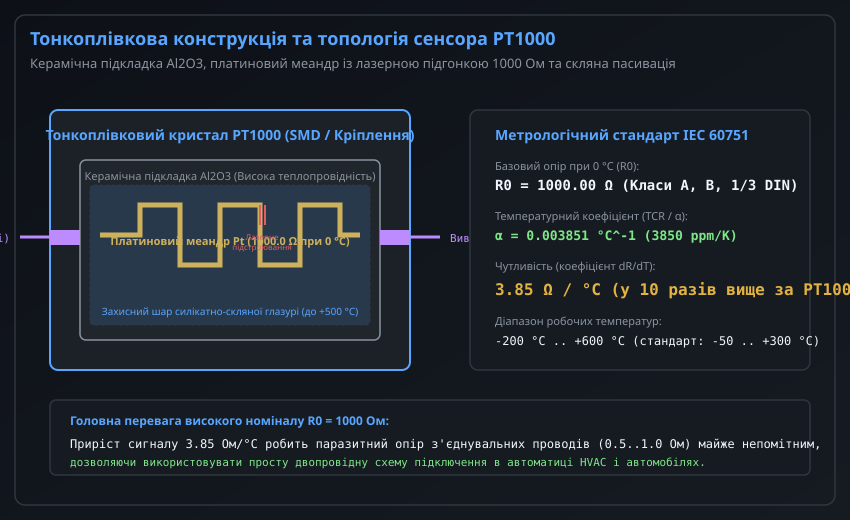
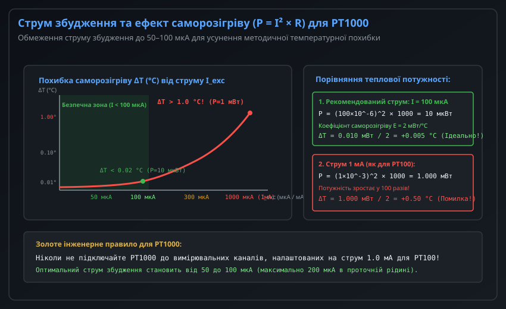
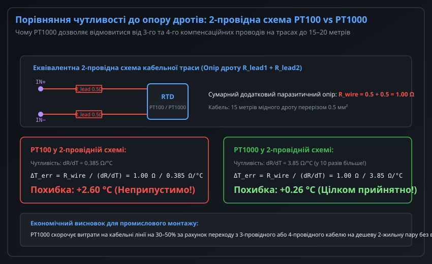
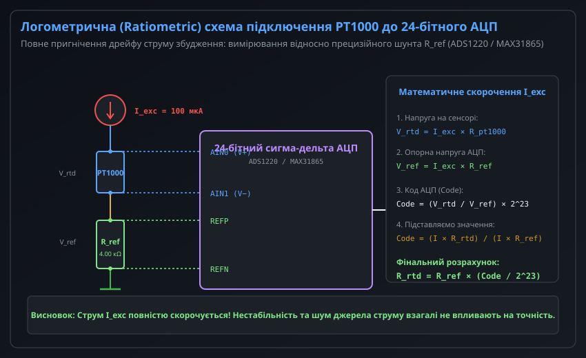
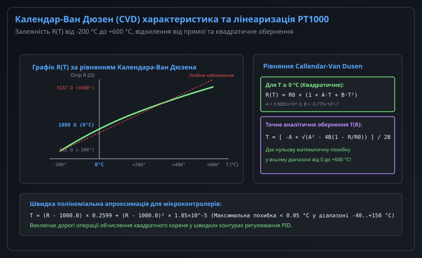

# Платиновий терморезистор PT1000 та особливості застосування

Платиновий терморезистор PT1000 належить до класу високоточних резистивних датчиків температури (RTD — Resistance Temperature Detector). На відміну від класичного промислового стандарту PT100 (з номінальним опором 100 Ом при 0 °C), датчик PT1000 має номінальний базовий опір **1000 Ом** за 0 °C.

Завдяки вдесятеро вищому базовому опору чутливість сенсора становить близько **3.85 Ом/°C**, що кардинально змінює підходи до побудови вимірювальних трактів: значно знижується чутливість до опору з'єднувальних дротів, мінімізується струм збудження (і відповідно споживана потужність), що робить PT1000 ідеальним сенсором для кліматичних систем (HVAC), автомобільних вузлів, теплових лічильників та автономних батарейних приладів.

---

## 1. Конструкція, фізичний принцип та стандарти платинового термометра PT1000

Метрологічні характеристики та залежність опору від температури для платинових датчиків суворо регламентуються міжнародним стандартом **IEC 60751** (в Україні діє як ДСТУ EN 60751).



### Тонкоплівкова технологія виробництва (Thin-Film RTD)

Створення резистора з опором 1000 Ом за традиційною дротяною технологією (намотування тонкого платинового дроту на керамічний каркас) призводить до значного збільшення габаритів і вартості сенсора. Тому переважна більшість сучасних датчиків PT1000 виготовляється за тонкоплівковою технологією:
1. **Керамічна підкладка:** Пластина з високоочищеного оксиду алюмінію (Al2O3), що забезпечує механічну міцність, ізоляцію та високу швидкість передачі тепла.
2. **Платиновий шар:** Осадження платинової мікроплівки товщиною близько 1 мкм методом вакуумного катодного або магнетронного напилення.
3. **Формування меандру та лазерне підстроювання:** Методом фотолітографії формується змієподібна доріжка (меандр). Прецизійне лазерне підстроювання (Laser Trimming) підганяє опір до номіналу 1000.00 Ом з точністю до десятих часток ома.
4. **Пасивація склом:** Покриття шаром термостійкого силікатного скла, яке герметизує платину від окиснення газами та хімічної корозії до температур +500...+600 °C.

### Метрологічні класи точності за IEC 60751

Стандарт визначає температурний коефіцієнт опору платини (TCR або alpha):

```
alpha = (R_100 - R_0) / (100 * R_0) = (1385.05 - 1000.00) / (100 * 1000.00) = 0.003851 °C^-1
```

Допустимі відхилення температури залежно від класу точності:

| Клас точності | Граничне відхилення температури Delta_T (°C) | Допуск опору при 0 °C |
| :--- | :--- | :--- |
| **Клас AA (1/3 DIN)** | +/- (0.10 + 0.0017 * |t|) | +/- 0.04% (0.4 Ом) |
| **Клас A** | +/- (0.15 + 0.0020 * |t|) | +/- 0.06% (0.6 Ом) |
| **Клас B** | +/- (0.30 + 0.0050 * |t|) | +/- 0.12% (1.2 Ом) |
| **Клас C** | +/- (0.60 + 0.0100 * |t|) | +/- 0.24% (2.4 Ом) |

---

## 2. Струм збудження, тепловий розсіюваний баланс та усунення саморозігріву

Головною небезпекою при проектуванні аналогової частини для PT1000 є методична похибка саморозігріву (Self-Heating Error). 

Електричний струм збудження `I_exc`, що протікає через платиновий опір R, генерує джоулеве тепло:

```
P = I_exc^2 * R
```



### Порівняльний розрахунок теплової потужності PT100 та PT1000

Для датчиків PT100 стандартним струмом збудження є 1.0 мА. Якщо подати струм 1.0 мА на датчик PT1000, теплова потужність зростає пропорційно опору:

```
P_pt100  = (1.0e-3 А)^2 * 100 Ом = 0.0001 Вт = 0.10 мВт
P_pt1000 = (1.0e-3 А)^2 * 1000 Ом = 0.0010 Вт = 1.00 мВт
```

Виділення потужності 1.0 мВт на мініатюрному тонкоплівковому кристалі в повітрі (де коефіцієнт тепловіддачі становить лише E ≈ 1.5–2.0 мВт/°C) викликає штучне розігрівання сенсора на:

```
Delta_T_self_heating = P / E = 1.0 мВт / (2.0 мВт/°C) = +0.50 °C
```

Ця похибка повністю перекриває заводський клас точності А (+/-0.15 °C).

### Оптимальний вибір струму збудження

Щоб похибка від саморозігріву не перевищувала 0.01–0.02 °C, робочий струм збудження для PT1000 вибирають у діапазоні:

```
I_exc = 50 .. 100 мкА (максимально допустимо до 200 мкА)
```

При струмі `I_exc = 100 мкА`:

```
P = (100e-6 А)^2 * 1000 Ом = 10e-9 * 1000 = 10 мкВт (0.010 мВт)
Delta_T = 0.010 мВт / 2.0 мВт/°C = +0.005 °C (Нехтовно мала величина)
```

При цьому вихідна напруга на датчику при 0 °C становить:

```
V_out = 100 мкА * 1000 Ом = 100.0 мВ
```

Напруга 100 мВ зручно оцифровується сучасними 24-бітними АЦП навіть без додаткового підсилення.

---

## 3. Двопровідна схема підключення та стійкість до опору кабельної лінії

Однією з найважливіших інженерних переваг PT1000 є можливість використання простої двопровідної схеми підключення без втрати метрологічної точності.



### Фізична причина стійкості PT1000 до опору кабелю

При 2-провідному підключенні опір підвідних дротів `R_wire = R_lead1 + R_lead2` додається безпосередньо до виміряного опору датчика:

```
R_measured = R_sensor + R_wire
```

Методична похибка температури дорівнює доданому опору, поділеному на чутливість давача:

```
Delta_T_error = R_wire / (dR / dT)
```

Порівняння для лінії з опором проводів R_wire = 1.00 Ом (близько 15 метрів типового мідного кабелю перерізом 0.5 мм²):
- **Для датчика PT100** (чутливість 0.385 Ом/°C):
  ```
  Delta_T = 1.00 Ом / (0.385 Ом/°C) = +2.60 °C (Катастрофічна похибка!)
  ```
  Для PT100 двопровідна схема на відстанях понад 1–2 метри категорично непридатна.
- **Для датчика PT1000** (чутливість 3.851 Ом/°C):
  ```
  Delta_T = 1.00 Ом / (3.851 Ом/°C) = +0.26 °C
  ```
  Похибка 0.26 °C є цілком прийнятною для більшості систем опалення, вентиляції (HVAC), сонячних геліосистем та побутової автоматики. Якщо довжина лінії становить до 3–5 метрів (R_wire ≈ 0.2–0.3 Ом), похибка складе менше 0.06–0.08 °C, що вкладається в межі класу А.

Завдяки цьому PT1000 дозволяє заощаджувати сотні метрів дорогого екранованого трижильного або чотирижильного кабелю, спрощуючи монтаж у шафах автоматики.

---

## 4. Логометричний аналоговий тракт на базі сигма-дельта АЦП (ADS1220 / MAX31865)

Найвищу метрологічну стабільність забезпечує логометрична (Ratiometric) вимірювальна схема.



### Принцип логометричного взаємного скорочення нестабільності

У класичних схемах напруга на датчику порівнюється з незалежним джерелом опорної напруги V_ref. У такому разі будь-який температурний або часовий дрейф генератора струму збудження чи джерела V_ref перетворюється на пряму похибку температури.

У логометричній схемі:
1. Той самий струм збудження `I_exc` (100 мкА) послідовно протікає через сенсор PT1000 та прецизійний опорний резистор `R_ref` (зазвичай 4.00 кОм або 4.30 кОм з допуском 0.05% та ТКО 5 ppm/°C).
2. Напруга на сенсорі надходить на диференційний аналоговий вхід АЦП:
   ```
   V_rtd = I_exc * R_pt1000
   ```
3. Падіння напруги на резисторі R_ref підключається безпосередньо до диференційних входів зовнішньої опорної напруги АЦП (REFP / REFN):
   ```
   V_ref = I_exc * R_ref
   ```
4. Цифровий код АЦП з розрядністю N біт (наприклад, N = 24, біполярний діапазон 2^23 відліків):
   ```
   Code = (V_rtd / V_ref) * 2^23 = ( (I_exc * R_pt1000) / (I_exc * R_ref) ) * 2^23 = (R_pt1000 / R_ref) * 2^23
   ```

Струм збудження `I_exc` повністю скорочується в чисельнику та знаменнику! Нестабільність, пульсації та температурний дрейф джерела струму взагалі не впливають на результат перетворення. Точність вимірювання залежить виключно від стабільності резистора R_ref.

Опір платинового сенсора обчислюється однією формулою:

```
R_pt1000 = R_ref * ( (float)Code / 8388608.0f )
```

---

## 5. Рівняння Календара-Ван Дюзена та математична лінеаризація для МК

Залежність опору платини від температури має незначну нелінійність (крива має невелику опуклість догори). Точний зв'язок описується рівнянням Календара-Ван Дюзена (Callendar-Van Dusen, CVD).



### Математична модель IEC 60751

Для базового опору R0 = 1000.0 Ом залежність описується двома діапазонами:

1. **Для додатних температур (0 °C ... +600 °C):**
   ```
   R(T) = R_0 * ( 1 + A * T + B * T^2 )
   ```
2. **Для від'ємних температур (-200 °C ... 0 °C):**
   ```
   R(T) = R_0 * [ 1 + A * T + B * T^2 + C * (T - 100) * T^3 ]
   ```

Стандартні константи для платини класу alpha = 0.003851:
- `A = 3.9083e-3 °C^-1`
- `B = -5.7750e-7 °C^-2`
- `C = -4.1830e-12 °C^-4`

### Точне квадратичне обернення для позитивних температур (0 °C .. +600 °C)

Для отримання температури за виміряним опором `R` рівняння для T >= 0 °C зводиться до класичного квадратного рівняння:

```
B * T^2 + A * T + (1 - R / R_0) = 0
```

Його аналітичний розв'язок дає точну температуру без будь-якої похибки лінеаризації:

```
T = [ -A + sqrt( A^2 - 4 * B * (1 - R / R_0) ) ] / (2 * B)
```

Для практичного використання у вихідному коді на C:

```c
#include <math.h>

float pt1000_resistance_to_celsius_exact(float resistance_ohm) {
    const float R0 = 1000.0f;
    const float A = 3.9083e-3f;
    const float B = -5.7750e-7f;

    if (resistance_ohm >= R0) {
        /* Для T >= 0 °C точне обчислення за формулою коренів */
        float discriminant = (A * A) - (4.0f * B * (1.0f - (resistance_ohm / R0)));
        if (discriminant < 0.0f) {
            discriminant = 0.0f;
        }
        return (-A + sqrtf(discriminant)) / (2.0f * B);
    } else {
        /* Для T < 0 °C: швидка кубічна апроксимація поліномом */
        float dR = resistance_ohm - R0;
        return (dR * 0.2599f) + (dR * dR * 1.05e-5f);
    }
}
```

Такий підхід забезпечує абсолютну похибку менше 0.02 °C у всьому промисловому діапазоні температур.
