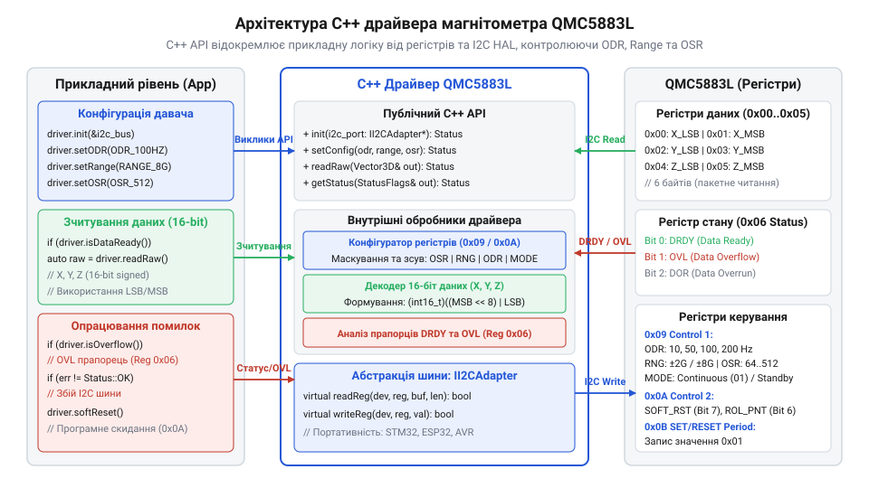
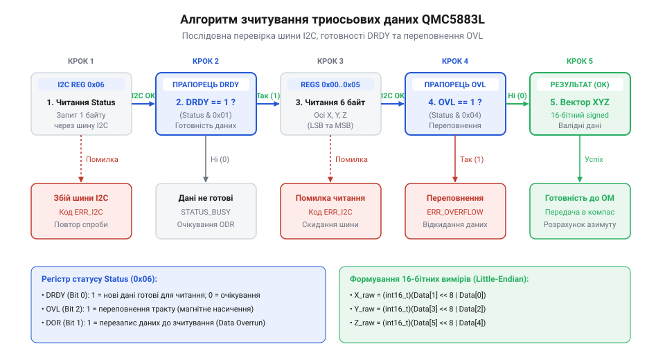

# Програмний API C++ драйвера для QMC5883L

<preknowlist>
- [GY-271 / HMC5883L — компас/магнетометр](root:cat-hw-sensors/hmc5883l) — відмінності регістрової карти та режимів роботи QMC5883L від оригінального HMC5883L
</preknowlist>

## Необхідність C++ обгортки регістрів

Створення прошивок для мікроконтролерів нерідко починається з безпосереднього виклику процедур шини I2C прямо з прикладної логіки програми. Коли інженер додає до системи цифровий магнітометр (грецьк. @@en|magnetos@@ — магніт + @@en|metron@@ — міра), виникає спокуса написати декілька послідовних викликів запису байтів у регістри пристрою, оперуючи безпосередніми шістнадцятковими адресами. Проте такий підхід миттєво створює проблеми: у коді з'являються так звані @@en|магічні числа@@ (англ. @@en|magic numbers@@) — некодовані константи на кшталт `0x0D`, `0x09` чи `0x1D`. При прочитанні такого коду неможливо зрозуміти, що саме робить той чи інший запис, не тримаючи перед очима технічну документацію на сенсор QMC5883L.

Повна відсутність абстракції робить програму крихкою. Якщо в проєкті виникне потреба змінити апаратну платформу, замінити бібліотеку роботи з шиною чи перейти на інший чип, наприклад [попередник HMC5883L](root:cat-hw-sensors/hmc5883l), доведеться переписати прикладну логіку в багатьох файлах. Натомість архітектура надійних вбудованих систем вимагає чіткого розмежування відповідальності. Обмін даними варто розділяти на два незалежних рівні: апаратний рівень абстракції шини I2C (англ. @@en|Hardware Abstraction Layer@@, скорочено HAL) та предметний @@en|драйвер@@ (англ. @@en|driver@@, від @@en|drive@@ — керувати) конкретного давача.


*Архітектурні шари взаємодії між прикладним кодом прошивки, предметним C++ драйвером QMC5883L та абстракційним рівнем I2C HAL.*

Шинний рівень I2C HAL відповідає виключно за фізичну передачу послідовності байтів між мікроконтролером та адресатом на шині. Окрім форматування транзакцій, цей шар ізолює прикладний код від апаратних збоїв фізичного середовища — відсутності відповіді пристрою @@en|NACK@@ (англ. @@en|Negative Acknowledgment@@, від @@en|negative@@ — негативний + @@en|acknowledge@@ — підтверджувати) через хибну адресу або обрив лінії, а також @@en|таймауту@@ (англ. @@en|timeout@@, від @@en|time@@ — час + @@en|out@@ — поза) шини у разі утримування ліній у низькому стані. Замість передачі нагору системних статусних регістрів мікроконтролера адаптер транслює ці збої у повертуване булеве значення: `true` гарантує успішний обмін даними, тоді як `false` сигналізує драйверу про апаратну помилку для її подальшого опрацювання. Для забезпечення уніфікованого доступу цей шар надає @@en|інтерфейс@@ (англ. @@en|interface@@, від @@en|inter@@ — між + @@en|face@@ — обличчя):

```cpp
class II2CAdapter {
public:
    virtual ~II2CAdapter() = default;
    virtual bool writeRegister(uint8_t devAddr, uint8_t regAddr, uint8_t value) = 0;
    virtual bool readRegisters(uint8_t devAddr, uint8_t regAddr, uint8_t* buffer, size_t length) = 0;
};
```

Своєю чергою, C++ драйвер QMC5883L інкапсулює специфіку внутрішньої регістрової карти сенсора, приховує бітові маски та забезпечує контроль стану пристрою. Прикладний код взаємодіє виключно з високорівневими методами драйвера, передаючи зрозумілі конфігураційні типи. Це дозволяє легко повторно використовувати написаний драйвер у найрізноманітніших проєктах — від простих автономних роботів до комплексних систем орієнтації з [багатоосьовими модулями MPU-6050](root:cat-hw-sensors/mpu6050).

## Переліки та конфігураційні типи даних

Апаратне налаштування вимірювального тракту QMC5883L здійснюється через внутрішній регістр керування `Control Register 1` (адреса `0x09`). Цей 8-бітний регістр об'єднує чотири незалежні параметри, кожен з яких займає власну групу бітів:

1. **Режим роботи (Mode, біти 1:0)**: визначає, чи перебуває @@en|магнітометр@@ у режимі очікування зі зниженим енергоспоживанням (`Standby`, значення `00`), чи здійснює безперервні вимірювання (`Continuous`, значення `01`). 2. **Частота оновлення даних (Output Data Rate, ODR, біти 3:2)**: задає темп дискретизації. Доступні значення: 10 Гц (`00`), 50 Гц (`01`), 100 Гц (`10`) та 200 Гц (`11`). 3. **Діапазон вимірювання (Full Scale Range, RNG, біти 5:4)**: визначає граничну індукцію магнітного поля: ±2 Гаус (`00`) або ±8 Гаус (`01`). Вибір діапазону прямо впливає на чутливість тракту: для ±2 Гаус вона становить 4096 LSB/G, а для ±8 Гаус — 1024 LSB/G. 4. **Коефіцієнт внутрішнього усереднення (Over Sampling Rate, OSR, біти 7:6)**: визначає кількість внутрішніх замірів на один вихідний відлік. Значення `00` відповідає OSR 512, `01` — OSR 256, `10` — OSR 128, `11` — OSR 64. Вищий коефіцієнт усереднення знижує рівень високочастотного шуму за рахунок додаткового цифрового фільтрування, але незначно збільшує споживання струму.

Щоб уникнути ручного формування бітових масок, в об'єктно-орієнтованому C++ API застосовують суворо типізовані переліки `enum class` (лат. @@en|enumeratio@@ — перерахування). Це унеможливлює передачу некоректного значення на етапі компіляції.

:::tabs
@tab C++
:::code api-qmc5883l-cpp-driver/cpp/qmc5883l-odr.cpp
@tab C
:::code api-qmc5883l-cpp-driver/c/qmc5883l-config-to-cr1.c
:::

Об'єднання параметрів у єдину структуру дозволяє безпечно переконфігурувати сенсор на льоту, змінюючи режим роботи чи діапазон без ризику випадкового скидання суміжних бітів регістру.

Окрім формування байта для регістру керування, структура `QMC5883LConfig` слугує джерелом математичних констант для обробки вимірювань. Сирі 16-бітні дані з регістрів давача є цілими числами в одиницях LSB (від англ. @@en|Least Significant Bit@@ — найменший значущий розряд). Щоб перевести їх у фізичну величину магнітної індукції, значення LSB ділять на @@en|sensitivity factor@@ (масштабний коефіцієнт чутливості). Для діапазону `Gauss2` (±2 Гаус) цей коефіцієнт становить `4096.0f` LSB/G, а для `Gauss8` (±8 Гаус) — `1024.0f` LSB/G. Реалізація в структурі `QMC5883LConfig` методу `getSensitivity()`, який повертає `float` на основі поточного поля `range`, позбавляє обчислювальний тракт жорстко зашитих констант і автоматично узгоджує перерахунок даних при зміні налаштувань.

## Ініціалізація та керування станом пристрою

Процедура програмної ініціалізації QMC5883L вимагає дотримання суворого порядку операцій запису в регістри. При подачі живлення або після фізичного скидання мікроконтролера регістри давача можуть перебувати у невизначеному стані.

Процес налаштування включає чотири обов'язкові кроки:

1. **Програмне скидання (Software Reset)**: у регістр `Control Register 2` (`0x0A`) записується старший біт `SOFT_RST` (`0x80`). Це ініціює скидання внутрішніх цифрових блоків давача та відновлення дефолтних значень регістрів. 2. **Технологічна пауза**: після видачі команди скидання необхідно витримати затримку тривалістю щонайменше 10 мікросекунд (на практиці рекомендується 2–5 мілісекунд) для завершення внутрішніх перезапускних процесів чипа. 3. **Конфігурування періоду SET/RESET**: у регістр `SET/RESET Period Register` (`0x0B`) обов'язково має бути записане значення `0x01`. Це специфічна вимога виробника QMC5883L. Цей регістр керує внутрішньою схемою відновлення намагніченості анізотропних резистивних елементів (AMR-сенсорів). Якщо залишити цей регістр неініціалізованим або записати `0x00`, вимірювальний тракт працюватиме нестабільно, а вихідні дані будуть зашумлені або дорівнюватимуть нулю. 4. **Застосування робочої конфігурації**: записати сформоване значення в регістр `Control Register 1` (`0x09`), увімкнувши безперервний режим вимірювання.

Для діагностики апаратних збоїв кожен виклик методів драйвера повинен повертати статус виконання.

:::tabs
@tab C++
:::code api-qmc5883l-cpp-driver/cpp/driverstatus.cpp
@tab C
:::code api-qmc5883l-cpp-driver/c/qmc5883l-init.c
:::

Перевірка повертуваного значення на кожному кроці ініціалізації гарантує, що прошивка не почне зчитувати фантомні вимірювання при обриві лінії шини I2C або відсутності живлення давача.

## Зчитування вимірювань та статусний контроль

Після переведення QMC5883L у режим безперервних вимірювань аналогово-цифровий перетворювач сенсора регулярно оновлює вихідні регістри даних відповідно до обраної частоти ODR. Зчитування значень без попередньої перевірки готовності даних може призвести до зчитування застарілих або частково оновлених байтів.

Для статусного контролю вимірювального тракту використовується `Status Register` (адреса `0x06`), у якому розглядаються три ключові прапорці:

- **DRDY (Data Ready, біт 0)**: приймає значення `1`, коли внутрішній цикл вимірювання завершено і свіжі 16-бітні значення по трьох осях зафіксовано в вихідних регістрах (`0x00`–`0x05`). Прапорець автоматично скидається в `0` після зчитування блоку даних. - **OVL (Overflow, біт 1)**: приймає значення `1`, якщо напруженість зовнішнього магнітного поля перевищила обрану межу чутливості (±2G або ±8G). Визначення насичення дає змогу програмі оперативно переключити діапазон `Range` на вищий рівень. - **DOR (Data Overrun, біт 2)**: вказує на пропуск відліку — нові дані були сформовані до того, як попередні були зчитані мікроконтролером.


*Послідовність операцій при зчитуванні триосьових даних із діагностикою шинних помилок та апаратного насичення.*

Зчитування триосьових вимірювань необхідно виконувати єдиною автоінкрементною I2C-транзакцією (англ. @@en|burst read@@) довжиною 6 байтів, починаючи з адреси `0x00`. Це гарантує атомарність оновлення: регістри засувки не змінять свои значення посеред зчитування векторних компонент.

Порядок розташування байтів у регістрах QMC5883L — @@en|Little-Endian@@ (молодший байт за меншою адресою):
- `0x00`: X LSB, `0x01`: X MSB
- `0x02`: Y LSB, `0x03`: Y MSB
- `0x04`: Z LSB, `0x05`: Z MSB

Значення реконструкції 16-бітного signed integer складаються бітовим зсувом:

```cpp
int16_t rawX = static_cast<int16_t>((buffer[1] << 8) | buffer[0]);
int16_t rawY = static_cast<int16_t>((buffer[3] << 8) | buffer[2]);
int16_t rawZ = static_cast<int16_t>((buffer[5] << 8) | buffer[4]);
```

:::tabs
@tab C++
:::code api-qmc5883l-cpp-driver/cpp/magnetometerdata.cpp
@tab C
:::code api-qmc5883l-cpp-driver/c/qmc5883l-read-raw.c
:::

Отримані значення є сирими відліками АЦП у одиницях LSB (англ. @@en|Least Significant Bit@@). Щоб перевести їх у фізичні величини Гаус або Тесла, сирі значення ділять на коефіцієнт чутливості обраного діапазону (наприклад, 4096 LSB/G для ±2G). 

Отриманий тривимірний вектор магнітного поля надалі використовується для компенсації нахилу разом із [цифровими акселерометрами ADXL345](root:cat-hw-sensors/adxl345) або комплексними [модулями Pololu IMU](root:cat-hw-sensors/pololu-imu). Алгоритмічне [калібрування магнітометра](root:cat-hw-sensors/qmc5883l/math-magnetometer-calibration.md) для усунення викривлень Hard-Iron та Soft-Iron, а також тригонометричний [розрахунок азимута компаса](root:com-signal/compass-heading-calculation) виконуються на вищому рівні математичного опрацювання сигналів. При інтеграції в операційні системи вбудованого класу взаємодія з драйвером оперується через стандартну [підсистему Industrial I/O](root:cat-hw-sensors/iio-subsystem-linux-kernel) ядра Linux.