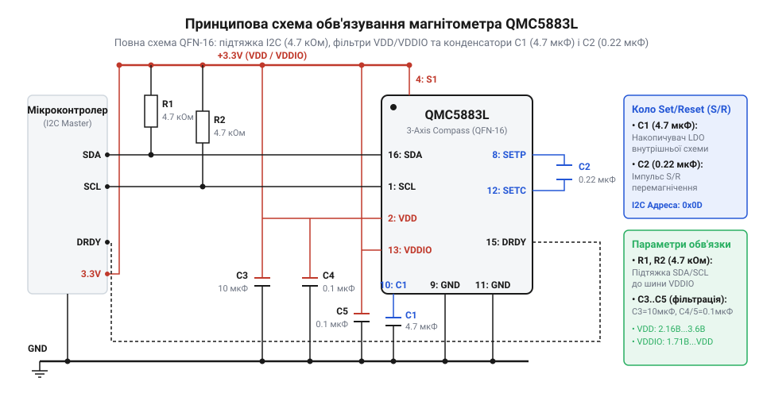
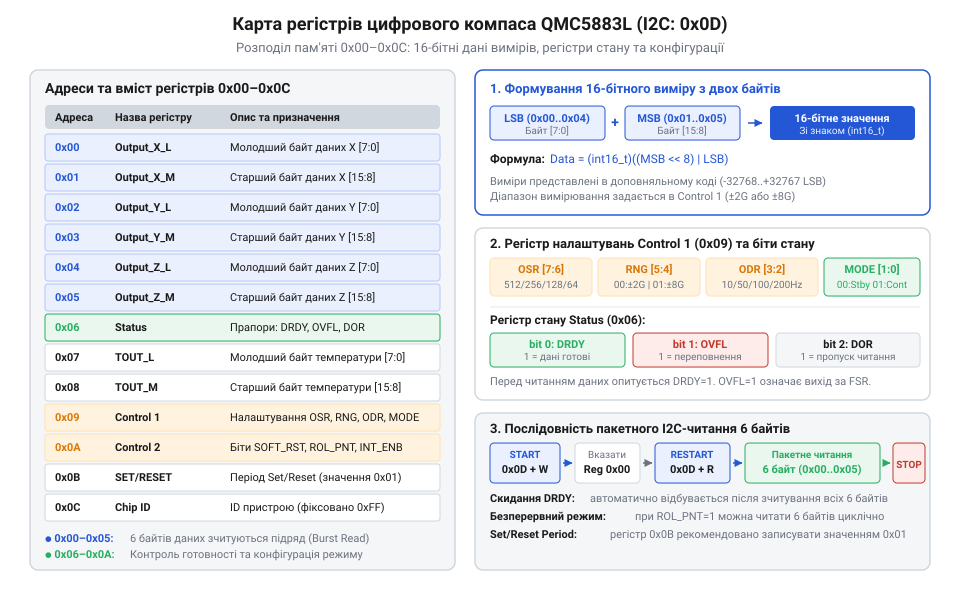

# Схемотехнічний інтерфейс та карта регістрів QMC5883L

<preknowlist>
- [GY-271 / HMC5883L — компас/магнетометр](root:cat-hw-sensors/hmc5883l) — відмінності між архітектурами магнетометрів HMC5883L та QMC5883L
</preknowlist>

## Спотворення магнітних даних без схемотехнічного обв'язування

Спроба зчитати вектор магнітного поля Землі за допомогою цифрового @@en|magnetometer@@ (магнетометр, грец. *magnetis* — магніт, *metron* — міра) QMC5883L без правильного зовнішнього обв'язування швидко завершується виявленням хаотичного шуму, постійного зсуву нуля або повним заблокуванням послідовної шини. На відміну від звичайних цифрових датчиків температури, 3-осьовий @@en|magnetometer@@ вимірює надзвичайно слабкі магнітні індукції (порядку 30–60 мікротесла). В основі внутрішніх первинних перетворювачів QMC5883L лежать тонкоплівкові структури з пермалою, які працюють на основі @@en|anisotropic magnetoresistance@@ (анізотропний магнеторезистивний ефект, AMR, грец. *anisotropia* — нерівнозначність напрямків, лат. *resistere* — чинити опір). Опір цих елементів змінюється залежно від кута між напрямком внутрішнього намагнічування та зовнішнім магнітним вектором. Для детальнішого ознайомлення з фізикою квантово-механічних процесів та зміною опору феромагнітних плівок дивіться матеріал про [анізотропний магнеторезистивний ефект (AMR) у мікроелектроніці](root:ph-condensed/amr-sensors-working-principle).

Якщо вимірювальний модуль підключити до мікроконтролера прямими провідниками без фільтрації живлення, будь-які пульсації від роботи цифрових кіл або сусідніх споживачів струму накладуться на аналоговий сигнал тонкоплівкових мостів. Щоб перетворити мікроскопічну зміну опору AMR-елементів у 16-бітне цифрове значення, внутрішній аналогово-цифровий перетворювач (АЦП) чипа потребує стабільної опорної напруги. Відсутність локального @@en|decoupling capacitor@@ (розв'язувальний конденсатор) безпосередньо біля виводів живлення призводить до того, що під час кожного такту дискретизації АЦП виникає просідання напруги (@@en|voltage sag@@). У результаті в зчитаних відліках магнітного поля з'являється високочастотна завада з амплітудою у сотні одиниць LSB, яка унеможливлює точне орієнтування пристрою в просторі.

Ще більшу небезпеку становить специфіка функціонування самих магнеторезистивних доменів. При дії сильних зовнішніх завад (наприклад, від імпульсних струмів силових моторів чи близького розташування постійних магнітів) внутрішня магнітна структура пермалоєвих смуг втрачає початкову орієнтацію доменів. У феромагнетику виникає залишкове перемагнічування (@@en|offset drift@@), через яке вихідне значення нуля зміщується на сотні мілігаусів. Для відновлення монодоменної структури та усунення гістерезису чип QMC5883L генерує внутрішні короткочасні струмові імпульси високої амплітуди через спеціалізоване коло відновлення. Якщо в схемі відсутній зовнішній накопичувальний конденсатор необхідної ємності, чип не здатен сформувати достатню напруженість перемагнічувального поля. Сенсор залишається в намагніченому стані, а вихідні дані втрачають лінійність і спотворюються.

Нарешті, недотримання вимог до цифрової шини @@en|I2C@@ (англ. *Inter-Integrated Circuit*) створює апаратні збої передачі. Оскільки лінії `SDA` та `SCL` є виходами з відкритим стоком, відсутність або неправильний розрахунок @@en|pull-up resistor@@ (підтягувальний резистор) завалює фронти цифрових сигналів. При високих частотах тактування @@en|I2C@@ або наявності довгого шлейфу фронт pulse затягується, мікроконтролер пропускає біт confirmation (ACK), а внутрішній автомат станів QMC5883L застрягає у стані передачі, надійно блокуючи лінію `SDA` в низькому рівні. Таким чином, без комплексного схемотехнічного обв'язування та розуміння карти регістрів побудувати надійний інтерфейс зчитування даних неможливо.

## Принципова схема та коло Set/Reset

Для забезпечення стабільної роботи @@en|magnetometer@@ QMC5883L у корпусі @@en|QFN-16 package@@ (корпус QFN-16, англ. *Quad Flat No-leads*) розробляється спеціалізована принципова схема включення, яка розділяє аналогове й цифрове живлення та формує коло накопичення енергії для імпульсного відновлення сенсора. Корпус чипа має 16 виводів, розташованих по периметру квадратного підкладкового елемента.

Основними лініями живлення пристрою є виводи `VDD` (вивід 2) та `VDDIO` (вивід 13). Напруга `VDD` забезпечує живлення внутрішніх аналогових підсилювачів, генератора струму та АЦП (робочий діапазон від 2,16 В до 3,6 В, номінально 3,3 В). Лінія `VDDIO` призначена для живлення цифрових буферів інтерфейсу @@en|I2C@@ і виводу переривань (від 1,65 В до `VDD`), що дозволяє безпосередньо узгоджувати логічні рівні з мікроконтролерами із живленням 1,8 В або 3,3 В. Для придушення високочастотних і низькочастотних завад паралельно виводу `VDD` встановлюють керамічний @@en|decoupling capacitor@@ ємністю 0,1 мкФ та танталовий або керамічний конденсатор ємністю 4,7 мкФ (або 10 мкФ) з низьким еквівалентним послідовним опором (ESR). Лінія `VDDIO` фільтрується окремим керамічним @@en|decoupling capacitor@@ ємністю 0,1 мкФ, розташованим якомога ближче до виводу 13.

Сигнальні лінії шини @@en|I2C@@ — `SCL` (вивід 1) та `SDA` (вивід 16) — підтягуються до лінії `VDDIO` за допомогою зовнішніх резисторів `R1` та `R2` номіналом від 2,2 кОм до 4,7 кОм залежно від ємності шини та швидкості передачі (100 кГц або 400 кГц). На відміну від застарілих [модулів на базі HMC5883L](root:cat-hw-sensors/hmc5883l), чип QMC5883L має фіксовану @@en|I2C@@-адресу `0x0D` та додатковий вивід переривання `DRDY` (вивід 15, @@en|Data Ready@@), який формує активний низький рівень при завершенні чергового циклу вимірювання.

Найважливішим вузлом схемотехнічного обв'язування QMC5883L є коло Set/Reset, підключене до виводу `SETC` (вивід 12). Між виводами `SETC` та `SETP` обов'язково встановлюється зовнішній накопичувальний керамічний конденсатор `C2` ємністю 0,22 мкФ (220 нФ) з діелектриком X7R або X5R.


*Принципова схема обв'язування QMC5883L: виділено живильні фільтри VDD/VDDIO, підтягувальні резистори I2C та накопичувальну ємність C1 кола Set/Reset.*

Фізичний механізм роботи кола Set/Reset полягає в наступному. Всередині чипа QMC5883L над пермалоєвими AMR-мостами прокладено інтегровані металеві смуги (@@en|Set/Reset strap@@). Для скидання залишкового намагнічування та усунення температурного зсуву необхідно пропустити через цю смугу короткий (тривалістю десятки наносекунд) струмовий імпульс амплітудою в кілька сотень міліампер. Внутрішнє джерело живлення чипа не здатне видати такий піковий струм безпосередньо з лінії `VDD`. Спеціалізований внутрішній драйвер заряджає зовнішній конденсатор `C1` у проміжках між вимірюваннями, а в момент формування імпульсу швидко розряджає його через металеву смугу. Створене імпульсне магнітне поле перемагнічує домени пермалою спочатку в одному напрямку (Set), а при наступному вимірюванні — у протилежному (Reset). Віднімання двох послідовних відліків дозволяє повністю компенсувати власне зміщення нуля підсилювального тракту та виміряти виключно зовнішнє магнітне поле. Щоб дізнатися більше про електродинаміку перемагнічування та розрахунок амплітуди відновлювальних струмів, перегляньте статтю про [принцип роботи кіл Set/Reset у магнітометрах](root:ph-condensed/magnetometer-set-reset-pulse).

## Карта регістрів та зчитування даних

Уся внутрішня пам'ять QMC5883L доступна для зчитування та запису через послідовний інтерфейс @@en|I2C@@ за 7-бітною адресою `0x0D`. Карта регістрів пристрою охоплює адреси від `0x00` до `0x0C` і містить блоки вихідних даних магнітного поля, датчика температури, регістр стану та керуючі регістри.


*Карта регістрів QMC5883L: розподіл блоків даних осьового магнітного поля, засобів контролю стану та конфігураційних регістрів.*

Блок регістрів вихідних даних осей X, Y та Z займає адреси від `0x00` до `0x05`. Для кожної з трьох просторових осей виділено по два 8-бітні регістри: молодший байт (@@en|least significant byte@@, LSB) розташований за меншою адресою, а старший байт (@@en|most significant byte@@, MSB) — за наступною адресою (порядок байтів @@en|Little-Endian@@). - `0x00`: `DataOUT_X_LSB` — молодший байт осі X
- `0x01`: `DataOUT_X_MSB` — старший байт осі X
- `0x02`: `DataOUT_Y_LSB` — молодший байт осі Y
- `0x03`: `DataOUT_Y_MSB` — старший байт осі Y
- `0x04`: `DataOUT_Z_LSB` — молодший байт осі Z
- `0x05`: `DataOUT_Z_MSB` — старший байт осі Z

Отримані значення осей представлені у формі 16-бітного signed integer у @@en|two's complement@@ (доповняльний код, лат. *complementum* — доповнення). Діапазон вихідних чисел становить від -32768 до +32767 LSB. Обчислення 16-бітного значення осі `X` з двох 8-бітних байтів проводиться за формулою:

```
Raw_X = (int16_t)((uint16_t)MSB << 8 | LSB)
```

Регістр стану `Status` за адресою `0x06` містить важливі прапорці готовності та валідності даних:
- Біт 0 (`DRDY` — @@en|Data Ready@@): приймає значення `1`, коли АЦП завершив новий цикл вимірювання й оновив регістри `0x00`–`0x05`. При прочитанні будь-якого з регістрів даних або регістра стану прапорець `DRDY` автоматично скидається в `0`. - Біт 1 (`OVFL` — @@en|Overflow@@): приймає значення `1`, якщо виміряне значення магнітного поля перевищило максимально допустимий діапазон вимірювальної шкали. Якщо `OVFL = 1`, значення у відповідних регістрах даних стають невалідними. - Біт 2 (`DOR` — @@en|Data Overrun@@): встановлюється в `1`, якщо новий результат вимірювання був записаний поверх попереднього до того, як мікроконтролер встиг його зчитати.

Адреси `0x07` (`TOUT_LSB`) та `0x08` (`TOUT_MSB`) займає внутрішній цифровий датчик температури, вихідні дані якого також представлені 16-бітним знаком у @@en|two's complement@@. Цей датчик показує відносну зміну температури кристала та застосовується для температурної компенсації дрейфу нульової точки. При об'єднанні даних магнітометра з іншими сенсорами, наприклад при створенні систем навігації на основі [шестиосьового IMU MPU-6050](root:cat-hw-sensors/mpu6050) або при використанні [цифрового акселерометра ADXL345](root:cat-hw-sensors/adxl345), зчитування даних магнітометра виконують блоковим (burst) транзакційним викликом.

Критично важливо зчитувати всі 6 байтів даних (`0x00`–`0x05`) в рамках однієї групової @@en|I2C@@-транзакції. Внутрішній автомат QMC5883L при зчитуванні байта `0x00` блокує оновлення буферних регістрів виходу (@@en|atomic read protection@@), що гарантує цілісність даних: АЦП не зможе перезаписати старший байт осі під час зчитування її молодшого байта. Нижче наведено приклади реалізації атомарного зчитування даних QMC5883L.

:::tabs
:::tab c|esp-idf
:::code api-qmc5883l-hardware/c/esp-idf/qmc5883l-read-mag.c
:::
:::tab cpp|arduino
:::code api-qmc5883l-hardware/cpp/arduino/magdata.cpp
:::
:::

## Конфігурація режимів вимірювання та передискретизації

Режим функціонування, вимірювальний діапазон, частота оновлення даних та коефіцієнт цифрового усереднення QMC5883L визначаються налаштуванням двох керуючих регістрів `Control Register 1` (`0x09`), `Control Register 2` (`0x0A`) та регістра періоду скидання `SET/RESET Period Register` (`0x0B`).

Регістр `Control Register 1` (`0x09`) є головним конфігураційним полем чипа. Структура його бітів наведена нижче:
- Біти `[1:0]` — `MODE` (режим роботи чипа):
  - `00` — @@en|Standby mode@@ (режим очікування). Аналогові кола та АЦП вимкнені, споживання струму становить мінімальні ~3 мкА. - `01` — @@en|Continuous mode@@ (режим безперервного вимірювання). Сенсор автоматично виконує вимірювання з вибраною частотою `ODR`, оновлює вихідні регістри та генерує сигнал `DRDY`. - `10`, `11` — зарезервовано. - Біти `[3:2]` — `ODR` (@@en|Output Data Rate@@, частота оновлення вихідних даних):
  - `00` — 10 Гц
  - `01` — 50 Гц
  - `10` — 100 Гц
  - `11` — 200 Гц
- Біти `[5:4]` — `RNG` (@@en|Full Scale Range@@, шкала вимірювального діапазону):
  - `00` — ±2 Гаус (чутливість складає 12000 LSB/Гаус)
  - `01` — ±8 Гаус (чутливість складає 3000 LSB/Гаус)
  - `10`, `11` — зарезервовано. - Біти `[7:6]` — `OSR` (@@en|Over Sampling Rate@@, коефіцієнт передискретизації):
  - `00` — OSR = 512
  - `01` — OSR = 256
  - `10` — OSR = 128
  - `11` — OSR = 64

Математичний зміст коефіцієнта передискретизації `OSR` полягає в тому, що внутрішній АЦП робить кілька надлишкових замірів на один вихідний відлік. При OSR = 512 АЦП виконує 512 внутрішніх вимірювань і усереднює їх, розширюючи ефективну розрядність та знижуючи середньоквадратичний шум (RMS noise). Вибір OSR = 512 забезпечує найвищу точність вимірювання магнітного поля, але вимагає більшого споживання струму в активному стані. При OSR = 64 рівень шуму зростає, але час активного виконання вимірювання скорочується.

Регістр `Control Register 2` (`0x0A`) відповідає за службові функції та скидання:
- Біт 7 — `SOFT_RST` (програмне скидання): запис одиниці в цей біт відновлює значення всіх регістрів до заводських налаштувань за замовчуванням. Біт автоматично скидається в `0` після завершення процедури скидання. - Біт 6 — `ROL_PNT` (циклічний перехід покажчика регістрів): при значенні `1` дозволяє автоматичний перехід покажчика @@en|I2C@@ з регістра `0x06` назад на `0x00` при безперервному зчитуванні. - Біт 0 — `INT_ENB` (дозвіл переривання `DRDY`): `0` — вивід `DRDY` дозволено (активний високий рівень при готовності); `1` — вивід `DRDY` переведено в високоімпедансний стан.

Регістр `SET/RESET Period Register` (`0x0B`) контролює періодичність формування внутрішніх перемагнічувальних імпульсів. Виробник рекомендує завжди записувати в цей регістр значення `0x01`. Це гарантує, що перемагнічувальний струмовий імпульс через конденсатор `C1` випромінюватиметься перед кожним циклом вимірювання, повністю усуваючи накопичений температурний дрейф та гістерезис.

Послідовність ініціалізації QMC5883L включає такі обов'язкові кроки:
1. Запис `0x80` у регістр `0x0A` (виконання програмного скидання `SOFT_RST`) з паузою ~10 мс. 2. Запис `0x01` у регістр `0x0B` (увімкнення схемотехнічного регенеративного імпульсу Set/Reset). 3. Запис обраного байта конфігурації в регістр `0x09` (наприклад, `0x1D`, що відповідає OSR=512, RNG=±8G, ODR=200Hz, Mode=Continuous).

:::tabs
:::tab c|esp-idf
:::code api-qmc5883l-hardware/c/esp-idf/qmc5883l-init.c
:::
:::tab cpp|arduino
:::code api-qmc5883l-hardware/cpp/arduino/initqmc5883l.cpp
:::
:::