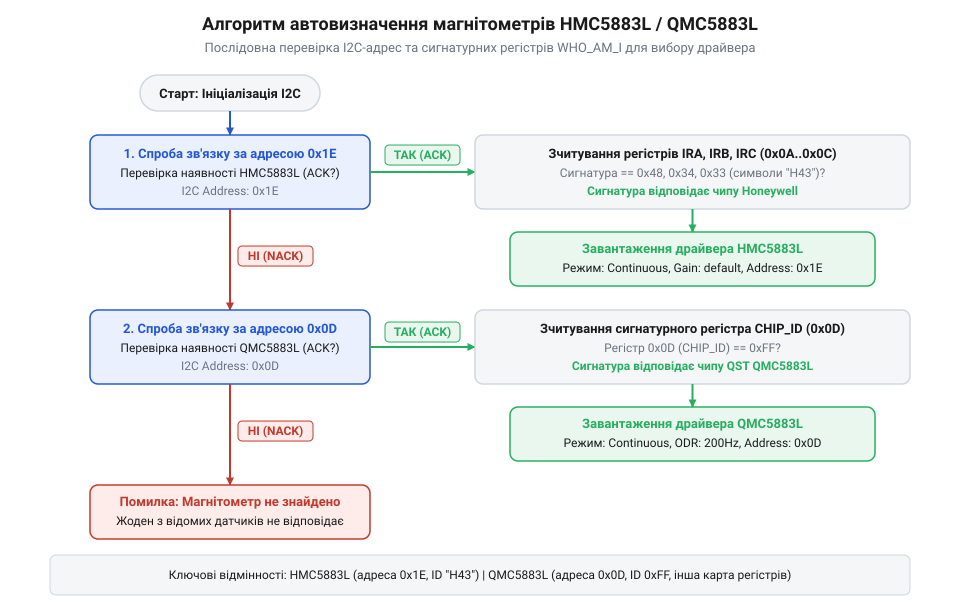
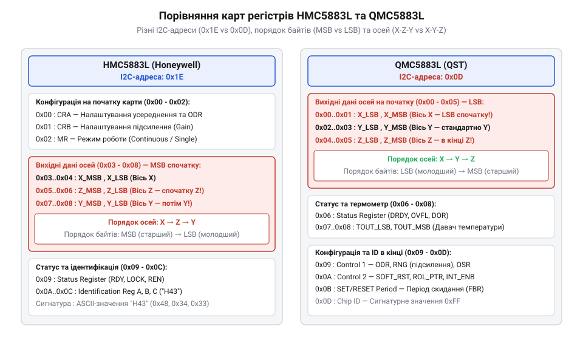

# Історія виходу QMC5883L та розриву сумісності з HMC5883L

<preknowlist>
- [GY-271 / HMC5883L — компас/магнетометр](root:cat-hw-sensors/hmc5883l) — Базові принципи роботи магнітометра HMC5883L, його роль у навігаційних модулях та стандартну структуру керування цим чипом
</preknowlist>

## Масовий збій компасів у польотних контролерах

У 2016 році спільнота розробників аматорських безпілотних літальних апаратів та робототехніки зіштовхнулася з несподіваною проблемою. При складанні мультикоптерів розробники масово використовували [модулі компаса GY-271](root:cat-hw-sensors/hmc5883l) для визначення азимута та орієнтації пристрою в просторі. Ці компактні плати розширення (англ. @@en|breakout board@@) традиційно збирали на базі триосьового магнітометра (від грец. *магніт* і *метрон* — вимірювач магнітного поля, @@en|magnetometer@@) @@en|HMC5883L@@ компанії @@en|Honeywell@@. Однак нові партії плати @@en|GY-271@@, куплені у популярних дистриб'юторів, раптово перестали функціонувати в зібраних системах.

Під час підключення нової плати до польотного контролера (англ. @@en|flight controller@@) під керуванням прошивки (англ. @@en|firmware@@ — мікропрограма) @@en|Cleanflight@@, @@en|Betaflight@@, @@en|iNav@@ або @@en|ArduPilot@@ індикатор компаса залишався неактивним. Система видавала помилку ініціалізації давача або фіксувала нульові значення магнітного поля. Спроби запустити пристрій за допомогою стандартних бібліотек для мікроконтролерів @@en|Arduino@@ також завершувалися невдачею: виклики ініціалізації на шині @@en|I2C@@ (англ. *Inter-Integrated Circuit* — міжмікросхемна шина) повертали помилку відсутності підтвердження (англ. @@en|NACK@@, *Negative Acknowledge*).

Причина апаратного збою з'ясувалася після фізичного огляду мікросхем. Хоча друкована плата зберігала звичну шовкографію @@en|GY-271@@, а в описі товару зазначався чип @@en|HMC5883L@@, корпус мікросхеми містив нове лазерне маркування — `DB5883` або `DA5883` замість оригінального `L883`. Виробники модулів здійснили «тиху» підміну мікросхеми без зміни назви продукту та маркування на платі. Старий драйвер звертався до шини @@en|I2C@@ за адресою `0x1E`, проте новий чип взагалі не відповідав на цей запит, оскільки його апаратна адреса була запрограмована як `0x0D`.

Раптова зміна компонента спричинила хаос у кодових базах відкритих проектів. Замість фіксованої адреси та єдиного драйвера розробникам довелося терміново впроваджувати механізми динамічного сканування шини @@en|I2C@@ та автовизначення типів давачів.

*Алгоритм автовизначення магнітометра в прошивці польотного контролера шляхом послідовної перевірки шини I2C.*

## Зняття HMC5883L та вихід QMC5883L

Причиною масової появи нових чипів на ринку стало офіційне рішення компанії @@en|Honeywell@@ припинити виробництво давача @@en|HMC5883L@@. У 2016 році виробник видав сповіщення про завершення життєвого циклу (англ. @@en|EOL@@, *End of Life*) цієї мікросхеми. @@en|Honeywell@@ переорієнтувала свої потужності на високоточні промислові та аерокосмічні системи, згорнувши випуск масових споживчих магнітометрів. Це створило гострий дефіцит доступних триосьових давачів для цивільних безпілотників, смартфонів та навчальних наборів робототехніки, де вони працювали в зв'язці з [модулями MPU-6050](root:cat-hw-sensors/mpu6050) або [давачами MPU-9250](root:cat-hw-sensors/mpu9250).

Для заповнення утвореної ніші китайська напівпровідникова компанія @@en|QST Corporation@@ випустила власний магнітометр @@en|QMC5883L@@. Щоб спростити перехід для фабрик із монтажу друкованих плат, @@en|QST Corporation@@ спроектувала новий чип у такому ж 16-піновому корпусі @@en|LCC@@ з ідентичним розташуванням виводів живлення та сигнальних ліній шини @@en|I2C@@. Завдяки цьому виробники модулів @@en|GY-271@@ змогли встановлювати @@en|QMC5883L@@ на існуючі друковані плати без коригування розводки провідників та без переналаштування складальних ліній.

Китайські фабрики зберегли маркування @@en|GY-271@@ і навіть згадку @@en|HMC5883L@@ у назвах товарів з огляду на маркетинг. Позначення @@en|GY-271@@ та @@en|HMC5883L@@ були найпопулярнішими пошуковими запитами на торгових майданчиках, тому зміна назви картки товару призвела б до втрати позицій у пошуковій видачі.

У форумах розробників виник міф про те, що @@en|QMC5883L@@ є підробкою або контрафактним клоном оригінального чипа @@en|Honeywell@@. Насправді @@en|QMC5883L@@ — це самостійна спеціалізована інтегральна схема (англ. @@en|ASIC@@, *Application-Specific Integrated Circuit*), розроблена інженерами @@en|QST Corporation@@ на основі анізотропного магніторезистивного ефекту (англ. @@en|AMR@@, *Anisotropic Magnetoresistance*). Чип отримав вищу розрядність аналого-цифрового перетворювача (16 біт проти 12 біт у @@en|HMC5883L@@), збільшену частоту видачі даних (до 200 Гц проти 75 Гц) та вбудований температурний компенсатор. Проте повна відсутність програмної сумісності вимагала кардинального оновлення драйверів.

## Глибокі апаратні та програмні відмінності

Незважаючи на фізичну взаємозамінність корпусів на платах розширення, мікросхеми @@en|HMC5883L@@ та @@en|QMC5883L@@ мають принципово різну внутрішню архітектуру та програмний інтерфейс керування. Першою відмінністю є адреса веденого пристрою на шині @@en|I2C@@. Оригінальний чип @@en|Honeywell@@ відповідає за фіксованою 7-бітною адресою `0x1E`, тоді як чип @@en|QST Corporation@@ використовує адресу `0x0D`. Спроба старої прошивки звернутися за адресою `0x1E` на модулі з @@en|QMC5883L@@ викликає відмову апаратного підтвердження шини.

Друга критична відмінність полягає в карті регістрів (англ. @@en|registers@@) та форматі упакування вихідних даних. В @@en|HMC5883L@@ керуючі налаштування розміщено в регістрах `0x00` та `0x01`, а результат вимірювання займає регістри від `0x03` до `0x08`. При цьому дані передаються у форматі зі старшим байтом попереду (англ. @@en|MSB@@, *Most Significant Byte*), а осі зчитуються у послідовності X, Z, Y. В @@en|QMC5883L@@ регістри даних починаються безпосередньо з адреси `0x00` до `0x05`, байтова послідовність змінена на молодший байт попереду (англ. @@en|LSB@@, *Least Significant Byte*), а порядок осій є стандартним — X, Y, Z.

*Порівняння карти регістрів та системних параметрів магнітометрів HMC5883L і QMC5883L.*

Третя відмінність визначається алгоритмами керування режимами вимірювання. @@en|HMC5883L@@ вимагає налаштування режимів одиночного чи безперервного вимірювання через окремий регістр режиму `0x02`. У @@en|QMC5883L@@ керування згруповано в першому регістрі контролю `0x09`, де одночасно задаються режим робочого стану, частота виходу даних (англ. @@en|ODR@@, *Output Data Rate*), діапазон вимірювання та коефіцієнт передискретизації (англ. @@en|OSR@@, *Over-Sampling Ratio*). Крім того, @@en|QMC5883L@@ потребує ініціалізації періоду імпульсів скидання в регістрі `0x0B` значенням `0x01` для коректної роботи внутрішнього магнітного містка.

Для програмної ідентифікації чипів розробники використовують ідентифікаційні регістри. @@en|HMC5883L@@ повертає символьну сигнатуру `'H'`, `'4'`, `'3'` у регістрах `0x0A`, `0x0B` та `0x0C`. Натомість @@en|QMC5883L@@ містить регістр ідентифікації чипа за адресою `0x0D`, який за замовчуванням повертає значення `0xFF`. Якщо старий драйвер @@en|HMC5883L@@ намагається прочитати дані з @@en|QMC5883L@@, він сприймає молодший байт осі Y як старший байт осі X, що призводить до отримання спотворених або нульових векторів напрямку. Надійне розрізнення цих магнітометрів досягається через сканування адрес шини @@en|I2C@@ та перевірку сигнатурних регістрів при завантаженні системи.

## Розвінчання міфу про неякісний клон

У перші місяці після поява чипа @@en|QMC5883L@@ у розробницьких спільнотах та на форумах DIY-електроніки запанувала думка, що новий сенсор є лише «дешевою підробкою» чи неякісно скопійованим клоном оригінального давача @@en|HMC5883L@@ від компанії @@en|Honeywell@@. Причиною такого упередження стала «тиха» заміна мікросхем на популярних [модулях компаса GY-271](root:cat-hw-sensors/hmc5883l), через яку існуючий код переставав працювати без будь-яких попереджень. Проте детальний технічний аналіз внутрішньої структури кристала доводить, що @@en|QMC5883L@@ розроблений компанією @@en|QST Corporation@@ як повністю самостійна інтегральна схема із власним набором характеристик.

Причин, чому @@en|QMC5883L@@ плутають із клоном, дві: однаковий 16-піновий корпус @@en|LCC@@ із збереженням розташування виводів та співзвучна назва. Виробник навмисно зберіг розпінування, щоб розробники апаратного забезпечення могли встановлювати новий чип на плату @@en|GY-271@@ без переробки її розводки. Усередині ж кристала реалізовано власну архітектуру на основі анізотропного магніторезистивного ефекту (англ. @@en|AMR@@). За основними параметрами @@en|QMC5883L@@ не поступається оригіналу @@en|Honeywell@@, а в окремих вузлах навіть перевищує його:

1. **Частота виходу даних (англ. @@en|ODR@@, *Output Data Rate*)**: Одночасно з вимірюванням векторів магнітного поля оригінальний @@en|HMC5883L@@ забезпечував максимальну частоту вибірки 75 Гц. Натомість @@en|QMC5883L@@ здатний видавати дані зі швидкістю до 200 Гц. Це дає суттєву перевагу у високодинамічних системах стабілізації, де магнітометр працює в паралелі з [модулями MPU-6050](root:cat-hw-sensors/mpu6050) або [інерційними давачами MPU-9250](root:cat-hw-sensors/mpu9250). 2. **Розрядність АЦП та чутливість**: В @@en|HMC5883L@@ аналого-цифровий перетворювач має розрядність 12 біт, що дає роздільну здатність близько 1090 відліків на Гаус (англ. @@en|LSB@@/@@en|Gauss@@). У @@en|QMC5883L@@ застосовано 16-бітний АЦП, який у діапазоні ±2 Гаус забезпечує роздільну здатність до 3000 відліків на Гаус, гарантуючи вищу точність фіксації дрібних відхилень магнітного поля. 3. **Апаратна фільтрація та передискретизація**: Чип від @@en|QST Corporation@@ містить вбудований цифровий сигнальний процесор (від лат. *digitus* — палець, число, англ. @@en|DSP@@, *Digital Signal Processor*), який здійснює апаратне усереднення сигналу за допомогою коефіцієнтів передискретизації (від лат. *discretus* — відокремлений, англ. @@en|OSR@@, *Over-Sampling Ratio* до 512). Це забезпечує фільтрацію (від пізньолат. *filtrum* — повсть, англ. @@en|LPF@@, *Low-Pass Filter*) високочастотних завад і знижує середньоквадратичний шум без залучення обчислювальних ресурсів центрального мікроконтролера. 4. **Схема скидання та компенсації**: Для усунення температурного дрейфу нуля та розмагнічування осей у @@en|QMC5883L@@ інтегровано автоматичний генератор розмагнічувальних імпульсів @@en|SET/RESET@@, керування яким спрощено до запису єдиного біта в регістр `0x0B`.

Слабким місцем @@en|QMC5883L@@ на момент виходу була не якість кристала, а відсутність якісної документації англійською мовою та вужчий вибір вимірювальних діапазонів (лише ±2 та ±8 Гаус проти гнучкого вибору з 8 рівнів в @@en|HMC5883L@@). Отже, @@en|QMC5883L@@ є не підробкою, а повноцінним альтернативним давачем, який вимагає власних алгоритмів ініціалізації та обробки даних.

## Впровадження автовизначення у відкритих прошивках

Поява двох різних за програмним інтерфейсом чипів у корпусах з однаковим розпінуванням поставила складне завдання перед розробниками відкритих прошивок для польотних контролерів (таких як @@en|Cleanflight@@, @@en|Betaflight@@, @@en|iNav@@, @@en|ArduPilot@@ та @@en|PX4@@). Раніше код спирався на жорстко зашиту адресу `0x1E` та стандартну конфігурацію регістрів @@en|HMC5883L@@. Коли пілоти підключали нові плати @@en|GY-271@@, прошивка видавала помилку компаса, що робило неможливим утримання позиції та вихід у режим автопілота.

Примушувати користувачів вручну обирати тип чипа в конфігураторі або перекомпілювати прошивку під окремий давач було неефективним кроком через високу ймовірність помилок недосвідчених користувачів. Тому архітектуру підсистеми ініціалізації обладнання було кардинально перероблено шляхом переходу до динамічного зондування (від франц. *sonder* — вимірювати глибину, англ. @@en|I2C probing@@) шини @@en|I2C@@ та створення мультидрайверного шару абстракції (від лат. *abstractio* — відволікання, англ. @@en|HAL@@, *Hardware Abstraction Layer*).

Процес автовизначення магнітометра під час завантаження польотного контролера відбувається за таким покроковим алгоритмом:

1. **Сканування первинної адреси**: Система надсилає тестовий запит підтвердження (англ. @@en|ACK@@) на адресу `0x1E`. Якщо пристрій відповідає, прошивка зчитує сигнатурні регістри `0x0A`, `0x0B` та `0x0C`. Отримання послідовності байтів `'H'`, `'4'`, `'3'` підтверджує наявність оригінального чипа @@en|HMC5883L@@. Для нього активується відповідний драйвер, який налаштовує регістри `0x00`–`0x02`. 2. **Перехід до резервної адреси**: Якщо адреса `0x1E` повертає відсутність підтвердження (англ. @@en|NACK@@) або сигнатурні регістри не збігаються, контролер опитує адресу `0x0D`. Отримання відповіді та зчитування ідентифікаційного регістру `0x0D` (який повертає `0xFF`) однозначно вказує на наявність чипа @@en|QMC5883L@@. 3. **Ініціалізація та уніфікація даних**: Після ідентифікації @@en|QMC5883L@@ драйвер записує конфігураційні значення в регістр `0x09` (встановлюючи режим continuous, частоту вибірки 200 Гц та діапазон ±2 Гаус) та регістр `0x0B` (період скидання).

Після завершення ініціалізації будь-якого з чипів драйвер переводить їхні сирі 16-бітні відліки у єдині фізичні одиниці вимірювання — мікротесли (мкТл, μT) або Гауси, враховуючи різницю в порядку байтів (англ. @@en|MSB@@ в @@en|HMC5883L@@ проти @@en|LSB@@ в @@en|QMC5883L@@) та орієнтації осей. На верхній рівень навігаційного алгоритму та розширеного фільтра Калмана (англ. @@en|EKF@@, *Extended Kalman Filter*) подається уніфікований вектор магнітного поля, незалежно від того, який саме давач встановлено на платі.

## Практична ідентифікація та адаптація коду

Для розробників мікроконтролерних систем на базі @@en|Arduino@@, @@en|ESP32@@ або @@en|STM32@@, які працюють із [модулями розширення GY-271](root:cat-hw-sensors/hmc5883l) або інтегрованими платами на зразок [серії Pololu IMU](root:cat-hw-sensors/pololu-imu), критично важливо вміти точно визначити тип встановленого чипа та підготувати кодову базу.

Ідентифікація давача здійснюється у три послідовні етапи:

1. **Візуальний огляд маркування**: Попри однаковий чорний корпус типу @@en|LCC-16@@ розміром 3×3 мм, лазерне гравіювання на поверхні мікросхеми відрізняється. Оригінальний чип @@en|Honeywell@@ @@en|HMC5883L@@ має маркування `L883`, за яким слідує чотиризначний номер партії. Мікросхема @@en|QMC5883L@@ від @@en|QST Corporation@@ позначається кодами `DB5883`, `DA5883` або безпосередньо `QMC5883`. 2. **Програмне сканування шини**: Підключивши виводи `SDA` та `SCL` до мікроконтролера, запускають стандартний скрипт сканування шини @@en|I2C@@. Відгук за адресою `0x1E` свідчить про наявність @@en|HMC5883L@@, а відгук за адресою `0x0D` — про @@en|QMC5883L@@. 3. **Перевірка сигнатурних регістрів (від лат. *signatura* — позначка, англ. @@en|signature@@)**: Щоб уникнути помилкового визначення, якщо за адресою перебуває інший пристрій, програмний код виконує зчитування ідентифікаційних регістрів:

:::code hist-qmc5883l-hmc5883l-history/cpp/detectmagnetometer.cpp

Адаптація кодової бази вимагає вибору належної бібліотеки. Популярна бібліотека `Adafruit_HMC5883_Unified` призначена виключно для чипів @@en|Honeywell@@ i не працюватиме з @@en|QMC5883L@@, оскільки вона звертається за адресою `0x1E` та записує конфігураційні байти в регістри `0x00`–`0x02`. Для роботи з мікросхемою від @@en|QST Corporation@@ слід використовувати спеціалізовані бібліотеки `MechaQMC5883` або `QMC5883L_Compass`, які правильно виконують ініціалізацію регістрів `0x09` і `0x0B` та читають 6 байтів вимірювань починаючи з адреси `0x00` у форматі @@en|LSB@@-first.