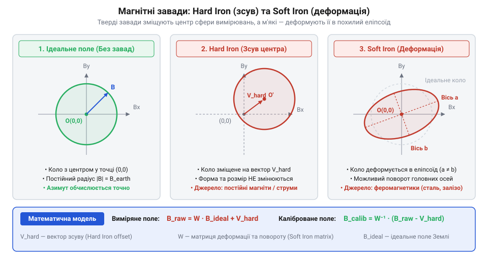
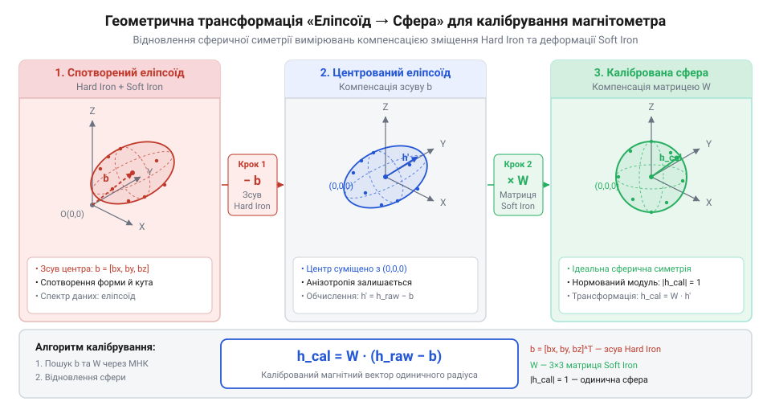

# Математичні моделі калібрування твердих і м'яких магнітних завад

<preknowlist>
- [GY-271 / HMC5883L — компас/магнетометр](root:cat-hw-sensors/hmc5883l) — фізичний принцип вимірювання векторних компонентів магнітного поля та структуру сирих вихідних даних X, Y, Z
</preknowlist>

## Спотворення навігації некаліброваним триосьовим компасом

Коли безпілотний літальний апарат або мобільний робот витримує заданий @@ar|азимут@@ (араб. *as-sumūt* — напрямок, шлях), його навігаційна система спирається на вимірювання геомагнітного поля Землі. У припущенні ідеального середовища — без зовнішніх штучних завад — вектор індукції природного магнітного поля має сталий модуль у точці вимірювання. Якщо повертати пристрій у тривимірному просторі навколо всіх трьох осей, кінці виміряних векторів створюють геометричне тіло із замкненою симетрією. Кожна точка `(B_x, B_y, B_z)` триосьового вимірювання лежить на поверхні правильної сфери з радіусом `R`, який дорівнює модулю геомагнітного вектора `|B_true|`. Центр цієї ідеальної сфери розташований чітко в початку координат `(0, 0, 0)`.

Обчислення курсового кута `ψ` спирається на проекції виміряного вектора на горизонтальну площину. У строго горизонтальному положенні давача сирі компоненти `B_x` та `B_y` збігаються з цією площиною, проте в реальному русі корпус пристрою зазнає просторового нахилу. Тривимірне відхилення визначають кути @@nl|крен@@ (голланд. *krengen* — нахиляти на бік) `ϕ` навколо поздовжньої осі та @@fr|тангаж@@ (франц. *tangage* — похитувати ніс і корму) `θ` навколо поперечної осі. При поверненні вимірювальних осей відносно горизонту до горизонтальних складових підмішується потужна вертикальна компонента геомагнітного поля `B_z`. Тому для отримання чистих горизонтальних проекцій вектор `(B_x, B_y, B_z)` спочатку обертають на кути `ϕ` та `θ`, визначені за допомогою [триосьового акселерометра](root:cat-hw-sensors/adxl345) або [інерційного модуля](root:cat-hw-sensors/mpu6050). Без такої попередньої компенсації нахилу спотворені значення `B_x` та `B_y` дають суттєву хибу курсу ще до обчислення тригонометричного арктангенса:

```
ψ = arctan2(-B_y, B_x)    [тригонометричний розрахунок азимута в горизонтальній площині]
```

Тут `B_x` та `B_y` — горизонтальні компоненти магнітного поля, а `arctan2` — математична функція арктангенса двох аргументів, яка враховує знаки координат для визначення кута в межах від `-π` до `+π`. Поки сфера вимірювань лишається симетричною та центрованою у точці `(0, 0, 0)`, зміна кута повороту корпусу на кожен градус викликає пропорційну і плавну зміну розрахованого значення `ψ`.

Проте реальний @@gr|магнетометр@@ (грец. *magnetis* — магніт та *metron* — вимірювач: прилад для вимірювання індукції магнітного поля), наприклад [цифровий триосьовий компас](root:cat-hw-sensors/hmc5883l), ніколи не працює в ізольованій порожнечі. Він змонтований на друкованій платі поруч із силовими провідниками, сталевими гвинтами, феритовими дроселями, елементами живлення та металевими конструкціями корпусу. Усі ці елементи створюють власні магнітні поля або викривляють зовнішні лінії індукції.

У результаті взаємодії з конструктивними матеріалами виникає два руйнівні геометричні спотворення:
1. Зсув центру: геометричний центр тривимірної хмари точок переміщується з початку координат `(0, 0, 0)` у довільну точку `(V_x, V_y, V_z)`. 2. Деформація та поворот: ідеальна сфера втрачає однаковість радіусів уздовж різних напрямків і перетворюється на витягнутий або стиснутий 3D-еліпсоїд, осі якого повернуті відносно вимірювальних осей давача.

Якщо подати такі сирі, некалібровані значення `(B_x, B_y, B_z)` у формулу обчислення азимута, обчислений кут `ψ` отримує значні нелінійні викривлення. На певних інтервалах повороту зміна реального курсу на `10°` відображається як зміна на `40°`, а на протилежних ділянках компас практично «застрягає», майже не реагуючи на розвороти. Якщо ж вектор постійного зсуву перевищує за модулем горизонтальну складову геомагнітного поля, хмара точок взагалі перестає охоплювати початок координат `(0, 0, 0)`. У таком разі розрахований кут `ψ` коливається у вузькому секторі, і навігаційна система втрачає здатність орієнтуватися у просторі.


*Геометрична деформація вимірювального поля: постійний зсув Hard Iron переміщує центр сфери, а анізотропний Soft Iron стискає та повертає її в еліпсоїд.*

Для компенсації нахилу пристрою у тривимірному просторі магнітометр часто поєднують з іншими давачами, такими як [триосьовий цифровий акселерометр](root:cat-hw-sensors/adxl345) або [багатоосьовий інерційний модуль](root:cat-hw-sensors/mpu6050). Проте жодні тригонометричні алгоритми компенсації кутів не здатні усунути спотворення курсу, поки самі магнітні дані не позбавлені геометричного зсуву та деформації. Щоб повернути навігаційну точність, необхідно побудувати математичну модель викривлень, яка розділяє завади на дві фізичні категорії та визначає параметри їхньої компенсації. Докладніше про математичний алгоритм проектування виміряних компонентів магнітного поля у горизонтальну площину читайте у матеріалі про [компенсацію нахилу триосьового магнітного компаса за даними акселерометра](root:cat-hw-sensors/qmc5883l/math-tilt-compensation.md).

## Математична модель Hard та Soft Iron

Викривлення магнітного поля поблизу давача розділяють на два фізично й математично відмінних класи: завади від постійно намагнічених джерел та завади від перенамагнічуваних феромагнітних матеріалів.

Першу категорію називають @@en|Hard Iron@@ (англ. *hard iron*, від *hard* — твердий та *iron* — залізо: завади від елементів із постійною намагніченістю). Вона виникає через деталі, що володіють власною постійною або довготривалою намагніченістю: неодимові магніти динаміків, намагнічені сталеві гвинти, батарейні контейнери, а також постійні струми в провідниках живлення друкованої плати.

Оскільки ці джерела жорстко зафіксовані відносно системи координат @@gr|магнетометр@@а, їхній магнітний вектор не залежить від орієнтації пристрою в просторі. Вони додають до істинного геомагнітного вектора `B_true` сталий вектор зсуву `V`:

```
V = [V_x, V_y, V_z]ᵀ    [вектор постійного зміщення Hard Iron]
```

Пряма модель впливу @@en|Hard Iron@@ описується сумою векторів:

```
B_hard
= B_true + V             [додавання постійного вектора зміщення]
```

Тут `B_true` — вектор істинного геомагнітного поля, а `B_hard` — сумарне поле з урахуванням твердих завад. З геометричної точки зору завади @@en|Hard Iron@@ виконують чисте паралельне перенесення вимірювальної сфери. Форма та розміри сфери не змінюються, але її центр переміщується з точки `(0, 0, 0)` у координати `(V_x, V_y, V_z)`:

```
(B_x - V_x)² + (B_y - V_y)² + (B_z - V_z)²
= R²                     [рівняння зсунутої сфери радіуса R]
```

Де `B_x`, `B_y`, `B_z` — виміряні компоненти індукції, а `R` — модуль природного поля Землі.

Другу категорію називають @@en|Soft Iron@@ (англ. *soft iron*, від *soft* — м'який та *iron* — залізо: завади від перенамагнічувальних матеріалів). Вона зумовлена наявністю м'яких феромагнетиків (деталі із заліза, нікелю, металевих сплавів чи екранів), що мають високу магнітну проникність, але не володіють власною постійною намагніченістю.

Коли зовнішнє поле Землі проходить крізь такий матеріал, у ньому індукується вторинне магнітне поле. Оскільки геометрія деталей корпусу та плати зазвичай несиметрична, здатність концентрувати магнітні лінії залежить від напрямку зовнішнього поля відносно осей давача. Виникає @@gr|анізотропія@@ (грец. *an* — не, *isos* — рівний, *tropos* — напрямок: неоднаковість властивостей у різних напрямках) магнітного сприйняття.

Вплив @@en|Soft Iron@@ описується лінійним перетворенням за допомогою безрозмірної 3D-матриці деформації `W` розміром `3 × 3`:

```
B_soft
= W · B_true             [матричне множення вектора поля на матрицю деформації]
```

Матриця `W` містить дев'ять елементів:

```
    ┌                 ┐
    │ W_xx  W_xy  W_xz│
W = │ W_yx  W_yy  W_yz│
    │ W_zx  W_zy  W_zz│
    └                 ┘
```

Діагональні коефіцієнти `W_xx`, `W_yy`, `W_zz` відповідають за масштабування показів уздовж відповідних вимірювальних осей. Якщо значення цих елементів не рівні між собою, сфера стискається або розтягується, перетворюючись на витягнутий еліпсоїд. Позадіагональні коефіцієнти (наприклад `W_xy`, `W_xz`) описують перехресну чутливість осей, неортогональність вимірювальних каналів самого чипа, а також просторовий поворот головних осей еліпсоїда відносно декартової системи координат давача.

У реальному пристрої обома типами завад неможливо знехтувати, тому об'єднана пряма модель вимірювань `B_meas` поєднує в собі як деформацію @@en|Soft Iron@@, так і зсув @@en|Hard Iron@@:

```
B_meas
= W · B_true + V         [об'єднана модель спотворень вимірювань]
```

Тут `B_meas = [B_x, B_y, B_z]ᵀ` — вектор сирих показів, отриманих безпосередньо з регістрів давача, наприклад під час роботи з [сучасним інерційним модулем](root:cat-hw-sensors/mpu9250).

Для побудови алгоритму калібрування необхідно виразити істинний вектор `B_true` через виміряний вектор `B_meas`. Оскільки модуль істинного геомагнітного поля є величиною сталою `|B_true|² = R²`, скалярний квадрат вектора `B_true` дорівнює `R²`:

```
B_trueᵀ · B_true
= R²                     [умова сталості модуля геомагнітного поля]
```

Виразивши `B_true` з об'єднаної моделі спотворень:

```
B_true
= W⁻¹ · (B_meas - V)     [обернення прямої моделі вимірювань]
```

і підставивши цей вираз у умову сталості модуля, отримуємо квадратичну форму:

```
(B_meas - V)ᵀ · (W⁻¹)^T · W⁻¹ · (B_meas - V)
= R²                     [квадратична форма деформованого поля]
```

Поділивши обидві частини рівняння на `R²` та позначивши симетричну додатно визначену матрицю `A` розміром `3 × 3` як:

```
A
= (1 / R²) · (W⁻¹)^T · W⁻¹   [визначення матриці форми еліпсоїда]
```

отримуємо канонічне рівняння поверхні:

```
(B_meas - V)ᵀ · A · (B_meas - V)
= 1                      [канонічне рівняння 3D-еліпсоїда в матричній формі]
```

Розкриття цієї матричної форми у декартових координатах `x = B_x`, `y = B_y`, `z = B_z` дає алгебраїчне рівняння, яке описує загальна @@lat|квадрика@@ (лат. *quadratum* — квадрат: поверхня другого порядку) типу тривимірний @@gr|еліпсоїд@@ (грец. *elleipsis* — нестача та *eidos* — вигляд):

```
a·x² + b·y² + c·z² + 2d·x·y + 2e·x·z + 2f·y·z + 2g·x + 2h·y + 2i·z + j
= 0                      [квадратичне рівняння 3D-еліпсоїда в загальному вигляді]
```

Коефіцієнти `a`, `b`, `c` визначають діагональне розтягнення, `d`, `e`, `f` описують повороти осей у просторі через позадіагональні елементи матриці `A`, а лінійні члени `g`, `h`, `i` разом із константою `j` визначають просторовий зсув центру еліпсоїда `(V_x, V_y, V_z)`.


*Геометрична послідовність зворотного перетворення спотвореного 3D-масиву показів у правильну сферичну форму.*

Таким чином, математичне завдання калібрування магнітометра зводиться до обчислення алгебраїчних коефіцієнтів рівняння еліпсоїда за накопиченим масивом експериментальних вимірювань `(x, y, z)`. Знайшовши ці параметри, можна відновити вектор зміщення `V` та побудувати компенсаційну матрицю, яка повністю відновлює сферичну симетрію магнітного поля.

## Апроксимація квадрики методом найменших квадратів

Коли під час практичного калібрування оператор обертає мобільний робот або безпілотник у тривимірному просторі, давач, як-от [цифровий компас HMC5883L](root:cat-hw-sensors/hmc5883l), фіксує масив із кількох сотень або тисяч сирих точок `(x_k, y_k, z_k)`. Через наявність випадкового шуму вимірювального тракту, квантування аналого-цифрового перетворювача та нерівномірне обертання пристрою, жодна з виміряних точок не лежить строго на математичній поверхні еліпсоїда. Виникає перевизначена система вимірювань: кількість експериментальних відліків `N` значно перевищує кількість невідомих геометрії. Завдання полягає у пошуку таких коефіцієнтів квадратичної форми, які описують еліпсоїд, що найкраще згладжує наявну хмару шумних даних.

Для побудови розв'язку застосовують @@lat|апроксимацію@@ (лат. *approximare* — наближатися: математичний метод наближеного вираження складних чи шумних даних простішою математичною моделлю). Загальне алгебраїчне рівняння квадрики залежить від десяти коефіцієнтів:

```
a·x² + b·y² + c·z² + 2d·x·y + 2e·x·z + 2f·y·z + 2g·x + 2h·y + 2i·z + j
= 0                      [загальне рівняння 3D-квадрики]
```

Оскільки множення всіх коефіцієнтів на довільне ненульове число `λ` не змінює геометричну форму еліпсоїда, рівняння має один вільний ступінь вільності масштабу. Щоб зафіксувати масштаб і зробити систему лінійною відносно шуканих параметрів, вільний член приймають рівним `j = -1`. Перенесення одиниці у праву частину рівняння дає лінійну комбінацію дев'яти невідомих коефіцієнтів:

```
a·x² + b·y² + c·z² + 2d·x·y + 2e·x·z + 2f·y·z + 2g·x + 2h·y + 2i·z
= 1                      [лінеаризоване рівняння еліпсоїда зі нормованим вільним членом]
```

Тепер для кожного окремого `k`-го вимірювання `(x_k, y_k, z_k)` можна сформувати вектор-рядок спостережень `D_k` розміром `1 × 9`:

```
D_k = [x_k², y_k², z_k², 2·x_k·y_k, 2·x_k·z_k, 2·y_k·z_k, 2·x_k, 2·y_k, 2·z_k]
```

Об'єднуючи всі `N` експериментальних вимірювань у єдину матрицю спостережень `D` розміром `N × 9`, шуканий вектор геометрії еліпсоїда `v` розміром `9 × 1` та вектор одиничних вільних членів `y` розміром `N × 1`:

```
v = [a, b, c, d, e, f, g, h, i]ᵀ
y = [1, 1, ..., 1]ᵀ
```

отримуємо перевизначену систему лінійних алгебраїчних рівнянь у матричній формі:

```
D · v = y                [перевизначена система рівнянь спостережень]
```

Через шуми давача виміряні точки не задовольняють систему `D · v = y` точно. Для кожного відліку існує вектор неузгодженості `e = D · v - y`. Щоб знайти оптимальний вектор `v`, застосовують @@en|метод найменших квадратів@@. Цей метод знаходить такі значення параметрів, які мінімізують скалярну функцію помилки `S(v)` — суму квадратів відхилень усіх виміряних точок від поверхні еліпсоїда:

```
S(v)
= (D·v - y)ᵀ · (D·v - y)              [скалярна сума квадратів неузгодженостей]
= vᵀ·Dᵀ·D·v - 2·vᵀ·Dᵀ·y + yᵀ·y         [розкриття матричних добутків]
```

Щоб знайти мінімум функції помилки `S(v)`, обчислюють її градієнт за вектором параметрів `v` і прирівнюють його до нульового вектора:

```
∇S(v)
= 2·Dᵀ·D·v - 2·Dᵀ·y                    [обчислення градієнта суми квадратів]
= 0                                    [умова екстремуму функції помилки]
```

Шляхом скорочення на `2` та перенесення членів отримуємо квадратну нормальну систему рівнянь МНК розміром `9 × 9`:

```
(Dᵀ · D) · v
= Dᵀ · y                               [квадратна система нормальних рівнянь МНК]
```

Матричний добуток `Dᵀ · D` являє собою симетричну додатньо визначену квадратну матрицю розміром `9 × 9`. Вона акумулює в собі моментні суми вищих порядків експериментальних координат (наприклад `∑ x⁴`, `∑ x³y`, `∑ x²y²`). Це дозволяє стиснути будь-який обсяг накопичених вимірювань `N` у компактну квадратну систему.

Якщо точки вимірювань рівномірно розподілені по всіх трьох вимірювальних осях під час обертання пристрою, матриця `Dᵀ · D` є невиродженою і має обернену матрицю. Точний алгебраїчний розв'язок для вектора коефіцієнтів `v` виражається через @@gr|псевдообернену матрицю@@ (грец. *pseudes* — несправжній: узагальнена обернена матриця для прямокутних систем) Мора — Пенроуза: Математичні властивості та обчислювальний вивід псевдообернення для перевизначених систем розглянуто у матеріалі про [псевдообернену матрицю Мора — Пенроуза та МНК у лінійній алгебрі](root:math-algebra/moore-penrose-pseudoinverse).

```
v
= (Dᵀ · D)⁻¹ · Dᵀ · y                  [обчислення коефіцієнтів квадрики через псевдообернення]
```

Отриманий вектор `v = [a, b, c, d, e, f, g, h, i]ᵀ` містить усі числові параметри квадратичної форми, які повністю враховують реальний рівень шуму та анізотропні спотворення давача.

:::tabs
@tab C
:::code math-magnetometer-calibration/c/build-least-squares-system.c
@tab C++
:::code math-magnetometer-calibration/cpp/vector3f.cpp
:::

## Відновлення сферичної симетрії та калібрувальні коефіцієнти

Отриманий у результаті апроксимації вектор `v = [a, b, c, d, e, f, g, h, i]ᵀ` описує геометричні властивості деформованої квадратичної форми у загальному вигляді. Проте для практичної компенсації завад у реальному часі необхідно виконати @@lat|декомпозицію@@ (лат. *de-* — префікс скасування та *compositio* — складання: розклад складної структури на простіші компоненти) цієї квадрики. Це дозволяє виділити фізичний вектор зсуву @@en|Hard Iron@@ `V` та обчислити корегувальну матрицю @@en|Soft Iron@@ `T`.

З розрахованого вектора `v` будують симетричну матрицю квадричного тензора `A` розміром `3 × 3` та вектор лінійного зсуву `u` розміром `3 × 1`:

```
    ┌         ┐
    │ a  d  e │
A = │ d  b  f │
    │ e  f  c │
    └         ┘

u = [g, h, i]ᵀ
```

Порівнюючи розгорнуте рівняння квадрики з канонічним рівнянням центрованого еліпсоїда `(B_meas - V)ᵀ · A · (B_meas - V) = c₀`, встановлюють лінійне співвідношення між вектором `u` та вектором геометричного зсуву `V`:

```
u
= -A · V                                [зв'язок лінійних коефіцієнтів із вектором зсуву]
```

Оскільки матриця `A` є невиродженою, вектор зміщення @@en|Hard Iron@@ `V = [V_x, V_y, V_z]ᵀ` обчислюють шляхом множення оберненої матриці `A⁻¹` на вектор `u`:

```
V
= -A⁻¹ · u                              [визначення вектора зсуву Hard Iron]
```

Цей вектор `V` описує точні декартові координати зсунутого центра вимірювальної сфери в системі координат [інерційного модуля MPU-9250](root:cat-hw-sensors/mpu9250).

Після знаходження вектора `V` обчислюють скалярну константу нормування `c₀`, яка визначає масштаб геомагнітного поля після центрування:

```
c₀
= 1 + Vᵀ · A · V                        [скалярна константа масштабу квадрики]
= 1 - uᵀ · V                            [спрощений розрахунок константи c₀]
```

Діленням матриці `A` на константу `c₀` отримують нормовану матрицю форми еліпсоїда `A_norm`:

```
A_norm
= (1 / c₀) · A                          [нормування матриці еліпсоїда до одиничного радіуса]
```

Рівняння деформованого еліпсоїда набуває вигляду `(B_meas - V)ᵀ · A_norm · (B_meas - V) = 1`. 

З фізичної моделі вимірювань відомо, що після віднімання зсуву @@en|Hard Iron@@ спотворення @@en|Soft Iron@@ описуються матрицею `W⁻¹`. Для відновлення одиничної сфери `B_calibᵀ · B_calib = 1` шукана матриця компенсації `T = W⁻¹` має задовольняти матричну рівність:

```
A_norm
= Tᵀ · T                                [факторизація нормованої матриці квадрики]
```

Оскільки матриця `A_norm` є симетричною і додатньо визначеною, її піддають @@gr|спектральному розкладанню@@. Визначають її @@de|власні вектори@@ (нім. *eigen* — власний: вектори, напрямок яких не змінюється під дією лінійного перетворення) та власні значення:

```
A_norm
= R_rot · Λ · R_rotᵀ                    [спектральна декомпозиція матриці еліпсоїда]
```

Тут `R_rot` — @@gr|ортогональна матриця@@ повороту розміром `3 × 3`, стовпчиками якої є власні вектори (вони визначають просторові напрямки головних осей еліпсоїда), а `Λ = diag(λ₁, λ₂, λ₃)` — діагональна матриця з додатних власних значень (квадратів півасей еліпсоїда).

Корегувальна матриця @@en|Soft Iron@@ `T` обчислюється як матричний квадратний корінь із `A_norm`:

```
T
= R_rot · √Λ · R_rotᵀ                   [обчислення корегувальної матриці Soft Iron]
```

де `√Λ = diag(√λ₁, √λ₂, √λ₃)`. Матриця `T` одночасно компенсує як анізотропне стиснення/розтягнення осей, так і їхній просторовий перекіс.

Повний підсумковий алгоритм калібрування будь-якого сирого відліку `B_meas = [B_x, B_y, B_z]ᵀ` зводиться до двох послідовних лінійних операцій:

```
B_calib
= T · (B_meas - V)                      [підсумкова формула лінійного калібрування магнітометра]
```

Спочатку від сирих показів віднімають вектор `V`, зміщуючи центр хмари точок у початок координат `(0, 0, 0)`. Потім отриманий вектор множать на матрицю `T`, яка стискає або розтягує осі та повертає їх у вихідне положення. У результаті вектор `B_calib` належить ідеальній одиничній сфері `|B_calib| = 1`.

Отримані нормовані компоненти геомагнітного поля далі передають у алгоритми орієнтації, де їх поєднують із даними [акселерометра ADXL345](root:cat-hw-sensors/adxl345) для компенсації кутів нахилу або зчитують через [підсистему IIO ядра Linux](root:cat-hw-sensors/iio-subsystem-linux-kernel) у навігаційних контролерах.

:::tabs
@tab C
:::code math-magnetometer-calibration/c/apply-magnetometer-calibration.c
@tab C++
:::code math-magnetometer-calibration/cpp/vector3f-2.cpp
:::