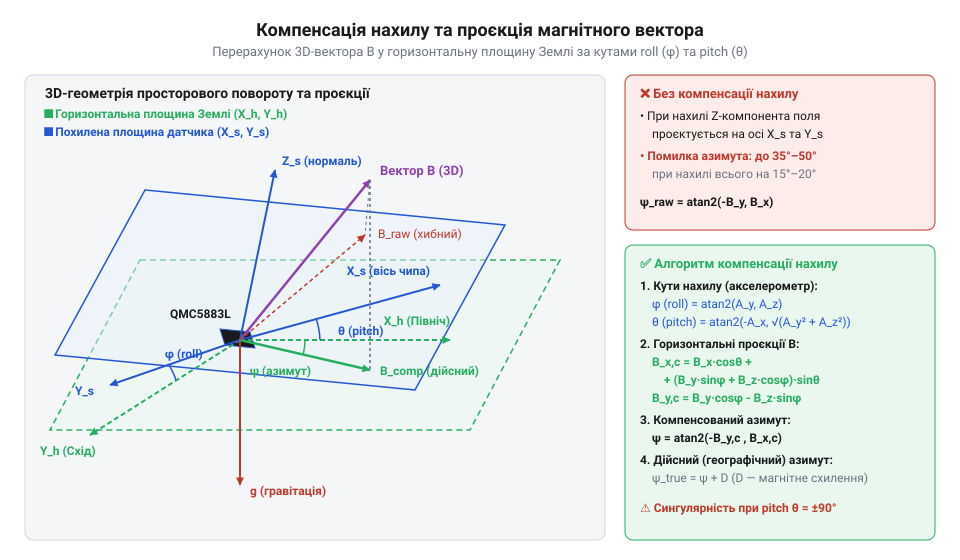

# Математика компенсації нахилу магнітного компаса

<preknowlist>
- [GY-271 / HMC5883L — компас/магнетометр](root:cat-hw-sensors/hmc5883l) — Сирі тривимірні виміри магнітної індукції Bx, By, Bz у власній системі координат датчика.
- [GY-61 ADXL335 — 3-осьовий акселерометр](root:cat-hw-sensors/adxl335) — Вимірювання вектора прискорення вільного падіння та отримання з нього кутів крену та тангажу.
</preknowlist>

## Викривлення азимута при нахилі компаса

Уявіть плату автономного робота або дрона, на якій закріплено цифровий @@en|магнітометр@@ (грец. *magnēs* — притягальний камінь, *metron* — міра). Поки пристрій лежить строго горизонтально на столі, обчислити @@en|магнітний азимут@@ (араб. *al-sumūt* — напрямки, шляхи) здається тривіальною задачею: виміряти дві компоненти магнітної індукції уздовж осі `X` та осі `Y` і застосувати математичну функцію тригонометрії. Проте щойно робот виїжджає на похилу поверхню або дрон здійснює маневр, кут орієнтації за вимірами компаса миттєво «пливе» на десятки градусів, навіть якщо сам пристрій не змінював напрямку руху.

Чому так відбувається? Причина полягає у фізичній природі магнітного поля Землі. Силові лінії геомагнітного поля не паралельні поверхні планети — вони входять у Землю під певним кутом, який називають @@en|магнітним нахилом@@ (лат. *inclinatio* — відхилення, нахил). У більшості помірних широт вертикальна складова магнітного поля суттєво перевищує горизонтальну.

Коли @@en|триосьовий магнітометр@@, такий як [модуль HMC5883L](root:cat-hw-sensors/hmc5883l), перебуває у строго горизонтальному положенні, його власна @@en|система координат@@ (лат. *co* — разом, *ordinatus* — впорядкований) повністю збігається з плоскою горизонтальною системою Землі. У цьому стані чутливі елементи осей `X` та `Y` @@en|магнітометра@@ фіксують виключно горизонтальну проєкцію векторного поля, а потужна вертикальна складова спрямовується уздовж осі `Z` і не впливає на плоский розрахунок.

Проте варто платі нахилитися хоча б на кілька градусів, як власні осі `X` та `Y` @@en|магнітометра@@ втрачають горизонтальність. У результаті потужна вертикальна компонента геомагнітного поля починає проєктуватися на осі `X` та `Y` @@en|магнітометра@@. Оскільки вертикальне поле сильне, навіть невелике відхилення осі у 5–10 градусів підмішує у виміри `Bx` та `By` величезну хибну величину. Плоский розрахунок кута сприймає цю підмішану вертикальну складову як реальний поворот пристрою на площині.

Щоб повернути точність навігації, виміряний тривимірний вектор індукції `[Bx, By, Bz]` у рухомій @@en|системі координат@@ датчика потрібно математично повернути у світову горизонтальну @@en|систему координат@@. Для такого перетворення необхідно знати поточний кутовий нахил плати — @@en|крен@@ (голл. *krengen* — нахиляти судно на бік; `@@en|roll@@`) та @@en|тангаж@@ (фр. *tangage* — кільова хитавиця; `@@en|pitch@@`), які вимірює [триосьовий акселерометр ADXL335](root:cat-hw-sensors/adxl335) (лат. *acceleratio* — прискорення, грец. *metron* — міра).

## Проєкція вектора на горизонтальну площину

Для скасування кутового нахилу датчика необхідно побудувати оператор просторового повороту, який трансформує виміряний вектор з власної @@en|системи координат@@ плати у вирівняну горизонтальну систему. Цю трансформацію виконують за допомогою інструменту під назвою @@en|матриця повороту@@ (лат. *matrix* — джерело, таблиця).

Позначимо кут повороту навколо поздовжньої осі `X` як @@en|крен@@ (`ϕ`), а кут повороту навколо поперечної осі `Y` як @@en|тангаж@@ (`θ`). Нехай сирі виміри @@en|магнітометра@@ у власній @@en|системі координат@@ датчика дорівнюють `Bx`, `By` та `Bz`.

Трансформація відбувається у два послідовних кроки. Спочатку скасовується @@en|крен@@ шляхом повороту вектора навколо осі `X` на кут `-ϕ`. Потім скасовується @@en|тангаж@@ шляхом повороту на кут `-θ` навколо осі `Y`.

Запишемо перший крок повороту вектора для компенсації @@en|крену@@ `ϕ`:

```
B_x1 = Bx                                           [вісь X є віссю обертання]
B_y1 = By · cos(ϕ) + Bz · sin(ϕ)                     [поворот компоненти Y]
B_z1 = -By · sin(ϕ) + Bz · cos(ϕ)                    [поворот компоненти Z]
```

Отриманий проміжний вектор `[B_x1, B_y1, B_z1]` повернуто так, що його вісь `Y` вже лежить у горизонтальній площині.

Тепер виконаємо другий крок — поворот на кут @@en|тангажу@@ `-θ` навколо оновленої осі `Y`, щоб остаточно вирівняти вектор у горизонтальній площині:

```
B_Xh = B_x1 · cos(θ) + B_z1 · sin(θ)                 [проєкція на нову горизонтальну вісь X]
B_Yh = B_y1                                          [вісь Y вже лежить у горизонті]
```

Підставивши вирази для `B_x1`, `B_y1` та `B_z1` з першого кроку в формули другого кроку, отримуємо підсумкові алгебраїчні рівняння для компенсованих горизонтальних компонентів магнітної індукції `B_Xh` та `B_Yh`:

```
B_Xh = Bx · cos(θ) + By · sin(ϕ) · sin(θ) + Bz · cos(ϕ) · sin(θ)   [компенсована компонента X]
B_Yh = By · cos(ϕ) - Bz · sin(ϕ)                                    [компенсована компонента Y]
```

Символи `Bx`, `By`, `Bz` позначають сирі виміри індукції уздовж осей @@en|магнітометра@@, `ϕ` — кут @@en|крену@@, `θ` — кут @@en|тангажу@@, а `B_Xh` та `B_Yh` — обчислені проєкції магнітного вектора на нерухому горизонтальну площину Землі.

Кути @@en|крену@@ `ϕ` та @@en|тангажу@@ `θ` обчислюють за показами @@en|акселерометра@@, який у статичному стані вимірює проєкції вектора прискорення вільного падіння `ax`, `ay`, `az` у власній @@en|системі координат@@. При нахилі пристрою вектор прискорення розкладається уздовж трьох осей: кут @@en|крену@@ `ϕ` визначається співвідношенням компонент `ay` та `az` у поперечній площині `Y-Z`. Проте для обчислення кута @@en|тангажу@@ `θ` не можна просто використати компоненту `az`, оскільки за наявності @@en|крену@@ вертикальна складова гравітації перерозподіляється між осями `Y` та `Z`, що призвело б до помилкової залежності @@en|тангажу@@ від кута повороту навколо осі `X`. Щоб повністю відокремити обчислення @@en|тангажу@@ від кута @@en|крену@@, беруть евклідову @@en|норму@@ (лат. *norma* — косинець, правило) проєкції вектора прискорення на площину `Y-Z`, яка дорівнює `sqrt(ay² + az²)`. Ця величина визначає повний модуль поперечно-вертикальної складової прискорення, ортогональної до поздовжньої осі `X`. Оскільки поздовжня компонента дорівнює `ax = -g · sin(θ)`, а результуючий модуль у площині `Y-Z` дорівнює `sqrt(ay² + az²) = g · cos(θ)`, їхнє відношення у функції арктангенса двох аргументів `atan2(-ax, sqrt(ay² + az²))` дає точний кут @@en|тангажу@@, незалежний від @@en|крену@@:

```
ϕ = atan2(ay, az)                                    [обчислення кута крену]
θ = atan2(-ax, sqrt(ay² + az²))                      [обчислення кута тангажу]
```


*Проєкція вектора магнітної індукції на горизонтальну площину через послідовні повороти на кути крену та тангажу.*

Отримані значення `B_Xh` та `B_Yh` звільнені від впливу вертикального геомагнітного поля і описують орієнтацію вектора індукції виключно в площині горизонту.

## Розрахунок магнітного та дійсного азимута

Знайшовши вирівняні проєкції `B_Xh` та `B_Yh`, ми відновлюємо геометрію плоского компаса. Для перетворення двох прямокутних компонентів вектора у неперервний кут напрямку використовують тригонометричну функцію @@en|арктангенс@@ двох аргументів (лат. *arcus* — дуга, *tangens* — той, що торкається; `@@en|atan2@@`).

Функція `atan2(y, x)` повертає кут у радіанах у діапазоні від `-π` до `+π`, враховуючи знаки обох аргументів для визначення квадранта:

```
ψ_raw = atan2(B_Yh, B_Xh)                             [магнітний кут у радіанах]
```

Оскільки навігаційний @@en|азимут@@ вимірюється в градусах від `0°` до `360°` за годинниковою стрілкою від північного напрямку, від’ємні значення кута переводять у позитивний діапазон додаванням `2π` (або `360°` після переведення у градуси):

```
ψ_deg = ψ_raw · (180 / π)                             [переведення в градуси]
ψ_mag = (ψ_deg < 0) ? (ψ_deg + 360) : ψ_deg            [нормалізація в діапазон 0..360]
```

Отримане значення `ψ_mag` — це @@en|магнітний азимут@@, який вказує напрямок на Північний магнітний полюс Землі. Проте магнітний полюс не збігається з географічним Північним полюсом. Кутове відхилення між ними в точці вимірювання називається @@en|магнітне схилення@@ (лат. *declinatio* — відхилення; `@@en|magnetic declination@@`, позначимо як `D`).

Щоб обчислити @@en|дійсний азимут@@ (географічний курс), до @@en|магнітного азимута@@ додають кут @@en|магнітного схилення@@ для даної місцевості (східне схилення вважається додатним, західне — від’ємним):

```
ψ_true_raw = ψ_mag + D                               [додавання магнітного схилення]
ψ_true = wrap_360(ψ_true_raw)                        [нормалізація підсумкового азимута]
```

Розглянемо практичну реалізацію повного обчислювального ланцюга компенсації нахилу.

:::tabs
:::code math-tilt-compensation/c/calculate-tilt-compensated-heading.c
:::code math-tilt-compensation/cpp/tiltcompensatedcompass.cpp
:::

Алгоритм відновлює точний напрямок на північ незалежно від кутового положення датчика у просторі.

## Обмеження та джерела математичних помилок

Математична модель компенсації нахилу спирається на два вихідні припущення: @@en|акселерометр@@ вимірює виключно вектор гравітації, а @@en|магнітометр@@ вимірює виключно неспотворене геомагнітне поле. Порушення цих припущень викликає помилки обчислень.

Перше обмеження є суто алгебраїчним і відоме як математична @@en|сингулярність@@ (лат. *singularis* — поодинокий, особливий), або @@en|карданів замок@@ (італ. *Cardano* — прізвище винахідника; `@@en|gimbal lock@@`). У формулах проєкції при куті @@en|тангажу@@ `θ = ±90°` (`±π/2` радіан) величина `cos(θ)` стає рівною нулю. При абсолютно вертикальному положенні пристрою вісь `X` збігається з вектором гравітації, у результаті чого визначити кут @@en|крену@@ `ϕ` стає математично неможливо — вирази втрачають однозначність, а `atan2` потрапляє в неопределеність. Статична матрична компенсація в цій точці ламається. Для обчислення просторової орієнтації без кутових сингулярностей та карданова замка дивіться матеріал про [математику орієнтації за допомогою кватерніонів](root:math-geometry/quaternions).

Другим джерелом помилок є динамічні прискорення. @@en|Акселерометр@@ реагує не лише на вектор прискорення вільного падіння, а й на будь-яке лінійне прискорення руху пристрою (прискорення робота, вібрацію, центробіжну силу на повороті). Якщо рухомий об’єкт прискорюється, вектор виміряного прискорення відхиляється від справжнього напрямку донизу. Програма сприймає це як хибний нахил корпусу, обчислює некоректні кути `ϕ` та `θ` і викривлює @@en|азимут@@. Для компенсації динамічних завад @@en|акселерометр@@ об'єднують із @@en|гіроскопом@@ (грец. *gyros* — коло, обертання, *skopeo* — дивитися) у [6-осьовий IMU MPU-6050](root:cat-hw-sensors/mpu6050) або [9-осьовий IMU MPU-9250](root:cat-hw-sensors/mpu9250) за допомогою @@en|комплементарного фільтра@@ (лат. *complementum* — доповнення) або @@en|фільтра Калмана@@ (угор. *Kálmán* — прізвище розробника).

Третє джерело викривлень — це власні магнітні завади навколо плати: феромагнітні деталі корпусу (hard-iron) та струми живлення двигунів і провідників (soft-iron). Вони створюють постійне або змінне паразитне магнітне поле, яке зміщує й деформує сферичний вектор геомагнітного поля у викривлений еліпсоїд. Без попереднього калібрування @@en|магнітометра@@ проєкція вектора на горизонтальну площину даватиме викривлений кут навіть при ідеально компенсованому нахилі. Для усунення паразитного зміщення та деформацій магнітного поля читайте статтю про [калібрування магнітометра від hard-iron та soft-iron викривлень](root:cat-hw-sensors/qmc5883l/math-magnetometer-calibration.md).