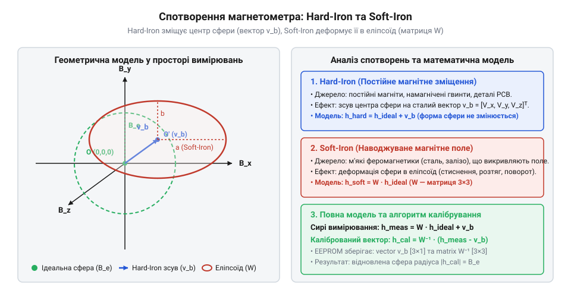
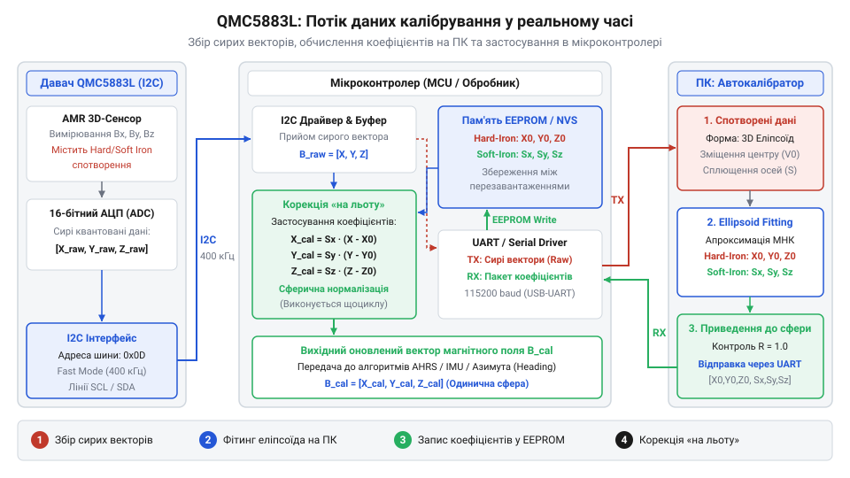

# Програмний автокалібратор магнітометра в реальному часі

<preknowlist>
- [GY-271 / HMC5883L — компас/магнетометр](root:cat-hw-sensors/hmc5883l) — Базові принципи функціонування 3-осьових магнетометрів, зчитування сирих 16-бітних даних осій по I2C та первинне перетворення даних у фізичні одиниці Gauss/uT.
</preknowlist>

## Викривлення компаса та деградація навігації

У світі автономних систем і мобільних роботів точне визначення напрямку руху є критичною вимогою для навігаційних алгоритмів. Цифровий магнітометр (або електронний компас) вимірює вектор локального магнітного поля Землі, дозволяючи обчислити курс (heading) платформи відносно магнітної півночі. Проте в реальних умовах робота датчика стикається з серйозними перешкодами, які призводять до катастрофічної деградації навігаційних даних. Будь-які феромагнітні матеріали (залізні деталі корпусу, електродвигуни, акумулятори, кріпильні гвинти) та джерела постійних магнітних полів на борту пристрою створюють власне магнітне поле. Накладання цього поля на природне геомагнітне поле спотворює вимірювання, роблячи показники сирого датчика непридатними для орієнтації.

Якщо уявити ідеальні умови, то під час повного обертання пристрою у тривимірному просторі кінець вектора магнітної індукції описує ідеальну сферу, центр якої збігається з початком координат, а радіус дорівнює модулю локального геомагнітного поля. Проте в присутності локальних феромагнітних впливів картина кардинально змінюється. Схема порівнює ідеальну сферу вимірювань магнітного поля зі спотвореним еліпсоїдом під впливом зміщення Hard-Iron та деформації Soft-Iron. Частина спотворень зміщує центр усієї системи координат, зсуваючи його в певну точку простору, тоді як інші фактори деформують саму сферичну поверхню, перетворюючи її на витягнутий еліпсоїд. Без математичної компенсації цих ефектів навігаційна система отримує помилкові кути курсу, які можуть хилитися на десятки і навіть сотні градусів залежно від орієнтації пристрою.

## Геометрія спотворень Hard-Iron та Soft-Iron

Для успішного відновлення істинної геометрії вимірювань необхідно чітко розрізняти два типи похибок: Hard-Iron та Soft-Iron, які постійно супроводжують роботу магнітометра на реальному рухомому носії. Уявіть, що ви тримаєте компас у руці, але поруч із ним на платі розташований постійний магніт роз'єму, сталевий гвинт кріплення чи провідник із сильним постійним струмом. Це додаткове магнітне поле не залежить від орієнтації пристрою в пространстві — воно завжди додається до вектора земного магнітного поля як сталий векторний зсув. У результаті, якщо крутити компас у всі боки, центр сфери, яку описує кінчик вектора магнітної індукції, зміщується від початку координат в іншу точку. Геометрично це чисте паралельне перенесення (трансляція) простору вимірювань, яке називається спотворенням Hard-Iron. Для компенсації цього адитивного зміщення сирий виміряний 3D-вектор `v_raw` коригується відніманням вектора зсуву `b`, як це реалізовано в методі `calibrate_point` з модуля `ellipsoid_fit.py`: `v_hi = v_raw - b`, що відповідає компонентам `[x_raw - b_x, y_raw - b_y, z_raw - b_z]`.

Проте на практиці цим похибки не вичерпуються. Навіть після усунення зміщення центру хмара точок не утворює ідеальну сферу — вона перетворюється на витягнутий або сплюснутий еліпсоїд, а його головні ося повертаються під певним кутом до осей корпусу датчика. Такі спотворення породжуються феромагнітними матеріалами без власного магнітного поля (наприклад, елементами шасі, экранами, металевими деталями корпусу чи нержавіючою сталлю), які мають високу магнітну проникність. Вони фокусують і спотворюють силові лінії зовнішнього магнітного поля, розтягуючи простір вимірювань вздовж одних напрямків і стискаючи вздовж інших. Це і є ефект Soft-Iron (м'якого заліза). Для його компенсації недостатньо простого зсуву — потрібна симетрична матриця трансформації `W_soft` розмірністю 3х3, яка здійснює одночасне масштабне перетворення та поворот координат: загальне перетворення має вигляд `v_calib = W_soft * (v_raw - b)`. Повні коефіцієнти цього перетворення обчислюються в класі `EllipsoidFitter` шляхом алгебраїчної апроксимації поверхні другого порядку методом найменших квадратів, що дозволяє повернути вимірюванням ідеальну сферичну форму перед подачею їх у конвеєр обчислення курсу.

У цьому розділі розкрито геометричну та математичну природу спотворень Hard-Iron (адитивний зсув центру) та Soft-Iron (деформація сфери в еліпсоїд через магнітну проникність матеріалів), а також введено поняття вектора зсуву `b` та матриці трансформації `W_soft` для приведення вимірювань до каліброваної сферичної форми.

## Потоковий протокол передачі сирих даних

Коли математична модель визначена, виникає практичне завдання організації високошвидкісного та надійного обміну даними між мікроконтролером з датчиком QMC5883L та комп'ютерним програмним забезпеченням калібрування. Діаграма показує потік даних між QMC5883L, мікроконтролером та комп'ютерним автокалібратором через UART. Мікроконтролер виконує циклічне зчитування 16-бітних сирих значень осей магнітометра по шині I2C, упаковує їх у текстові або бінарні пакети та передає через апаратний UART на швидкості 115200 бод. 

Для надійної стійкості до перешкод та втрати байтів у потоці використовується універсальний парсер, здатний розпізнавати як компактні JSON-структури, так і розділені комами чи пробілами рядки. Комп'ютерний хост-інструмент накопичує не менше 300-350 унікальних вибірок при повному тривимірному обертанні датчика в усіх напрямках, контролюючи рівномірність покриття октантів простору. Після завершення накопичення масиву та успішного розрахунку матриць калібрування, хост формує зворотну команду у форматі JSON з ключем `SET_CALIBRATION` і передає коефіцієнти назад на мікроконтролер, де вони записуються в енергонезалежну пам'ять EEPROM для використання у виконавчому режимі.

## Алгоритм обчислення калібрувальних коефіцієнтів

Обчислення компенсаційних параметрів цифрового компаса QMC5883L базується на апроксимації 3D-точок вимірювань магнітного поля поверхнею еліпсоїда. Під час обертання сенсора в просторі сирі вимірювання утворюють облако точок, яке через зміщення нулів та взаємний вплив металевих елементів конструкції деформується у квадрику другого порядку. Загальне алгебраїчне рівняння еліпсоїда в декартових координатах описується рівнянням квадрики: A x^2 + B y^2 + C z^2 + 2D xy + 2E xz + 2F yz + 2G x + 2H y + 2I z = 1. Маючи потік вимірювань з хост-інструменту visualizer/calibrator, алгоритм методом найменших квадратів (Least Squares) через матричні перетворення зводить задачу до розв'язку перевизначеної системи лінійних рівнянь.

*Порівняння ідеальної сферичної траєкторії магнітного поля та еліпсоїда, спотвореного ефектами Hard-Iron і Soft-Iron, демонструє необхідність математичної компенсації.*

Для знаходження вектора зміщення жорсткого заліза `b_offset` та матриці трансформації м'якого заліза `W_soft` використовується числовий модуль `ellipsoid_fit.py`. Коефіцієнти матриці квадрики збираються в матрицю дизайну, після чого за допомогою NumPy розраховується центр еліпсоїда та власні значення і вектори матриці форми.

:::code proj-qmc5883l-calibrator-tool/py/ellipsoid_fit.py 72-152

Отриманий вектор зміщення дозволяє компенсувати адитивні зсуви осей, а симетрична матриця `W_soft` виконує масштабування та поворот осей для відновлення симетричної сферичної форми. Контроль повноти просторового покриття за 8 октантами гарантує, що калібрування виконується лише після достатнього обертання датчика в усіх напрямках.

## Фіксація коефіцієнтів в EEPROM та корекція

Після завершення обчислень на хост-комп'ютері калібрувальні параметри передаються назад на мікроконтролер через послідовний інтерфейс UART. Для реалізації автономності пристрою розраховані значення вектора Hard-Iron та матриці Soft-Iron повинні зберігатися в енергонезалежній пам'яті (EEPROM) мікроконтролера. Під час старту пристрою мікроконтролер зчитує збережені константи, щоб застосовувати їх «на льоту» до кожного нового вимірювального вектора від QMC5883L.

Діаграма показує потік даних між QMC5883L, мікроконтролером та комп'ютерним автокалібратором через UART. 
*Архітектура потокового обміну даними та зворотного завантаження калібрувальних коефіцієнтів через UART забезпечує автономну роботу електронного компаса.*

Формула коригування сирого вектора магнітної індукції `v_raw` у реальному часі виглядає наступним чином: від сирого вектора віднімається вектор зміщення `b_offset`, після чого результат множиться на матрицю компенсації м'якого заліза `W_soft`. Для забезпечення високої продуктивності вбудованого контролера матричне множення реалізується через оптимізовані операції з фіксованою або плаваючою комою залежно від архітектури MCU.

:::code proj-qmc5883l-calibrator-tool/py/main.py 64-80

Зберігання констант в EEPROM та їх застосування в головному циклі вимірювань перетворює звичайний датчик магнітного поля на високоточний електронний компас, повністю стійкий до локальних магнітних спотворень платформи.