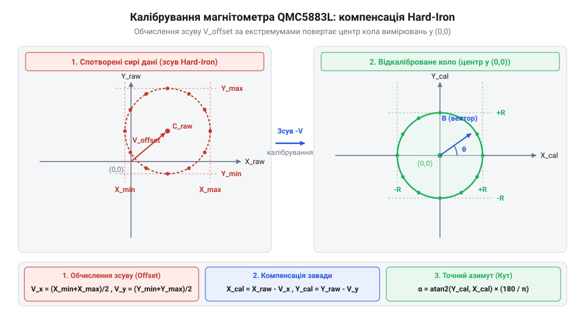
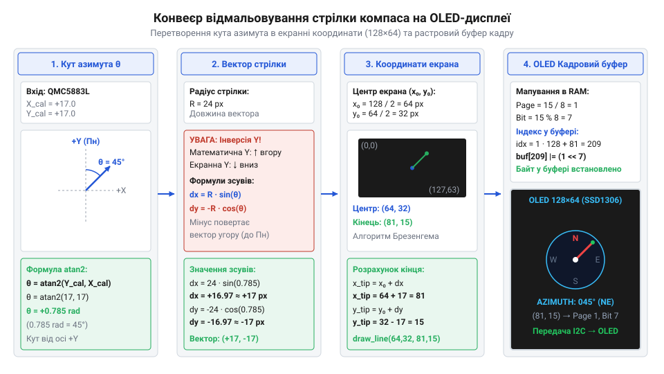

# Цифровий компас на QMC5883L з графічним OLED-дисплеєм

<preknowlist>
- [GY-271 / HMC5883L — компас/магнетометр](root:cat-hw-sensors/hmc5883l) — Базові принципи вимірювання магнітного поля та відмінності в картах регістрів між HMC5883L та QMC5883L.
</preknowlist>

## Чому необроблений магнітометр вказує хибний напрямок

Коли ми беремо 3-осьовий цифровий магнітометр на кшталт **QMC5883L** і вперше намагаємося обчислити кут напрямку на магнітну північ (азимут), нас часто спіткає розчарування. Стрілка «компаса» на екрані стрибає, вказує вбік при обертанні плати або показує зовсім хибні значення залежно від того, як розташований пристрій у просторі. Чому так відбувається, якщо магнітне поле Землі є стабільним природним орієнтиром?

Річ у тім, що магнітометр вимірює **абсолютну векторну суму всіх магнітних полів**, які діють на його чутливі елементи в точці вимірювання. До цього результуючого поля входять:
1. **Природне магнітне поле Землі** (геомагнітне поле), модуль якого на поверхні планети становить приблизно від 0.25 до 0.65 Гауса (Гс) залежно від географічної широти.
2. **Постійні магнітні завади (Hard-Iron)** — поля, що створюються постійними магнітами, намагніченими деталями металевого корпусу, гвинтами, батареями або дорожками живлення плати із сильним постійним струмом. Вони додають до вимірюваного вектора сталий адитивний зсув.
3. **Змінні магнітні завади (Soft-Iron)** — матеріали (наприклад, залізна або нікелева фурнітура), які не створюють власного поля, але викривлюють силові лінії зовнішнього поля, розтягуючи або деформуючи кругову траєкторію вимірювань в еліпс.

Якщо спробувати уявити вимірювання магнітометра на двовимірній площині XY під час повного обертання пристрою на 360°, то в ідеальних умовах кінцева точка вектора (X, Y) повинна описувати ідеальне коло, центр якого збігається з початком координат (0, 0).

На практиці під впливом **Hard-Iron** завад центр цього кола зміщується всторону на величину (X_offset, Y_offset). У результаті сирі відліки мають зміщений центр, і просте обчислення кута через тригонометричну функцію `atan2(Y, X)` дає систематичну помилку, яка залежить від поточного орієнтиру пристрою.



Щоб перетворити необроблені дані сенсора на точний навігаційний прилад, система повинна виконати дві ключові процедури:
- **Компенсацію Hard-Iron** (зсув нуля шляхом знаходження середнього арифметичного між мінімальними та максимальними значеннями кожної осі під час обертання).
- **Компенсацію Soft-Iron** (масштабування осей для приведення еліптичної траєкторії до ідеального кола).

Без цих кроків жоден цифровий компас не зможе забезпечити стабільний і достовірний результат.

## Конфігурація QMC5883L та зчитування векторів

Магнітометр **QMC5883L** (виробництва QST) зовні дуже схожий на популярний класичний HMC5883L, проте має суттєві відмінності в архітектурі регістрів та внутрішній логіці. Зокрема, QMC5883L використовує іншу I2C адресу за замовчуванням (`0x0D` замість `0x1E`) і розширену карту регістрів конфігурації.

Для роботи з давачем на рівні мікроконтролера ми використовуємо апаратну шину I2C. Нижче наведено базовий інтерфейс ініціалізації шини з файлу `i2c_driver.h`:

```c
#include "i2c_driver.h"

/* Ініціалізація апаратного модуля I2C у режимі Master (наприклад, 400 кГц) */
i2c_status_t i2c_init(i2c_speed_t speed);

/* Запис та читання регістрів веденого пристрою */
i2c_status_t i2c_write_reg(uint8_t dev_addr, uint8_t reg_addr, uint8_t value);
i2c_status_t i2c_read_regs(uint8_t dev_addr, uint8_t reg_addr, uint8_t *buffer, size_t len);
```

### Карта регістрів та конфігурація QMC5883L

Драйвер магнітометра з оголошення у файлі `qmc5883l.h` визначає основні управляючі регістри:
- **`0x00..0x05`**: Сирі 16-бітні дані осей X, Y, Z (у форматі Little-Endian: спочатку LSB, потім MSB).
- **`0x06` (Status Register)**: Містить прапорці `DRDY` (готовність даних) та `OVL` (переповнення діапазону).
- **`0x09` (Control Register 1)**: Визначає режим роботи (Mode), частоту опитування (ODR), вимірювальний діапазон (RNG) та коефіцієнт передискретизації (OSR).
- **`0x0A` (Control Register 2)**: Керує програмним скиданням (Soft Reset) та перериваннями.
- **`0x0B` (Set/Reset Period)**: Регістр внутрішнього періоду ініціалізації періодичного намагнічування (рекомендоване значення `0x01`).

Ініціалізація та конфігурація чипа у неперервному режимі (`QMC5883L_MODE_CONTINUOUS`) з частотою 100 Гц (`QMC5883L_ODR_100HZ`), діапазоном ±8 Гаус (`QMC5883L_RNG_8G`) та передискретизацією 512 (`QMC5883L_OSR_512`) виконується функцією з файлу `qmc5883l.c`:

:::code proj-qmc5883l-oled-compass/c/qmc5883l-init.c

Коли нові дані готові (`DRDY = 1`), ми зчитуємо 6 байтів поспіль починаючи з регістра `0x00`:

:::code proj-qmc5883l-oled-compass/c/qmc5883l-read-raw.c

Цей код забезпечує надійне отримання сирих вимірів магнітного поля по трьох осях для подальшої математичної обробки.

## Алгоритм динамічного калібрування Hard-Iron завад

Маючи потік сирих векторів від магнітометра, ми маємо усунути вплив постійних магнітних завад (Hard-Iron). Найефективнішим методом для автономного пристрою є **динамічне калібрування за мінімумами та максимумами (Min-Max calibration)** під час обертання пристрою користувачем на повні 360°.

### Принцип роботи алгоритму
Під час обертання пристрою у горизонтальній площині ми неперервно порівнюємо поточні сирі значення координат X та Y з чинними межами:

```
X_min = min(X_min, X_raw),   X_max = max(X_max, X_raw)
Y_min = min(Y_min, Y_raw),   Y_max = max(Y_max, Y_raw)
```

Після завершення повного оберту зсуви центру (Hard-Iron offsets) обчислюються як середина відрізків між екстремумами:

```
X_offset = (X_min + X_max) / 2
Y_offset = (Y_min + Y_max) / 2
```

Коефіцієнти масштабування для компенсації еліптичності (Soft-Iron scale) вираховують через порівняння амплітуд осей:

```
X_delta = (X_max - X_min) / 2
Y_delta = (Y_max - Y_min) / 2
Avg_delta = (X_delta + Y_delta) / 2
X_scale = Avg_delta / X_delta
Y_scale = Avg_delta / Y_delta
```

Реалізація оновлення екстремумів у C-драйвері (`qmc5883l.c`) виглядає так:

:::code proj-qmc5883l-oled-compass/c/qmc5883l-calib-update.c

### Розрахунок азимута через `atan2f`
Після застосування компенсації до сирих вимірів:

```c
void qmc5883l_calib_apply(const qmc5883l_calib_t *calib, const qmc5883l_raw_t *raw,
                          float *cal_x, float *cal_y, float *cal_z) {
    *cal_x = ((float)raw->x - calib->x_offset) * calib->x_scale;
    *cal_y = ((float)raw->y - calib->y_offset) * calib->y_scale;
}
```

ми обчислюємо кут орієнтації у горизонтальній площині за допомогою стандартної функції `atan2f`:

```c
float qmc5883l_compute_heading(float x, float y, float declination_deg) {
    float heading_rad = atan2f(y, x);
    float heading_deg = heading_rad * (180.0f / M_PI);

    heading_deg += declination_deg;

    if (heading_deg < 0.0f)   heading_deg += 360.0f;
    if (heading_deg >= 360.0f) heading_deg -= 360.0f;

    return heading_deg;
}
```

Отриманий кут азимута повністю готовий для візуалізації у вигляді стрілки на графічному OLED-дисплеї SSD1306, архітектуру рендерингу якого показано нижче:



Цей конвеєр забезпечує плавну анімацію стрілки компаса та виведення текстових координат у реальному часі.

Магнітометр **QMC5883L** живиться та конфігурується через послідовну шину **I2C**, яка використовує стандартну адресу `0x0D` (на відміну від старішого HMC5883L з адресою `0x1E`). Для повноцінної роботи з давачем мікроконтролер записує значення у внутрішні регістри конфігурації:

1. **Control Register 1 (`0x09`)** — визначає чотири ключові параметри роботи сенсора:
   - **Режим оновлення/живлення (`MODE`)**: задається у бітах `[1:0]`. Ми використовуємо неперервний режим (`QMC5883L_MODE_CONTINUOUS = 0x01`), за якого сенсор автоматично виконує вимірювання з вибраною частотою, або режим очікування (`QMC5883L_MODE_STANDBY = 0x00`) для економії енергії.
   - **Частота опитування (`ODR` — Output Data Rate)**: задається у бітах диференціації `[3:2]`. Доступні значення: 10 Гц (`0x00`), 50 Гц (`0x01`), 100 Гц (`0x02`) та 200 Гц (`0x03`). Висока частота 100–200 Гц дозволяє мінімізувати затримки в контурі керування, тоді як 10 Гц суттєво знижує енергоспоживання.
   - **Вимірювальний діапазон (`RNG` — Full Scale Range)**: задається у бітах `[5:4]`. Підтримуються режими ±2 Гаусс (`0x00`, чутливість 12000 LSB/Gauss) та ±8 Гаусс (`0x01`, чутливість 3000 LSB/Gauss). Діапазон ±8 Гаусс є оптимальним для мобільних пристроїв, оскільки запобігає насиченню ядра при наявності локальних феромагнітних деталей.
   - **Коефіцієнт передискретизації (`OSR` — Over Sampling Ratio)**: задається у бітах `[7:6]`. Високий OSR (наприклад, 512 у вигляді `0x00`) здійснює багаторазові внутрішні вимірювання для фільтрації високочастотного шуму, тоді як нижчі значення (наприклад, 64 у вигляді `0x03`) забезпечують максимальну швидкість перетворення.

2. **Control Register 2 (`0x0A`)** — керує додатковими функціями, такими як програмне скидання (`Soft Reset` біт `0x80`), яке примусово повертає всі регістри у початковий стан перед ініціалізацією.

3. **Set/Reset Period Register (`0x0B`)** — відповідає за внутрішній період циклу намагнічування сенсорних мостів. Рекомендоване виробником значення `0x01` забезпечує стабільність нульової точки та компенсацію температурного дрейфу.

Послідовність ініціалізації полягає у послідовній відправці цих байтів через `i2c_write_reg`, після чого оновлені 16-бітні дані з осей X, Y і Z зчитуються блоком із 6 байтів починаючи з регістра `0x00`.

Алгоритм динамічного знаходження мінімумів і максимумів базується на неперервному порівнянні кожного нового виміряного вектора сирих координат X та Y з поточними збереженими межами діапазону. Під час ініціалізації структури калібрування екстремуми скидаються у протилежні крайні стани (наприклад, мінімуми встановлюються в максимальне можливе додатне значення `INT16_MAX`, а максимуми — в мінімальне `INT16_MIN`). Коли пристрій обертається користувачем на повні 360 градусів у горизонтальній площині, кожне нове значення порівнюється через умовні оператори: якщо сирий відлік менший за поточний мінімум, він стає новим мінімумом; якщо більший за максимум — новим максимумом. Оновлені межі дозволяють «на льоту» перераховувати зсуви центру Hard-Iron (середнє арифметичне між мін і макс) та масштабні коефіцієнти Soft-Iron, забезпечуючи адаптацію компаса до умов конкретної плати без необхідності попереднього стаціонарного калібрування в лабораторних умовах.

## Перетворення векторів у кут азимута

Маючи відкалібровані координати у проєкції на горизонтальну площину, ми стикаємось із завданням перетворення двовимірного вектора магнітної індукції на кут напрямку. У тригонометрії кут визначається через відношення протилежного катета до прилеглого, однак просте ділення `y` на `x` за допомогою стандартної функції `atan` дає результат лише в межах двох квадрантів і втрачає інформацію про знаки окремих осей, що призводить до невизначеності напрямку на площині. Для повноцінного охоплення всіх чотирьох квадрантів і коректного визначення кута в діапазоні від нуля до трьохста шістдесяти градусів використовується двоаргументна функція @@en|atan2@@. Вона аналізує знаки обох компонентів окремо, автоматично враховуючи положення вектора у просторі та запобігаючи помилкам ділення на нуль.

Обчислення курсового кута азимута виконується через покрокове перетворення виміряних значень у географічний напрямок:

```
        heading_rad = atan2f(y, x)
        heading_deg = heading_rad · (180.0 / π) + declination_deg              [переведення у градуси та врахування схилення]
        heading_deg = heading_deg mod 360.0                                    [нормалізація у діапазоні від 0 до 360]
```

Отриманий попередній магнітний кут вказує напрямок на магнітну північ, проте географічна північ через особливості розподілу магнітного поля Землі може відрізнятись на величину локального @@en|magnetic declination@@, яке для кожної місцевості має своє стале значення і додається до розрахованого кута. Щобільше, для усунення високочастотних шумів та дрижання відліків, спричинених електромагнітними наводками й коливаннями приладу, на вихідний кут накладається цифрова фільтрація або експоненційне згладжування перед подачею на графічний інтерфейс. У нашому програмному забезпеченні ці перетворення повністю реалізовані в модулі `compass_calibrator.hpp`, де метод `calculateHeading` перетворює скоригований вектор у фінальний азимут.

## Графічне відтворення стрілки на OLED-екрані

Отримавши стабільне значення кута азимута, ми переходимо до його візуалізації у вигляді динамічного циферблата на графічному дисплеї. Оскільки контролер SSD1306 працює з растровим буфером пам'яті через послідовну шину @@en|I2C@@, нам необхідно перетворити полярні координати стрілки компаса в декартові пікселі екранного поля за допомогою тригонометричних функцій синуса й косинуса. На фігурі показано покроковий потік даних від обчисленого кута азимута через тригонометричний розрахунок координат кінця стрілки до буфера кадрів OLED-дисплея.


*На схемі зображено конвеєр візуалізації компаса: обчислений кут азимута перетворюється у кінцеві координати стрілки на екрані, після чого буфер передається на дисплей.*

Для малювання кола циферблата та стрілки використовується алгоритм @@en|Bresenham's line algorithm@@, який дозволяє ефективно будувати відрізки без трудомістких операцій з плаваючою комою. Візуальний інтерфейс розділений на дві частини: у лівій половині розташований круглий циферблат із позначками основних сторін світу та рухомою стрілкою, а в правій — текстова панель із числовим значенням кута в градусах та літерним позначенням румбу. Програмна реалізація цього процесу повністю інкапсульована в класі `CompassRenderer`, який формує повний кадр у пам'яті та передає його апаратному драйверу.

## Збирання пристрою та динамічне тестування

Маючи окремі програмні модулі для конфігурації магнітометра, автокалібрування та графічного рендерингу, ми поєднуємо їх у єдину автономну систему цифрового компаса. На практиці спільна робота датчика QMC5883L та дисплея SSD1306 на єдиній шині вимагає коректної обробки часу оновлення та дотримання черговості опитування, оскільки інтенсивний обмін даними не повинен блокувати вимірювальні циклічні переривання. Процедура тестування починається з автоматичного калібрування Min-Max, під час якого користувач обертає пристрій у просторі для збору екстремумів і компенсації завад Hard-Iron та Soft-Iron.

:::tabs
:::code proj-qmc5883l-oled-compass/c/stm32/main.c
:::code proj-qmc5883l-oled-compass/cpp/src/main.cpp
:::

У процесі тестування прилад демонструє стабільне відмальовування положення стрілки в реальному часі з мінімальним часом затримки. Завдяки використанню згладжування та попередньо вирахованих тригонометричних співвідношень досягається висока плавність анімації без мерехтіння графічного екрана.