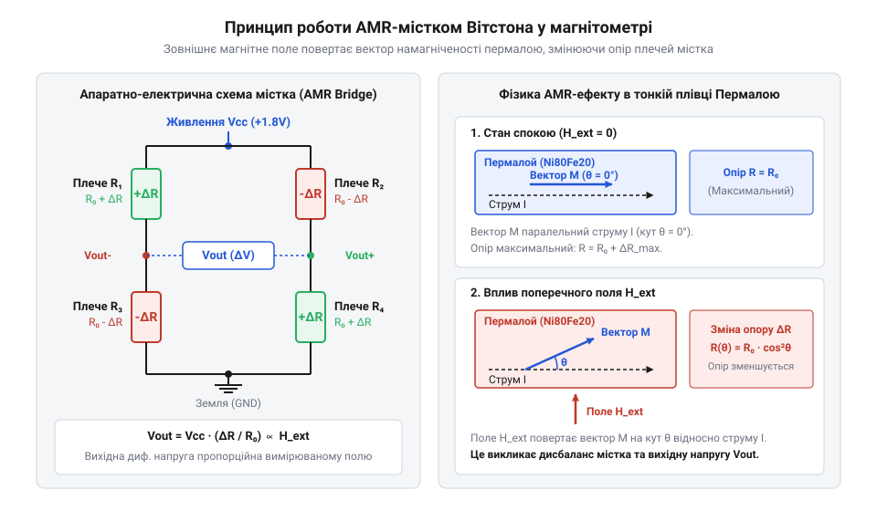
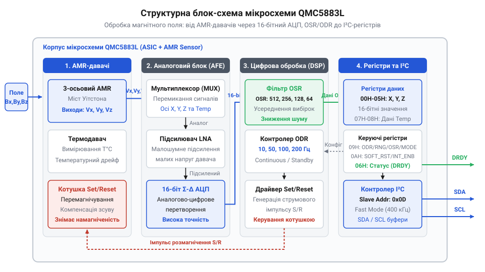
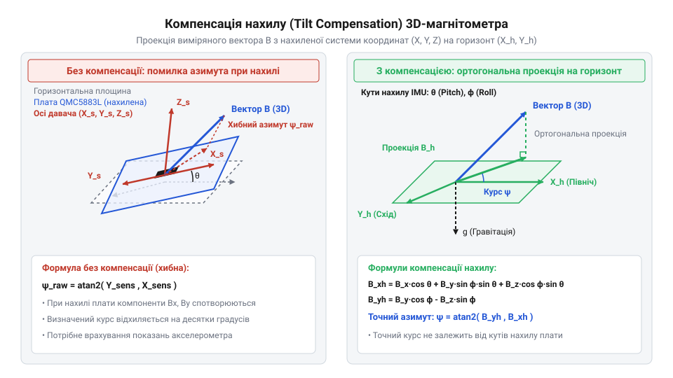
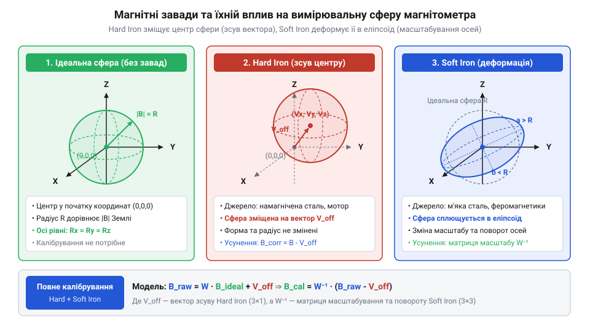
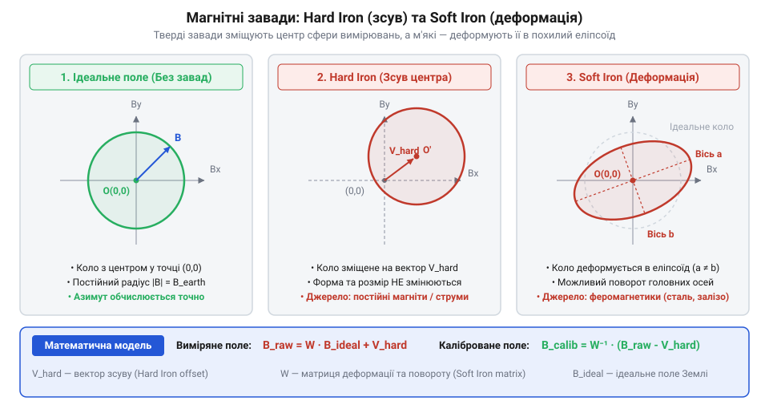
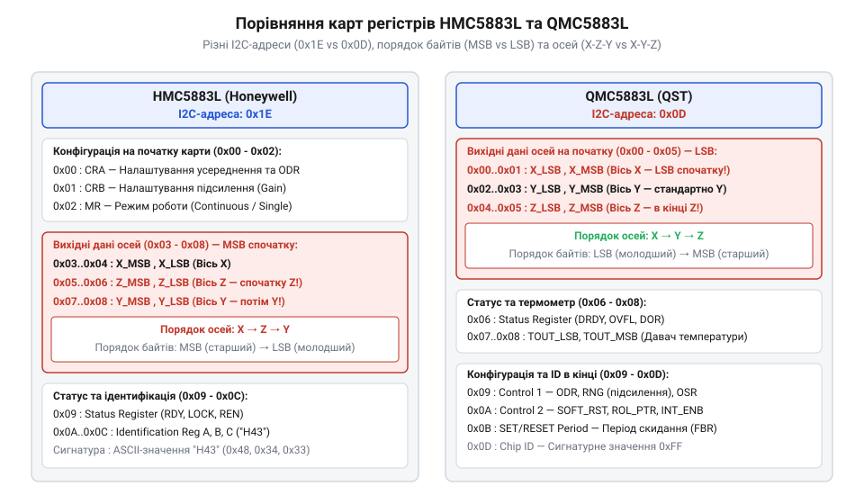

# QMC5883L — цифровий компас (I2C)

<preknowlist>
- [GY-521 / MPU-6050 — 6-осьовий IMU (акселерометр+гіроскоп)](root:cat-hw-sensors/mpu6050) — Принципи визначення вектора гравітації та обчислення кутів нахилу (Pitch/Roll) для компенсації положення компаса в просторі.
- [GY-271 / HMC5883L — компас/магнетометр](root:cat-hw-sensors/hmc5883l) — Загальна концепція 3-осьового магнітометра та використання магнітного поля Землі для навігації.
</preknowlist>

## Неминучий дрейф орієнтації без магнітометра

Для автопілота робота, безпілотного літального апарата або мобільного смартфона критично важливо знати свою точну просторову орієнтацію в кожен момент часу. У тривимірному просторі стан об'єкта описується трьома кутами повороту відносно земної системи координат: кутами крену (від англійського *roll* — коливання з боку в бік; @@en|roll@@), тангажу (від англійського *pitch* — нахил вперед/назад; @@en|pitch@@) та порскання (від англійського *yaw* — відхилення від курсу; @@en|yaw@@).

Визначити кути @@en|roll@@ та @@en|pitch@@ у статичному стані відносно відносно простих вимірювань дозволяє акселерометр (від латинського *acceleratio* — прискорення та грецького *metron* — міра; @@en|accelerometer@@). Чутливі елементи акселерометра вимірюють проєкцію сили тяжіння Землі `g ≈ 9.81 m/s²`. Якщо пристрій не прискорюється, вектор гравітації завжди спрямований строго вниз, до центра Землі. 

Використовуючи [тривісний цифровий акселерометр](root:cat-hw-sensors/adxl345) чи давач на основі [ємнісних MEMS-структур](root:cat-hw-sensors/mems-capacitive-sensing-principles), виміряні складові прискорення `a_x`, `a_y`, `a_z` дозволяють однозначно обчислити кути нахилу плати за допомогою тригонометричних співвідношень:

```
tan(ϕ) = a_y / a_z                     [визначення тангенса кута крену через проєкції прискорення]
ϕ = arctan(a_y / a_z)                 [обчислення кута крену roll]

tan(θ) = -a_x / √(a_y² + a_z²)         [визначення тангенса кута тангажу через проєкції]
θ = arctan(-a_x / √(a_y² + a_z²))      [обчислення кута тангажу pitch]
```

Тут `a_x`, `a_y` та `a_z` є нормованими проєкціями вектора прискорення вільного падіння на осі давача, `ϕ` позначає кут @@en|roll@@, а `θ` — кут @@en|pitch@@.

Оскільки вектор гравітації спрямований перпендикулярно до горизонтальної площини, він слугує стабільним фізичним орієнтиром для визначення двох кутів нахилу. Проте під час обертання пристрою навколо вертикальної осі Z (зміна кута порскання @@en|yaw@@) проєкція вектора гравітації на осі X, Y та Z не змінюється взагалі. Наприклад, коли плата лежить горизонтально (`a_x = 0`, `a_y = 0`, `a_z = g`), будь-який поворот у горизонтальній площині залишає свідчення акселерометра незмінними: `a_x = 0`, `a_y = 0`, `a_z = g`. Фізична причина полягає в тому, що частинні похідні проєкцій гравітації за кутом порскання дорівнюють нулю: `∂a_x / ∂ψ = 0`, `∂a_y / ∂ψ = 0`. Отже, @@en|accelerometer@@ фундаментально не здатний визначити абсолютний курс або азимут (від арабського *as-sumut* — шляхи, напрямки; @@en|azimuth@@).

Для вимірювання динамічних поворотів у класичних інерційних системах, таких як [шестиосьові модулі IMU](root:cat-hw-sensors/mpu6050) або розширені [багатоосьові інерційні системи](root:cat-hw-sensors/mpu9250), використовують гіроскоп (від грецького *gyros* — коло, обертання та *skopeo* — дивитися; @@en|gyroscope@@). Внутрішній @@en|gyroscope@@ вимірює миттєву кутову швидкість обертання `ω_z(t)` навколо осі Z у радіанах за секунду.

Щоб отримати поточне значення кута @@en|yaw@@, обчислювальний модуль змушений інтегрувати кутову швидкість у часі від початкового моменту:

```
ψ(t) = ψ(0) + ∫₀ᵗ ω_z(τ) dτ             [математичне інтегрування кутової швидкості]
```

Тут `ψ(t)` є обчисленим кутом @@en|yaw@@ у момент часу `t`, `ψ(0)` — початковий кут, `ω_z(τ)` — істинна кутова швидкість обертання, а `τ` — змінна інтегрування.

Однак реальний кристалічний @@en|gyroscope@@ має дрейф нуля (від англійського *bias drift* — зміщення нульового рівня; @@en|bias drift@@) `b_z(t)` та високочастотний шум `n(t)`. Реальний виміряний сигнал `ω_meas(t)` описується сумою:

```
ω_meas(t) = ω_z(t) + b_z(t) + n(t)      [модель реального сигналу гіроскопа з дрейфом нуля та шумом]
```

Під час математичного інтегрування навіть незначний постійний зсув `b_z(t)` (наприклад, `0.01 rad/s`) накопичується безперервно й безмежно:

```
ψ_est(t) = ∫₀ᵗ (ω_z(τ) + b_z(τ) + n(τ)) dτ
= ψ(t) + ∫₀ᵗ b_z(τ) dτ + ∫₀ᵗ n(τ) dτ     [розподіл інтеграла на істинне значення та накопичені помилки]
≈ ψ(t) + b_avg · t + e_noise(t)         [лінійне зростання помилки з часом через постійну складову дрейфу]
```

Тут `b_avg` позначає середню величину дрейфу нуля, `t` — тривалість роботи, а `e_noise(t)` — випадкову складову шуму. 

Оскільки доданок `b_avg · t` зростає лінійно з часом `t`, вже через кілька хвилин помилка обчислення кута курсу досягає десятків градусів. Навіть найскладніші [алгоритми злиття даних IMU](root:com-signal/sensor-fusion) не спроможні зупинити цей дрейф без зовнішнього опорного вектора в горизонтальній площині.

Розв'язати цю проблему дозволяє геомагнітне поле Землі. Вектор магнітної індукції Землі `B_earth` у кожній точці планети має горизонтальну складову `B_h`, спрямовану в бік магнітного північного полюса. 

Додавання в систему 3-осьового магнітометра (від грецького *magnetis* — магніт та *metron* — вимірювач; @@en|magnetometer@@) @@en|QMC5883L@@ дає змогу виміряти ортогональні проєкції магнітного поля `B_x`, `B_y`, `B_z`. Для горизонтально розташованого пристрою цифровий компас (від італійського *compasso* — циркуль; @@en|compass@@) обчислює магнітний @@en|azimuth@@ безпосередньо з виміряних компонент:

```
tan(ψ_mag) = B_y / B_x                [тангенс магнітного азимута в горизонтальній площині]
ψ_mag = atan2(B_y, B_x)               [обчислення абсолютної орієнтації відносно магнітного північного полюса]
```

Тут `B_x` та `B_y` є проєкціями магнітної індукції на горизонтальні осі давача, а `atan2` — функція арктангенса двох аргументів, що повертає кут у діапазоні від `-π` до `+π`.

Оскільки значення `ψ_mag` є миттєвим абсолютним вимірюванням зовнішнього фізичного поля, воно не залежить від часу й не піддається накопиченню помилки інтегрування (`dE/dt = 0`). Завдяки цьому об'єднання акселерометра, гіроскопа та магнітометра @@en|QMC5883L@@ дозволяє сформувати повну 9-осьову систему орієнтації (9-DOF), яка здатна безмежно довго тримати стабільний курс без дрейфу.

## Анізотропний магніторезистивний ефект у кристалі

Для перетворення зовнішнього магнітного поля на цифровий електричний сигнал у мікросхемі @@en|QMC5883L@@ застосовується анізотропний магніторезистивний ефект (від грецького *anisos* — нерівний, *tropos* — напрямок, латинського *magnetis* — магніт та *resisto* — опиратися; @@en|Anisotropic Magnetoresistive Effect@@, @@en|AMR@@). Докладніше про фізичні основи зміни опору тонкоплівкових феромагнітних сплавів у зовнішньому магнітному полі читайте в матеріалі про [анізотропний магніторезистивний ефект (AMR)](root:ph-condensed/anisotropic-magnetoresistance-effect).

На кремнієву підкладку чипа нанесено тонкі плівки феромагнітного сплаву пермалою (від англійського *permeability* — проникність та *alloy* — сплав; @@en|Permalloy@@, складеного приблизно з 80% нікелю та 20% заліза). Завдяки геометрії смужок у матеріалі виникає внутрішня анізотропія: вектор спонтанної намагніченості `M` за відсутності зовнішнього поля самочинно орієнтується вздовж довгої осі смужки (легка вісь намагнічування).

Коли крізь пермалоєву смужку тече постійний електричний струм `I`, а зовнішнє магнітне поле `H` повертає вектор внутрішньої намагніченості `M` на кут `θ` відносно напрямку струму, електричний опір матеріалу `R` змінюється згідно з базовим законом @@en|AMR@@:

```
R(θ) = R_0 + ΔR · cos²(θ)             [базове рівняння анізотропного магнітоопору пермалою]
```

Тут `R_0` є вихідним опором смужки при перпендикулярній орієнтації струму й намагніченості (`θ = 90°`), `ΔR` — максимально можливим магніторезистивним приростом опору (зазвичай 2–3% від `R_0`), а `θ` — кутом між вектором щільності струму `I` та вектором намагніченості `M`.

Проте функція `cos²(θ)` має нульову похідну в околі `θ = 0°` та `θ = 90°`, що робить реакцію на слабкі магнітні поля нелінійною та малочутливою. Для лінеаризації характеристики поверх пермалоєвих смужок під кутом 45° наносять високопровідні золоті або алюмінієві смужки Барбера (від англійського *Barber poles* — похилі смужки за аналогією з вивіскою перукарів; @@en|Barber poles@@). Оскільки опір металевих смужок Барбера значно менший за опір пермалою, електричний струм `I` змушений текти найкоротшим шляхом під кутом 45° до легкої осі. Це зміщує робочу точку на середину лінійного відрізка характеристики:

```
R(H_y) ≈ R_45 + ΔR_lin · (H_y / H_k)   [лінеаризована залежність опору від зовнішнього поля]
```

Тут `R_45` є опором у стані спокою при куті 45°, `H_y` — вимірюваним зовнішнім магнітним полем, `H_k` — полем внутрішньої анізотропії кристала, а `ΔR_lin` — коефіцієнтом лінійної чутливості.

Щоб компенсувати температурне розширення та зміну опору від нагріву, чотири пермалоєві смужки з протилежним нахилом провідників Барбера об'єднують у мостову схему — місток Вітстона (від імені науковця Charles Wheatstone; @@en|Wheatstone bridge@@).


*Будова вимірювального містка AMR: пермалоєві смужки з провідниками Барбера перетворюють зміну напрямку магнітної індукції на різницю потенціалів.*

При появі зовнішнього магнітного поля `H_y` опір двох плечей містка зростає на `+ΔR`, а двох інших — зменшується на `-ΔR`. Підключивши місток до напруги живлення `V_DD`, з диференційних виходів знімають напругу `V_bridge`, пропорційну магнітній індукції:

```
V_bridge = V_DD · (ΔR / R_0) · (B_y / B_sat) [диференційна вихідна напруга містка AMR]
```

Тут `V_DD` — напруга живлення містка, `B_y` — вимірювана індукція магнітного поля, а `B_sat` — індукція насичення пермалоєвої структури.

Суттєвою пасткою феромагнітних плівок є гістерезис (від грецького *hysteresis* — відставання, запізнення; @@en|hysteresis@@) та ризик розмагнічування або переполяризації доменів під дією сильних зовнішніх завад (наприклад, поблизу постійних магнітів чи сильних струмових імпульсів). Це призводить до втрати чутливості та зсуву нульового рівня (@@en|flipped domain state@@).

Для захисту й відновлення характеристик у чип @@en|QMC5883L@@ інтегровано внутрішні плоскі обмотки Set/Reset (від англійського *Set/Reset strap*; @@en|Set/Reset strap@@). Перед кожним вимірюванням внутрішній генератор імпульсів пропускає крізь обмотку короткий потужний струмовий імпульс скидання та відновлення (@@en|Set/Reset pulse@@). Цей імпульс створює сильне локальне магнітне поле, яке орієнтує всі магнітні домени пермалою в єдиному початковому напрямку.

Почергове формування позитивного імпульсу (Set) та негативного імпульсу (Reset) повертає вектор намагніченості `M` на 180°. Диференційне вимірювання сигналу у двох станах дозволяє повністю усунути постійне зміщення підсилювачів:

```
V_set = V_signal + V_offset           [напруга вимірювання у стані Set з урахуванням зсуву]
V_reset = -V_signal + V_offset        [напруга вимірювання у стані Reset зі зворотним сигналом]

V_signal = (V_set - V_reset) / 2      [істинний магнітний сигнал без постійної складової зсуву]
V_offset = (V_set + V_reset) / 2      [внутрішній зсув нуля підсилювача та АЦП]
```

Тут `V_signal` позначає корисний сигнал від зовнішнього магнітного поля, `V_offset` — власний зсув нульового рівня підсилювального тракту, `V_set` — напругу після імпульсу Set, а `V_reset` — напругу після імпульсу Reset. 

Завдяки обчисленню піврізниці `(V_set - V_reset) / 2` чип повністю нейтралізує температурний дрейф нуля підсилювачів і забезпечує високу точність вимірювання.

Для формування 3D-вектора індукції на одному кремнієвому кристалі @@en|QMC5883L@@ розташовано три ортогональні вимірювальні містки @@en|AMR@@ для осей X, Y та Z. Обробка аналогового сигналу всередині чипа відбувається за послідовною схемою:


*Функціональна схема QMC5883L: від первинних AMR-містків X, Y, Z крізь малошумні підсилювачі, 16-бітний АЦП і блоки OSR/ODR до регістрів I2C.*

1. **Малошумне підсилення**: Диференційні напруги з трьох містків X, Y, Z надходять на малошумні підсилювачі з регульованим коефіцієнтом підсилення. 2. **Аналого-цифрове перетворення**: Сигнал оцифровується за допомогою 16-бітного сигма-дельта аналого-цифрового перетворювача (@@en|ADC@@), який видає знакове 16-бітне ціле число в доповняльному коді (від `-32768` до `+32767`). 3. **Цифрова фільтрація та усереднення (OSR)**: Для приглушення високочастотного теплового шуму внутрішній цифровий процесор застосовує апаратне усереднення. Коефіцієнт усереднення (від англійського *Over-Sampling Rate*; @@en|OSR@@) налаштовується в регістрах на `512`, `256`, `128` або `64` відліків на одне вимірювання. Збільшення @@en|OSR@@ зменшує дисперсію шуму в `N_osr` разів і підвищує ефективну розрядність. 4. **Налаштування частоти оновлення (ODR)**: Частота оновлення даних (від англійського *Output Data Rate*; @@en|ODR@@) задає інтервал запису нових значень у регістри даних (`10 Hz`, `50 Hz`, `100 Hz` або `200 Hz`). 5. **Інтерфейс шини**: Оцифровані й відфільтровані векторні дані зберігаються в регістровому масиві, звідки зчитуються через [послідовну шину I2C](root:com-devices/i2c-bus).

На практиці розробники часто плутають модулі GY-271 на базі чипів Honeywell HMC5883L та QST QMC5883L. Незважаючи на спільний фізичний принцип @@en|AMR@@, мікросхема @@en|QMC5883L@@ не є програмно сумісною з HMC5883L: вона має іншу I2C-адресу (`0x0D` замість `0x1E`), змінену карту регістрів та інший порядок ініціалізації. Подробиці розриву сумісності викладено в [історії розвитку датчика](root:cat-hw-sensors/qmc5883l/hist-qmc5883l-hmc5883l-history.md), а повний опис пам'яті й підключення наведено в [схемотехнічному описі регістрів](root:cat-hw-sensors/qmc5883l/api-qmc5883l-hardware.md).

## Цифрова обробка та регістри QMC5883L

В аналоговій частині магнітометра вихідний сигнал з трьох вимірювальних містків є надзвичайно слабкою напругою, пропорційною магнітній індукції. Щоб мікроконтролер зміг обчислити орієнтацію, цей аналоговий відгук повинен пройти підсилення, цифрову фільтрацію та конвертацію без втрати чутливості до слабкого геомагнітного поля. Головним завданням цифрового тракту @@en|QMC5883L@@ є перетворення аналогового опору пермалоєвих смужок у стабільні 16-бітні значення вектора індукції по трьох осях, доступні через шину даних.

Внутрішньо чип містить три незалежні 16-бітні аналого-цифрові перетворювачі (@@en|ADC@@, від @@en|Analog-to-Digital Converter@@), по одному на кожну вісь орієнтації. Перед подачею на @@en|ADC@@ сигнал проходить через вбудований цифровий фільтр усереднення @@en|OSR@@ (від @@en|Over Sampling Rate@@ — коефіцієнт передискретизації). Користувач може обрати рівень усереднення між 512, 256, 128 або 64 відліками. Високий коефіцієнт @@en|OSR@@ зменшує високочастотний шум вимірювань за рахунок трохи більшого енергоспоживання. Швидкість оновлення вихідних даних регулюється блоком @@en|ODR@@ (від @@en|Output Data Rate@@ — частота вихідних даних) із значеннями 10, 50, 100 або 200 Гц.

Динамічний діапазон вимірювання чипа задається параметром @@en|RNG@@ (від @@en|Range@@ — вимірювальний діапазон) і має два значення: ±2 @@en|Гаус@@ (±200 @@en|мкТл@@) або ±8 @@en|Гаус@@ (±800 @@en|мкТл@@). Для діапазону ±2 Гаус чутливість становить 12000 відліків @@en|LSB@@ (від @@en|Least Significant Bit@@ — найменший значущий розряд) на один Гаус, тоді як для ±8 Гаус чутливість зменшується до 3000 @@en|LSB@@/Гаус. Вибір діапазону визначає роздільну здатність системи: діапазон ±2 Гаус ідеально підходить для вимірювання слабкого геомагнітного поля Землі (що становить приблизно 0.3–0.6 Гаус), забезпечуючи максимальну точність.

Зв'язок із мікроконтролером відбувається через інтерфейс @@en|I2C@@. Багато розробників стикаються з плутаниною при заміні модулів, оскільки плату @@en|GY-271@@ тривалий час випускали на базі застарілого чипа @@en|HMC5883L@@ від компанії @@en|Honeywell@@. Новий чип @@en|QMC5883L@@ розроблено компанією @@en|QST@@ як альтернативу, проте вони мають принципові апаратні відмінності. Справа в тому, що чип @@en|HMC5883L@@ займає адресу `0x1E` на [послідовною шиною I2C](root:com-devices/i2c-bus), тоді як @@en|QMC5883L@@ використовує фіксовану адресу `0x0D`. Ознайомитися з передісторією цього переходу та нюансами несумісності можна у довідці з [історії розриву сумісності](root:cat-hw-sensors/qmc5883l/hist-qmc5883l-hmc5883l-history.md).

Внутрішня карта регістрів @@en|QMC5883L@@ починається з вихідних даних вимірювань, розташованих у регістрах від `0x00` до `0x05`. На кожну вісь виділено по два байти, причому спочатку зчитується молодший байт (@@en|LSB@@), а потім старший (@@en|MSB@@, від @@en|Most Significant Bit@@ — найстарший значущий розряд) у форматі @@en|Little-Endian@@:

- `0x00`: `X_LSB`, `0x01`: `X_MSB`
- `0x02`: `Y_LSB`, `0x03`: `Y_MSB`
- `0x04`: `Z_LSB`, `0x05`: `Z_MSB`

Значення вимірювань представлені у формі доповняльного коду до двох (@@en|two's complement@@) як 16-бітні знакові цілі числа в діапазоні від -32768 до +32767. Після регістрів даних розташовано регістр статусу `STATUS` (`0x06`). Його найнижчий біт `DRDY` (Data Ready) сигналізує про готовність нової порції вимірювань, біт `OVL` вказує на переповнення діапазону АЦП, а біт `DOR` виявляє пропуск зчитування даних.

Конфігурація робочих режимів здійснюється через три керуючі регістри: `CONTROL 1` (`0x09`), `CONTROL 2` (`0x0A`) та `SET/RESET Period` (`0x0B`). У регістрі `CONTROL 1` перші два біти задають режим роботи `MODE` (00 — бездіяльність @@en|Standby@@, 01 — безперервний вимір @@en|Continuous@@). Біти `ODR` (біти 3–2), `RNG` (біти 5–4) та `OSR` (біти 7–6) настроюють відповідні параметри обробки. 

Особливістю ініціалізації @@en|QMC5883L@@ є необхідність явного запису значення `0x01` у регістр `SET/RESET Period` (`0x0B`). Цей запис активує внутрішній генератор потужних струмових імпульсів переполяризації пермалоєвих смужок для скидання залишкової намагніченості та усунення зсуву нуля. Детальний опис розведення виводів та апаратної конфігурації викладено в описі [карти регістрів чипа](root:cat-hw-sensors/qmc5883l/api-qmc5883l-hardware.md).

Нижче наведено приклад ініціалізації та зчитування сирих 16-бітних даних з осей @@en|QMC5883L@@ для мов C та C++.

:::tabs
@tab C
:::code qmc5883l-d/c/qmc5883l-init.c
@tab C++
:::code qmc5883l-d/cpp/qmc5883l.cpp
:::

Отримані значення осей X, Y, Z у цифрових відліках АЦП є первинними даними. Для того щоб отримати фізичне значення магнітного поля у Гаусах або мікротеслах, відліки ділять на масштабний коефіцієнт обраного діапазону. Наприклад, при діапазоні ±2 Гаус значення 12000 LSB відповідає індукції в 1 Гаус (100 мкТл).

## Обчислення азимута та компенсація нахилу

Після отримання трьох компонент магнітного поля `(X, Y, Z)` головним завданням орієнтації є розрахунок компасного азимута (@@en|azimuth@@, від араб. @@ar|as-sumūt@@ — напрямки) — кута між поздовжньою віссю пристрою та напрямком на північний магнітний полюс Землі. За умови, що датчик розташований ідеально горизонтально в площині XY, вертикальна компонента Z не впливає на орієнтацію, і кут обчислюється за допомогою тригонометричної функції арктангенса двох аргументів:

    азимут_рад = atan2(Y, X)

Для переведення радіан у градуси отримане значення множать на `180 / π`. Якщо результат виходить від'ємним, до нього додають `360°`, щоб отримати кут у стандартному діапазоні від `0°` до `360°`. Отриманий магнітний азимут відрізняється від справжнього географічного азимута на величину магнітного схилення (@@en|magnetic declination@@), яке залежить від конкретних координат пристрою на поверхні Землі та додається до обчисленого кута.

Однак у реальних умовах робототехніки чи безпілотних апаратів плата рідко перебуває у строго горизонтальному положенні. Коли пристрій нахиляється на кути крену (@@en|Roll@@, позначимо як `φ`) чи тангажу (@@en|Pitch@@, позначимо як `θ`), вимірювальні осі X та Y відхиляються від горизонтальної площини. Оскільки вектор геомагнітного поля Землі спрямований під кутом до поверхні (має вертикальну індукцію), вертикальна компонента Z починає проектуватися на осі X та Y. Навіть незначний нахил плати на 5–10 градусів без компенсації викликає помилку обчислення азимута у 20–30 градусів, роблячи компас непридатним для навігації.

Для відновлення справжнього напрямку необхідно спроектувати виміряний 3D-вектор магнітного поля назад на уявну горизонтальну площину. Для цього потрібні дані про просторовий нахил пристрою, які отримують від зовнішнього акселерометра, наприклад [модулем IMU MPU-6050](root:cat-hw-sensors/mpu6050) або [цифровим акселерометром ADXL345](root:cat-hw-sensors/adxl345) чи [аналогового акселерометр ADXL335](root:cat-hw-sensors/adxl335). Акселерометр вимірює вектор прискорення вільного падіння, з якого обчислюються кути крену `φ` та тангажу `θ`:

    φ = atan2(A_y, A_z)
    θ = atan2(-A_x, √(A_y² + A_z²))

За допомогою отриманих кутів виконується алгебраїчний поворот вектора вимірювань `(X, Y, Z)` для розрахунку проекцій `X_h` та `Y_h` на горизонтальну площину:

    X_h = X × cos(θ) + Z × sin(θ)                                   [проекція осі X]
    Y_h = X × sin(φ) × sin(θ) + Y × cos(φ) - Z × sin(φ) × cos(θ)    [проекція осі Y]

Компенсоване значення `X_h` відновлює поздовжній компонент поля з урахуванням нахилу тангажу, а `Y_h` враховує спільний вплив крену та тангажу. Після розрахунку горизонтальних проекцій компенсований азимут визначається як `atan2(Y_h, X_h)`.


*Векторна діаграма проекції 3D-вектора магнітного поля на горизонтальну площину при нахиленій платі за допомогою кутів Pitch та Roll.*

Математичне обґрунтування тригонометричних матриць повороту для компенсації нахилу розкрито у довіднику з [математичному виведенні компенсації](root:cat-hw-sensors/qmc5883l/math-tilt-compensation.md).

Окрім просторового нахилу, на вимірювання магнітометра суттєво впливають магнітні завади навколишнього середовища, які поділяють на два класи: @@en|Hard Iron@@ (тверде залізо) та @@en|Soft Iron@@ (м'яке залізо).

Завади типу @@en|Hard Iron@@ створюються елементами конструкції, що мають власне постійне магнічне поле: сталевими гвинтами, динаміками, намагніченими деталями корпусу або постійними струмами живлення. Це поле додається до геомагнітного поля Землі у вигляді сталого вектора зсуву `(V_ox, V_oy, V_oz)`. Геометрично завади @@en|Hard Iron@@ зміщують центр вимірювальної сфери з початку координат `(0, 0, 0)` у точку зсуву.

Завади типу @@en|Soft Iron@@ виникають через феромагнітні матеріали (софт-сталь, нікель), розташовані поруч із давачем. Вони не мають власного поля, але викривляють лінії зовнішнього геомагнітного поля. Геометрично завади @@en|Soft Iron@@ деформують вимірювальну сферу, перетворюючи її на витягнутий та повернутий еліпсоїд.


*Геометричне порівняння ідеальної вимірювальної сфери з еліпсоїдом, зміщеним завадами Hard Iron та деформованим Soft Iron.*

Повна математична модель калібрування зводиться до віднімання вектора зсуву @@en|Hard Iron@@ та множення на матрицю корекції @@en|Soft Iron@@:

    V_calib = W × (V_raw - V_offset)

де `V_raw` — вектор сирих вимірювань, `V_offset` — тривимірний вектор зсуву центру, а `W` — симетрична матриця масштабування 3×3. Алгоритми знаходження цих параметрів через еліпсоїдну регресію подано у довіднику з [математичній моделі калібрування](root:cat-hw-sensors/qmc5883l/math-magnetometer-calibration.md), а створення інструменту збору точок описано у [програмі автоматичного калібрування](root:cat-hw-sensors/qmc5883l/proj-qmc5883l-calibrator-tool.md). Практичну збірку автономного пристрою наведено в [автономному OLED компасі](root:cat-hw-sensors/qmc5883l/proj-qmc5883l-oled-compass.md), а розширені алгоритми для 9-осьових інерційних систем розглядаються в [алгоритмам злиття даних](root:com-signal/sensor-fusion). Для систем під управлінням Linux роботу з пристроєм інтегровано з [підсистемою Industrial I/O](root:cat-hw-sensors/iio-subsystem-linux-kernel). Готовий клас управління пристроєм доступний у довіднику з [програмного драйвера C++](root:cat-hw-sensors/qmc5883l/api-qmc5883l-cpp-driver.md).

Нижче наведено приклад реалізації компенсації нахилу та калібрування Hard Iron мовами C та C++.

:::tabs
@tab C
:::code qmc5883l-d/c/calculate-tilt-compensated-heading.c
@tab C++
:::code qmc5883l-d/cpp/vector3d.cpp
:::

## Спотворення від феромагнетиків та калібрування

Ви зібрали мобільний робот або квадрокоптер, підключили давач @@en|QMC5883L@@, налаштували обчислення азимута і перевірили його роботу на дерев'яному столі — компас бездоганно показує на північ. Однак варто закріпити модуль всередині пластикового чи алюмінієвого корпусу поруч із акумулятором @@en|LiPo@@, сталевими гвинтами кріплення, силовими дротами та безколекторними моторами, як покази азимута починають спотворюватися. Робот замість прямолінійного руху описує дугу, а похибка визначення напрямку сягає від 20° до 90°. Причиною цього є не шум самого АЦП чи зсув нуля AMR-елементів, а локальні магнітні поля та феромагнітні матеріали конструкції пристрою, які накладаються на рівномірне геомагнітне поле Землі.

За відсутності сторонніх завад під час обертання 3-осьового давача в усіх можливих напрямках кінці виміряного вектора магнітної індукції `B = [X, Y, Z]ᵀ` утворюють в ідеальному тривимірному просторі сферу з радіусом, рівним модульній величині напруженості земного поля `|B_earth|`, та з центром у точці `(0, 0, 0)`. Зовнішні металеві деталі та струми змінюють цю геометрію двома принципово різними шляхами.

Тверді магнітні завади (від англ. @@en|Hard Iron distortion@@, де *hard* позначає постійну намагніченість феромагнітних деталей) створюються об'єктами, які самі є постійними магнітами або постійними джерелами магнітного поля. До них належать намагнічені сталеві елементи рами, динаміки, статори постійних магнітів у моторах, а також силові провідники живлення з постійним струмом. Ці джерела створюють власні векторні поля `V_hard = [V_x, V_y, V_z]ᵀ`, які додаються до поля Землі векторною сумою незалежно від просторової орієнтації давача. У результаті вимірювальна сфера повністю зміщується від початку координат `(0, 0, 0)` на постійний вектор `V_hard`. Форма сфери та її радіус при цьому не змінюються, але центр опиняється в точці `(V_x, V_y, V_z)`.

М'які магнітні завади (від англ. @@en|Soft Iron distortion@@, де *soft* позначає високу магнітну проникність матеріалу, що перенаправляє зовнішнє поле) виникають під дією деталей із м'якої сталі, нікелю або фериту. Такі матеріали не створюють власного поля, але вони викривляють і концентрують зовнішні лінії геомагнітного поля всередині себе. Ступінь цього викривлення залежить від кута між зовнішнім полем і віссю феромагнітної деталі. У результаті ідеальна вимірювальна сфера деформується в тривимірний еліпсоїд. Осі еліпсоїда стискаються або розтягуються залежно від чутливості за окремими напрямками, а в разі несиметричного розташування металу відносно осей давача — ще й повертаються на певний кут.


*Зсув центра вимірювальної сфери завадами Hard Iron та деформація її в калібрувальний еліпсоїд завадами Soft Iron.*

Сумарне спотворення виміряного вектора магнітної індукції `B_raw` описується матричним рівнянням, де `M_soft` — симетрична матриця 3×3 деформації м'яких завад, `V_hard` — вектор 3×1 зсуву твердих завад, а `B_ideal` — справжній неспотворений вектор геомагнітного поля:

    B_raw = M_soft · B_ideal + V_hard

У більшості практичних задач вбудованих систем головний внесок роблять тверді завади `V_hard` та діагональні коефіцієнти масштабування `M_soft`. Для компенсації цього ефекту виконують процедуру калібрування, що складається з чотирьох послідовних кроків.

Спочатку пристрій обертають у повітрі за всіма трьома осями, охоплюючи повну сферу 360°, і фіксують екстремальні значення за кожною з осей: `X_min`, `X_max`, `Y_min`, `Y_max`, `Z_min`, `Z_max`.

На другому кроці обчислюють вектор зсуву `V_hard` як середнє арифметичне крайніх точок:

    V_x = (X_max + X_min) / 2
    V_y = (Y_max + Y_min) / 2
    V_z = (Z_max + Z_min) / 2

На третьому кроці розраховують піврадіуси (амплітуди) за кожною з осей та їхнє середнє значення:

    R_x = (X_max - X_min) / 2
    R_y = (Y_max - Y_min) / 2
    R_z = (Z_max - Z_min) / 2
    R_avg = (R_x + R_y + R_z) / 3      [середній радіус сфери]

Масштабні коефіцієнти для нормування осей усувають деформацію еліпсоїда:

    S_x = R_avg / R_x
    S_y = R_avg / R_y
    S_z = R_avg / R_z

На четвертому кроці кожне нове вимірювання `(X_raw, Y_raw, Z_raw)` від АЦП @@en|QMC5883L@@ компенсується двокроковою операцією віднімання зсуву та масштабування:

    X_calib = (X_raw - V_x) × S_x
    Y_calib = (Y_raw - V_y) × S_y
    Z_calib = (Z_raw - V_z) × S_z

Якщо потрібне врахування недіагональних елементів матриці (повороту осей еліпсоїда), застосовують розширену [математичну модель калібрування](root:cat-hw-sensors/qmc5883l/math-magnetometer-calibration.md) з побудовою квадратичної форми 3D-еліпсоїда методом найменших квадратів.

Під час автономної роботи збір екстремумів виконує спеціальний [програмний калібратор даних](root:cat-hw-sensors/qmc5883l/proj-qmc5883l-calibrator-tool.md), який зберігає знайдені коефіцієнти в енергонезалежну пам'ять мікроконтролера.

Нижче наведено програмну реалізацію обробки сирих даних @@en|QMC5883L@@ мовами C та C++.

:::tabs
== ESP-IDF (C)
:::code qmc5883l-d/c/esp-idf/qmc5883l-apply-calibration.c
== Arduino (C++)
:::code qmc5883l-d/cpp/arduino/magcalibration.cpp
:::

Відкалібрований вектор `[cal_x, cal_y, cal_z]` у подальшому об'єднують з даними від [шестиосьового модуля орієнтації](root:cat-hw-sensors/mpu6050) для побудови стійких систем навігації. Обчислене значення азимута подається безпосередньо на вивід у пристроях типу [автономного цифрового компаса](root:cat-hw-sensors/qmc5883l/proj-qmc5883l-oled-compass.md) з дисплеєм.

## Апаратний розрив сумісності з HMC5883L

У багатьох радіоаматорських та інженерних проєктах на базі платформ Arduino чи Raspberry Pi широко використовувався модуль з маркуванням @@en|GY-271@@. Роками цей модуль комплектувався чипом @@en|HMC5883L@@ від компанії @@en|Honeywell@@. Приблизно в 2016 році компанія @@en|Honeywell@@ зняла @@en|HMC5883L@@ з виробництва, і ринок масових модулів миттєво заполонив чип @@en|QMC5883L@@ від шанхайської фірми @@en|QST@@ (Shanghai QST Corporation). Для детального ознайомлення з регістровою картою, драйвером та практичною роботою попередника дивіться статтю про [цифровий компас Honeywell HMC5883L](root:cat-hw-sensors/hmc5883l).

Маркування плат @@en|GY-271@@ залишилося незмінним, і навіть на деяких друкованих платах продовжували шовкодруком наносити позначення "HMC5883L", хоча під корпусом мікросхеми розпаяно @@en|QMC5883L@@. Розробник, купуючи такий модуль і завантажуючи стандартну бібліотеку для @@en|HMC5883L@@, стикається з тим, що шина @@en|I2C@@ видає помилку відсутності пристрою або драйвер повертає суцільні нулі чи значення `-1`. Причина полягає в тому, що @@en|QMC5883L@@ не є прямим ліцензійним чи апаратним клоном @@en|HMC5883L@@ — це повністю самостійний чип з іншою архітектурою внутрішніх регістрів та іншою адресою на шині @@en|I2C@@.


*Порівняльна схема I2C-адрес, послідовності вихідних регістрів та порядку байтів між QMC5883L та HMC5883L.*

Адресація на шині @@en|I2C@@ становить перший бар'єр сумісності. Давач @@en|HMC5883L@@ має фіксовану 7-бітну I2C-адресу `0x1E` (байт запису `0x3C`, байт зчитування `0x3D`). Натомість @@en|QMC5883L@@ використовує фіксовану 7-бітну I2C-адресу `0x0D` (байт запису `0x1A`, байт зчитування `0x1B`). Якщо прошивка надсилає запит на адресу `0x1E`, чип @@en|QMC5883L@@ не розпізнає свій ідентифікатор і видає непідтвердження прийому (від англ. @@en|Negative Acknowledgment@@, @@en|NACK@@) на шині. Збої пакетної передачі через [протокол послідовної шини](root:com-devices/i2c-bus) негайно блокують подальшу ініціалізацію пристрою.

Другим розривом є послідовність осей та порядок байтів у пам'яті. У @@en|HMC5883L@@ регістри вихідних даних розташовані за адресами `0x03..0x08` у послідовності осей `X`, `Z`, `Y`. При цьому формат кодування 16-бітних чисел — порядок байтів від старшого до молодшого (від англ. @@en|Big-Endian@@), де спочатку йде старший байт (від англ. @@en|Most Significant Byte@@, @@en|MSB@@), а потім молодший байт (від англ. @@en|Least Significant Byte@@, @@en|LSB@@). У @@en|QMC5883L@@ вихідні регістри знаходяться за адресами `0x00..0x05` у природній послідовності `X`, `Y`, `Z`. Формат кодування чисел — порядок байтів від молодшого до старшого (від англ. @@en|Little-Endian@@), де першим зчитується @@en|LSB@@. Спроба прочитати 6 байтів поспіль з @@en|QMC5883L@@ за правилами @@en|HMC5883L@@ призводить до того, що байт @@en|LSB@@ осі X інтерпретується як @@en|MSB@@, значення осі Y сприймається як Z, а числа перетворюються на некоректні дані.

Третя відмінність полягає в карті керуючих регістрів та алгоритмі ініціалізації. Для запуску безперервного вимірювання в @@en|HMC5883L@@ потрібно записати `0x00` у керуючий регістр Mode Register (`0x02`). Амплітуда підсилення та частота задаються в регістрах Configuration Register A (`0x00`) та Configuration Register B (`0x01`). У @@en|QMC5883L@@ регістр конфігурації Control Register 1 розташований за адресою `0x09`. Для активації безперервного режиму в нього записують байт, де молодші два біти дорівнюють `01` (режим @@en|Continuous@@). Додатково @@en|QMC5883L@@ вимагає обов'язкового запису значення `0x01` у регістр періоду імпульсів Set/Reset Period Register (`0x0B`), без чого вимірювальний місток не скидає внутрішній гістерезис і давач повертає нулі.

Четверта розбіжність стосується регістрів статусу та ідентифікації чипа. У @@en|HMC5883L@@ регістр статусу знаходиться за адресою `0x09`, а регістри ідентифікації Identification Register A, B, C за адресами `0x0A..0x0C` повертають зашитий ASCII-рядок `"H43"`. У @@en|QMC5883L@@ регістр статусу знаходиться за адресою `0x06` (біти @@en|DRDY@@, @@en|OVL@@, @@en|DOR@@), а ідентифікаційний регістр Chip ID розташований за адресою `0x0D` і повертає значення `0xFF`.

Зведену порівняльну таблицю ключових регістрів наведено нижче:

| Параметр / Регістр | Honeywell HMC5883L | QST QMC5883L |
| :--- | :--- | :--- |
| **7-бітна I2C-адреса** | `0x1E` | `0x0D` |
| **Регістри даних (6 байт)** | `0x03`–`0x08` (`X_MSB..Y_LSB`) | `0x00`–`0x05` (`X_LSB..Z_MSB`) |
| **Порядок байтів (Endianness)** | @@en|Big-Endian@@ (MSB first) | @@en|Little-Endian@@ (LSB first) |
| **Послідовність осей у пам'яті** | `X`, `Z`, `Y` | `X`, `Y`, `Z` |
| **Керуючий регістр (Control 1)** | `0x02` (Mode Register) | `0x09` (Control Register 1) |
| **Необхідність Set/Reset рег.** | Відсутній (автоматично) | `0x0B` (значення `0x01`) |
| **Регістр статусу** | `0x09` | `0x06` |
| **Ідентифікатор (Chip ID)** | `0x0A..0x0C` (`"H43"`) | `0x0D` (`0xFF`) |

При фізичній заміні чипів на друкованій платі слід враховувати різницю в розпіновці корпусів. Хоча обидва чипи виготовляються в 16-вивідних корпусах, @@en|HMC5883L@@ випускався у корпусі @@en|LCC-16@@, а @@en|QMC5883L@@ — у корпусі @@en|QFN-16@@ із принципово іншим призначенням ніжок підключення зовнішніх конденсаторів переполяризації та внутрішнього лінійного регулятора напруги з низьким падінням (від англ. @@en|Low Dropout Regulator@@, @@en|LDO@@). Детальніші схемотехнічні відмінності розкрито в описі [карти апаратного інтерфейсу](root:cat-hw-sensors/qmc5883l/api-qmc5883l-hardware.md).

Програмний розрив сумісності усувають автовизначенням чипа під час старту прошивки. Спершу здійснюють опитування адреси `0x0D`, і в разі отримання підтвердження прийому (від англ. @@en|Acknowledgment@@, @@en|ACK@@) завантажують алгоритм керування @@en|QMC5883L@@. Якщо ж відповідь надійшла з адреси `0x1E`, система переключається на застарілий [магнітометр першого покоління](root:cat-hw-sensors/hmc5883l). Детальний історичний контекст появи чипа та причин зняття попередника з виробництва описує [історія випуску давача](root:cat-hw-sensors/qmc5883l/hist-qmc5883l-hmc5883l-history.md).

Універсальну програмну реалізацію обміну даними, яка розрізняє обидві модифікації модулів на апаратному рівні, містить [драйвер обміну даними](root:cat-hw-sensors/qmc5883l/api-qmc5883l-cpp-driver.md). При створенні складних навігаційних комплексів отриманий орієнтир передають в [алгоритми злиття даних](root:com-signal/sensor-fusion) разом із показниками акселерометра й гіроскопа.