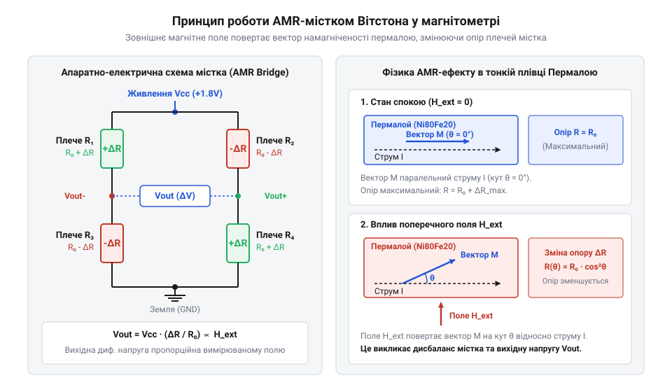
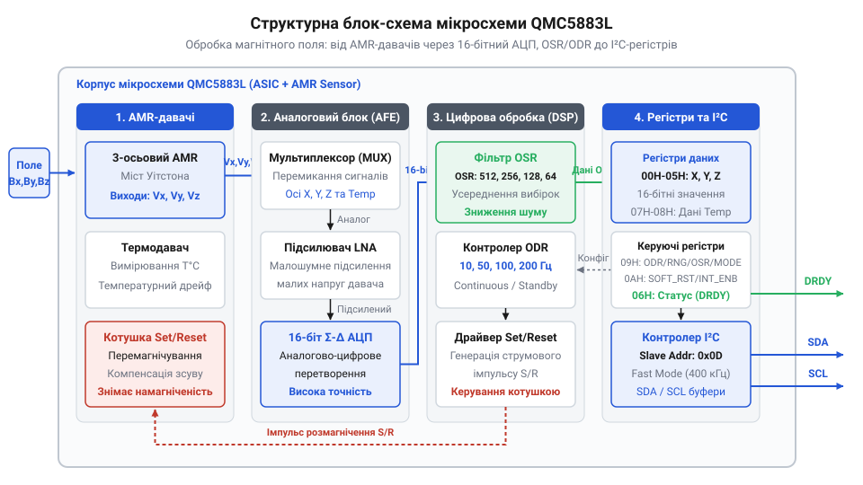
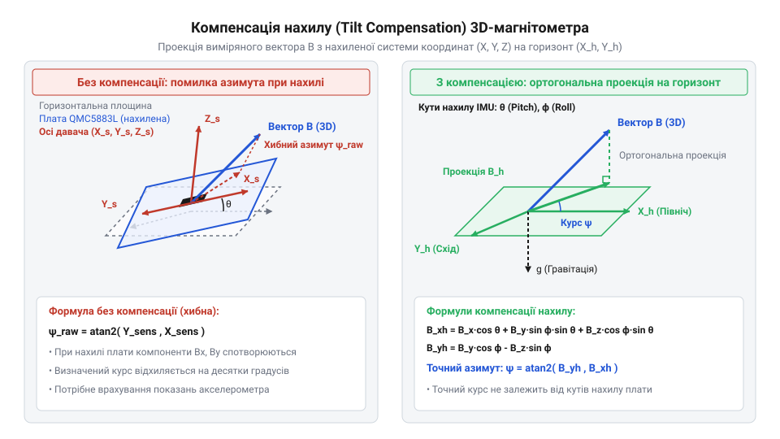
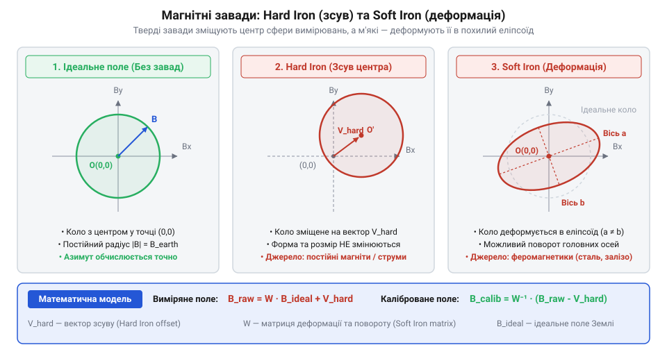
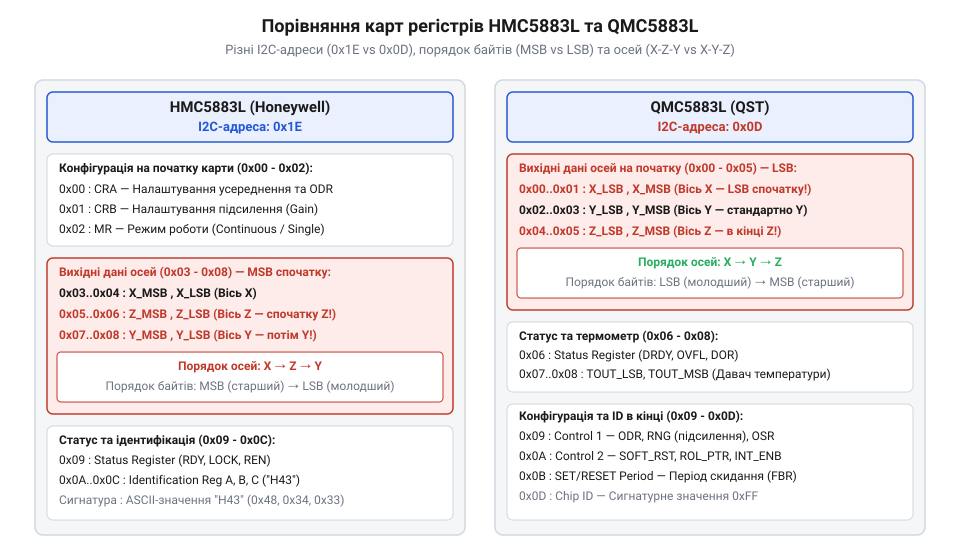

# QMC5883L — цифровий компас (I2C)

<preknowlist>
- [GY-521 / MPU-6050 — 6-осьовий IMU (акселерометр+гіроскоп)](root:cat-hw-sensors/mpu6050) — Принципи визначення вектора гравітації та обчислення кутів нахилу (Pitch/Roll) для компенсації положення компаса в просторі.
- [GY-271 / HMC5883L — компас/магнетометр](root:cat-hw-sensors/hmc5883l) — Загальна концепція 3-осьового магнітометра та використання магнітного поля Землі для навігації.
</preknowlist>

## Неминучий дрейф орієнтації без магнітометра

Акселерометр вимірює проєкцію гравітації, визначаючи кути @@en|pitch@@ (тангаж) та @@en|roll@@ (крен). Обертання навколо осі `Z` не змінює цієї проєкції, тож обчислити курс @@en|yaw@@ (порскання) він не може.

Курс `θ` виражають інтегруванням кутової швидкості `ω` гіроскопа:

```
θ(t) = θ₀ + ∫₀ᵗ ω(t) dt
```

Однак зсув нуля @@en|zero-rate offset@@ накопичує дрейф @@en|gyro drift@@, спотворюючи курс [MPU-6050](root:cat-hw-sensors/mpu6050) за хвилини. Для його зупинки потрібне геомагнітне поле Землі від QMC5883L.

## Анізотропний магніторезистивний ефект у кристалі

Для вимірювання геомагнітного поля QMC5883L використовує анізотропний магніторезистивний ефект (від англ. @@en|anisotropic magnetoresistance@@, AMR) у плівках пермалою (від англ. @@en|permalloy@@), опір яких залежить від кута між струмом і намагніченістю.

Через квадратичну нелінійність ефекту біля нуля на плівку під кутом 45° наносять золоті провідники Барбера (від англ. @@en|Barber poles@@), які повертають струм і зміщують робочу точку в лінійну зону. Докладніше про геометрію золотих смужок та лінеаризацію вольт-амперної характеристики AMR-структур читайте у статті про [провідники Барбера у магніторезистивних давачах](root:ph-condensed/barber-poles).


*Будова вимірювального містка AMR.*

Чотири AMR-елементи утворюють місток Вітстона (від англ. @@en|Wheatstone bridge@@) для кожної осі, формуючи диференціальну напругу.

Для компенсації дрейфу струмові петлі Set/Reset переполяризовують домени імпульсами у двох напрямках. Різниця вимірювань нейтралізує напругу зсуву (від англ. @@en|offset voltage@@). Далі сигнал оцифровується 16-бітним АЦП і проходить через блоки передискретизації (від англ. @@en|oversampling ratio@@, OSR) та усереднення (від англ. @@en|output data rate@@, ODR). Детальний опис генерації потужних струмових імпульсів та захисту від температурного зсуву нуля наведено в матеріалі про [ланцюги імпульсного переполяризування Set/Reset у магнітометрах](root:ph-condensed/magnetometer-set-reset-pulse).

## Цифрова обробка та регістри QMC5883L

Дані QMC5883L зчитуються через шину I2C. Налаштування задає регістр керування Control Register 1 (адреса `0x09`):


*Блок-схема цифрової обробки сигналів QMC5883L від AMR-давачів до вихідних I2C-регістрів.*

1. Режим роботи (від англ. @@en|Mode Control@@): безперервний (`0x01`) або очікування (`0x00`). 2. Частота вихідних даних (від англ. @@en|output data rate@@, ODR): 10, 50, 100 або 200 Гц. 3. Вимірювальний діапазон (від англ. @@en|full scale range@@, RNG): `±2 G` (чутливість 12000 LSB/Гаус) або `±8 G`. 4. Коефіцієнт передискретизації (від англ. @@en|oversampling ratio@@, OSR): усереднення 64–512 відліків для пригнічення шуму.

Вихідні дані по трьох осях розташовано в регістрах `0x00–0x05` як 16-бітні знакові числа у форматі з молодшим байтом на початку (від англ. @@en|little-endian@@):

```
X_axis = (Register[0x01] << 8) | Register[0x00]
Y_axis = (Register[0x03] << 8) | Register[0x02]
Z_axis = (Register[0x05] << 8) | Register[0x04]
```

Для переведення сирих відліків `LSB` у магнітну індукцію `B` у Гаусах їх ділять на масштабний коефіцієнт обраного діапазону:

```
B [Gauss] = LSB / 12000    [при RNG = ±2 Gauss]
```

## Обчислення азимута та компенсація нахилу

Магнітний азимут (від англ. @@en|heading@@) за горизонтальними складовими `X` та `Y` обчислюють функцією арктангенса двох аргументів:

```
Azimuth = atan2(Y, X) × (180 / π)
```

Від'ємний результат приводять до діапазону `0°`–`360°` додаванням `360°`. Ця формула точна лише за строго горизонтального положення плати.

При нахилі на тангаж `θ` (@@en|pitch@@) чи крен `φ` (@@en|roll@@) потужніша вертикальна складова поля `Z` проєктується на осі `X` та `Y`, спотворюючи курс на десятки градусів.


*Векторний механізм компенсації нахилу плати за допомогою кутів крену та тангажу.*

Для компенсації нахилу кути `φ` та `θ` зчитують із зовнішнього [акселерометра ADXL345](root:cat-hw-sensors/adxl345) і повертають 3D-вектор у горизонтальну площину:

```
X_h = X × cos(θ) + Y × sin(φ) × sin(θ) + Z × cos(φ) × sin(θ)
Y_h = Y × cos(φ) - Z × sin(φ)
Azimuth = atan2(Y_h, X_h) × (180 / π)
```

Отримані проєкції `X_h` і `Y_h` очищені від впливу `Z`, що зберігає стабільний курс при будь-яких нахилах корпусу.

## Спотворення від феромагнетиків та калібрування

Електромотори, батареї та металеві елементи корпусу викривляють геомагнітне поле довкола давача. Джерела власного сталого поля зсувають центр вимірювальної сфери від початку координат на вектор `(X_off, Y_off, Z_off)` — це тверді завади (від англ. @@en|hard iron distortion@@). Феромагнетики з високою проникністю деформують силові лінії, стискаючи чи розтягуючи сферу в еліпсоїд — це м'які завади (від англ. @@en|soft iron distortion@@).


*Вплив твердих завад (зсув центру) та м'яких завад (деформація сфери в еліпсоїд) на вихідні дані магнітометра.*

Для відновлення вимірювальної сфери пристрій обертають у всіх площинах, фіксуючи екстремуми `X_min`, `X_max`, `Y_min`, `Y_max`, `Z_min`, `Z_max`, після чого обчислюють калібрувальні коефіцієнти:

```
X_off = (X_max + X_min) / 2
Y_off = (Y_max + Y_min) / 2
Z_off = (Z_max + Z_min) / 2

X_range = (X_max - X_min) / 2
Y_range = (Y_max - Y_min) / 2
Z_range = (Z_max - Z_min) / 2
Avg_range = (X_range + Y_range + Z_range) / 3

Scale_X = Avg_range / X_range
Scale_Y = Avg_range / Y_range
Scale_Z = Avg_range / Z_range

X_cal = (X - X_off) × Scale_X
Y_cal = (Y - Y_off) × Scale_Y
Z_cal = (Z - Z_off) × Scale_Z
```

Отримані значення `(X_cal, Y_cal, Z_cal)` повертають вимірам центровану сферичну форму, необхідну для точного розрахунку азимута.

## Апаратний розрив сумісності з HMC5883L

Модулі GY-271 постачаються з двома несумісними чипами: оригінальним HMC5883L або його аналогом QMC5883L. Пряма заміна між ними неможлива через кілька відмінностей:


*Відмінності між чипами QMC5883L та HMC5883L у структурі регістрів, I2C-адресі та порядку байтів.*

1. Адреса I2C: QMC5883L відповідає на `0x0D`, а [HMC5883L](root:cat-hw-sensors/hmc5883l) — на `0x1E` (помилка @@en|NACK@@ при зверненні не туди). 2. Порядок байтів і осей: QMC5883L дає 16-бітні дані в @@en|little-endian@@ (LSB спочатку) за порядком `X, Y, Z` (`0x00–0x05`). HMC5883L вичитується в @@en|big-endian@@ та порядку `X, Z, Y` (`0x03–0x08`). 3. Регістр Set/Reset: QMC5883L вимагає запису `0x01` у регістр `0x0B` при ініціалізації. Без цього вимірювальний генератор не запускається і регістри повертають нулі.

Для сумісності прошивка опитує адресу `0x0D`: якщо пристрій відповідає та регістр ідентифікації `0x0D` повертає `0xFF`, драйвер вмикає режим QMC5883L.