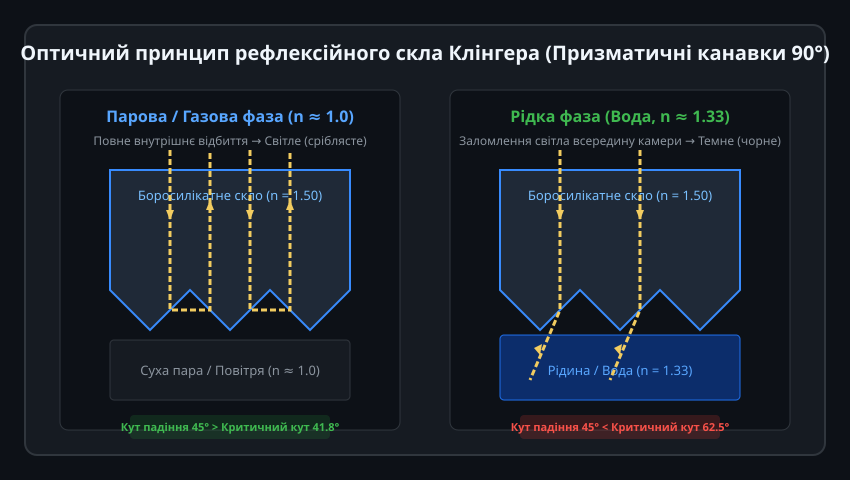
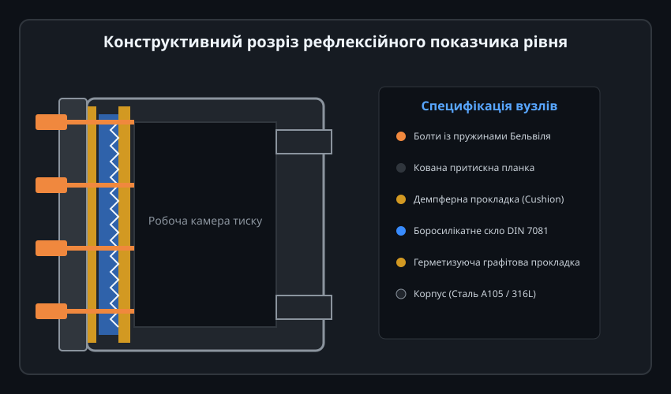
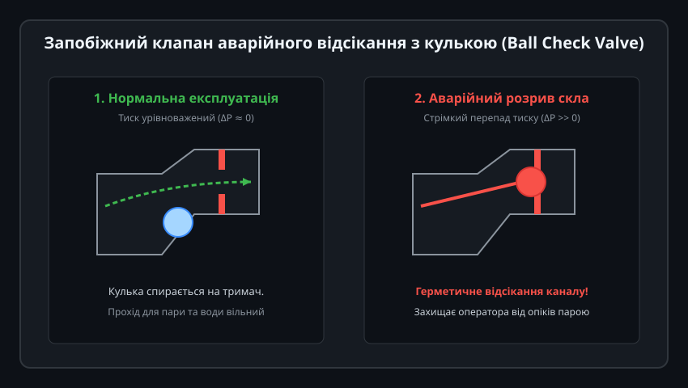
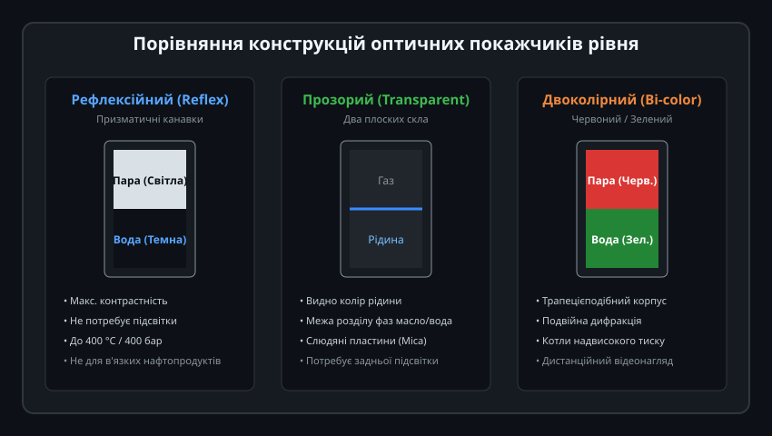
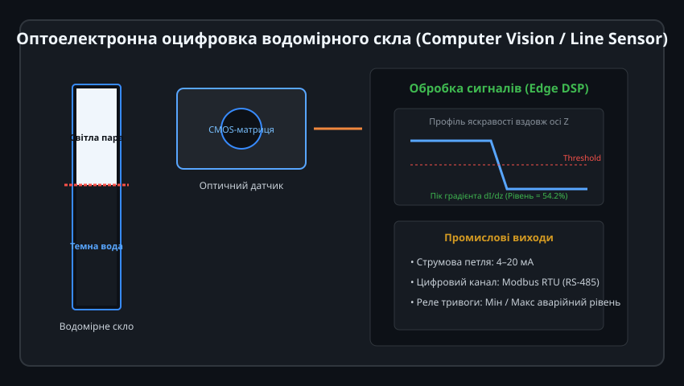

# Поглиблений інженерний аналіз та автоматизація водомірних колонок Клінгера

Рефлексійне скло є високонадійним первинним перетворювачем рівня рідини прямої дії. Розуміння хвильової оптики призматичних середовищ, термомеханічних напружень у складному композиті «сталь-прокладка-скло», гідродинаміки пароводяної суміші в барабані котла та алгоритмів машинного зору дозволяє ефективно інтегрувати ці прилади в сучасні автоматизовані системи керування технологічними процесами (АСКТП).

---

## 1. Оптична теорія рефлексії та аналіз коефіцієнтів відбиття Френеля

Робота рефлексійного скла базується на багаторазовому відбитті світлового фронту від двох ортогональних граней V-подібної призми:



### Розрахунок граничних кутів та енергії променя:
1. **Закон Снеліуса-Декарта для призми:**
   При нормальному падінні пучка на зовнішню грань кут падіння на внутрішню скошену грань становить рівно alpha = 45°.
   
   sin(theta_c) = n_medium / n_glass

   - Для парової або повітряної фази (`n_medium ≈ 1.0003`, `n_glass = 1.515` для боросилікатного скла за довжини хвилі 589 нм):
     
     theta_c = arcsin(1.0003 / 1.515) = 41.32°
     
     Оскільки `alpha = 45° > theta_c = 41.32°`, реалізується режим повного внутрішнього відбиття (Total Internal Reflection, TIR). Коефіцієнт відбиття енергії променя за формулами Френеля:
     
     R = 1.00 (100% відбиття без поглинання на першій грані)
     
     Відбитий промінь падає на сусідню грань під кутом 45°, зазнає другого повного відбиття `R = 1.00` і виходить паралельно вхідному променю у бік спостерігача (ретрорефлексія).

2. **Для водної фази (`n_medium = 1.333` за 20 °C):**
   
   theta_c = arcsin(1.333 / 1.515) = 61.62°
   
   Оскільки `alpha = 45° < theta_c = 61.62°`, повне відбиття відсутнє. Промінь частково відбивається і частково заломлюється всередину камери:
   - Кут заломлення beta:
     
     sin(beta) = (n_glass / n_water) * sin(45°) = (1.515 / 1.333) * 0.7071 = 0.8037  =>  beta ≈ 53.48°

   - Коефіцієнт відбиття неполяризованого світла:
     
     R = 0.5 * (R_s + R_p) ≈ 0.005 (менше 0.5%)

   Понад 99.5% світлового потоку проходить у рідку фазу та розсіюється на шорстких зачорнених стінках сталевої камери. Око людини або сенсор камери фіксують оптичний контраст між парою та водою понад 200:1.

---

## 2. Термомеханіка вузла ущільнення та розрахунок зусилля затягування

Скляна пластина є крихким елементом, що працює в умовах високого гідростатичного тиску, нерівномірного нагріву та згинальних моментів.



### Розрахунок зусилля стиску та моментів затяжки болтів:
Для забезпечення герметичності за тиску `P` зусилля болтів `F_total` має перевищувати силу виштовхування скла плюс необхідне питоме навантаження на прокладку:

F_total = P * A_glass + m * P * A_gasket + y * A_gasket

де:
- `A_glass` — видима площа скла під дією тиску середовища,
- `A_gasket` — площа контакту ущільнювальної прокладки,
- `m` — фактор прокладки (для терморозширеного графіту `m ≈ 2.5`),
- `y` — мінімальне питоме зусилля посадки прокладки (`y ≈ 20 МПа`).

### Небезпека термічного удару та роль демпфера (Cushion Gasket):
1. **Коефіцієнт лінійного теплового розширення (КТР):**
   - Корпус із вуглецевої сталі ASTM A105: `alpha_steel ≈ 12 * 10^-6 1/°C`.
   - Боросилікатне скло: `alpha_glass ≈ 3.3 * 10^-6 1/°C`.
   Різниця КТР майже в 4 рази спричиняє ковзання металу по склу під час нагріву.
2. **Демпферна прокладка:** Виготовляється з безазбестового волокнистого матеріалу товщиною 1.5–2.0 мм. Вона компенсує шорсткість металевої притискної кришки, виключаючи виникнення локальних концентраторів механічного напруження.
3. **Тарілчасті пружини (пружини Бельвіля):** Встановлюються пакетами під головки болтів. Вони підтримують постійне зусилля попереднього натягу шпильок за зміни товщини пакету через теплові деформації.

---

## 3. Гідродинаміка барабана котла: хибний рівень та продування колонок

Рівень рідини в оглядовій колонці не завжди дорівнює істинному середньому рівню в барабані парового котла через явища «хибного рівня» (Swell and Shrink) та охолодження води в зовнішніх імпульсних лініях.



### Фізичні причини розбіжності рівнів:
1. **Гідростатична різниця густин:**
   Вода у віддаленій від барабана водомірній колонці охолоджується через тепловіддачу в цех (наприклад, до 80 °C, `rho_1 = 971 кг/м³`), тоді як усередині барабана за тиску 40 бар температура кипіння становить 250 °C (`rho_2 = 799 кг/м³`).
   За законом сполучених посудин:
   
   h_скло = h_котел * (rho_котел / rho_скло)
   
   Рівень у склі завжди дещо нижчий за геометричний рівень киплячої води в барабані (похибка стовпа може досягати 10–30 мм).
2. **Пароутворення та набухання (Swell Effect):** При різкому відкритті парової засувки тиск у барабані падає, об'єм парових бульбашок у товщі води різко зростає («закипання в об'ємі»), викликаючи миттєвий підйом суміші. У водомірній колонці, де закипання відсутнє, рівень реагує плавніше.
3. **Регламент продування (Blowdown):**
   Для очищення канавок від іржі та накипу щозмінно виконують послідовне продування:
   - Закрити нижній кран (вода), відкрити дренажний вентиль — продути паровий канал.
   - Закрити верхній кран (пара), відкрити нижній — продути водяний канал.
   - Повільно відкрити обидва крани, спостерігаючи за поверненням кульок безпеки у вихідні кишені.

---

## 4. Обмеження застосування та лужна деструкція кварцового скла

Рефлексійне скло має суворе обмеження за параметрами пари: максимальний робочий тиск 35–40 бар (температура насичення близько 240–250 °C).



### Хімічна кінетика вилуговування:
1. У котловій воді для запобігання корозії підтримують лужне середовище (pH = 9.0 ... 10.5) за допомогою дозування фосфатів або їдкого натру.
2. Гідроксид-іони `OH-` активно реагують із діоксидом кремнію боросилікатної матриці за підвищених температур:
   
   SiO2 + 2 OH-  -->  SiO3(2-) + H2O

3. **Чому рефлексійне скло не можна захистити слюдою:**
   На прозорих плоских стеклах (Transparent) для захисту від контакту з окропом встановлюють природні слюдяні пластини (Mica Shields) сорту Мусковіт. Проте слюда є плоским листовим мінералом: її неможливо деформувати для повторення 90° канавок без перекриття оптики. Контакт котлової води з рефлексійним склом є прямим.
4. При тиску понад 40 бар швидкість розчинення скла досягає кількох десятих міліметра на місяць. Гострі вершини призм заокруглюються, світло перестає повністю відбиватися, і лічильник стає матово-сірим по всій висоті.
5. Для тисків від 40 до 225 бар переходять виключно на прозорі (Transparent) або двоколірні (Bi-color) покажчики зі слюдяним захистом.

---

## 5. Алгоритм оцифрування на базі комп'ютерного зору (OpenCV та Line Sensor)

Для інтеграції рефлексійної колонки в SCADA-систему розгортають обчислювальний модуль Edge AI на базі мікроконтролера STM32MP1 або промислового одноплатного комп'ютера з камерою.



### Програмний конвеєр визначення рівня:
1. **Виділення ROI (Region of Interest):** Локалізація прямокутної вертикальної щілини скла на зображенні.
2. **Просторове усереднення:** Обчислення середньої яскравості по ширині каналу для формування одновимірного профілю `I(y)`.
3. **Обчислення градієнта та фільтрація Гауса:** Згладжування шумів матриці та пошук максимуму першої похідної:
   
   G(y) = d/dy (I(y) * Gaussian(sigma))

4. **Субпіксельна апроксимація:** Параболічна інтерполяція навколо піку екстремуму для підвищення роздільної здатності.

```python
"""
Модуль комп'ютерного зору для визначення рівня у водомірному склі Клінгера.
Працює в режимі реального часу на промислових Edge-процесорах.
"""

import cv2
import numpy as np


class SightGlassLevelDetector:

  def __init__(self, glass_roi_coords, threshold_gradient=25.0):
    """glass_roi_coords: (x, y, width, height) зони оглядового скла

    threshold_gradient: мінімальний поріг градієнта для детекції межі
    """
    self.roi = glass_roi_coords
    self.threshold = threshold_gradient
    self.filtered_level_pct = 50.0
    self.alpha_filter = 0.15  # Експоненційний фільтр шуму

  def process_frame(self, frame_bgr):
    """Обробка вхідного відеокадру.

    Повертає: (level_pct, debug_frame)
    """
    x, y, w, h = self.roi
    roi_img = frame_bgr[y : y + h, x : x + w]

    # Перетворення у відтінки сірого
    gray = cv2.cvtColor(roi_img, cv2.COLOR_BGR2GRAY)

    # 1D-профіль яскравості: усереднення по горизонталі
    intensity_profile = np.mean(gray, axis=1)

    # Згладжування 1D-профілю фільтром Гауса
    kernel_size = 11
    smoothed_profile = cv2.GaussianBlur(
        intensity_profile.reshape(-1, 1), (1, kernel_size), 2.5
    ).flatten()

    # Обчислення градієнта вздовж вертикальної осі
    # Світла пара зверху (висока яскравість) -> Темна вода знизу (низька яскравість)
    gradient = np.diff(smoothed_profile)

    # Межа розділу відповідає найглибшому спаду яскравості (мінімум похідної)
    min_grad_idx = np.argmin(gradient)
    min_grad_val = gradient[min_grad_idx]

    detected = False
    raw_level_pct = self.filtered_level_pct

    # Перевірка порогу надійності перепаду яскравості
    if abs(min_grad_val) > self.threshold:
      # Субпіксельна параболічна інтерполяція
      if 0 < min_grad_idx < len(gradient) - 1:
        y0 = gradient[min_grad_idx - 1]
        y1 = gradient[min_grad_idx]
        y2 = gradient[min_grad_idx + 1]
        denom = 2.0 * (y0 - 2.0 * y1 + y2)
        if abs(denom) > 1e-5:
          subpixel_offset = (y0 - y2) / denom
          exact_y = min_grad_idx + subpixel_offset
        else:
          exact_y = float(min_grad_idx)
      else:
        exact_y = float(min_grad_idx)

      # Рівень рідини (0% - внизу скла, 100% - вгорі)
      raw_level_pct = (1.0 - (exact_y / float(h))) * 100.0
      raw_level_pct = max(0.0, min(100.0, raw_level_pct))
      detected = True

    # Експоненційна фільтрація для плавності показників
    if detected:
      self.filtered_level_pct = (
          self.alpha_filter * raw_level_pct
          + (1.0 - self.alpha_filter) * self.filtered_level_pct
      )

    # Оверлей для налагодження та оператора
    debug_roi = roi_img.copy()
    if detected:
      detected_y = int((1.0 - self.filtered_level_pct / 100.0) * h)
      cv2.line(
          debug_roi, (0, detected_y), (w, detected_y), (0, 0, 255), 2
      )  # Червона лінія рівня
      cv2.putText(
          debug_roi,
          f'{self.filtered_level_pct:.1f}%',
          (5, max(20, detected_y - 8)),
          cv2.FONT_HERSHEY_SIMPLEX,
          0.5,
          (0, 255, 0),
          1,
      )

    return self.filtered_level_pct, debug_roi
```

Цей алгоритм демонструє стійкість до промислових вібрацій, дифузного сонячного засвічення та локальних крапель конденсату на склі, перетворюючи механічне скло Клінгера на надійний інтелектуальний давач промислового Інтернету речей (IIoT).
