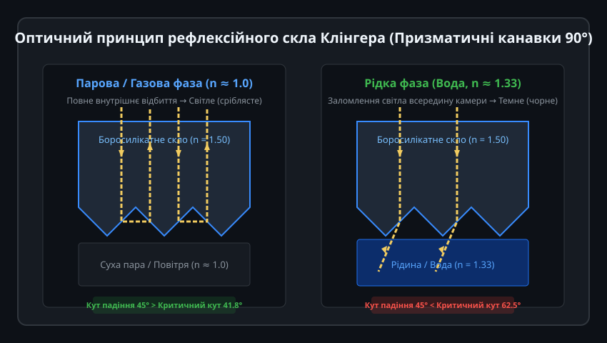
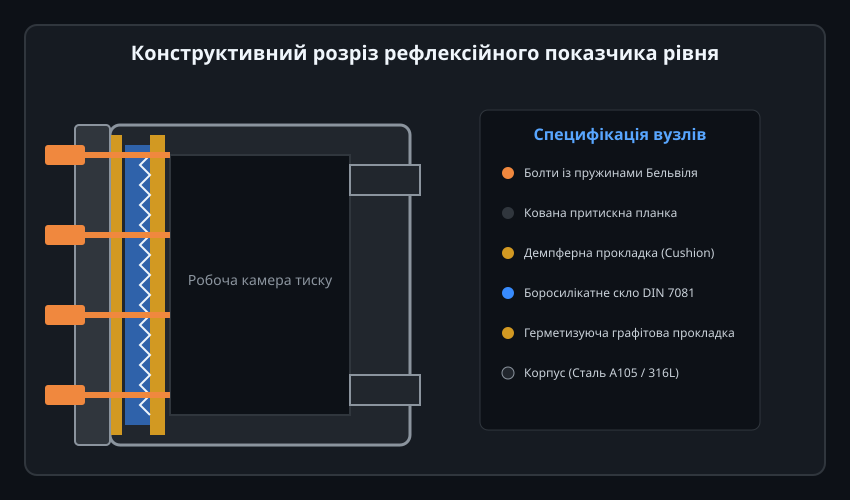
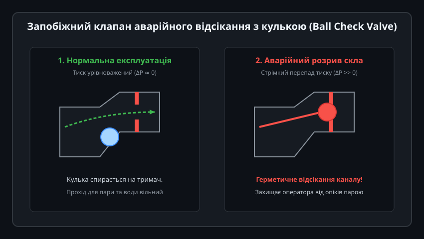
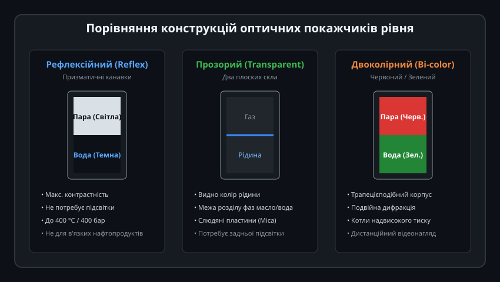
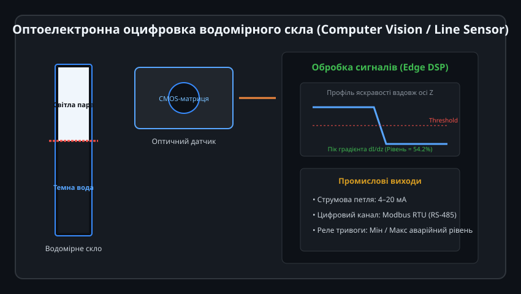

# Рефлексійне водомірне скло Клінгера

Рефлексійне водомірне скло (винайдене Ріхардом Клінгером у 1886 році) залишається одним із найнадійніших і безвідмовних приладів контролю рівня рідини в парових котлах, автоклавах та напірних резервуарах. Завдяки повній відсутності рухомих елементів, поплавків та електричних кіл прилад забезпечує миттєву візуальну індикацію межі поділу середовищ навіть за умов повного знеструмлення промислового об'єкта.

---

## 1. Фізичний принцип рефлексії та закон заломлення світла

В основі роботи рефлексійного покажчика лежить фундаментальне явище повного внутрішнього відбиття світла на межі двох середовищ із різними оптичними густинами:

### Оптична геометрія призми:
Внутрішня грань загартованого боросилікатного скла, яка безпосередньо контактує з робочим середовищем резервуара, має ряд поздовжніх призматичних канавок із кутом при вершині рівно 90° (дві робочі площини під кутом 45° до зовнішньої грані).

1. **Газова або парова фаза (n_газ ≈ 1.00):**
   - Показник заломлення боросилікатного скла становить `n_скло ≈ 1.50`.
   - За законом Снеліуса критичний кут повного внутрішнього відбиття дорівнює:
     
     theta_c = arcsin(n_газ / n_скло) = arcsin(1.00 / 1.50) ≈ 41.8°

   - Промені природного світла входять крізь передню плоску поверхню скла під прямим кутом і падають на скошену грань призми під кутом 45°. Оскільки 45° > 41.8°, світло зазнає першого повного відбиття, спрямовується на сусідню грань під тим самим кутом 45°, зазнає другого повного відбиття і повертається назад до очей спостерігача.
   - **Результат:** Зона, зайнята парою або газом, має яскравий сріблясто-білий дзеркальний вигляд.

2. **Рідка фаза (вода, n_вода ≈ 1.33):**
   - Для межі скло–вода критичний кут становить:
     
     theta_c = arcsin(n_вода / n_скло) = arcsin(1.33 / 1.50) ≈ 62.5°

   - Кут падіння променів (45°) тепер значно менший за критичний (45° < 62.5°). Повне внутрішнє відбиття стає неможливим: промені світла заломлюються крізь скло всередину рідини під кутом близько 53° і поглинаються темними внутрішніми стінками кованого сталевого корпусу.
   - **Результат:** Зона, заповнена водою, виглядає глибоко чорною.

Різкий контраст між білою парою і чорною водою усуває будь-яку неоднозначність спостереження та виключає помилки паралаксу.

---

## 2. Конструкція та матеріальне виконання

Покажчик рівня Клінгера розрахований на екстремальні промислові параметри: робочий тиск до 40 МПа (400 бар) та температуру до 400 °C.

### Ключові елементи конструкції:
- **Масивний кований корпус:** Виготовляється з якісної вуглецевої сталі ASTM A105 (для стандартних парових систем) або корозійностійкої нержавіючої сталі AISI 316L (для хімічних виробництв).
- **Боросилікатне загартоване скло:** Виготовляється за стандартом DIN 7081 (типорозміри від номеру 1 до 9, довжина однієї секції від 115 до 340 мм). Скло проходить термічне гартування для створення контрольованих внутрішніх напружень стиску, що збільшує стійкість до гідроударів та термічного удару при контакті з окропом.
- **Багатошарове ущільнення:**
  - *Герметизуюча прокладка (Gasket):* Встановлюється між склом і сталевим корпусом з боку рідини. Зазвичай використовується терморозширений графіт з армуванням або чистий PTFE.
  - *Демпферна прокладка (Cushion Gasket):* Розташовується між зовнішньою плоскою стороною скла та притискною металевою планкою. Вона слугує амортизатором, який рівномірно розподіляє зусилля затиску болтів і запобігає прямому контакту металу зі склом, який міг би призвести до утворення мікротріщин.
- **Притискні болти з тарілчастими пружинами:** Болти затягуються тарованим динамометричним ключем за схемою від центру до країв. Тарілчасті пружини Бельвіля компенсують циклічні температурні розширення корпусу при пуску та зупинці котла.

---

## 3. Запобіжні клапани автоматичного відсікання

Руйнування оглядового скла на паровому котлі високого тиску створює загрозу викиду тонни перегрітого окропу й пари в робочу зону котельні. Для запобігання аварії верхній і нижній вентилі покажчика обов'язково оснащуються автоматичними кульковими відсікачами (Safety Ball Check Valves):

### Механізм дії кулькового відсікача:
1. **Штатний режим роботи:**
   - Сталева прецизійна кулька вільно лежить у похилій нижній кишені клапана під дією сили тяжіння.
   - Повільний перетік води та пари при коливаннях рівня в барабані котла створює мізерний динамічний перепад тиску (Delta P < 0.05 бар), якого недостатньо для підйому кульки. Прохідний перетин залишається повністю відкритим.

2. **Аварійний розрив скла:**
   - При порушенні цілісності скла тиск у камері миттєво падає до атмосферного (0 бар), тоді як у котлі зберігається робочий тиск (наприклад, 16–40 бар).
   - Потужний швидкісний потік котлової води захоплює кульку з кишені і за соті частки секунди притискає її до сідла клапана.
   - Повний гідравлічний перепад надійно утримує кульку в сідлі, повністю герметизуючи витік до моменту, коли персонал зможе вручну перекрити ручні корінні шпинделі.

---

## 4. Порівняння оптичних покажчиків: Reflex, Transparent та Bi-color

Залежно від фізико-хімічних властивостей робочого середовища та робочого тиску використовують різні типи оптичних приладів рівня:

| Параметр / Тип | Рефлексійний (Reflex) | Прозорий (Transparent) | Двоколірний (Bi-color) |
| :--- | :--- | :--- | :--- |
| **Оптична схема** | Одне скло з 90° канавками | Два гладких паралельних скла | Трапеція + кольорові світлофільтри |
| **Кольорова індикація** | Світлий (пара) / Чорний (вода) | Просвіт крізь рідину | Червоний (пара) / Зелений (вода) |
| **Потреба у підсвітці** | Не потрібна (денне світло) | Обов'язкова задня підсвітка | Обов'язкова лампа високої яскравості |
| **Граничний тиск пари** | До 35 бар (без захисту скла) | До 120 бар (із слюдою Mica) | До 225 бар (надкритичні котли) |
| **Контроль межі фаз** | Неможливий | Можливий (нафта / підтоварна вода) | Не застосовується |
| **Стійкість до лугів** | Вразливе (канавки змиваються) | Захищається слюдою Mica Shield | Захищається слюдою Mica Shield |

> Рефлексійні стекла заборонено застосовувати на парових котлах із робочим тиском пари понад 35–40 бар. За високих температур котлова вода з високим рівнем pH (лужний режим) вилуговує кремній із боросилікатного скла, що призводить до поступового згладжування гострих 90° граней канавок і повної втрати рефлексійного ефекту.

---

## 5. Цифрова інтеграція та автоматичне зчитування для SCADA

Сучасні норми промислової безпеки вимагають передачі даних рівня в розподілену систему керування (DCS / SCADA). Для цього рефлексійні колонки оснащують оптичними насадками без врізки в напірний контур:

### Методи оцифрування:
1. **Лінійний фотодіодний сенсор (CMOS Line Sensor):**
   - Уздовж оглядової щілини монтується захищений корпус із лінійкою фотодіодів (наприклад, 1024 або 2048 пікселів) та матричним світлодіодним випромінювачем.
   - Світла зона пари відбиває світло на сенсор (високий рівень сигналу ADC), темна зона води поглинає світло (низький рівень ADC).
2. **Промисловий відеомоніторинг із Edge AI:**
   - Камера з об'єктивом спостерігає за склом на відстані 1–2 метри.
   - Процесор аналізує градієнт яскравості вздовж вертикальної координати `z`. Межа розділу визначається за максимумом просторової похідної `dI/dz`.
3. **Вихідні інтерфейси:**
   - Струмова петля 4–20 мА (пропорційно 0–100% видимого рівня).
   - Цифрова шина RS-485 Modbus RTU із передачею прапорів аварійного мінімального та максимального рівнів для автоматичного відключення пальників котла.
