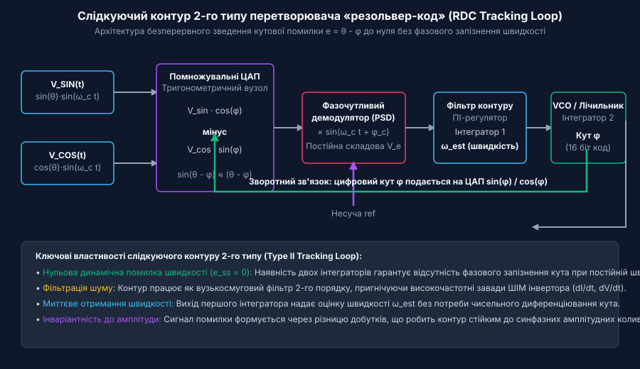
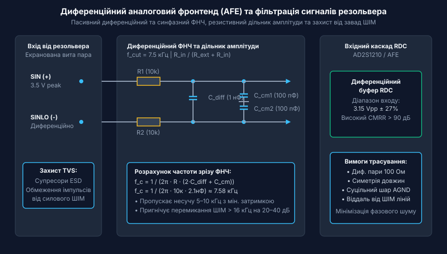
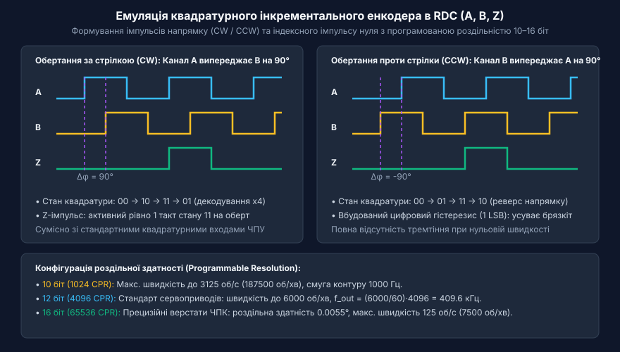
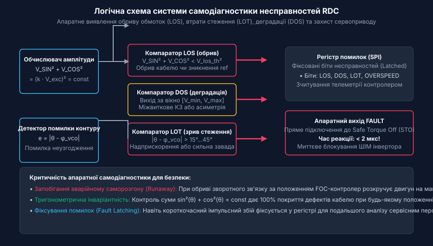
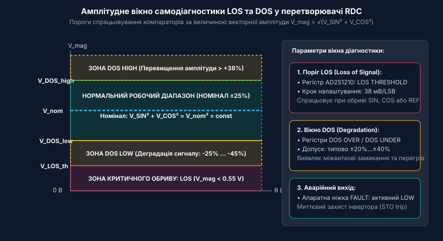
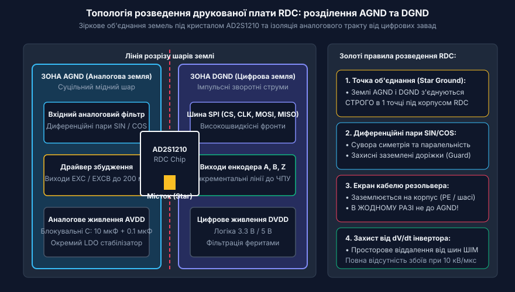

# Перетворювачі «резольвер-код» (RDC)

<preknowlist>
- [Сельсини та резольвери: обертові трансформаторні кутоміри](root:cat-hw-sensors/synchro-and-resolver-transducers) — фізичний принцип формування амплітудно-модульованих сигналів синуса й косинуса обмоточними трансформаторами
- [Синхронне детектування та фазочутлива демодуляція давачів положення](root:cat-hw-sensors/synchronous-demodulation-for-inductive-transducers) — базові принципи виділення обвідної гармонічного сигналу за допомогою фазочутливого випрямлення
- [Енкодери кутового та лінійного переміщення](root:cat-hw-sensors/optical-and-magnetic-encoders) — принципи квадратурного кодування та призначення вихідних імпульсних сигналів A, B і Z
</preknowlist>

## Проблема прямих вимірювань у жорстких умовах

В промислових сервоприводах важкого машинобудування, гірничодобувному обладнанні, тягових електродвигунах транспортних засобів та аерокосмічних системах керування векторний контроль моменту й швидкості вимагає безперервного та надточного знання абсолютного кутового положення ротора. Проте робоче середовище таких установок характеризується екстремальними чинниками: механічними ударами, вібраціями високої амплітуди, температурним діапазоном від -55 °C до +150 °C і вище, агресивним пилом, масляним туманом та потужними електромагнітними завадами. Джерелом останніх є широтно-імпульсна модуляція (@@en|pulse-width modulation@@, PWM) у силових інверторах на транзисторах (IGBT чи SiC), де швидкі перемикання струму та напруги (з високими показниками dI/dt і dV/dt) створюють сильну імпульсну заваду в електричних колах сенсорів.

Традиційні цифрові датчики кута — такі як скляні чи полімерні диски [оптичних та магнітних енкодерів](root:cat-hw-sensors/optical-and-magnetic-encoders) — виявляються непридатними для таких умов. У разі механічних ударів скляні растри енкодерів розтріскуються, а випромінювальні світлодіоди швидко деградують при температурах понад +85 °C. Конденсат чи масляний туман на оптичних доріжках призводить до втрати імпульсів квадратурних каналів, спричиняючи зсув відліку та фатальний збій алгоритму керування двигуном. Напівпровідникові сенсори кута на основі ефекту Холла чи [магніторезистивних сенсорів](root:cat-hw-sensors/amr-gmr-tmr-magnetic-sensors), хоч і не мають крихких оптичних елементів, містять чутливу первинну електроніку безпосередньо у корпусі давача на валу. Високі температури викликають дрейф нуля й деградацію напівпровідникових кристалів, а сильні змінні магнітні поля від обмоток статора двигуна наводять викривлення в низьковольтних аналогових колах сенсорів.

Для подолання цих обмежень у критично важливих вузлах застосовують обертові трансформаторні кутоміри — [сельсини та резольвери](root:cat-hw-sensors/synchro-and-resolver-transducers). Резольвер являє собою пасивну електромеханічну машину без жодного напівпровідникового компонента всередині. Його статор і ротор виготовлено з прецизійної електротехнічної сталі з мідними обмотками, залитими високотемпературним компаундом, що дозволяє пристрою безперебійно працювати при температурах понад +200 °C та витримувати ударні навантаження в сотні g.

Принцип роботи резольвера полягає у зміні коефіцієнта взаємоіндукції між первинною обмоткою збудження на роторі та двома квадратурними (синусною та косинусною) обмотками на статорі. На обмотку збудження подається високочастотна гармонічна напруга несучої частоти:

`V_ref(t) = V_0 · sin(ω_c · t)`

де `V_0` — амплітуда напруги збудження (типово від 2 В до 7 В RMS), `f_c = ω_c / (2π)` — частота несучої (зазвичай від 2 кГц до 20 кГц, найчастіше 10 кГц).

Вторинні напруги на статорних обмотках виявляються амплітудно-модульованими гармонічними сигналами, амплітуда яких пропорційна синусу та косинусу механічного (або електричного) кута повороту ротора `θ`:

`V_SIN(t) = k · V_0 · sin(θ) · sin(ω_c · t + φ)`

`V_COS(t) = k · V_0 · cos(θ) · sin(ω_c · t + φ)`

де `k` — коефіцієнт трансформації резольвера (типово 0.5), а `φ` — фазовий зсув, внесений індуктивністю та активним опором обмоток пристрою.

Пряме вимірювання таких сигналів за допомогою стандартних аналого-цифрових перетворювачів (АЦП) мікроконтролера з подальшим обчисленням кута через арктангенс `arctan(V_SIN / V_COS)` зазнає краху в реальних умовах. По-перше, миттєве вибіркове зчитування сигналів вразливе до високочастотного шуму перемикання силових транзисторів інвертора, який накладається на корисну амплітуду. По-друге, фазовий зсув `φ` змінюється від температури та навантаження, викликаючи розсинхронізацію між вибіркою АЦП та піком несучої частоти. По-третє, прямий розрахунок арктангенса миттєвих значень у цифровому процесорі дає високу чутливість до розбалансу амплітуд і шумів квантування, що призводить до значного фазового запізнення й дрижання (@@en|jitter@@) обчисленого кута при високих швидкостях обертання.

Для вирішення проблеми перетворення аналогових модульованих сигналів резольвера у високоточний цифровий код кута без запізнення та із захистом від завад застосовують спеціалізовані перетворювачі «резольвер-код» (від англ. @@en|resolver-to-digital converter@@, скорочено @@en|RDC@@).

Історичний шлях пристроїв обробки сигналів резольверів проліг від масивних аналогових електромеханічних слідкуючих систем до однокристальних систем на кристалі. На ранніх етапах розвитку автоматики обробка сигналів кутомірів базувалася на застосуванні спеціальних трансформаторних схем, таких як @@en|Scott-T transformer@@ (трансформатор Скотта, від імені інженера Чарльза Скотта), які перетворювали трифазні сигнали сельсинів у двофазні синусно-косинусні сигнали, з подальшим поданням на аналогові фазочутливі підсилювачі й виконавчі серводвигуни. З появою напівпровідникової техніки розробники перейшли до гібридних дискретних модулів, де фазочутлива демодуляція реалізовувалася на дискретних операційних підсилювачах та аналогових ключах. Проте справжній прорив у надійності та точності відбувся завдяки створенню монокристалічних мікросхем RDC (@@en|RDC@@). Сучасні монокристалічні перетворювачі об'єднують на одному кремнієвому кристалі високопрецизійний аналоговий фронтенд (@@en|analog front-end@@, @@en|AFE@@), синтезатор опорного сигналу збудження (@@en|excitation synthesizer@@), обчислювальний цифровий контур слідкування 2-го типу (@@en|type II tracking loop@@) чи цифровий процесор сигналів (@@en|DSP@@), а також розвинену систему аналогово-цифрової самодіагностики. Це дозволило відмовитися від ручного налаштування фази, забезпечити компенсацію фазових спотворень у широкому температурному діапазоні та підвищити завадостійкість приводу до рівня, недосяжного для традиційних оптичних сенсорів.

## Архітектура слідкуючого контуру другого типу

На відміну від систем прямого відкритого оцифрування (@@en|open-loop sampling@@), де кут обчислюється розраховуванням арктангенса співвідношення миттєвих амплітуд, сучасні прецизійні мікросхеми RDC будуються за принципом замкненого слідкуючого контуру (@@en|tracking converter@@ або @@en|tracking RDC@@). Слідкуючий перетворювач безперервно підтримує у своєму внутрішньому цифровому регістрі поточну оцінку кута `ϕ` і коригує її таким чином, щоб звести до нуля тригонометричну різницю між реальним кутом ротора `θ` та оцінкою `ϕ`.

Вирішальною перевагою цієї архітектури є використання слідкуючого контуру 2-го типу (від англ. @@en|type II tracking loop@@). У теорії автоматичного керування контур 1-го типу (що має один інтегратор у ланцюзі зворотного зв'язку) здатний відстежувати статичну позицію з нульовою помилкою, проте при сталій швидкості обертання ротора `ω = dθ/dt` створює постійне фазове запізнення (помилку швидкості), пропорційне частоті обертання. Контур 2-го типу містить у своїй структурі два послідовно ввімкнені інтегратори. Це математично гарантує нульову динамічну помилку кута при постійній швидкості обертання (`e_ss = 0`), а також забезпечує високий коефіцієнт приглушення високочастотних завад завдяки властивостям низькочастотного фільтра другого порядку.


*Схема замкненого слідкуючого контуру 2-го типу: перетворення амплітудно-модульованих сигналів синуса й косинуса на цифровий код кута шляхом мінімізації тригонометричної помилки неузгодження.*

Розглянемо ключові вузли та послідовне перетворення сигналів у замкненому контурі RDC:

1. **Вхідні сигнали резольвера**: На аналогові входи RDC надходять диференційні сигнали від синусної та косинусної обмоток статора:

`V_SIN(t) = V_m · sin(θ) · sin(ω_c · t)`

`V_COS(t) = V_m · cos(θ) · sin(ω_c · t)`

де `V_m = k · V_0` — пікове значення амплітуди вихідної напруги.

2. **Тригонометричний мультиплікатор неузгодження (@@en|trigonometric error multiplier@@)**: Внутрішній цифровий регістр RDC зберігає поточне цифрове значення оцінки кута `ϕ`. Це значення подається на внутрішні цифрово-аналогові перетворювачі (помножувальні ЦАП), які генерують тригонометричні коефіцієнти `cos(ϕ)` та `sin(ϕ)`. Аналоговий помножувач виконує перехресне множення вхідних сигналів:
- Сигнал синуса `V_SIN(t)` множиться на `cos(ϕ)`;
- Сигнал косинуса `V_COS(t)` множиться на `sin(ϕ)`.

Після цього віднімач формує аналоговий сигнал помилки неузгодження `e(t)`:

`e(t) = V_SIN(t) · cos(ϕ) - V_COS(t) · sin(ϕ)`

Підставивши вирази для вхідних сигналів і застосувавши тригонометричну тотожність для синуса різниці кутів `sin(A - B) = sin(A) · cos(B) - cos(A) · sin(B)`, отримуємо:

`e(t) = V_m · sin(θ - ϕ) · sin(ω_c · t)`

Оскільки слідкуючий контур постійно утримує оцінку `ϕ` дуже близькою до реального кута `θ`, різниця кутів `Δθ = θ - ϕ` є малою величиною. Для малих кутів справедлива наближена рівність `sin(θ - ϕ) ≈ (θ - ϕ)`. Отже, вираз для сигналу неузгодження спрощується до вигляду:

`e(t) ≈ V_m · (θ - ϕ) · sin(ω_c · t)`

З цього виразу видно, що результуючий сигнал являє собою гармонічну несучу `sin(ω_c · t)`, амплітуда якої прямо пропорційна поточній кутовій помилці `(θ - ϕ)`.

3. **Фазочутливий демодулятор (@@en|phase-sensitive detector@@, PSD)**: Для виділення постійної складової, що відповідає помилці кута `(θ - ϕ)`, сигнал `e(t)` подається на фазочутливий демодулятор (вузол [синхронного детектування](root:cat-hw-sensors/synchronous-demodulation-for-inductive-transducers)). Демодулятор виконує перемноження сигналу неузгодження `e(t)` на опорний сигнал несучої частоти `sin(ω_c · t + φ_comp)`, вирівняний по фазі з вхідним сигналом:

```
e_demod(t)
= V_m · (θ - ϕ) · sin(ω_c · t) · sin(ω_c · t)           [перемноження на опорну несучу]
= V_m · (θ - ϕ) · sin²(ω_c · t)                          [зведення у квадрат]
= V_m · (θ - ϕ) · (1/2) · [1 - cos(2 · ω_c · t)]        [тригонометрична тотожність sin²(x)]
```

Отриманий сигнал містить дві складові: постійну напругу, пропорційну кутовій помилці `(1/2) · V_m · (θ - ϕ)`, та високочастотну гармоніку на подвоєній частоті несучої `2 · ω_c`.

4. **Фільтр контуру та два інтегратори**: Високочастотна складова `cos(2 · ω_c · t)` ефективно відфільтровується пасивним або активним ФНЧ у складі пропорційно-інтегрального регулятора (@@en|proportional-integral controller@@, @@en|PI-controller@@). На виході демодулятора утворюється постійна напруга помилки:

`v_error = K_d · (θ - ϕ)`

де `K_d` — коефіцієнт передачі демодулятора.

Ця напруга подається на підсилювач контуру з двома послідовними інтеграторами:
- **Перший інтегратор** інтегрує напругу помилки `v_error`, формуючи на своєму виході сигнал, пропорційний розрахованій кутовій швидкості обертання ротора `ω_est = dϕ/dt`. - **Другий інтегратор** (втілений у формі керованого напругою генератора чи цифрового накопичувача) інтегрує сигнал швидкості `ω_est`, накопичуючи та оновлюючи поточне цифрове значення кута `ϕ`.

5. **Керований напругою генератор (@@en|voltage-controlled oscillator@@, VCO)**: У цифрових мікросхемах RDC роль другого інтегратора виконує цифровий накопичувач або керований генератор імпульсів. Вихідний сигнал швидкості керує частотою імпульсів VCO. Ці імпульси інкрементують або декрементують вміст реверсивного лічильника кута `ϕ`, змінюючи його доти, доки значення `ϕ` точно не дорівнюватиме `θ`. Коли `ϕ = θ`, сигнал неузгодження `e(t) = 0`, вихід демодулятора стає нульовим, і вміст лічильника зупиняється на точному цифровому еквіваленті кута.

Продемонструємо математично, чому контур 2-го типу забезпечує нульову помилку при рівномірному обертанні. У операторній формі Лапласа передаточна функція розкритого контуру 2-го типу з двома інтеграторами має вигляд:

`G(s) = (K_p · s + K_i) / s²`

де `K_p` та `K_i` — пропорційний та інтегральний коефіцієнти контурного фільтра.

Передаточна функція помилки замкненого контуру `E(s) / Θ(s)` становить:

`W_e(s) = 1 / (1 + G(s)) = s² / (s² + K_p · s + K_i)`

Нехай ротор обертається з постійною кутовою швидкістю `ω_0`. Кутове положення описується лінійною функцією часу `θ(t) = ω_0 · t`, що в області Лапласа відповідає зображенню `Θ(s) = ω_0 / s²`.

За теоремою про граничне значення визначаємо сталу кутову помилку `e_ss` при `t → ∞`:

```
e_ss
= lim_{s → 0} [s · Θ(s) · W_e(s)]                         [теорема про граничне значення]
= lim_{s → 0} [s · (ω_0 / s²) · (s² / (s² + K_p · s + K_i))] [підстановка Θ(s) та W_e(s)]
= lim_{s → 0} [s · ω_0 / (s² + K_p · s + K_i)]            [скорочення s² у чисельнику й знаменнику]
= 0 / K_i                                                [граничний перехід при s → 0]
= 0                                                      [значення сталої помилки]
```

Отже, встановлена кутова помилка слідкуючого контуру 2-го типу при сталій швидкості обертання дорівнює ТОЧНО НУЛЮ! Це означає відсутність фазового запізнення між реальним положенням ротора й цифровим кодом у регістрі RDC під час стаціонарного руху.

Для детального аналізу параметрів стійкості, розрахунку запасів по фазі та амплітуді слідкуючого контуру перегляньте [математичну модель демодуляції](root:cat-hw-sensors/resolver-to-digital-converters/math-tracking-loop-demodulation.md). Завдяки цій замкненій цифро-аналоговій структурі сучасні мікросхеми [перетворювачів «резольвер-код»](root:cat-hw-sensors/resolver-to-digital-converters) поєднують завадостійкість аналогової обробки з високою точністю й динамікою цифрових систем керування рухом.

## Аналоговий фронтенд та компенсація фазового зсуву

Вторинні сигнали резольвера, що надходять до перетворювача, формуються в умовах жорсткої електромагнітної обстановки силового електроприводу. Сильнострумові перемикання інвертора створюють синфазну заваду високої амплітуди, а індуктивний характер обмоток та довгі кабельні лінії спричиняють фазовий зсув між напругою збудження та вторинними гармонічними напругами. Якщо подати такі сигнали безпосередньо на цифрові каскади або внутрішній демодулятор, високочастотні імпульсні завади призведуть до хибних спрацьовувань слідкуючого контуру, а фазовий розсув зменшить коефіцієнт передачі демодулятора та створить методичну похибку вимірювання кута.

Для усунення цих спотворень між резольвером і мікросхемою перетворення розміщують аналоговий фронтенд (з англійської @@en|analog front-end@@, @@en|AFE@@). Головним завданням AFE є диференційна фільтрація вищих гармонік, узгодження амплітудного діапазону сигналів із вхідними каскадами RDC та компенсація фазового зсуву.

### Структура диференційного вхідного тракту та фільтрація завад

Вихідні сигнали синусної та косинусної обмоток резольвера є диференційними змінними напругами несучої частоти від 2 кГц до 20 кГц. Синфазна завада (з англійської @@en|common-mode noise@@), наведена від широтно-імпульсної модуляції (ШІМ) інвертора, діє одночасно на обидва провідники кожної пари. Тому вхідний тракт AFE будують за суворо симетричною диференційною схемою, де першим каскадом виступає пасивний фільтр низьких частот (ФНЧ) другого порядку або диференційний операційний підсилювач.


*Схема диференційного вхідного аналогового фронтенду з пасивними ФНЧ та каскадом компенсації фазового зсуву.*

Пасивна диференційна фільтрація містить диференційний конденсатор між сигнальними лініями та два синфазних конденсатори, підключених до аналогової землі. Така конфігурація пригнічує як диференційні високочастотні завади, так і синфазні наведення від силового кабелю двигуна. Призначення та [математичний розрахунок фільтрів](root:cat-hw-sensors/resolver-to-digital-converters/math-afe-filter-transfer.md) визначають граничну частоту зрізу так, щоб вона була в 3–5 разів вищою за частоту збудження, але значно нижчою за частоту перемикання ШІМ.

Розрахунок граничної частоти диференційного фільтра здійснюється за формулою:

```
f_c = 1 / (2 · π · R · (2 · C_diff + C_comm))
= 1 / (2 · 3.14159 · 10000 · (2 · 1.0 · 10⁻⁹ + 0.1 · 10⁻⁹))  [підстановка номіналів R=10kΩ, C_diff=1nF, C_comm=100pF]
= 1 / (6.28318 · 10000 · 2.1 · 10⁻⁹)                        [проміжний розрахунок знаменника]
= 7578.8 Hz                                                  [підсумкова частота зрізу ФНЧ]
```

Подібно до того, як будують каскади [вхідного аналогового фронтенду](root:cat-hw-sensors/lvdt-analog-front-end) для лінійних індуктивних давачів, правильно розрахований ФНЧ мінімізує групову затримку сигналів несучої частоти, забезпечуючи максимальне послаблення високочастотного шуму.

### Узгодження коефіцієнта трансформації та динамічного діапазону

Кожен електромашинний резольвер характеризується коефіцієнтом трансформації k, який визначає відношення максимальної вихідної амплітуди вторинних обмоток до амплітуди напруги збудження. Типові значення k становлять від 0.28 до 0.5. Наприклад, якщо синтезатор збудження (з англійської @@en|excitation synthesizer@@) формує синусоїдальний сигнал амплітудою 7.0 V в піку (або 5.0 Vrms), вихідна напруга вторинних обмоток при k = 0.5 досягатиме 3.5 V в піку (7.0 Vpp диференційно).

Вхідні аналогові каскади мікросхем [перетворювачів резольвер-код](root:cat-hw-sensors/resolver-to-digital-converters), таких як AD2S1210, розраховані на строго визначений динамічний діапазон (наприклад, 3.15 Vpp ± 27% диференційно). Подача сигналу більшої амплітуди призводить до насичення вхідних підсилювачів та викривлення тригонометричного неузгодження. Подача занадто малого сигналу зменшує співвідношення сигнал/шум і розрядність перетворення.

Узгодження амплітуд виконується резистивним дільником на вході AFE. Необхідний опір верхнього плеча дільника R_ext розраховується з умови обмеження максимальної напруги:

```
V_in = V_exc · k · (R_in / (R_ext + R_in))
= 7.0 · 0.5 · (10000 / (2200 + 10000))    [підстановка V_exc=7V, k=0.5, R_in=10kΩ, R_ext=2.2kΩ]
= 3.5 · (10000 / 12200)                   [обчислення коефіцієнта ділення]
= 2.869 V                                 [вихідна пікова напруга на вході RDC]
```

Такий розрахунок гарантує, що амплітуда вхідного сигналу перебуває в оптимальній зоні лінійності AFE за будь-яких температурних дрейфів опору обмоток.

### Механізм фазового зсуву та його вплив на фазочутливий демодулятор

Індуктивний опір обмоток резольвера створює фазове запізнення φ між первинною напругою збудження V_ref(t) = V_0 · sin(ω_exc · t) та вторинними сигналами:

```
V_SIN(t) = V_0 · k · sin(θ) · sin(ω_exc · t + φ)
V_COS(t) = V_0 · k · cos(θ) · sin(ω_exc · t + φ)
```

Кут фазового зсуву φ залежить від частоти збудження, активного опору мідного провідника обмотки та довжини з'єднувального кабелю, сягаючи від декількох градусів до 40°. 

У внутрішній структурі RDC фазочутливий демодулятор (з англійської @@en|phase-sensitive detector@@, PSD) множить сформований сигнал тригонометричної помилки на опорну напругу несучої частоти. Якщо опорний сигнал синхронізовано з первинною напругою збудження sin(ω_exc · t), результату демодуляції властиве згасання:

```
V_demod(t) = (V_0 · k · sin(θ - φ_vco) · sin(ω_exc · t + φ)) · sin(ω_exc · t)
= V_0 · k · sin(θ - φ_vco) · 0.5 · [cos(φ) - cos(2 · ω_exc · t + φ)]
```

Після проходження через інтегрувальний ФНЧ високочастотна складова подвійної частоти 2·ω_exc відфільтровується, і на вхід цифрового інтегратора потрапляє постійна складова, пропорційна cos(φ).

Якщо фазовий зсув φ дорівнює 0°, cos(φ) = 1, що дає максимальний коефіцієнт підсилення контуру. Якщо фазовий зсув φ досягає 30°, cos(30°) ≈ 0.866, що зменшує коефіцієнт передачі слідкуючого контуру на 13.4%, погіршуючи динамічну швидкість відпрацювання змінення кута та знижуючи стійкість замкненої системи. При φ = 90° вихідний сигнал демодулятора повністю перетворюється на нуль, і перетворювач втрачає здатність відстежувати кутове положення.

Аналогічні явища виникають при [кондиціонуванні сигналів LVDT](root:cat-hw-sensors/ad698-signal-conditioner), де неузгодження фаз також вимагає застосування спеціалізованих каскадів фазового зсуву.

Для компенсації фазового зсуву в сучасних RDC використовують два основні підходи:
1. Аналоговий фазообертач: активний або пасивний RC-каскад у колі опорного сигналу, який додає фазову затримку, тотожну фазовому зсуву в резольвері. 2. Цифрова автопідстройка фази: внутрішній контур Phase-Locked Loop (PLL), який виявляє переходи через нуль вторинних сигналів sin(ω_exc · t + φ) та синтезує внутрішню опорну частоту, строго зфазовану з вихідними сигналами.

### Драйвер обмотки збудження

Для живлення первинної обмотки резольвера потрібне джерело змінної напруги низького вихідного опору, здатне віддавати струм до 100–200 мА. Вбудований у мікросхему RDC синтезатор збудження формує лише диференційний синусоїдальний малопотужний сигнал.

Для підсилення струму застосовують двотактні каскади на дискретних транзисторах або спеціалізовані потужні операційні підсилювачі, включені за мостовою схемою (BTL). Практична реалізація підсилювача збудження, розводка його живлення та захист від зворотної ЕРС описані в матеріалі про [проєктування модуля RDC](root:cat-hw-sensors/resolver-to-digital-converters/proj-ad2s1210-servo-interface.md).

## Цифрові інтерфейси виведення кутового положення

Після демодуляції та обробки сигналів у замкненому слідкуючому контурі перетворювач обчислює цифровий еквівалент поточного кутового положення ротора θ та кутової швидкості ω. Для передачі цих даних у зовнішню систему керування рухом (промисловий сервопривід, контролер ЧПУ або систему керування роботом) RDC надає кілька паралельних апаратних інтерфейсів. Вибір конкретного режиму виведення визначається вимогами до швидкодії, розрядності, завадостійкості та наявних обчислювальних ресурсів мікроконтролера.

### Емуляція інкрементального квадратурного енкодера

Найпопулярнішим апаратним режимом для інтеграції RDC у стандартні сервоконтролери є емуляція оптичного енкодера (з англійської @@en|quadrature encoder emulation@@). У цьому режимі мікросхема генерує два квадратурні імпульсні сигнали A та B, зсунуті за фазою на 90°, а також один імпульс покажчика Z (індексний імпульс нуля), який формується один раз за повний оберт ротора.


*Часові діаграми вихідних сигналів A, B та Z в режимі емуляції інкрементального квадратурного енкодера.*

При обертанні ротора за годинниковою стрілкою сигнал A випереджає сигнал B на 90° (фаза +90°). При зміні напрямку обертання фаза змінюється на -90° (сигнал B випереджає A). Зовнішній квадратурний лічильник сервоприводу підраховує фронти сигналів A та B, декодуючи напрямок та збільшуючи роздільну здатність у 4 рази (квадратурне декодування x4).

На відміну від фізичних [оптичних інкрементальних енкодерів](root:cat-hw-sensors/optical-and-magnetic-encoders), де роздільна здатність зафіксована растром кодувального диска, в RDC роздільна здатність емульованого виходу є програмованою (наприклад, 10, 12, 14 або 16 біт). Це відповідає від 1024 до 65536 імпульсам на оберт (PPR).

Максимальна частота вихідних імпульсів f_out обмежена швидкодією внутрішніх логічних каскадів RDC та швидкістю обертання ротора n (об/хв):

```
f_out = (n / 60) · N_cpr
= (6000 / 60) · 4096      [підстановка швидкості n=6000 об/хв та роздільної здатності N_cpr=4096]
= 100 · 4096              [обчислення кількості імпульсів за секунду]
= 409600 Hz               [підсумкова частота проходження імпульсів A/B (409.6 кГц)]
```

Для запобігання «дребінгу» та хибному ґенелюванню імпульсів при нульовій швидкості під дією завад, внутрішня цифрова логіка RDC містить гістерезис. Сигнали A та B змінюють свій стан лише тоді, коли відхилення обчисленого кута перевищує поріг гістерезису (зазвичай 1 LSB).

### Паралельний цифровий інтерфейс

Паралельний цифровий інтерфейс призначений для систем із максимально високими вимогами до швидкодії та мінімальної затримки (латентності) зчитування даних. У цьому режимі виходи мікросхеми формують 10-, 12-, 14- або 16-розрядну паралельну двійкову шину даних (D0–D15).

Для узгодження зчитування з обчислювальними циклами мікроконтролера застосовується стробувальний протокол з сигналами керування:
* `SAMPLE`: вхідний сигнал від контролера, який фіксує поточний стан слідкуючого реверсивного лічильника у вихідному регістрі RDC. * `RD` / `ENABLE`: сигнал дозволу зчитування, що переводить вихідні буфери даних зі стану високого імпедансу (Tri-state) у активний стан. * `BUSY`: вихідний прапор мікросхеми RDC, який сигналізує про процес оновлення внутрішнього лічильника положення.

Процедура зчитування вимагає подачі низького рівня на лінію `SAMPLE`, очікування зняття прапора `BUSY` та активації лінії `RD`. Оскільки кут передається паралельним кодом, зчитування 16-бітного слова виконується за один такт шини процесора. Для захисту від помилок зчитування при переході через значення 0xFFFF додатково може застосовуватись перетворення у форму [двійкового коду Ґрея](root:cat-hw-sensors/gray-code).

### Послідовний інтерфейс SPI та налаштування регістрів

Високошвидкісний послідовний інтерфейс (з англійської @@en|SPI@@, Serial Peripheral Interface) є найбільш універсальним каналом зв'язку між RDC та мікроконтролером. Порівняно з паралельною шиною, SPI вимагає лише 4 сигнальні лінії (`CS`, `SCLK`, `SDI`, `SDO`), зберігаючи цінними виводи портів контролера.

Через інтерфейс SPI можна не лише зчитувати 16-бітне кутове положення та 16-бітну швидкість обертання, а й виконувати повну конфігурацію мікросхеми:
1. Зміну частоти синтезатора збудження (від 2 кГц до 20 кГц). 2. Налаштування розрядності слідкуючого контуру (10, 12, 14 або 16 біт). 3. Встановлення порогів самодіагностики несправностей. 4. Зчитування розширеного регістра статусів помилок.

Детальний деталізований опис виводів та комутації міститься в матеріалі про конфігурацію [апаратного цифрового інтерфейсу](root:cat-hw-sensors/resolver-to-digital-converters/api-ad2s1210-hardware-interface.md), а розклад карти регістрів наведено у вставці про вибір [програмних регістрів SPI](root:cat-hw-sensors/resolver-to-digital-converters/api-ad2s1210-spi-registers.md).

Приклад програмного зчитування даних кута та швидкості з RDC по інтерфейсу SPI наведено нижче:

:::tabs
@c
:::code resolver-to-digital-converters-d/c/rdc-read-telemetry.c
@cpp
:::code resolver-to-digital-converters-d/cpp/rdctransceiver.cpp
:::

Використання сучасних [цифрових послідовних інтерфейсів](root:cat-hw-sensors/ssi-bissc-digital-interfaces) забезпечує високу завадостійкість при передачі даних на контролер руху.

### Вбудована самодіагностика та виявлення несправностей

На відміну від оптичних енкодерів, які в разі пошкодження диска або забруднення скла можуть видавати спотворені імпульси без індикації помилки, перетворювачі «резольвер-код» мають безперервну аналогову й цифрову самодіагностику (з англійської @@en|fault detection@@).


*Структурна схема системи аналогової та цифрової самодіагностики несправностей резольверного тракту.*

Логічний блок діагностики в RDC аналізує три ключові критерії цілісності:
1. Виявлення обриву або короткого замикання сигнальних ліній (з англійської @@en|Loss of Signal@@, LOS). Згідно з тригонометричною тотожністю sin²(θ) + cos²(θ) = 1, сума квадратів амплітуд сигналів V_SIN та V_COS має бути постійною величиною, пропорційною напрузі збудження. Якщо сума амплітуд падає нижче встановленого порогу V_SIN² + V_COS² < V_th_min², RDC негайно активує прапор `LOS`. Це свідчить про обрив обмотки резольвера або кабелю. 2. Втрата відстеження контуру (з англійської @@en|Loss of Tracking@@, LOT). Якщо кутове прискорення ротора перевищує динамічні можливості слідкуючого генератора VCO, або амплітуда завад спотворює демодульований сигнал, помилка неузгодження e = θ - φ_vco зростає. Коли помилка перевищує допустимий поріг (наприклад, 15°), компаратор активує вихідний сигнал `LOT`. 3. Вихід амплітуди за допустимі межі (Degraded of Signal, DOS). Виникає при несиметрії обмоток або міжвитковому замиканні, коли сума квадратів напруг перевищує верхній поріг V_SIN² + V_COS² > V_th_max².

Внутрішня діагностика RDC виводить сигнальні прапори безпосередньо на апаратні ніжки мікросхеми (`FAULT`, `LOT`, `DOS`), що дозволяє силовому інвертору миттєво відключити ШІМ-генерацію при виявленні несправності, запобігаючи неконтрольованому розгону двигуна. Розуміючи, як діє [математичну модель слідкуючого](root:cat-hw-sensors/resolver-to-digital-converters/math-tracking-loop-demodulation.md) контуру, інженер може оптимально розрахувати пороги спрацьовування компараторів для конкретного типу резольвера.

## Апаратна самодіагностика та обробка несправностей

У промислових системах керування рухом, силових сервоприводах та електротранспорті аварійна втрата сигналів зворотного зв'язку за положенням ротора є критичною загрозою. Якщо мікроконтролер сервоприводу втрачає інформацію про поточний кут ротора синхронного двигуна, векторне керування (англ. @@en|Field-Oriented Control@@, @@en|FOC@@) миттєво розсинхронізується: струм статора починає подаватися з хибним фазовим кутом. Це викликає ударні механічні моменти, неконтрольований розгін (англ. @@en|runaway@@, аварійний саморозгін) або негайне вимкнення інвертора через перевантаження за струмом. На відміну від [інкрементальних енкодерів](root:cat-hw-sensors/optical-and-magnetic-encoders), де обрив одного зі світлодіодів чи пошкодження оптичного диска може тривалий час залишатися непоміченим аж до зупинки генерації імпульсів, електромагнітні [сельсини та резольвери](root:cat-hw-sensors/synchro-and-resolver-transducers) у зв'язку з монокристалічними перетворювачами «резольвер-код» (англ. @@en|resolver-to-digital converter@@, @@en|RDC@@) надають повний комплекс апаратної самодіагностики в режимі реального часу.

В основі апаратної діагностики аналогових кіл RDC лежить фундаментальна тригонометрична тотожність для вихідних гармонічних сигналів резольвера. Згадаймо, що вторинні напруги синусної та косинусної обмоток резольвера після [фазочутливої демодуляції](root:cat-hw-sensors/synchronous-demodulation-for-inductive-transducers) або аналогової вибірки мають амплітуди, пропорційні синусу й косинусу кута повороту ротора `θ`:

```
V_SIN = V_exc · k · sin(θ)
V_COS = V_exc · k · cos(θ)
```

Тут `V_exc` — амплітуда напруги збудження, а `k` — коефіцієнт трансформації резольвера. Якщо піднести обоє рівнянь до квадрата та скласти їх, залежність від кута `θ` тотожно зникає:

```
V_SIN² + V_COS² = (V_exc · k · sin(θ))² + (V_exc · k · cos(θ))²
                = (V_exc · k)² · (sin²(θ) + cos²(θ))            [винесення спільного множника]
                = (V_exc · k)²                                  [синусно-косинусна сума дорівнює 1]
```

Отже, сума квадратів амплітуд сигналів вхідного аналогового фронтенду (англ. @@en|analog front-end@@, @@en|AFE@@) для справного резольвера є строго постійною величиною, яка залежить лише від напруги збудження та конструктивного коефіцієнта трансформації. Будь-яке відхилення суми `V_SIN² + V_COS²` від номінального значення свідчить про електричну або механічну несправність у вимірювальному тракті.

Сучасні монокристалічні RDC (зокрема серії AD2S1210) містять внутрішні апаратні компаратори, які постійно порівнюють обчислений рівень `V_SIN² + V_COS²` із настроюваними порогами:


*Пороги спрацьовування апаратних компараторів LOS та DOS за амплітудою векторної суми сигналів резольвера.*

- **Втрата сигналу** (англ. @@en|Loss of Signal@@, @@en|LOS@@, від англ. @@en|Loss of Signal@@ — втрата сигналу): виникає тоді, коли обчислена амплітуда обвідної `√(V_SIN² + V_COS²)` падає нижче критичного нижнього порогу `V_LOS_th` (з роздільною здатністю `38 мВ` на МЗР). Причинами спрацьовування `LOS` є механічний обрив з'єднувального кабелю, розрив провідників у роторній або статорних обмотках резольвера, чи зникнення напруги збудження. - **Деградація сигналу** (англ. @@en|Degradation of Signal@@, @@en|DOS@@, від англ. @@en|Degradation of Signal@@ — погіршення сигналу): реєструється тоді, коли амплітудна сума виходить за межі допустимого допускного вікна `[V_DOS_low, V_DOS_high]` (наприклад, відхилення на `±20%...±40%` від номіналу). Спрацьовування `DOS` вказує на міжвиткове коротке замикання в обмоткам резольвера, витік струму через пошкодження ізоляції, значний температурний дрейф опору міді або розбаланс амплітуд синусового та косинусового каналів.

Окрім аналогових несправностей обмоток, RDC контролює працездатність внутрішнього слідкуючого контуру 2-го типу (англ. @@en|type II tracking loop@@). - **Втрата стеження** (англ. @@en|Loss of Tracking@@, @@en|LOT@@, від англ. @@en|Loss of Tracking@@ — втрата стеження): якщо динамічне прискорення ротора перевищує максимальну смугу пропускання контуру регулювання (`dω/dt > α_max`), або якщо на вхідні кола діє потужна імпульсна завада, внутрішній кут цифрового лічильника керованого напругою генератора (англ. @@en|voltage-controlled oscillator@@, @@en|VCO@@) втрачає синхронізацію з реальним кутом ротора. Коли кутова помилка неузгодження `φ_err = θ - φ` перевищує допустимий поріг (наприклад, `|φ_err| > 45°`), апаратна логіка виставляє прапорець `LOT`. - **Перевищення швидкості** (англ. @@en|Over-speed@@, від англ. @@en|Over-speed@@ — перевищення граничної швидкості): виникає, якщо обчислена швидкість обертання ротора перевищує максимальну межу для обраної розрядності цифрового виходу. Наприклад, при розрядності `16 біт` максимальна вимірювана швидкість обмежується значенням `125 об/с`; при спробі обертання швидше цифровий регістр швидкості переповнюється, викликаючи апаратний сигнал помилки.

Для забезпечення миттєвої реакції в силових сервоприводах RDC поєднує прямі апаратні виводи тривоги та внутрішні регістри помилок, які доступні через [цифровому інтерфейсі SPI](root:cat-hw-sensors/resolver-to-digital-converters/api-ad2s1210-spi-registers.md). Апаратний вивід `FAULT` (або окремі логічні виходи `LOT` та `DOS`) підключається безпосередньо до входу аварійного блокування (англ. @@en|Break Input@@ / @@en|Safe Torque Off@@, @@en|STO@@, безпечне вимкнення крутного моменту) ШІМ-генератора мікроконтролера. При виникненні будь-якої аварії апаратний сигнал змінює стан за кілька мікросекунд. Це дозволяє силовим транзисторам інвертора негайно закритися ще до того, як мікроконтролер почне розбирати біти через SPI.

Після аварійного зняття готовності силової частини мікроконтролер виконує читання регістру стану несправностей (англ. @@en|Fault Register@@) по шині SPI для ідентифікації причини відмови. Бітова структура регістру дає змогу точно визначити, яка саме з обмоток зазнала обриву або чи відбулася втрата синхронізації VCO. Більшість аварійних прапорців є фіксованими (англ. @@en|latched@@): вони зберігаються в регістрі навіть після відновлення нормального сигналу доти, доки контролер не виконає процедуру скидання (зчитування регістру або подача сигналу на вивід @@en|RESET@@).

## Інтеграція RDC у промислові сервоприводи

Промисловий сервопривід є надзвичайно жорстким середовищем з точки зору електромагнітної сумісності (англ. @@en|electromagnetic compatibility@@, @@en|EMC@@). Силовий інвертор комутує струми у десятки й сотні ампер при напругах постійного струму `300...800 В` із частотою ШІМ `4...16 кГц` та крутизною фронтів `dV/dt`, що сягає `10 кВ/мкс`. При цьому довгі кабелі (до 50-100 метрів), що з'єднують сервопривід із резольвером, прокладаються поруч із силовими кабелями двигуна. Капацитивні та індуктивні наводки від ШІМ можуть легко наводитися на слабкі аналогові сигнали `V_SIN` та `V_COS`, викликаючи спотворення обчисленого кута або помилкові спрацьовування апаратної самодіагностики.

Основним інструментом забезпечення завадостійкості при розробці друкованих плат (англ. @@en|printed circuit board@@, @@en|PCB@@) з RDC є суворе топологічне розділення аналогової й цифрової точок заземлення:


*Топологічне розділення поверхонь AGND та DGND зі зірковим з'єднанням під корпус мікросхеми AD2S1210.*

- **Аналогова земля** (англ. @@en|Analog Ground@@, @@en|AGND@@): формується у вигляді суцільного низькоімпедансного шару міді під аналоговим фронтендом (AFE), вхідними диференційними ФНЧ, генератором збудження та аналоговими виводами живлення RDC (`AVDD`). На цей шар не повинні заходити жодні цифрові зворотні струми. - **Цифрова земля** (англ. @@en|Digital Ground@@, @@en|DGND@@): об'єднує зворотні провідники цифрової шини SPI, лінії емуляції квадратурного енкодера (`A`, `B`, `Z`), виводи налаштування розрядності та цифрове живлення (`DVDD`). - **Зіркове з'єднання** (англ. @@en|Star Grounding@@, від англ. @@en|Star Grounding@@ — заземлення «зіркою»): аналогова та цифрова площини заземлення об'єднуються строго в одній точці — безпосередньо під теплознімальним майданчиком (англ. @@en|exposed pad@@) або заземлювальним виводом мікросхеми RDC за допомогою короткого містка або феритової намистини (англ. @@en|ferrite bead@@). Це унеможливлює протікання пульсуючих цифрових струмів через чутливу аналогову землю.

Сигнали від резольвера `SIN`/`SINLO` та `COS`/`COSLO` повинні трасуватися на друкованій платі у вигляді симетричних диференційних пар (англ. @@en|differential pair@@) з однаковою довжиною та постійним хвильовим імпедансом. Провідники диференційних пар не можна розводити під гострими кутами або пропускати через імпульсні цифрові лінії. Безпосередньо біля вхідних виводів RDC розміщують симетричні RC-фільтри нижніх частот для придушення високочастотних синфазних завад (англ. @@en|common-mode noise@@). Параметри фільтра розраховуються так, щоб частота зрізу була вищою за несучу частоту збудження (наприклад, `f_cut = 50...100 кГц` при `f_exc = 10 кГц`), але ефективно затримувала гармоніки ШІМ-інвертора. Детальні формули та методику розрахунку аналогового фронтенду наведено у матеріалі про [математичний розрахунок фільтрів](root:cat-hw-sensors/resolver-to-digital-converters/math-afe-filter-transfer.md).

Вихідні сигнали генератора збудження `EXC` та `EXCB` працюють на індуктивне навантаження первинної обмотки резольвера і потребують струму до `100...200 мА`. Для їх підсилення застосовують зовнішні потужні операційні підсилювачі або буферні каскади. Драйвер збудження розміщують на краю аналогової зони плати, а вихідні провідники відокремлюють від чутливих вхідних ліній `SIN`/`COS` заземленими екрануючими доріжками (англ. @@en|guard traces@@). Зовнішній кабель резольвера мусить мати індивідуальне вите параве екранування для кожної сигналу (`SIN`, `COS`, `EXC`). Загальний зовнішній екран кабелю підключається до корпусу пристрою та захисного заземлення (англ. @@en|Protective Earth@@, @@en|PE@@) на введі в сервопривід, і в жодному разі не повинен з'єднуватися з сигнальною землею `AGND` на платі.

При інтеграції RDC у сервосистему розробник отримує гнучкість у виборі інтерфейсу зчитування. Для задач високоефективного векторного керування мікроконтролер зчитує абсолютний кут ротора та швидкість через високошвидкісний [інтерфейсу SPI](root:cat-hw-sensors/resolver-to-digital-converters/api-ad2s1210-spi-registers.md). Водночас для сумісності зі стандартними ЧПУ-контролерами (англ. @@en|CNC controller@@) та зовнішніми позиціонерами RDC надає апаратні виходи [емуляції інкрементального енкодера](root:cat-hw-sensors/optical-and-magnetic-encoders) (сигнали `A`, `B` та нульова мітка `Z`). Це дозволяє замінити крихкі оптичні енкодери на надійні електромагнітні резольвери в [промислових сервоприводах](root:cat-hw-sensors/servo-feedback-potentiometers-and-magnetic-encoders) без зміни керуючої електроніки шафи автоматизації. Більш детально схематичне виконання та апаратні виводи розглянуто у матеріалі про [апаратний інтерфейс AD2S1210](root:cat-hw-sensors/resolver-to-digital-converters/api-ad2s1210-hardware-interface.md) та практичному посібнику з [проєктування модуля AD2S1210](root:cat-hw-sensors/resolver-to-digital-converters/proj-ad2s1210-servo-interface.md).