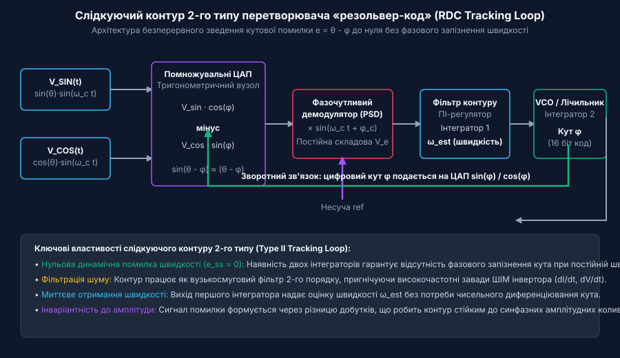
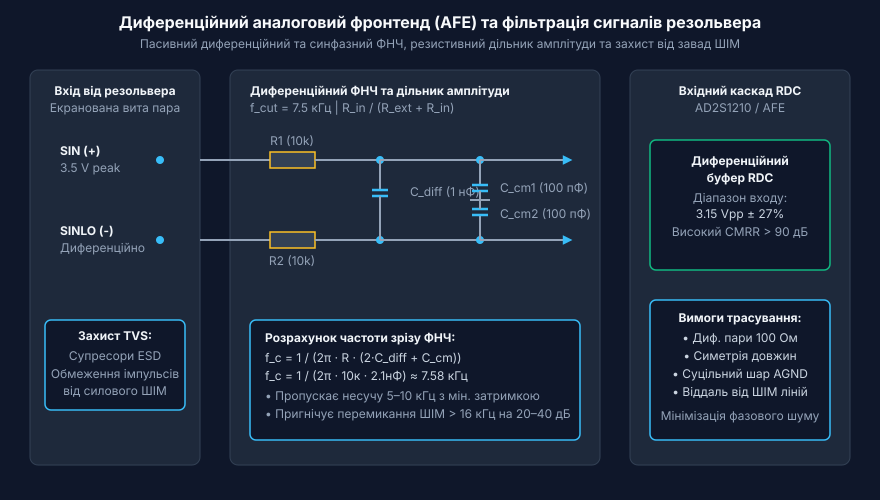
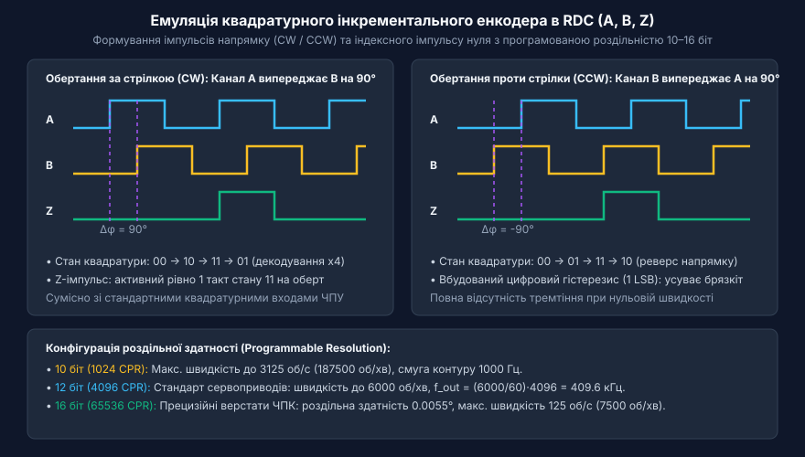
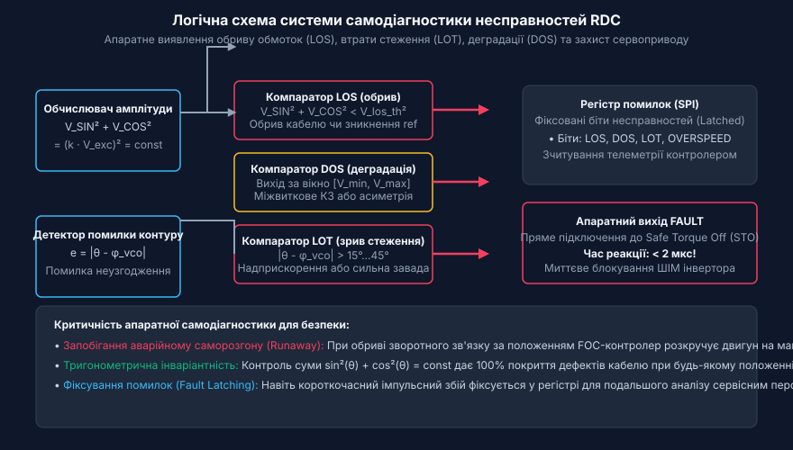
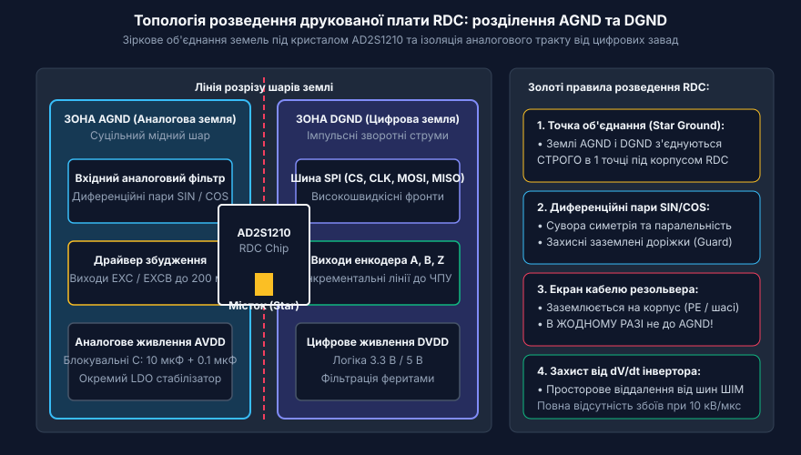

# Перетворювачі «резольвер-код» (RDC)

<preknowlist>
- [Сельсини та резольвери: обертові трансформаторні кутоміри](root:cat-hw-sensors/synchro-and-resolver-transducers) — фізичний принцип формування амплітудно-модульованих сигналів синуса й косинуса обмоточними трансформаторами.
- [Синхронне детектування та фазочутлива демодуляція давачів положення](root:cat-hw-sensors/synchronous-demodulation-for-inductive-transducers) — базові принципи виділення обвідної гармонічного сигналу за допомогою фазочутливого випрямлення.
- [Енкодери кутового та лінійного переміщення](root:cat-hw-sensors/optical-and-magnetic-encoders) — принципи квадратурного кодування та призначення вихідних імпульсних сигналів A, B і Z.
</preknowlist>

## Навіщо потрібні RDC у промислових сервоприводах

У важкому машинобудуванні, гірничодобувній техніці, залізничному електротранспорті, тягових інверторах електромобілів та авіаційних приводах керування польотом вимірювання кутового положення вала двигуна відбувається в екстремальних умовах. Традиційні оптичні та магнітні енкодери часто виходять з ладу:
- Скляні кодувальні диски оптичних енкодерів тріскаються від ударних перевантажень у 50–100 g;
- Світлодіоди та оптоелектронні матриці деградують при робочих температурах понад +85 °C;
- Масляний туман, конденсат або промисловий пил перекривають оптичні щілини, викликаючи пропуск імпульсів;
- Напівпровідникові датчики Холла чи магніторезистивні сенсори страждають від температурного дрейфу нуля та електромагнітних наводок статора.

Для вирішення цих проблем у критичних вузлах використовують електромагнітні [резольвери](root:cat-hw-sensors/synchro-and-resolver-transducers). Резольвер — це пасивний обертовий трансформатор без жодних електронних компонентів усередині. Він витримує температури понад +150...+200 °C, радіацію, занурення в масло та колосальні вібрації.

Первинна обмотка ротора резольвера живиться гармонійною напругою збудження несучої частоти (2–20 кГц):

```
V_ref(t) = V_0 · sin(ω_c t)
```

Дві ортогональні вторинні обмотки статора видають амплітудно-модульовані сигнали, пропорційні синусу та косинусу кута повороту `θ`:

```
V_SIN(t) = k · V_0 · sin(θ) · sin(ω_c t + φ)
V_COS(t) = k · V_0 · cos(θ) · sin(ω_c t + φ)
```

де `k` — коефіцієнт трансформації (зазвичай 0.28–0.5), а `φ` — фазовий зсув обмоток.

Спроба оцифрувати ці напруги звичайним АЦП мікроконтролера та обчислити кут через функцію арктангенса `atan2(V_SIN, V_COS)` призводить до низької завадостійкості: імпульсні перемикання силових транзисторів інвертора (dI/dt, dV/dt) спотворюють миттєві вибірки, спричиняючи значне фазове запізнення та тремтіння (jitter) кута. Для надійного перетворення цих сигналів у високоточний цифровий код застосовують спеціалізовані перетворювачі «резольвер-код» (Resolver-to-Digital Converters, RDC).

## Принцип дії замкненого слідкуючого контуру 2-го типу

Сучасні мікросхеми RDC (такі як AD2S1210 або PGA411-Q1) будуються за архітектурою замкненого слідкуючого контуру 2-го типу (Type II Tracking Loop). На відміну від відкритих систем дискретизації, слідкуючий контур безперервно підтримує внутрішній цифровий код оцінки кута `ϕ` і динамічно зводить тригонометричну помилку `(θ - ϕ)` до нуля.


*Блок-схема замкненого слідкуючого контуру 2-го типу RDC з тригонометричним мультиплікатором, фазочутливим демодулятором та генератором VCO.*

Алгоритм слідкування складається з наступних кроків:

1. **Тригонометричне перехресне множення**:
   Вхідні аналогові сигнали множаться на цифрово-аналогових перетворювачах на тригонометричні коефіцієнти поточної оцінки кута `cos(ϕ)` та `sin(ϕ)`:
   ```
   e(t) = V_SIN(t) · cos(ϕ) - V_COS(t) · sin(ϕ)
        = V_m · sin(ω_c t) · [sin(θ) cos(ϕ) - cos(θ) sin(ϕ)]
        = V_m · sin(θ - ϕ) · sin(ω_c t)
   ```
   Для малих кутових розбіжностей `sin(θ - ϕ) ≈ (θ - ϕ)`.

2. **Фазочутлива демодуляція (PSD)**:
   Сигнал помилки множиться на синфазну опорну несучу `sin(ω_c t)`. Високочастотна складова подвоєної частоти `2 ω_c` зрізається фільтром, залишаючи постійну напругу, пропорційну помилці кута:
   ```
   v_error = K_d · (θ - ϕ)
   ```

3. **Два послідовні інтегратори**:
   - Перший інтегратор (ПІ-регулятор контуру) формує сигнал, пропорційний розрахованій кутовій швидкості `ω_est = dϕ/dt`.
   - Другий інтегратор (керований генератор VCO та реверсивний лічильник) інтегрує швидкість, постійно оновлюючи цифровий регістр кута `ϕ`.

Головна перевага контуру 2-го типу полягає в тому, що при постійній швидкості обертання вала стала кутова помилка контуру дорівнює строго нулю (`e_ss = 0`). Це гарантує повну відсутність динамічного запізнення положення ротора в контурі векторного керування (FOC).

## Аналоговий фронтенд та компенсація фазового зсуву

Вхідні сигнали резольвера проходять через аналоговий фронтенд (AFE), який захищає чутливі каскади перетворювача від комутаційних перешкод інвертора та узгоджує електричні рівні.


*Принципова схема вхідного диференційного фільтра AFE та резистивного атенюатора для мікросхеми RDC.*

Аналоговий фронтенд виконує три критичні завдання:

1. **Диференційна та синфазна фільтрація завад**:
   Пасивний RC-фільтр другого порядку (R1, R2, C_diff та C_cm) має частоту зрізу близько 7.5–10 кГц:
   ```
   f_c = 1 / (2 · π · R · (2 · C_diff + C_cm))
   ```
   Він пропускає корисну несучу частоту збудження з мінімальним зсувом фази, але ефективно пригнічує високочастотний синфазний шум ШІМ силового інвертора (> 16 кГц).

2. **Масштабування амплітуди**:
   Вхідний каскад RDC розрахований на фіксований розмах диференційного сигналу (наприклад, 3.15 Vpp у мікросхемі AD2S1210). Оскільки резольвер має коефіцієнт трансформації `k = 0.28...0.5`, вхідні сигнали ослаблюються прецизійним резистивним дільником:
   ```
   V_in = V_exc · k · [R_in / (R_ext + R_in)]
   ```

3. **Компенсація фазового зсуву обмоток**:
   Індуктивність і активний опір мідного дроту створюють відставання фази вторинних сигналів `φ` на 5°–40°. Оскільки постійна напруга після демодулятора пропорційна `cos(Δφ)`, розфазування на 30° зменшує підсилення контуру на 13.4%, а при 90° сигнал зникає. Сучасні RDC компенсують цей зсув за допомогою внутрішнього фазового контуру автопідлаштування (PLL), який автоматично синхронізує опорний сигнал демодулятора з переходами вторинних синусів через нуль.

## Цифрові інтерфейси виведення: емуляція енкодера (A, B, Z) та SPI

Для передачі обчисленого кутового положення та швидкості в систему керування сервоприводом RDC пропонує кілька паралельних інтерфейсів:

1. **Емуляція квадратурного енкодера (Incremental Encoder Emulation)**:
   Мікросхема апаратно генерує квадратурні імпульси A, B та нульову мітку Z, що робить її повністю сумісною зі стандартними контролерами ЧПУ та сервопідсилювачами.


*Часові діаграми вихідних сигналів A, B та Z в режимах обертання за та проти годинникової стрілки.*

При русі за годинниковою стрілкою (CW) сигнал A випереджає B на 90°, при русі проти годинникової стрілки (CCW) — навпаки. Роздільна здатність є програмно керованою (10, 12, 14 або 16 біт, що відповідає від 1024 до 65536 імпульсам на оберт). Вбудований цифровий гістерезис (1 LSB) повністю усуває дрижання сигналів при нульовій швидкості.

2. **Послідовний інтерфейс SPI**:
   Забезпечує пряме зчитування абсолютного 16-бітного кута положення та 16-бітної швидкості за мінімальної кількості провідників (CS, SCLK, SDI, SDO). Через SPI також конфігурується частота збудження та зчитується розширений регістр несправностей.

3. **Паралельна шина даних (Parallel Bus)**:
   Надає паралельний доступ до 16-бітного двійкового коду за один такт стробу `SAMPLE` / `RD`, забезпечуючи мінімальну латентність для високодинамічних приводів.

## Апаратна самодіагностика та правила розведення друкованої плати

Головною перевагою RDC порівняно з оптичними датчиками є безперервний апаратний контроль цілісності вимірювального тракту в реальному часі.

В основі діагностики лежить тригонометрична тотожність:

```
V_SIN² + V_COS² = (k · V_exc)² · (sin²(θ) + cos²(θ)) = (k · V_exc)² = const
```

Для справного резольвера сума квадратів амплітуд є строго постійною величиною за будь-якого кута повороту вала.


*Логіка апаратної самодіагностики: формування аварійних прапорів LOS, DOS та LOT за тригонометричним критерієм.*

Система виявляє три типи дефектів:
- **LOS (Loss of Signal)**: Обчислене значення `V_SIN² + V_COS²` падає нижче порогу `V_los_th`. Це свідчить про фізичний обрив кабелю або розрив обмоток.
- **DOS (Degradation of Signal)**: Амплітуда виходить за встановлені межі вікна `[V_dos_low, V_dos_high]` через міжвиткове замикання, асиметрію чи перегрів.
- **LOT (Loss of Tracking)**: Помилка стеження перевищує допустимий поріг (наприклад, 15°–45°) при надлишковому прискоренні ротора.

Аварійний сигнал `FAULT` змінює стан за `< 2 мкс` і підключається безпосередньо до входу захисного вимкнення інвертора (Safe Torque Off, STO), запобігаючи неконтрольованому розгону двигуна (runaway).


*Правила проектування друкованої плати RDC: розділення зон AGND та DGND зі зірковим заземленням під корпусом мікросхеми.*

Для забезпечення електромагнітної сумісності (EMC) на платі сервоприводу дотримуються трьох правил:
1. **Розділення земель**: Аналогова земля (AGND) та цифрова земля (DGND) розводяться окремими полігонами і з'єднуються строго в одній точці під корпусом RDC (Star Ground).
2. **Трасування диференційних пар**: Лінії `SIN`/`SINLO` та `COS`/`COSLO` ведуться симетричними парами однакової довжини з хвильовим опором 100 Ом.
3. **Екранування**: Зовнішній екран кабелю резольвера підключається до корпусу пристрою (PE), і в жодному разі не до сигнальної землі AGND на платі.

Нижче наведено приклад зчитування телеметрії кута та регістра помилок з мікросхеми AD2S1210 через інтерфейс SPI на мові C:

```c
#include <stdint.h>
#include <stdbool.h>

#define RDC_CMD_POSITION   0x80
#define RDC_CMD_VELOCITY   0x82
#define RDC_CMD_FAULT      0xFF

#define FAULT_LOT_BIT      (1 << 1)
#define FAULT_DOS_BIT      (1 << 2)
#define FAULT_LOS_BIT      (1 << 3)

typedef struct {
    uint16_t raw_position;
    int16_t raw_velocity;
    float angle_degrees;
    bool loss_of_signal;
    bool loss_of_tracking;
    bool degradation_of_signal;
} RdcTelemetry;

// Прототип апаратної передачі байта через SPI
extern uint8_t spi_transfer(uint8_t byte);
extern void rdc_chip_select(bool active);
extern void rdc_sample_pulse(void);

// Зчитування абсолютного кута та діагностики RDC
int rdc_read_telemetry(RdcTelemetry *telemetry) {
    // 1. Строб SAMPLE для фіксації поточного кута у вихідному регістрі
    rdc_sample_pulse();

    rdc_chip_select(true);

    // 2. Зчитування 16-бітного значення кута
    uint8_t msb = spi_transfer(RDC_CMD_POSITION);
    uint8_t lsb = spi_transfer(0x00);
    telemetry->raw_position = ((uint16_t)msb << 8) | lsb;
    telemetry->angle_degrees = (telemetry->raw_position / 65536.0f) * 360.0f;

    // 3. Зчитування 16-бітної кутової швидкості
    msb = spi_transfer(RDC_CMD_VELOCITY);
    lsb = spi_transfer(0x00);
    telemetry->raw_velocity = (int16_t)(((uint16_t)msb << 8) | lsb);

    // 4. Зчитування регістра несправностей
    uint8_t fault_reg = spi_transfer(RDC_CMD_FAULT);
    telemetry->loss_of_tracking = (fault_reg & FAULT_LOT_BIT) != 0;
    telemetry->degradation_of_signal = (fault_reg & FAULT_DOS_BIT) != 0;
    telemetry->loss_of_signal = (fault_reg & FAULT_LOS_BIT) != 0;

    rdc_chip_select(false);

    // Повертаємо -1 якщо виявлено апаратну несправність
    if (telemetry->loss_of_signal || telemetry->loss_of_tracking) {
        return -1;
    }
    return 0;
}
```

Використання монокристалічних RDC у поєднанні з електромагнітними резольверами забезпечує найвищий рівень надійності зворотного зв'язку за положенням ротора в сучасних тягових та промислових електроприводах.
