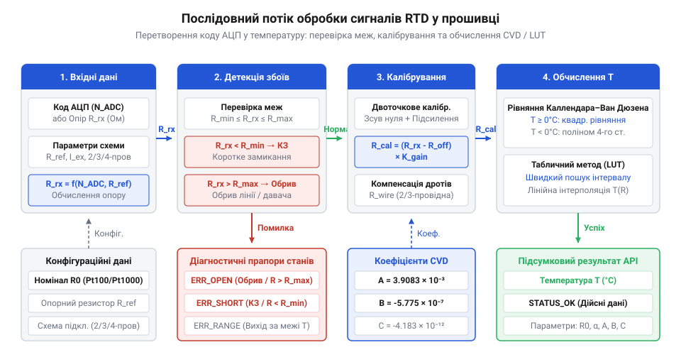
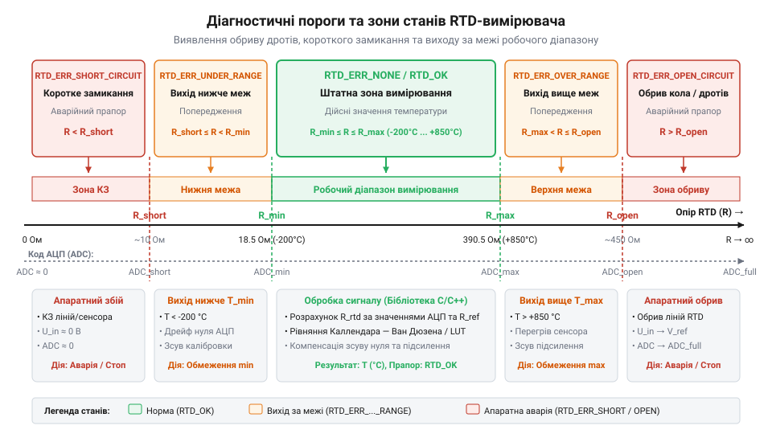

# Програмний інтерфейс бібліотеки обробки сигналів RTD: лінеаризація, калібрування та діагностика

<preknowlist>
- [PT100 — платиновий термоопір](root:cat-hw-sensors/pt100-rtd) — базову залежність опору платини від температури, схемотехніку 2/3/4-провідного підключення та поняття еталонного опору R0.
- [Стандарт IEC 60751 для платинових термоопорів](root:cat-hw-sensors/iec-60751-standard-for-rtd) — коефіцієнти Каллендара — Ван Дюзена (A, B, C), класи точності RTD та допустимі відхилення опору.
- [MAX31865 — перетворювач опору платинових датчиків PT100/PT1000](root:cat-hw-sensors/max31865-rtd-converter) — принцип вимірювання відношення опорів RTD та Rref у спеціалізованих АЦП для RTD.
</preknowlist>

## Похибки та ризики прямого вимірювання

У розробці систем термометрії поширена помилка — припущення, що опір @@en|RTD@@-датчика змінюється строго лінійно з температурою, а аналогово-цифровий перетворювач (від @@la|convertio@@ — перетворення, @@en|ADC@@) видає ідеальний цифровий код, прямо пропорційний реальному опору. У реальних умовах пряме перетворення цифрового коду в градуси Цельсія через простий лінійний коефіцієнт призводить до зростання похибки вимірювання до кількох градусів при віддаленні від точної точки 0 °C.

Основним джерелом фізичної нелінійності є властивості самого платинового матеріалу. Зі зростанням температури хаотичний тепловий рух іонів у металевій ґратці створює додатковий опір дрейфу вільних електронів, тому приріст опору на кожен градус поступово зменшується. Для [платинового термоопору PT100](root:cat-hw-sensors/pt100-rtd) номінальний опір становить 100.0 Ом при 0 °C, але залежність опору від температури описується кривою, нормованою у [стандарті IEC 60751](root:cat-hw-sensors/iec-60751-standard-for-rtd). Спроба знехтувати цією кривизною викликає системне відхилення, яке неприпустиме в точних технологічних процесах.

Друга група похибок виникає в самому аналоговому вимірювальному тракті. Відхилення опору еталонного резистора R_ref від номіналу, напруга зсуву нуля операційного підсилювача та температурний дрейф коефіцієнта підсилення @@en|ADC@@ створюють систематичний зсув (від @@en|zero offset@@) та масштабну похибку (від @@en|span error@@). Крім того, опір з'єднувальних дротів у двопровідних та трипровідних схемах додає паразитальний опір до виміряного значення.

Третій ризик полягає в апаратних аваріях ліній вимірювання. Механічний обрив дротів давача викликає нескінченний опір (від @@en|open circuit@@), а випадкове коротке замикання кабелю знижує опір майже до нуля (від @@en|short circuit@@). Якщо програмне забезпечення розраховує температуру без перевірки граничних значень, від'ємні або нескінченно великі значення опору викликають арифметичне переповнення, ділення на нуль або непідтримувані обчислення у плаваючій точці (від @@en|NaN@@ / @@en|Infinity@@). Це призводить до хибних рішень у виконавчих алгоритмах терморегулювання.

Для запобігання цим ризикам потрібен детермінований програмний конвеєр обробки сигналів. Він має послідовно виконувати валідацію вхідних даних, двоточкове калібрування тракту, математичну лінеаризацію та генерувати бітові прапори діагностичних помилок.

## Ініціалізація та конфігурація конвеєра обробки

Щоб програмний конвеєр працював детерміновано та не потребував повторного виділення динамічної пам'яті під час виконання, усі параметри датчика та вимірювальної схеми збираються в окрему структуру конфігурації @@en|rtd_config_t@@, а поточний стан зберігається у структурі контексту @@en|rtd_ctx_t@@.

Конфігураційна структура описує паспортизовані характеристики термоперетворювача опору та параметри обв'язки. У ній задаються номінальний опір R_0 (наприклад, 100.0 Ом для PT100 або 1000.0 Ом для PT1000), температурний коефіцієнт α (alpha, за стандартом 0.003851 °C⁻¹), коефіцієнти рівняння Каллендара — Ван Дюзена A, B, C, значення еталонного опору R_ref вимірювальної схеми, а також фізичні межі опору R_min та R_max для діагностики. Якщо обробка виконується через спеціалізований [перетворювач опору MAX31865](root:cat-hw-sensors/max31865-rtd-converter), у конфігурацію також заноситься розрядність АЦП для автоматичного перерахунку цифрового коду в опір.


*Послідовний потік даних від виміряного опору або коду АЦП через блоки перевірки меж, двоточкового калібрування та обчислення за рівнянням CVD або LUT до підсумкового значення температури з прапорами стану.*

Функція ініціалізації `rtd_init()` приймає вказівник на контекст та структуру конфігурації. Вона перевіряє коректність вхідних параметрів (відсутність нульових значень R_0 та R_ref, валідність коефіцієнтів), розраховує допоміжні константи та встановлює початкові калібрувальні коефіцієнти зсуву та підсилення за замовчуванням (zero_offset = 0.0, span_gain = 1.0).

Нижче наведено програмну реалізацію структур даних та функції ініціалізації для мов C та C++:

:::tabs
@tab C
:::code api-rtd-software-processing-library/c/rtd-init.c
@tab C++
:::code api-rtd-software-processing-library/cpp/rtdcalcmode.cpp
:::

## Математична лінеаризація опору в температуру

Після отримання відкаліброваного значення опору R_cal постає завдання точного перетворення опору в температуру T. Основний стандартний метод описується рівнянням Каллендара — Ван Дюзена (від @@en|Callendar–Van Dusen equation@@, @@en|CVD@@).

Для додатних температур (T ≥ 0 °C) залежність опору платини від температури описується квадратичним рівнянням:

```
R(T) = R_0 × (1 + A × T + B × T²)
```

Для обчислення температури T за відомим виміряним опором R_T квадратне рівняння розв'язується відносно T:

```
B × T² + A × T + (1 - R_T / R_0) = 0
```

Використовуючи формулу коренів квадратного рівняння, отримуємо прямий вираз для обчислення температури T:

```
T = (-A + sqrt(A² - 4 × B × (1 - R_T / R_0))) / (2 × B)
```
величина температури T обчислюється через коефіцієнти A та B, номінальний опір R_0 та поточний опір R_T
квадратний корінь обчислюється від дискримінанта, який завжди додатний для валідного діапазону опорів
знаменник (2 × B) має від'ємне значення, оскільки коефіцієнт B для платини є від'ємним (B ≈ -5.775 × 10⁻⁷ °C⁻²)

Для від'ємних температур (T < 0 °C) у рівняння додається член четвертого степеня з коефіцієнтом C:

```
R(T) = R_0 × (1 + A × T + B × T² + C × (T - 100) × T³)
```

Оскільки аналітичне розв'язання рівняння четвертого степеня ускладнене, для від'ємних температур застосовують метод ітерацій Ньютона — Рафсона (від @@en|Newton–Raphson method@@) або поліноміальну апроксимацію.

На мікроконтролерах без блоку обчислень із плаваючою крапкою (від @@en|FPU@@) обчислення квадратного кореня виконується повільно. У таких системах використовують таблицю пошуку (від @@en|Lookup Table@@, @@en|LUT@@) із кусочно-лінійною інтерполяцією (від @@en|piecewise linear interpolation@@). Таблиця містить пари значень (R_i, T_i) зкроковані через рівні інтервали.

Для виміряного опору R_T знаходиться відповідний інтервал [R_i, R_{i+1}], і температура розраховується за формулою:

```
T = T_i + (R_T - R_i) × (T_{i+1} - T_i) / (R_{i+1} - R_i)
```

Нижче наведено реалізацію функції обчислення температури `rtd_calc_temperature()`:

:::tabs
@tab C
:::code api-rtd-software-processing-library/c/calc-cvd-pos.c
@tab C++
:::code api-rtd-software-processing-library/cpp/rtdcalculator.cpp
:::

## Калібрування зсуву нуля та підсилення

Навіть при використанні точного математичного рівняння виміряні значення опору можуть мати систематичну похибку через допуски опорних резисторів R_ref, опір друкованих доріжок та зсув аналогових підсилювачів. Для усунення цих похибок бібліотека надає механізм програмного двоточкового калібрування (від @@en|two-point calibration@@).

Математична модель калібрування описує зв'язок між виміряним опором R_meas та реальним відкаліброваним опором R_cal:

```
R_cal = (R_meas - R_zero_offset) × span_gain
```

Процедура калібрування здійснюється у два етапи з використанням двох точних прецизійних еталонних опорів R_ref1 та R_ref2:

1. **Калібрування зсуву нуля (Zero Calibration):** До входу підключається перший еталонний опір R_ref1 (наприклад, прецизійний резистор 100.0 Ом, що відповідає 0 °C). Виміряне значення R_meas1 фіксується. 2. **Калібрування підсилення (Span Calibration):** До входу підключається другий еталонний опір R_ref2 (наприклад, 138.51 Ом, що відповідає 100 °C). Виміряне значення R_meas2 фіксується.

Розрахунок нових коефіцієнтів виконується за формулами:

```
span_gain = (R_ref2 - R_ref1) / (R_meas2 - R_meas1)
```

```
R_zero_offset = R_meas1 - (R_ref1 / span_gain)
```

Нижче наведено реалізацію функцій калібрування у бібліотеці:

:::tabs
@tab C
:::code api-rtd-software-processing-library/c/rtd-calibrate-zero.c
@tab C++
:::code api-rtd-software-processing-library/cpp/rtdcalibrator.cpp
:::

## Апаратна діагностика та обробка помилок

Перевірка цілісності вимірювального тракту має виконуватися перед кожним розрахунком температури. Спроба обчислити квадратний корінь або виконати інтерполяцію за невалідними даними опору викликає критичні помилки виконання.

Апаратна діагностика аналізує виміряний опір R_meas на відповідність трьом критеріям:

1. **Обрив ліній (Open Circuit):** Якщо виміряний опір перевищує верхній діагностичний поріг R_meas > R_max (або поріг обриву, наприклад, R > 400 Ом для PT100), фіксується помилка `RTD_ERR_OPEN_CIRCUIT`. 2. **Коротке замикання (Short Circuit):** Якщо виміряний опір нижчий за нижній діагностичний поріг R_meas < R_min (наприклад, R < 10 Ом), фіксується помилка `RTD_ERR_SHORT_CIRCUIT`. 3. **Вихід за межі робочого діапазону (Out of Range):** Якщо опір знаходиться між аварійними межами, але розрахована температура перевищує специфіковані межі датчика (наприклад, T < -200 °C або T > +850 °C), фіксується прапор `RTD_ERR_OUT_OF_RANGE`.


*Схема ілюструє діапазони опору RTD із позначенням точок спрацьовування прапорів обриву дротів (RTD_ERR_OPEN_CIRCUIT), короткого замикання (RTD_ERR_SHORT_CIRCUIT) та виходу за робочі межі.*

Коди помилок повертаються у вигляді бітової маски типу `rtd_status_t`. Це дозволяє одночасно виявляти кілька комбінованих аномалій та приймати безпечні рішення в системі керування (наприклад, вимикати нагрівач та переводити прошивку у захищений режим).

Нижче наведено функцію діагностичної перевірки:

:::tabs
@tab C
:::code api-rtd-software-processing-library/c/rtd-diagnose.c
@tab C++
```cpp
class RtdDiagnostics {
public:
    static uint8_t evaluateStatus(float r_meas, float r_min, float r_max) {
        uint8_t status = static_cast<uint8_t>(RtdStatus::Ok);
        if (r_meas >= r_max) {
            status |= static_cast<uint8_t>(RtdStatus::OpenCircuit);
        }
        if (r_meas <= r_min) {
            status |= static_cast<uint8_t>(RtdStatus::ShortCircuit);
        }
        return status;
    }
};
```
:::

## Інтеграція бібліотеки в циклічні задачі

Для надійної роботи в прошивці мікроконтролера (від @@en|firmware@@) бібліотека обробки сигналів RTD інтегрується у періодичний цикл опитування (від @@en|polling loop@@) або окрему задачу операційної системи реального часу (від @@en|RTOS task@@, наприклад @@en|FreeRTOS@@).

Детермінованість конвеєра гарантується тим, що час виконання кожного виклику `rtd_process_sample()` є постійним і не залежить від значення виміряного опору. Функція виконує повний цикл обробки:
1. Зчитування сирого коду АЦП або значення опору з апаратного драйвера (наприклад, драйвера SPI для [перетворювача опору MAX31865](root:cat-hw-sensors/max31865-rtd-converter)). 2. Діагностична перевірка сирого значення на обрив та коротке замикання. 3. Програмна компенсація зсуву нуля та підсилення. 4. Лінеаризація за рівнянням CVD або LUT. 5. Повернення підсумкового статусу та розрахованого значення температури.

Нижче наведено приклад інтеграції конвеєра обробки у циклічну задачу прошивки:

:::tabs
@tab C
:::code api-rtd-software-processing-library/c/rtd-process-sample.c
@tab C++
:::code api-rtd-software-processing-library/cpp/rtdtaskprocessor.cpp
:::