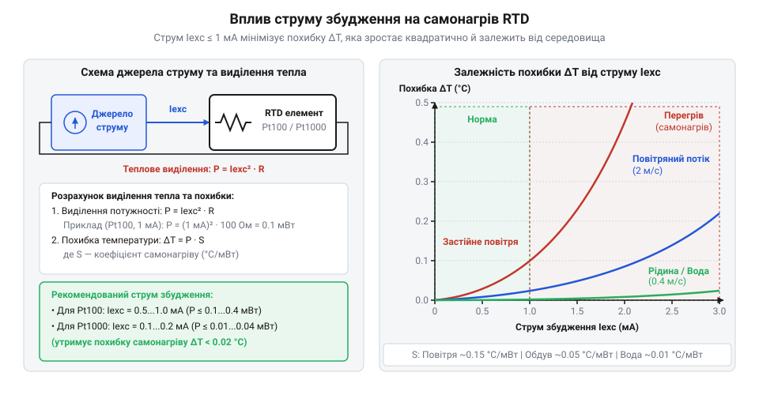
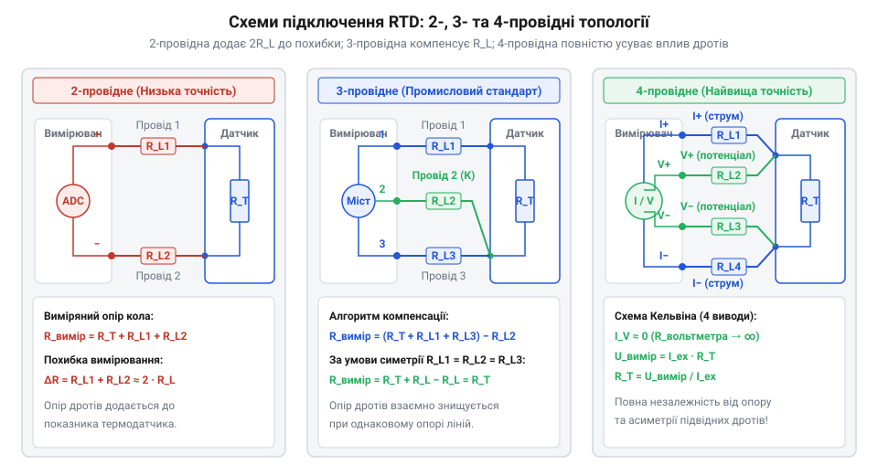
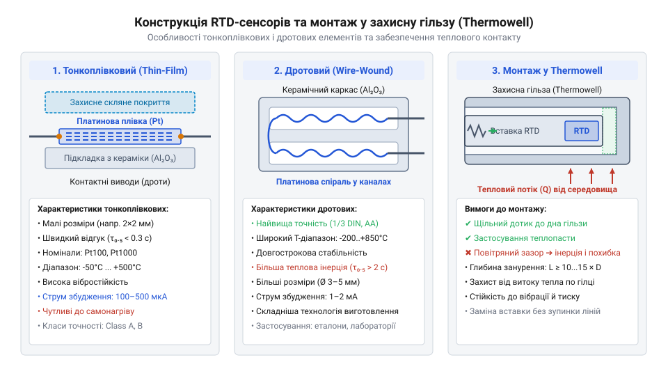
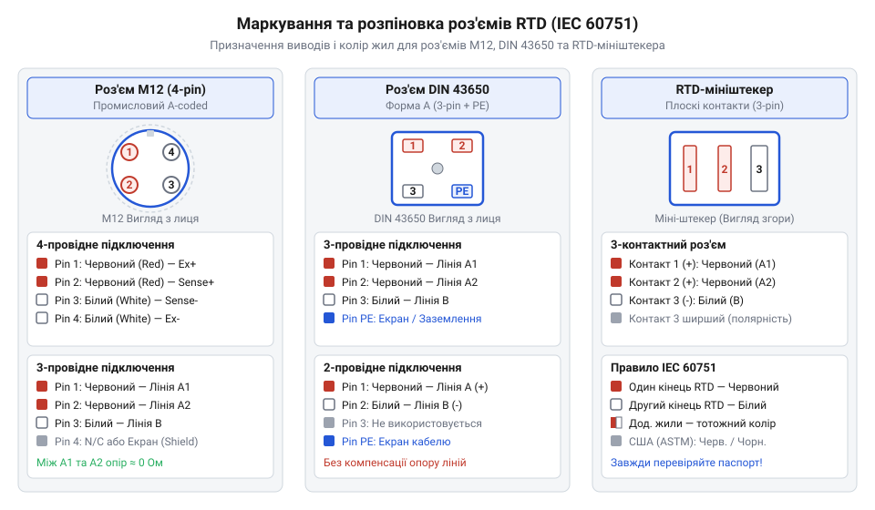
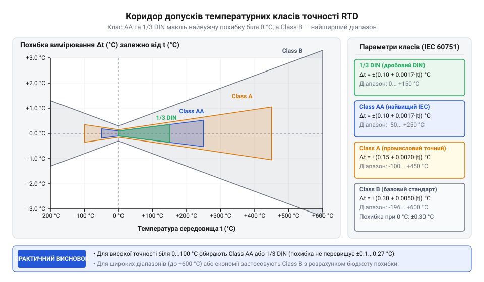
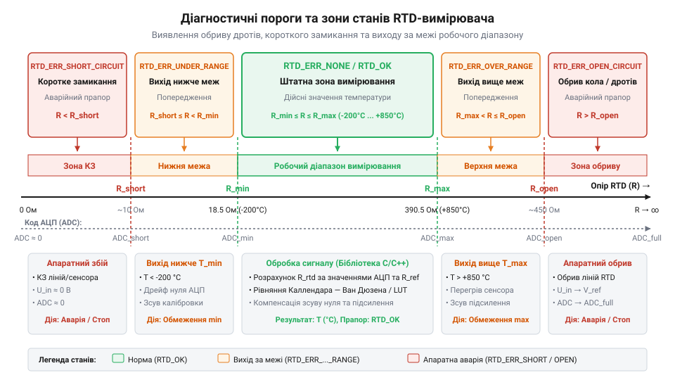

# Схеми підключення, монтажні роз'єми, класи точності та апаратний інтерфейс датчиків RTD

<preknowlist>
- [PT100 — платиновий термоопір](root:cat-hw-sensors/pt100-rtd) — Базовий принцип зміни опору платини від температури та номінальне значення опору 100 Ом при 0 °C.
- [MAX31865 — перетворювач опору платинових датчиків PT100/PT1000](root:cat-hw-sensors/max31865-rtd-converter) — Архітектуру підключення вимірювальних АЦП та роль опорного резистора.
- [Стандарт IEC 60751 для платинових термоопорів](root:cat-hw-sensors/iec-60751-standard-for-rtd) — Температурні коефіцієнти та загальні класи допусків для RTD-елементів.
</preknowlist>

## Вплив опору дротів на вимірювання

Підключення вимірювального давача температури на реальному промисловому об'єкті майже завжди вимагає прокладання лінії зв'язку від зони вимірювання до шафи автоматики чи контролера. Коли вимірювальну голівку розміщено всередині технологічної ємності, трубопроводу або кліматичної камери, а контрольний модуль перебуває на відстані 20–50 метрів, між сенсором та вимірювальним приладом з'являється довгий з'єднувальний кабель. Для багатьох типів первинних перетворювачів опір з'єднувальних дротів не створює суттєвих проблем, однак для резистивних датчиків температури @@en|RTD@@ (від англ. *Resistance Temperature Detector* — резистивний детектор температури / термоопір) паразитне падіння напруги на кабельних жилах стає головним джерелом систематичної похибки.

Принцип роботи @@en|RTD@@-сенсора полягає у зміні його електричного опору під впливом температури. Найпоширенішим вимірювальним елементом є [платиновий термоопір Pt100](root:cat-hw-sensors/pt100-rtd). Відповідно до специфікацій, які визначає [стандарт IEC 60751](root:cat-hw-sensors/iec-60751-standard-for-rtd), номінальний опір `Pt100` за температури `0 °C` становить чітко `100 Ом`. Усереднений температурний коефіцієнт опору @@en|TCR@@ (від англ. *Temperature Coefficient of Resistance* — температурний коефіцієнт опору) для чистої платини становить `α ≈ 0.003851 / °C`. Це означає, що при зміні температури на `1 °C` опір платинової спіралі або тонкої плівки змінюється лише на `0.3855 Ом`.

Коли давач підключають за найпростішою дводротовою схемою, вимірювальний прилад вимірює загальний опір кола, до якого входить опір самого чутливого елемента `R_RTD` та опір двох провідників лінії `R_L`. Звичайний мідний монтажний кабель із перерізом жили `0.2 мм²` має опір близько `0.085 Ом/м`. Якщо довжина траси становить `25 м`, то сумарна довжина двох дротів у петлі вимірювання досягає `50 м`, а їхній паразитний опір `2 · R_L` складає `4.25 Ом`.

Температурний зсув `ΔT` розраховують шляхом ділення сумарного паразитного опору з'єднувальної лінії `2 · R_L` на температурний коефіцієнт чутливості платини `α`.

```
ΔT = (2 · R_L) ÷ α
= 4.25 ÷ 0.3855          [ділення опору ліній на температурний коефіцієнт Pt100]
≈ 11.02 °C               [систематичний температурний зсув]
```

Отриманий вираз показує, що навіть коли чутливий елемент перебуває за танення льоду при `0 °C`, вимірювальний модуль зафіксує опір `104.25 Ом` і відобразить температуру `+11.02 °C`. Такий високий зсув робить двопровідні вимірювання з датчиками `Pt100` непридатними для точних застосувань.

Ситуація ускладнюється тим, що опір мідних дротів `R_L` не є постійною величиною. Мідь має власний високий температурний коефіцієнт опору `α_Cu ≈ 0.00393 / °C`. Якщо кабельну трасу прокладено через приміщення, де сезонна або добова температура повітря коливається на `20 °C`, опір дротів зміниться на `ΔR_L = 4.25 Ом · 0.00393 / °C · 20 °C ≈ 0.334 Ом`. Це викликає додатковий непередбачуваний дрейф вимірювань на `ΔT_drift = 0.334 ÷ 0.3851 ≈ 0.87 °C`, який неможливо усунути одноразовим програмним зсувом нуля (англ. *Zero Offset*).

Застосування сенсорів із вищим номінальним опором, таких як `@@en|Pt1000@@` (`1000 Ом` при `0 °C`, чутливість `α ≈ 3.855 Ом/°C`), суттєво зменшує відносний вплив дротів. Для тієї ж траси з опором `4.25 Ом` похибка для `Pt1000` становитиме `ΔT = 4.25 ÷ 3.855 ≈ 1.10 °C`. Хоча це вдесятеро менше, ніж для `Pt100`, у прецизійних вимірювальних системах похибка в `1.10 °C` все одно залишається неприпустимо великою, що обумовлює необхідність застосування спеціальних схем компенсації опору дротів.

## Матеріали та принципи збудження RTD

Вибір матеріалу чутливого елемента вимірювального перетворювача визначає його робочий температурний діапазон, лінійність та довгострокову стабільність. Платина є світовим еталоном для термоопорів `@@en|Pt100@@` та `@@en|Pt1000@@`. Вона вирізняється високою хімічною інертністю, високою точкою плавлення та стабільним температурним коефіцієнтом у діапазоні від `-200 °C` до `+850 °C`. Точний математичний зв'язок між опором і температурою платини описує [формула Каллендара-Ван Дюзена](root:hw-sensing/rtd-callendar-van-dusen-equation).

Окрім платини, у промисловості застосовують інші метали. Нікелеві термоопори `@@en|Ni120@@` (`120 Ом` при `0 °C`) володіють вищою чутливістю (`α ≈ 0.00672 / °C`), що полегшує реєстрацію малих температурних змін, проте їхній робочий діапазон обмежений від `-60 °C` до `+250 °C` через виражену нелінійність при нагріванні. Мідні сенсори `@@en|Cu50@@` (`50 Ом` при `0 °C`) мають практично ідеально лінійну характеристику (`α ≈ 0.00428 / °C`) і низьку вартість, але окислення міді обмежує їхнє використання діапазоном від `-50 °C` до `+150 °C`. На відміну від таких напівпровідникових елементів, як [аналоговий давач KY-013](root:cat-hw-sensors/ky-013-thermistor), метали володіють значно вищою часовою стабільністю та відтворюваністю параметрів.

Оскільки @@en|RTD@@ є пасивним елементом, для вимірювання його опору через нього необхідно пропускати струм збудження `I_ex` або прикладати стабілізовану напругу. Використання генератора стабільного струму є переважним апаратним рішенням, оскільки воно робить струм через сенсор незалежним від падіння напруги на живлючих лініях. Проте проходження струму через резистивний елемент неминуче призводить до виділення електричної потужності `P = I_ex² · R_RTD`, яка перетворюється на теплову енергію. Це явище називають ефектом самонагріву (англ. *Self-Heating Effect*, @@en|self-heating effect@@).

Теплова потужність нагріває чутливий елемент вище температури вимірюваного середовища. Рівноважний температурний перегрів `ΔT_self` визначається відношенням виділеної потужності `P` до коефіцієнта розсіювання тепла @@en|dissipation constant@@ `P_d` (вимірюється в `мВт/°C`), який описує здатність конструкції сенсора віддавати тепло в оточення.

```
P = I_ex² · R_RTD          [обчислення виділюваної електричної потужності]
ΔT_self = P ÷ P_d          [залежність перегріву від коефіцієнта розсіювання]
= (I_ex² · R_RTD) ÷ P_d    [підстановка електричної потужності в формулу перегріву]
```

Коефіцієнт розсіювання `P_d` критично залежить від теплопровідності та швидкості руху навколишнього середовища. У нерухомому повітрі для малогабаритного тонкоплівкового датчика `P_d` становить лише `1–2 мВт/°C`, тоді як у проточній воді чи маслі цей показник зростає до `20–50 мВт/°C`.

Якщо для сенсора `Pt1000` (`R = 1000 Ом` при `0 °C`) обрати струм збудження `I_ex = 1 мА`, виділювана потужність становитиме `P = (0.001 А)² · 1000 Ом = 1 мВт`. У нерухомому повітрі при `P_d = 2 мВт/°C` це створить систематичний перегрів `ΔT_self = 1 мВт ÷ 2 мВт/°C = 0.5 °C`. Ця похибка повністю спотворить реальні показники температури навколишнього середовища.


*Залежність похибки самонагріву термоопору від струму збудження та теплопровідності навколишнього середовища.*

Для мінімізації похибки самонагріву струм збудження обирають виходячи з номіналу сенсора:
- Для `Pt100` оптимальний струм лежить у межах від `100 мкА` до `1 мА` (рекомендовано `100–500 мкА`, що забезпечує потужність розсіювання до `25 мкВт`). - Для `Pt1000` струм збудження обмежують значеннями від `100 мкА` до `200 мкА` (при `100 мкА` потужність становить лише `10 мкВт`, що дає перегрів у повітрі менше `0.005 °C`).

У сучасних вимірювальних системах, де застосовується спеціалізований [перетворювач MAX31865](root:cat-hw-sensors/max31865-rtd-converter), струм збудження вмикають лише імпульсно на час оцифрування аналогово-цифровим перетворювачем, що практично повністю усуває накопичувальний нагрів елемента.

## Топології підключення дво-, три- й чотирипровідних схем

Усунення впливу паразитного опору дротів `R_L` досягається вибором відповідної електричної топології підключення @@en|RTD@@ до вимірювального тракту. На відміну від автономних інтегральних давачів, як-от [цифровий давач DS18B20](root:cat-hw-sensors/ds18b20), аналоговий термоопір вимагає узгодження струмових та потенціальних ліній.

Дводротова схема підключення є найпростішою, але не містить жодних засобів компенсації опору дротів. Струм збудження та вимірювальний потенціал передаються по тих самих двох жилах. Сумарний виміряний опір дорівнює `R_meas = R_RTD + 2 · R_L`. Цю топологію застосовують виключно для високоомних датчиків `Pt1000` при коротших кабельних трасах (до 1–2 метрів) або в побутових приладах, де допустима похибка становить `±1...2 °C`.

Тридротова схема є найбільш розповсюдженою в промисловій автоматиці. Вона використовує три з'єднувальні провідники з однаковим перерізом та довжиною (зазвичай дві жили одного кольору, наприклад червоного, і одна білого). Схема працює в складі збалансованого вимірювального моста (англ. *Bridge Circuit*, міст Вітстона `@@en|Wheatstone bridge@@`) або з двома узгодженими джерелами струму `I1` та `I2`, які інтегровано у вимірювальний аналого-цифровий перетворювач @@en|ADC@@ (від англ. *Analog-to-Digital Converter* — аналого-цифровий перетворювач).

При використанні двох однакових джерел струму `I1 = I2 = I_ex` перше джерело подає струм через лінію 1 (`R_L1`) у термоопір `R_RTD`. Друге джерело подає такий самий струм через лінію 2 (`R_L2`). Лінія 3 (`R_L3`) підключається до високоомного входу підсилювача чи @@en|ADC@@ і виконує роль потенціального провідника, струм через який практично дорівнює нулю.

Диференціальну напругу `V_diff` на входах вимірювальника визначають математичним відніманням падінь напруги на відповідних гілках.

```
V_diff = I_ex · (R_RTD + R_L1) - I_ex · R_L2
= I_ex · R_RTD + I_ex · (R_L1 - R_L2)    [розподільний закон та групування]
= I_ex · R_RTD                           [за умови симетрії R_L1 = R_L2]
```

З виведеного рівняння видно: якщо опір жили 1 дорівнює опору жили 2 (`R_L1 = R_L2`), падіння напруги на них повністю взаємно віднімаються, а виміряна напруга `V_diff` залежить виключно від опору термоопору `R_RTD`. Слабким місцем тридротової схемы є критична залежність від симетрії ліній. Якщо один із контактів у клемнику окислиться і виникне асиметрія опору дротів `ΔR_L = 0.2 Ом`, невикомпенсована похибка для `Pt100` складе `ΔT = 0.2 ÷ 0.3855 ≈ 0.52 °C`.

Чотиридротова схема (підключення Кельвіна, `@@en|Kelvin connection@@`) забезпечує абсолютну компенсацію опору ліній незалежно від їхньої довжини та асиметрії. Вона повністю розділяє струмовий ланцюг живлення (`Force+`, `Force-`) та потенціальний ланцюг вимірювання напруги (`Sense+`, `Sense-`).

Джерело струму `I_ex` пропускає струм через силові провідники `Force+` та `Force-`. Вимірювальні провідники `Sense+` та `Sense-` підключаються безпосередньо до виводів чутливого елемента і ведуть до вимірювального входу @@en|ADC@@ з високим вхідним опором (`R_in > 10⁸ Ом`). Оскільки вхідний опір вимірювача прямує до нескінченності, струм у потенціальних лініях `I_sense` практично дорівнює нулю (`I_sense ≈ 0 А`).

Рівняння виміряної потенціальної різниці напруги `V_sense` на вимірювальних виходах ілюструє повне зникнення впливу дротів.

```
V_sense = I_ex · R_RTD + I_sense · (R_L3 + R_L4)
= I_ex · R_RTD + 0 · (R_L3 + R_L4)       [струм вимірювальних дротів дорівнює нулю]
= I_ex · R_RTD                           [абсолютне усунення опору дротів]
```

Оскільки струм через вимірювальні провідники не тече, падіння напруги на їхньому опорі `R_L3` та `R_L4` відсутнє. Напруга `V_sense` точно дорівнює падінню напруги на термоопорі `R_RTD`. Чотиридротова топологія є єдиним вибором для еталонних та лабораторних вимірювань, де потрібна найвища точність.


*Схеми електричних топологій підключення RTD-сенсорів із виділенням струмових та потенціальних виводів.*

## Конструктивне виконання, гільзи та захист

Фізична конструкція чутливого елемента @@en|RTD@@ визначає його механічну міцність, діапазон робочих температур та швидкість реакції на зміну температури навколишнього середовища. За технологією виготовлення чутливого платинового шару датчики поділяють на два основних типи: тонкоплівкові та дротові.

Тонкоплівковий чутливий елемент (англ. *Thin-Film RTD*, `@@en|thin-film RTD@@`) створюють шляхом напилення мікроскопічного шару платини товщиною близько `1 мкм` на керамічну підкладку (від грецьк. keramos — гончарна глина) з подальшим покриттям захисним скляним шаром. *keramos* — гончарна глина) з подальшим покриттям захисним скляним шаром. Тонкоплівкові елементи володіють мінімальними габаритами, низькою матеріаломісткістю та високою стійкістю до механічних ударів і вібрацій (прискорення до `30 g`). Завдяки малій тепловій масі вони забезпечують високу швидкість вимірювань. Проте через різницю коефіцієнтів розширення платини та кераміки під час значних температурних циклів у плівці можуть виникати мікротріщини. Це обмежує їхній робочий діапазон значеннями від `-50 °C` до `+500 °C`.

Дротовий чутливий елемент (англ. *Wire-Wound RTD*, `@@en|wire-wound RTD@@`) виготовляють у вигляді тонкого платинового дроту, згорнутого в спіраль і вміщеного всередину високочистого керамічного ізолятора або намотаного на скляне осердя. Таке виконання повністю усуває механічне напруження платини при розширенні, що забезпечує найвищу довгострокову стабільність і розширює робочий діапазон від `-200 °C` до `+850 °C`. Дротові датчики є еталоном для лабораторних вимірювань та прецизійних промислових застосувань. Однак тонкий дріт вразливий до сильних вібрацій, а більша маса конструкції підвищує її теплову інерцію.


*Внутрішня будова RTD-елементів та варіанти їхнього монтажу в захисні гільзи для зменшення теплового опору.*

У промислових умовах чутливий елемент рідко контактує з вимірюваним середовищем напряму. Для захисту від високого тиску (до десятків мегапаскалів), агресивних хімічних речовин та абразивного потоку рідини чи газу сенсор вміщують у захисну гільзу (англ. *Thermowell*, від англ. *thermo* — тепло та *well* — колодязь, `@@en|thermowell@@`). Гільза дозволяє демонтувати та замінювати вимірювальну вставку без розгерметизації технологічного трубопроводу чи резервуара.

Головним недоліком захисної гільзи є збільшення теплового опору між середовищем і датчиком, що призводить до зростання теплової інерції вимірювальної траси. Часова константа `τ` (або `t₀.₆₃` — час, за який показники досягають `63.2 %` від кінцевого значення) для голого тонкоплівкового елемента становить `0.1–0.5 с`, тоді як для датчика в масивній сталевій гільзі вона може перевищувати `15–30 с`.

Для мінімізації теплового опору повітряний зазор між зовнішньою стінкою вимірювального зонда та внутрішньою стінкою гільзи заповнюють високотеплопровідною термопастою або керамічним порошком. Крім того, застосовують підпружинений шток (англ. *Spring-Loaded Probe*), який постійно притискає торець вимірювальної головки до дна гільзи, забезпечуючи безпосередній металевий тепловий контакт.

Низькорівневий аналоговий сигнал @@en|RTD@@ чутливий до зовнішніх електромагнітних завад, джерелами яких є частотні перетворювачі, потужні електродвигуни та силові контактори. Для захисту сигнальних жил застосовують екранування кабелю (`@@en|cable shielding@@`) у вигляді мідного плетива або алюмінієвої фольги. Критичним правилом монтажу є підключення екрана лише в одній точці (однопочкове заземлення, англ. *Single-Point Grounding*) — зазвичай на боці шафи контролера чи вимірювального перетворювача. Заземлення екрана з обох кінців кабелю утворює паразитний контур заземлення (англ. *Ground Loop*), через який протікають вирівнювальні струми різниці потенціалів заземлювачів, створюючи значні наводки на сигнальних жилах.

## Маркування виводів та промислові роз'єми

Для коректного монтажу вимірювального тракту та запобігання помилкам підключення струмових `Force` і потенціальних `Sense` ліній міжнародний [стандарт IEC 60751](root:cat-hw-sensors/iec-60751-standard-for-rtd) регламентує суворе кольорове маркування жил кабелю.

Згідно зі стандартом, кожному виводу термоопору відповідає визначений колір ізоляції:
- У дводротовій схемі один вивід маркується червоним кольором (англ. *Red*), другий — білим (англ. *White*). - У тридротовій схемі до одного кінця чутливого елемента підключено дві жили червоного кольору (одна струмова, одна потенціальна), а до другого кінця — одну жилу білого кольору. - У чотиридротовій схемі до одного кінця підключають дві червоні жили (`Force+`, `Sense+`), а до протилежного — дві білі жили (`Force-`, `Sense-`).


*Призначення контактів та кольорове маркування жил для основних типів роз'ємів RTD-датчиків.*

Для підключення датчиків у промислових та лабораторних умовах застосовують стандартизовані механічні роз'єми:
- Роз'єм M12 (`@@en|M12 connector@@`): 4-контактний різьбовий роз'єм із кодуванням A-coded та ступенем захисту `IP67/IP68`. За стандартом IEC 61076-2-101 контакти `1` та `2` відводять під червоні жили (`Force+` та `Sense+`), а контакти `3` та `4` — під білі жили (`Sense-` та `Force-`). Це забезпечує надійне герметичне з'єднання, стійке до вібрацій. - Роз'єм DIN 43650 (`@@en|DIN 43650 connector@@`, формати A та B): прямокутний штепсельний роз'єм із трьома силовими контактами та затискачем заземлення `PE`. Контакти `1`, `2` та `3` використовують для підключення жил RTD, а контакт `PE` підключають до захисного екрана кабелю. - RTD-мініштекери (`@@en|RTD mini-connector@@`): плоскі дво- або триконтактні роз'єми для лабораторного та вимірювального обладнання. Вони виготовляються з мідних або латунних контактів (на відміну від термопарних роз'ємів із термоелектродних сплавів) та мають біле кодування корпусу, що запобігає випадковому помилковому підключенню термопар.

Вибір чутливого елемента здійснюють на основі допусків класів точності (англ. *Tolerance Class*, `@@en|tolerance class@@`), визначених стандартом [IEC 60751](root:cat-hw-sensors/iec-60751-standard-for-rtd). Клас точності визначає максимально допустиме відхилення виміряної температури `ΔT` від істинного значення залежно від температури `t` (у градусах Цельсія):
- Class AA (або `1/3 DIN` при `0 °C`): `ΔT = ±(0.10 + 0.0017 · |t|) °C`
- Class A: `ΔT = ±(0.15 + 0.002 · |t|) °C`
- Class B: `ΔT = ±(0.30 + 0.005 · |t|) °C`

Для розрахунку допустимої похибки сенсора Class A за температури `100 °C` застосовують формулу допуску.

```
ΔT_ClassA = ±(0.15 + 0.002 · |t|)
= ±(0.15 + 0.002 · 100)        [підстановка значення температури 100 °C]
= ±(0.15 + 0.20)               [обчислення температурного допуску]
= ±0.35 °C                     [максимальне допустиме відхилення датчика Class A]
```


*Коридор допустимих похибок вимірювання температури для різних класів точності платинових термоопорів.*

Під час проектування вимірювальної системи розраховують загальний бюджет похибки. Сумарна похибка `ΔT_total` складається з власного допуску датчика `ΔT_sensor`, невикомпенсованого зсуву опору ліній `ΔT_line` та похибки АЦП-перетворювача, такого як [перетворювач MAX31865](root:cat-hw-sensors/max31865-rtd-converter).

На відміну від цифрових датчиків, як-от [цифровий давач DS18B20](root:cat-hw-sensors/ds18b20), апаратні несправності RTD-траси проявляються характерними змінами опору:
- Обрив кола (англ. *Open Circuit*): опір вимірювального кола прямує до нескінченності (`R -> ∞`). АЦП фіксує вихід за верхню межу діапазону (англ. *Overrange*) або видає помилку відкритого входу. Причиною зазвичай є механічно зламаний провідник або окислений клемник. - Коротке замикання (англ. *Short Circuit*): опір падає практично до `0 Ом` (менше `10 Ом`), що викликає помилку виходу за нижню межу (англ. *Underrange*). Несправність виникає через пробій ізоляції або потрапляння вологи всередину головки датчика. - Наводки та флуктуації показників: зумовлені відсутністю екранування, утворенням паразитних контурів заземлення або прокладанням сигнального кабелю поруч із силовими лініями. - Систематичний зсув або уповільнення реакції: свідчить про недотримання струмового режиму (перегрів струмом збудження) або відсутність термопасти в захисній гільзі.

## Класи точності та розрахунок похибки

Виготовлення чутливого елемента з платини чи іншого металу завжди супроводжується технологічними допускними відхиленнями чистоти матеріалу та геометричних розмірів тонкої плівки чи дроту. Через ці мікроскопічні відхилення опір реального давача при `0 °C` відрізняється від номінальних `100 Ом` чи `1000 Ом`. Без нормування таких відхилень неможливо визначити, чи зміна вихідного сигналу є наслідком реального технологічного процесу, чи чисто виробничою розбіжністю самого сенсора.

Для стандартизації взаємозамінності давачів без додаткового калібрування введено класи допуску (від лат. @@la|tolerantia@@ — терпіння, витриманість) @@en|tolerance class@@ відповідно до вимог [промислового стандарту](root:cat-hw-sensors/iec-60751-standard-for-rtd). Норматив регламентує гранично допустиме відхилення температури `Δt` залежно від модуля поточної вимірюваної температури `|t|`:

- **@@en|Class B@@**: Базовий індустріальний клас. Допустима похибка обчислюється за формулою `Δt = ±(0.30 + 0.005 · |t|) °C`. При `0 °C` відхилення становить `±0.30 °C` (`±0.12 Ом` для Pt100), а при `100 °C` зростає до `±0.80 °C`. - **@@en|Class A@@**: Високоточний промисловий клас. Граничне відхилення визначається як `Δt = ±(0.15 + 0.002 · |t|) °C`. При `0 °C` похибка не перевищує `±0.15 °C` (`±0.06 Ом`), а при `100 °C` становить `±0.35 °C`. - **@@en|Class AA@@**: Прецизійний клас (раніше відомий як 1/3 DIN). Описується співвідношенням `Δt = ±(0.10 + 0.0017 · |t|) °C`. При `0 °C` відхилення становить лише `±0.10 °C`, а при `100 °C` складає `±0.27 °C`.

Діапазон застосування класів залежить від конструкції: тонкоплівкові чутливі елементи (@@en|thin-film RTD@@) зазвичай відповідають класу A в межах від `-30 °C` до `+300 °C`, тоді як дротові елементи (@@en|wire-wound RTD@@) зберігають клас A від `-100 °C` до `+450 °C`.

Клас точності первинного перетворювача описує лише власну похибку сенсора. Реальна точність вимірювальної траси визначається сумарним бюджетом похибки (@@en|error budget@@), що враховує сукупність електричних і фізичних факторів:
1. **Власна похибка сенсора (`Δt_sensor`)**: визначається за формулою відповідного класу допуску для заданої температури `t`. 2. **Залишкова похибка компенсації ліній (`Δt_line`)**: виникає через асиметрію опору дротів `ΔR_L` у 3-провідних схемах. Зсув опору на `0.385 Ом` дає викривлення показників [платинового термоопору](root:cat-hw-sensors/pt100-rtd) рівно на `1 °C`. 3. **Похибка самонагріву (`Δt_self`)**: спричинена виділенням теплової потужності струмом збудження (@@en|excitation current@@). Обчислюється як відношення розсіюваної електричної потужності `P = I² · R` до коефіцієнта теплового розсіювання сенсора `P_D` (від англ. @@en|dissipation constant@@): `Δt_self = (I² · R) / P_D`. 4. **Апаратна похибка АЦП (`Δt_adc`)**: сумарне значення відхилення опорного резистора, шуму та нелінійності [вимірювального перетворювача](root:cat-hw-sensors/max31865-rtd-converter).

Оскільки окремі джерела похибок є взаємно незалежними випадковими величинами, загальний бюджет похибки вимірювального тракту `Δt_total` обчислюється за методом середньоквадратичного підсумовування (RSS, від англ. @@en|root sum square@@):

```
Δt_total = √((Δt_sensor)² + (Δt_line)² + (Δt_self)² + (Δt_adc)²)
```

**Обчислення бюджету похибки для промислової системи вимірювання температури 100 °C**:
Вимірювальний тракт побудовано на основі сенсора Pt100 класу A, який працює при температурі `t = 100 °C`. Лінія підключення — 3-провідна з некомпенсованою асиметрією `ΔR_L = 0.0385 Ом`. Струм збудження вимірювача становить `I = 1 мА`, коефіцієнт розсіювання гілки давача в гільзі `P_D = 4 мВт/°C`, а власна похибка аналогово-цифрового тракту `Δt_adc = 0.05 °C`.

```
[Крок 1: Обчислення похибки сенсора Class A при 100 °C]
Δt_sensor = ±(0.15 + 0.002 · 100)
          = ±(0.15 + 0.20)
          = ±0.35 °C

[Крок 2: Обчислення похибки від асиметрії лінії]
Δt_line = ΔR_L / 0.385
        = 0.0385 / 0.385
        = 0.10 °C

[Крок 3: Обчислення похибки самонагріву при I = 1 мА та R_100 = 138.51 Ом]
P_el = I² · R
     = (0.001 A)² · 138.51 Ом
     = 0.00013851 Вт
     = 0.1385 мВт
Δt_self = P_el / P_D
        = 0.1385 мВт / 4 мВт/°C
        = 0.0346 °C

[Крок 4: Підсумовування квадратів складових похибки]
(Δt_total)² = (0.35)² + (0.10)² + (0.0346)² + (0.05)²
            = 0.1225 + 0.0100 + 0.0012 + 0.0025
            = 0.1362 (°C)²

[Крок 5: Добування квадратного кореня для отримання суммарної похибки]
Δt_total = √(0.1362)
         = ±0.369 °C
```

Розрахунок показує, що основний внесок у бюджет похибки робить власний допуск датчика (`±0.35 °C`). При переході на поліноміальну обробку сигналу високої точності за [формулою Каллендара-Ван Дюзена](root:cat-hw-sensors/max31865-rtd-converter/math-callendar-van-dusen-equations.md) додатково враховують індивідуальні коефіцієнти калібрування конкретного екземпляра RTD.

## Діагностика та усунення несправностей апаратури

Під час експлуатації RTD-системи контролер може раптово видати аварійне значення переповнення верхньої межі (наприклад, `+999 °C`), від'ємне значення нижнього зашкалювання чи хаотично нестабільні показники. Помилкова заміна сенсора без системної перевірки кіл часто призводить до марної витрати коштів, оскільки причиною збою може бути пошкоджений кабель, волога в роз'ємі чи наводка від сусіднього силового обладнання.

Систематична діагностика апаратного тракту базується на послідовному вимірюванні електричного опору вимірювальними приладами та перевірці механічного стану вузлів:

1. **Обрив вимірювального кола (@@en|open circuit@@)**:
   - **Симптоми**: Значення вихідного сигналу прямує до нескінченності, а АЦП фіксує переповнення діапазону (зашкалювання вгору). - **Причини**: Механічний злам провідника кабелю, відгорання тонкоплівкового шару при перегріві, послаблення гвинтового затискача в монтажній головці або роз'ємі M12. - **Методика локалізації**: Від'єднати кабель від контролера й виміряти опір мультиметром безпосередньо між виводами чутливого елемента. Якщо опір рівний нескінченності, пошкоджено сам сенсор. Якщо опір сенсора відповідає нормі (наприклад, близько `107.8 Ом` для Pt100 при кімнатній температурі `20 °C`), обрив знаходиться в з'єднувальній лінії чи з'єднувачі.

2. **Коротке замикання (@@en|short circuit@@)**:
   - **Симптоми**: Температура зашкалює в нижню межу (для Pt100 показник падає до `-242 °C`, що відповідає `0 Ом`). - **Причини**: Потрапляння вологи чи конденсату всередину захисної гілки, механічне перетискання кабелю, пробій ізоляції між жилами. - **Методика локалізації**: Виміряти опір між сигнальними виводами. Значення, близьке до `0 Ом`, свідчить про пряме металеве замикання дротів. Окрім вимірювання опору жил, обов'язково перевіряють опір ізоляції між сигнальними жилами та металевою захисною оболонкою датчика за допомогою мегомметра (від грец. @@el|μέγας@@ — великий та @@el|μέτρον@@ — міра) @@en|megohmmeter@@ напругою `100 В` або `500 В`. Стандартне значення опору ізоляції при кімнатній температурі має становити не менше `100 МОм`. Падіння опору ізоляції нижче `10 МОм` вказує на проникнення вологи або деградацію керамічного заповнювача.

3. **Паразитні наводки та земляні петлі (@@en|ground loop@@)**:
   - **Симптоми**: Значні коливання (дрейф та хаотичний шум) виміряного значення, стрибки показників під час запуску частотних перетворювачів чи потужних електродвигунів. - **Причини**: Прокладання сигнального кабелю RTD в одному лотку з силовими лініями змінної напруги, відсутність екрана або утворення земляної петлі (від англ. @@en|ground loop@@) через заземлення екрана кабелю з обох боків. - **Методика усунення**: Для захисту від завад застосовують кручену пару (@@en|twisted pair@@) у спільному фольгованому чи плетеному екрані (@@en|cable shielding@@). Захисний екран необхідно заземлювати **лише в одній точці** — на боці вимірювального модуля або шафи керування. Заземлення екрана з двох боків створює вирівнювальний струм між різними потенціалами заземлювачів, який індукує паразитну напругу в сигнальних жилах.

4. **Теплові містки та недотримання контакту (@@en|thermal bridge@@)**:
   - **Симптоми**: Заниження показників при вимірюванні високих температур або завищення при вимірюванні низьких; висока теплова інерція (повільна реакція на зміну температури середовища). - **Причини**: Наявність повітряного зазору між сенсором та внутрішньою стінкою захисної гільзи (@@en|thermowell@@), відвід тепла вздовж стінок гільзи в навколишнє середовище (ефект теплового містка). - **Методика усунення**: Простір між дном захисної гільзи та чутливим елементом заповнюють високотемпературною теплопровідною пастою (@@en|thermal paste@@) або мідним/срібним адаптерним вкладишем. Глибина занурення гільзи `L` у вимірювальне середовище має відповідати правилові `L ≥ 10 · d`, де `d` — зовнішній діаметр захисної трубки, а виступаюча зовнішня частина гільзи має бути покрита теплоізоляцією.

Для систематичної перевірки вимірювального тракту рекомендується дотримуватися алгоритму локалізації несправностей:


*Послідовність дій при локалізації апаратних збоїв у кола RTD за допомогою мультиметра та мегомметра.*

Застосування вимірювальних каналів із підтримкою виявлення обриву та замикання дозволяє автоматично переводити системи автоматичного керування в безпечний режим при виникненні будь-якої з описаних несправностей.