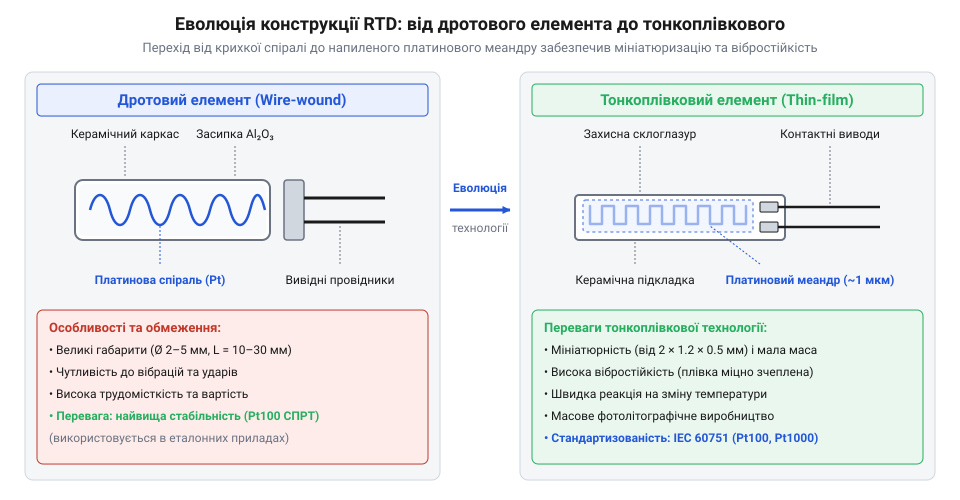
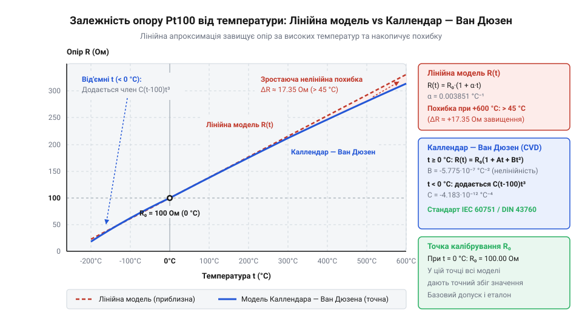
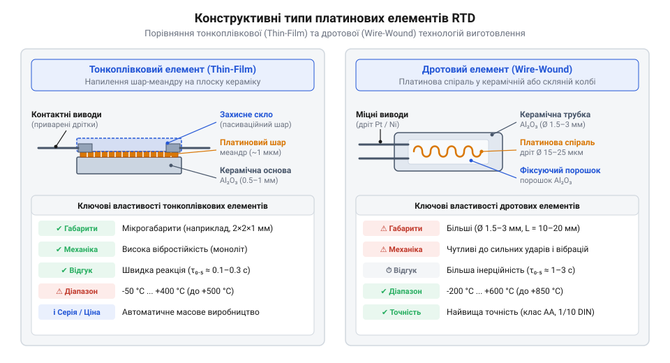

# Історія розвитку резистивних датчиків температури (RTD) та становлення стандарту IEC 60751

<preknowlist>
- [PT100 — платиновий термоопір](root:cat-hw-sensors/pt100-rtd) — базовий принцип термоопору та роль платини як чутливого матеріалу
- [Стандарт IEC 60751 для платинових термоопорів](root:cat-hw-sensors/iec-60751-standard-for-rtd) — сучасне визначення класів допуску та нормованого коефіцієнта alpha
</preknowlist>

## Криза механічної термометрії в промисловості

Промислова революція XIX століття докорінно змінила вимоги до технологічного контролю. Масштабне впровадження парових котлів високого тиску, доменних печей у металургії та реакторів хімічної дистиляції вимагало безперервного й точного вимірювання температури в жорстких експлуатаційних умовах. До того часу єдиним інструментом термометрії слугував @@en|рідинний скляний термометр@@ (від лат. *temperatura* — належне змішування), створений на основі теплового розширення ртуті або спирту. Проте в заводських цехах така конструкція швидко виявила фундаментальні фізичні й механічні обмеження.

Головним недоліком рідинних приладів була їхня висока крихкість та обмежений температурний діапазон. При температурах понад 300 °C скло розм'якшувалося під дією внутрішнього тиску, а ртуть закипала при 357 °C за нормальних умов. Сильні промислові вібрації та теплові удари спричиняли постійне руйнування скляних колб. Крім того, складна будова тонкого капіляра викликала в склі залишкові деформації — @@en|гістерезис@@ (від грецьк. *hysteresis* — відставання). *hysteresis* — запізнення або відставання), через який об'єм резервуара відновлювався після нагрівання годинами, що призводило до систематичних похибок показувань.

Спроби замінити скло металом привели до поява пристроїв, де працював @@en|біметалевий термометр@@ (англ. *bimetallic thermometer*, від лат. *bi-* — подвійний та грецьк. *metallon* — метал), побудований на різниці коефіцієнтів теплового розширення двох спаяних металевих смуг. Хоча ця конструкція була стійкішою до ударів, вона мала низьку точність через люфти й тертя в зубчастих передачах стрілочного механізму. Сучасні побутові пристрої, такі як [цифровий давач температури KY-028](root:cat-hw-sensors/ky-028-temp), повністю позбавлені таких механічних рухомих елементів.

Однак найгострішою проблемою як рідинних, так і біметалевих систем була повна неможливість дистанційної передачі вимірювального сигналу. Оператор мусив фізично наближатися до палаючої печі або вібруючого механізму, щоб зняти показування з покажчика. Створення централізованих пультів керування та автоматичних регуляторів вимагало переходу на новий фізичний принцип, де температура перетворюється на електричний параметр, здатний без затримок передаватися дротами на вимірювальний @@en|гальванометр@@ (франц. *galvanomètre*, від прізвища науковця Луїджі Ґальвані та грецьк. *metron* — вимірювати). Саме ця потреба привела до створення пристроїв класу @@en|RTD@@ (англ. *Resistance Temperature Detector*, від лат. *resisto* — опиратися), де вимірювальною величиною став електричний опір провідника.

## Відкриття Деві та термометр Сіменса

Фундамент для нового класу датчиків заклав у 1821 році англійський хімік і фізик @@en|Sir Humphry Davy@@ (англ. *Sir Humphry Davy*). Під час експериментів із проходженням струму крізь металеві провідники він виявив, що електричний опір металів монотонно зростає при підвищенні їхньої температури. На мікроскопічному рівні це пояснюється тим, що при нагріванні іони кристалічної ґратки металу коливаються з більшою амплітудою. Вільні електрони провідності частіше розсіюються на цих теплових коливаннях, що зменшує їхню середню довжину вільного пробігу й призводить до зростання опору.

Серед усіх металів найпривабливішим матеріалом для вимірювального елемента виявилася @@en|платина@@ (ісп. *platina*, зменшувальне від *plata* — срібло). На відміну від міді чи заліза, які швидко окиснюються на повітрі вже при відносно низьких температурах, платина є благородним металом із високою температурою плавлення (1768 °C), винятковою хімічною інертністю та високим ступенем чистоти отримання.


_Схематична еволюція конструкції платинових елементів від дротового спірального каркаса до мікроскопічної тонкоплівкової структури._

Перший практичний платиновий @@en|пірометр@@ (від грецьк. *pyr* — вогонь та *metron* — вимірювати) опору створив у 1871 році німецький та британський інженер @@en|Sir William Siemens@@ (нім. *Carl Wilhelm Siemens*). Первинний @@en|дротовий терморезистор@@ (англ. *wire-wound RTD*) являв собою тонкий платиновий дріт, намотаний на циліндричний каркас із вогнетривкої глини та поміщений у захисну залізну гільзу. Дріт підключався до вимірювального кола, де використовувався @@en|міст Вітстона@@ (англ. *Wheatstone bridge*). Сучасний [платиновий термоопір PT100](root:cat-hw-sensors/pt100-rtd) прямо наслідує цей вимірювальний принцип, хоч і реалізований на зовсім іншому технологічному рівні.

Однак винахід Сіменса зіштовхнувся з проблемами, які породили тривалий метрологічний міф. Поширена історія стверджувала, що термометр Сіменса одразу став надійним промисловим еталоном. У дійсності вже в 1874 році комісія Британської асоціації під керівництвом Джеймса Клерка Максвелла виявила катастрофічний дрейф показувань. Після кількох циклів нагрівання понад 800 °C опір платиновості незворотно змінювався, а калібрування збивалося.

Причина деградації полягала у хімічній реакції: за високих температур гази-відновники всередині залізної трубки відновлювали кремній із вогнетривкої глини каркаса. Пара вільного кремнію вступала у взаємодію з чистою платиною, викликаючи @@en|кремнієве отруєння платини@@ (англ. *silica contamination*). Утворення силіцидів платини змінювало внутрішню кристалічну структуру дроту, крихкість металу та його температурний коефіцієнт. Через цю нестабільність використання платинових термометрів у промисловості було призупинено майже на п'ятнадцять років.

## Рівняння Каллендара та Ван Дюзена

Прорив у метрології терморезисторів відбувся у 1887 році, коли англійський фізик @@en|Hugh Longbourne Callendar@@ (англ. *Hugh Longbourne Callendar*) переосмислив конструкцію давача. Каллендар збагнув, що для збереження стабільності платина не повинна контактувати із силікатною керамікою за високих температур і має вільно розширюватися без механічних напружень. Він розробив хрестоподібний каркас із чистої слюди, на який вільно намотувалася спіраль із чистої платини, а весь елемент вміщувався в захисну колбу з кварцового скла.

Каллендар також виявив, що простий лінійний зв'язок між опором і температурою є лише грубим наближенням. Зі зростанням температури крива опору платини відхиляється вниз від прямої лінії. Для опису цієї нелінійності при додатних температурах він запропонував квадратичну модель.

Отримати значення опору `R(t)` при температурі `t` (у °C) за відомого опору `R₀` при 0 °C можна за допомогою формули:

```
R(t) = R₀ × (1 + A × t + B × t²)
```

У цій формулі `R(t)` — опір платинового дроту за температури `t`, `R₀` — номінальний опір за 0 °C, а `A` і `B` — константи, що визначаються через коефіцієнти чистоти платини. Від'ємний коефіцієнт `B` компенсує сповільнення зростання опору за високих температур.

У 1925 році американський фізик @@en|Myron S. Van Dusen@@ (англ. *Myron S. Van Dusen*) з Національного бюро стандартів США дослідив поведінку платини при кріогенних температурах до -200 °C. Він виявив, що квадратичне рівняння Каллендара дає суттєву похибку при від'ємних температурах. Ван Дюзен доповнив формулу членом четвертого степеня, який діє лише в області `t < 0 °C`.

Так постало об'єднане @@en|рівняння Каллендара — Ван Дюзена@@ (англ. *Callendar-Van Dusen equation*), яке описує залежність опору в усьому діапазоні:

```
R(t) = R₀ × (1 + A × t + B × t² + C × (t - 100) × t³)    [для t < 0 °C]
= R₀ × (1 + A × t + B × t²)                              [для t ≥ 0 °C]
```

Для додатних температур член `C` дорівнює нулю, і рівняння зводиться до початкової формули Каллендара. Для від'ємних температур додатковий член з коефіцієнтом `C` точно враховує зміну фононної динаміки кристалічної ґратки.


_Температурна залежність опору платини показує нелінійне відхилення від лінійної апроксимації при високих та від'ємних температурах._

Це математичне обґрунтування перетворило платиновий термоопір на еталонний прилад для Міжнародної температурної шкали. Згодом на основі цих робіт розроблено німецький стандарт @@en|DIN 43760@@ та міжнародний @@en|IEC 60751@@. Згідно зі стандартом, нормований @@en|температурний коефіцієнт опору@@ (англ. *Temperature Coefficient of Resistance*, @@en|TCR@@) становить `α = 0.003851 °C⁻¹`, що відповідає стандартній чистоті платини.

Стандарт IEC 60751 зафіксував базові класи допуску та номінальні значення, такі як @@en|Pt100@@ (100 Ом при 0 °C) та @@en|Pt1000@@ (1000 Ом при 0 °C). З появою мікроелектроніки класичні спіралі поступаються місцем структурі @@en|тонкоплівковий терморезистор@@ (англ. *thin-film RTD*), де платина напилюється тонким шаром на керамічну підкладку. Для первинної обробки сигналів за рівнянням Каллендара — Ван Дюзена в сучасних приладах застосовується спеціалізований [перетворювач опору MAX31865](root:cat-hw-sensors/max31865-rtd-converter), а детальні вимоги до допусків описує [стандарт IEC 60751](root:cat-hw-sensors/iec-60751-standard-for-rtd).

## Від дротових елементів до тонких плівок

Виробничі вібрації, теплові удари та потреба в масовому автоматизованому вимірюванні швидко виявили слабкість класичних дротових терморезисторів (від англ. @@en|wire-wound RTD@@, де @@en|wire-wound@@ — дротова навивка, а @@en|RTD@@ — резистивний датчик температури). Ранні конструкції складалися з найтоншого платинового дроту діаметром 15–50 мікрометрів, навитого на керамічний трубчастий каркас або скляне осердя. Основне фізичне обмеження виникло там, де його найменше чекали: у різниці коефіцієнтів теплового розширення платини та матеріалу каркаса. Під час нагрівання або охолодження кераміка розширювалася з іншою швидкістю, ніж метал, натягуючи дріт. Виникала механічна деформація, яка через п'єзорезистивний ефект змінювала електричний опір незалежно від температури навколишнього середовища. Намагання закріпити дріт вільніше в керамічних каналах із порошком оксиду алюмінію розв'язували проблему натягу, але робили елемент вразливим до вібрацій: пристрій виходив із ладу через обрив спиралі або міжвиткове замикання.

Крім механічної крихкості, дротові сенсори мали великі габарити, значну теплову інерцію та вимагали високої частки ручної праці при виготовленні. Рішенням став технологічний перехід у другій половині XX століття до тонкоплівкових платинових структур (від англ. @@en|thin-film RTD@@, де @@en|thin-film@@ — тонка плівка). Замість навивання дроту на підкладку з високочистої алюмооксидної кераміки Al₂O₃ методом вакуумного магнетронного напилення (від англ. @@en|sputtering@@ — розпилення) наносять шар платини товщиною всього 1–2 мікрометри. Потім за допомогою фотолітографії (від грец. @@el|φῶς@@ — світло, @@el|λίθος@@ — камінь, @@el|γράφω@@ — пишу; англ. @@en|photolithography@@) формують меандровий струмопровідний доріжковий рисунок. Для коригування точного опору застосовують підгонку лазерним променем (від англ. @@en|laser trimming@@ — лазерна підгонка), а поверхню покривають захисним скляним пасиваційним шаром.


*Порівняння спіральної навивки дроту на кераміці та напиленого меандру тонкої плівки: тонкоплівкова структура фіксує платину на підкладці, усуваючи деформаційні напруження.*

Отриманий тонкоплівковий елемент принципово змінив експлуатаційні характеристики датчиків. Оскільки плівка платини молекулярно зв'язана з керамічною підкладкою, її деформація жорстко обмежена, що практично усунуло деформаційну чутливість. Відсутність ручної навивки дозволила зменшити розміри елементів до форматів поверхневого монтажу @@en|SMD@@ (від англ. @@en|Surface-Mount Device@@ — пристрій поверхневого монтажу), а мала маса платини знизила теплову інерцію, прискоривши відгук на зміну температури. Сучасний [платиновий термоопір](root:cat-hw-sensors/pt100-rtd) у тонкоплівковому виконанні витримує вібраційні навантаження понад 30g. Однак тонкоплівкова технологія має температурну межу: при температурах вище 500–600 °C атоми платини починають дифундувати в захисне скло або кераміку, тому для екстремальних температур до 850 °C і досі застосовують спеціалізовані дротові керамічні конструкції.

## Стандартизація IEC 60751 та класи допуску

У перші десятиліття промислового застосування кожна компанія-виробник використовувала платину власного ступеня очищення, через що температурний коефіцієнт опору (від англ. @@en|TCR@@ — @@en|Temperature Coefficient of Resistance@@) суттєво відрізнявся між екземплярами. Давач одного виробника неможливо було підключити до вимірювального приладу іншого без індивідуального калібрування. Для забезпечення взаємозамінності у Німеччині було розроблено стандарт @@de|DIN 43760@@ (від нім. @@de|DIN@@ — @@de|Deutsches Institut für Normung@@, Німецький інститут зі стандартизації), який згодом поклали в основу міжнародного нормативу @@en|IEC 60751@@ (від англ. @@en|IEC@@ — @@en|International Electrotechnical Commission@@, Міжнародна електротехнічна комісія).

Центральним елементом стандартизації стало фіксування номінального температурного коефіцієнта `α`. Його визначають через відносне збільшення опору при нагріванні від 0 °C до 100 °C. Позначимо опір сенсора при 0 °C як `R₀`, а при 100 °C як `R₁₀₀`. Обчислення коефіцієнта `α` виконують за співвідношенням:

```
α = (R₁₀₀ - R₀) / (100 × R₀)
  = (138.51 - 100) / (100 × 100)      [підстановка нормативних опорів при 100 °C та 0 °C]
  = 0.003851 °C⁻¹                    [базовий коефіцієнт для промислової платини]
```

Значення `α = 0.003851 °C⁻¹` відповідає платині з керованою кількістю домішок, що дещо нижче за чистоту метрологічних еталонів @@en|ITS-90@@ (`α = 0.003926 °C⁻¹`), але гарантує високу відтворюваність у масовому виробництві. Стандарт закріпив два основні номінали: Pt100 з опором `R₀ = 100 Ом` та Pt1000 з опором `R₀ = 1000 Ом`. Якщо в класичних аналогових мостових схемах домінував Pt100, то для сучасних цифрових систем вигідніший Pt1000: вищий у десять разів опір зменшує відносний вплив опору підвідних дротів та знижує струм самонагріву. Завдяки цьому [перетворювач опору платинових датчиків](root:cat-hw-sensors/max31865-rtd-converter) забезпечує високу точність вимірювання без додаткового нагріву сенсора вимірювальним струмом. Докладніше про застосування еталонних платинових термометрів та стандарт реперних точок читайте в матеріалі про [міжнародну температурну шкалу ITS-90](root:hw-sensing/its-90).

Вибір платини (лат. @@la|Platinum@@, від ісп. @@es|platina@@ — зменшувальне від @@es|plata@@, срібло) порівняно з іншими металами обґрунтований її фізико-хімічною інертністю. Мідь (лат. @@la|Cuprum@@ — від назви острова Кіпр) має високу лінійність, але інтенсивно окиснюється вже при температурах понад 100 °C та має низький питомий опір. Нікель (лат. @@la|Niccolum@@ — від нім. @@de|Kupfernickel@@) володіє вищою чутливістю (`α ≈ 0.0061 °C⁻¹`), проте його залежність опору від температури стає суттєво нелінійною вище 150 °C. Платина не окиснюється у широкому діапазоні, має високу температуру плавлення (1768 °C) і зберігає стабільність кристалічної ґратки.

Сучасний [стандарт IEC 60751](root:cat-hw-sensors/iec-60751-standard-for-rtd) також визначає класи точності, які встановлюють максимально допустиме відхилення температури `ΔT` залежно від модуля поточної температури `|t|` у градусах Цельсія. Позначимо допустиму похибку для різних класів допуску:

```
ΔT_B = ±(0.30 + 0.005 × |t|)          [допуск класу B у градусах Цельсія]
ΔT_A = ±(0.15 + 0.002 × |t|)          [допуск класу A у градусах Цельсія]
ΔT_AA = ±(0.10 + 0.0017 × |t|)        [допуск класу AA у градусах Цельсія]
```

З виразів видно, що в точці 0 °C похибка датчика класу B не перевищує `±0.3 °C`, а для класу AA становить лише `±0.10 °C`. З віддаленням від нульової точки допуск лінійно розширюється, що відображає зростання невизначеності вимірювань при екстремальних температурах.