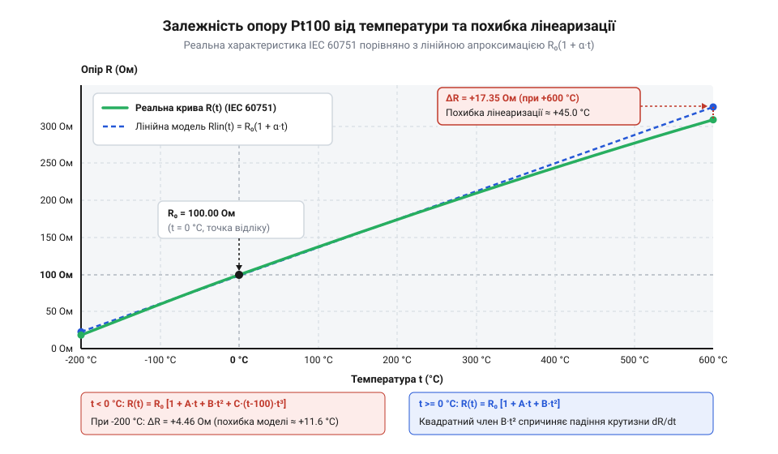
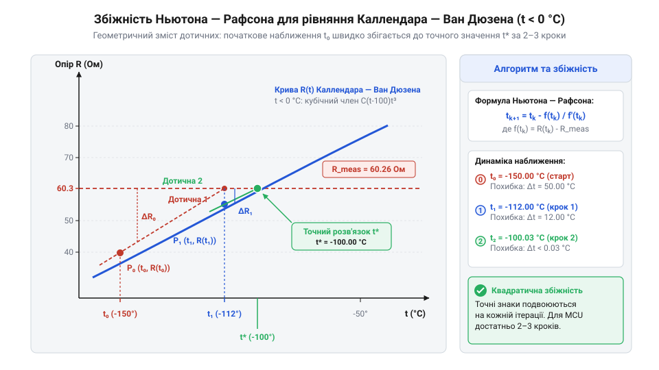

# Математичні рівняння Каллендара — Ван Дюзена, α-коефіцієнт та лінеаризація характеристик RTD

<preknowlist>
- [PT100 — платиновий термоопір](root:cat-hw-sensors/pt100-rtd) — фізичний принцип роботи платинового резистивного елемента та поняття номінального опору 100 Ом при 0 °C.
- [Стандарт IEC 60751 для платинових термоопорів](root:cat-hw-sensors/iec-60751-standard-for-rtd) — нормативні значення коефіцієнтів A, B, C та класи точності платинових RTD.
</preknowlist>

## Похибка лінійної моделі опору RTD

У вимірювальних системах контроль температури часто починають із найпростішого припущення: опір металевого провідника зростає строго пропорційно його температурі. Для резистивних давачів температури (від англійського @@en|resistance temperature detector@@, скорочено @@en|RTD@@) на основі платини початковим орієнтиром є лінійна залежність опору від температури. Її будують за двома точками: номінальним опором `R₀ = 100 Ом` при `0 °C` та середнім температурним коефіцієнтом `α` (альфа).

Математично найпростіша лінійна модель виражається формулою:

    R(t) = R₀ × (1 + α × t)

У цій формулі `R₀` позначає опір сенсора при `0 °C`, `t` — вимірювану температуру в градусах Цельсія, а `α` — температурний коефіцієнт опору (від англійського @@en|temperature coefficient of resistance@@, @@en|TCR@@). За вимогами стандарту @@en|IEC 60751@@ нормативне значення коефіцієнта `α` для промислових платинових датчиків становить `0.003851 °C⁻¹` (або точніше `0.00385055 °C⁻¹`). Фізично коефіцієнт `α` визначають як нормований середній приріст опору в діапазоні від `0 °C` до `100 °C`:

    α = (R₁₀₀ - R₀) / (100 × R₀)
      = (138.5055 - 100) / (100 × 100)       [підстановка опору PT100 при 100 °C]
      = 0.00385055 ≈ 0.003851 °C⁻¹          [середній температурний коефіцієнт]

Для вузького температурного вікна — наприклад, при вимірюванні кімнатної температури в межах від `0 °C` до `50 °C` — лінійна формула дає цілком прийнятну точність з похибкою у частки градуса. Проте під час моніторингу високотемпературних технологічних процесів чи кріогенного обладнання ця спрощена модель ламається.

Причиною є мікроскопічна природа електропровідності металів. Електричний опір платини виникає внаслідок розсіювання електронів провідності на теплових коливаннях кристалічної ґратки (фононах). При кімнатній температурі кількість фононів зростає майже лінійно з температурою. Проте при подальшому нагріванні виявляється ангармонізм решіткових коливань та теплове розширення кристала: швидкість зростання опору платини починає поступово сповільнюватися. Графік реальної залежності опору від температури загинається вниз відносно дотичної, проведеної при `0 °C`.


*Відхилення реальної характеристики опору платинового датчика PT100 від лінійної апроксимації при зростанні температури.*

Розглянемо чисельний приклад, що показує масштаби похибки. Для популярного [платинового термоопору PT100](root:cat-hw-sensors/pt100-rtd) дійсне значення опору при температурі `500 °C` згідно з нормативом [стандарту IEC 60751](root:cat-hw-sensors/iec-60751-standard-for-rtd) становить `280.98 Ом`.

Якщо прошивка мікроконтролера обчислює температуру за виміряним опором `R = 280.98 Ом` через лінійну формулу, вона отримує наступний результат:

    t_lin = (R / R₀ - 1) / α
          = (280.98 / 100 - 1) / 0.003851    [підстановка виміряного опору]
          = 1.8098 / 0.003851                [обчислення відносного приросту]
          = 469.96 °C                        [температура за лінійною моделлю]

Абсолютна похибка вимірювання за такої апроксимації становить:

    Δt = t_real - t_lin
       = 500 - 469.96                        [різниця дійсної та розрахованої величин]
       = +30.04 °C                           [похибка нелінійності при 500 °C]

Вимірювальна система із похибкою понад 30 °C є непридатною для промислового використання. Для усунення цієї нелінійності та забезпечення високої точності в усьому робочому діапазоні необхідно застосовувати точну математичну модель опору платини.

## Рівняння Каллендара — Ван Дюзена

Математичний опис реальної характеристики платинових датчиків @@en|RTD@@ базується на дослідженнях Х'ю Каллендара (від англійського @@en|Hugh Longbourne Callendar@@, 1886 рік), який запропонував поліноміальну модель для додатних температур, та Мілтона Ван Дюзена (від англійського @@en|M. S. Van Dusen@@, 1925 рік), який додав компенсаційний член для від'ємних температур. Ця модель відома як рівняння Каллендара — Ван Дюзена (від англійського @@en|Callendar-Van Dusen equation@@, @@en|CVD@@) і зафіксована в міжнародних стандартах @@en|IEC 60751@@ та @@en|ITS-90@@.

Рівняння Каллендара — Ван Дюзена задає пряму залежність опору `R(t)` від температури `t` (в градусах Цельсія) окремо для двох температурних діапазонів.

**1. Додатний діапазон (0 °C ≤ t ≤ +850 °C):**

    R(t) = R₀ × (1 + A × t + B × t²)

У цьому діапазоні характеристика є поліномом другого степеня (квадратним рівнянням).

**2. Від'ємний діапазон (-200 °C ≤ t < 0 °C):**

    R(t) = R₀ × [1 + A × t + B × t² + C × (t - 100) × t³]

Якщо розкрити дужки у додатковому члені `C × (t - 100) × t³ = C × t⁴ - 100 × C × t³`, стає видно, що при від'ємних температурах рівняння перетворюється на поліном четвертого степеня з ненульовими коефіцієнтами при третьому та четвертому степенях `t`.

Згідно зі стандартом @@en|IEC 60751@@ для платинових датчиків із коефіцієнтом `α = 0.003851 °C⁻¹` коефіцієнти мають наступні фіксовані значення:

    A = 3.9083 × 10⁻³ °C⁻¹
    B = -5.775 × 10⁻⁷ °C⁻²
    C = -4.183 × 10⁻¹² °C⁻⁴

Від'ємний знак коефіцієнта `B` математично відображає підлінійний вигин кривої опору при `t > 0 °C`. Коефіцієнт `C` працює лише при `t < 0 °C`. При `t = 0 °C` вираз `C × (0 - 100) × 0³ = 0`, що забезпечує гладку неперервність самої функції `R(t)` та її першої похідної на межі двох діапазонів.

В оригінальних роботах Каллендара та Ван Дюзена рівняння записували через три фізичні параметри: середній коефіцієнт `α`, коефіцієнт додатної нелінійності `δ` (дельта) та кріогенний коефіцієнт `β` (бета):

    A = α × (1 + δ / 100)
      = 0.00385055 × (1 + 1.4989 / 100)
      = 3.9083 × 10⁻³ °C⁻¹                  [зв'язок коефіцієнта A з α та δ]

    B = - α × δ / 10000
      = - 0.00385055 × 1.4989 / 10000
      = -5.775 × 10⁻⁷ °C⁻²                  [зв'язок коефіцієнта B з α та δ]

    C = - α × β / 100000000
      = - 0.00385055 × 1.0863 / 100000000
      = -4.183 × 10⁻¹² °C⁻⁴                 [зв'язок коефіцієнта C з α та β]

Для типового елемента PT100 значення класичних параметрів становлять `α ≈ 0.00385055`, `δ ≈ 1.4989` та `β ≈ 0.10863`.

У вимірювальних приладах напрямок обчислень зворотний. Апаратний модуль (наприклад, [перетворювач MAX31865](root:cat-hw-sensors/max31865-rtd-converter)) вимірює опір `R`, після чого прошивка розв'язує зворотну задачу — розраховує температуру `t(R)`:

- Для додатного діапазону (`t ≥ 0 °C`) квадратне рівняння розв'язується аналітично через точну алгебраїчну формулу. - Для від'ємного діапазону (`t < 0 °C`) рівняння 4-го степеня не має простої оберненої формули, тому застосовують чисельні ітераційні методи або поліноміальні наближення.

## Прямий аналітичний розв'язок для додатних температур

Діапазон додатних температур від `0 °C` до `+850 °C` є найбільш уживаним у промисловості. Для цього діапазону залежність опору описується квадратним рівнянням:

    R(t) = R₀ × (1 + A × t + B × t²)

Щоб вивести обернену функцію `t(R)`, зведемо рівняння до стандартного канонічного вигляду `a × t² + b × t + c = 0`. Розкриємо дужки та перенесемо всі члени в один бік:

    R = R₀ + R₀ × A × t + R₀ × B × t²
    (R₀ × B) × t² + (R₀ × A) × t + (R₀ - R) = 0             [перенесення членів]
    B × t² + A × t + (1 - R / R₀) = 0                       [ділення на R₀]

Отримаємо коефіцієнти квадратного рівняння відносно змінної `t`:

- `a = B`
- `b = A`
- `c = 1 - R / R₀`

Дискримінант `D` цього рівняння має вигляд:

    D = b² - 4 × a × c
      = A² - 4 × B × (1 - R / R₀)                           [вираз дискримінанта]

Корені квадратного рівняння визначаються класичною формулою:

    t = (-A ± √(A² - 4 × B × (1 - R / R₀))) / (2 × B)

Оскільки рівняння має два корені, необхідно вибрати один, який відповідає фізичній дійсності. Коефіцієнт `B` є від'ємним числом (`B = -5.775 × 10⁻⁷`), тому знаменник `2 × B` завжди від'ємний (`-1.155 × 10⁻⁶`).

При `R ≥ R₀` (температура `t ≥ 0 °C`) вираз `1 - R / R₀ ≤ 0`. Оскільки `B < 0`, добуток `-4 × B × (1 - R / R₀)` є від'ємним числовим значенням, тому дискримінант `D` виявляється меншим за `A²`, а його корінь `√D < A`.

Якщо вибрати знак мінус у чисельнику `(-A - √D)`, ми отримаємо суму двох від'ємних величин у чисельнику, що після ділення на від'ємний знаменник `2 × B` дасть хибний додатний корінь порядку кількох тисяч градусів Цельсія.

Фізично коректний розв'язок забезпечує знак плюс перед коренем дискримінанта:

    t(R) = (-A + √(A² - 4 × B × (1 - R / R₀))) / (2 × B)

Оскільки `√D < A`, чисельник `(-A + √D)` є від'ємним числом. Ділення від'ємного чисельника на від'ємний знаменник `2 × B` дає точний додатний результат `t ≥ 0 °C`.

Перевіримо роботу алгоритму на конкретному обчислювальному прикладі.

**Умова:** Зафіксовано опір платинового термоопору PT100 `R = 138.5055 Ом`. Знайти температуру `t`.

    Z = 1 - R / R₀
      = 1 - 138.5055 / 100
      = -0.385055                                            [відносне відхилення опору]

    4ac = 4 × B × Z
        = 4 × (-5.775 × 10⁻⁷) × (-0.385055)
        = +8.89477 × 10⁻⁷                                    [член дискримінанта]

    A² = (3.9083 × 10⁻³)²
       = 1.52748 × 10⁻⁵                                      [квадрат коефіцієнта A]

    D = A² - 4ac
      = 1.52748 × 10⁻⁵ - 8.89477 × 10⁻⁷
      = 1.438533 × 10⁻⁵                                      [дискримінант D]

    √D = √(1.438533 × 10⁻⁵)
       = 3.79280 × 10⁻³                                      [квадратний корінь дискримінанта]

    t = (-3.9083 × 10⁻³ + 3.79280 × 10⁻³) / (2 × (-5.775 × 10⁻⁷))
      = (-0.11550 × 10⁻³) / (-1.1550 × 10⁻⁶)                 [ділення чисельника на знаменник]
      = +100.0 °C                                             [точна температура]

Обчислення дає точну температуру `100.0 °C` без застосування чисельних ітерацій.

Сучасні мікроконтролери з апаратним модулем плаваючої коми (від англійського @@en|floating-point unit@@, @@en|FPU@@) виконують обчислення квадратного кореня `sqrtf()` за кілька тактів процесора. Нижче наведено готові фрагменти коду для прошивок мікроконтролерів.

:::tabs
:::code math-callendar-van-dusen-and-rtd-linearization/c/esp-idf/rtd-calculate-temp-positive.c
:::code math-callendar-van-dusen-and-rtd-linearization/cpp/arduino/rtdpt100calculator.cpp
:::

Обчислювальна складність цього аналітичного алгоритму є мінімальною (1 ділення, 1 вилучення квадратного кореня та кілька арифметичних операцій), що робить його ідеальним вибором для виконання у реальному часі на будь-якому 32-бітному мікроконтролері. Обмеженням формули є її застосовність виключно для додатних температур (`R ≥ R₀`).

## Чисельні методи для від'ємних температур

Аналітичне обчислення температури за виміряним опором платинового елемента стає безпорадним, щойно температура вимірювального середовища опускається нижче `0 °C`. Для додатного діапазону коефіцієнт `C` дорівнює нулю, що перетворює рівняння @@en|Callendar-Van Dusen@@ на звичайну квадратичну залежність. Проте при від'ємних температурах у діапазоні від `-200 °C` до `0 °C` згідно зі [стандартом IEC 60751](root:cat-hw-sensors/iec-60751-standard-for-rtd) набирає сили четвертий доданок з коефіцієнтом `C = -4.183 × 10⁻¹² °C⁻⁴`. Через це математична модель датчика [платинового термоопору PT100](root:cat-hw-sensors/pt100-rtd) набуває вигляду полінома четвертого степеня:

R(t) = R₀ · [1 + A·t + B·t² + C·(t - 100)·t³]

Якщо розкрити дужки у виразі `C·(t - 100)·t³`, то отримаємо залежність `R(t) = R₀ · (1 + A·t + B·t² - 100·C·t³ + C·t⁴)`. Спроба знайти прямий обернений аналітичний розв'язок `t(R)` для полінома четвертого степеня призводить до громіздких формул Феррарі, які вимагають обчислення кубічних та квадратних коренів від комплексних чисел. У прошивці, яку виконує @@en|microcontroller@@ (@@en|MCU@@), такі розрахунки спричиняють катастрофічну втрату точності через накопичення похибок округлення чисел з плаваючою крапкою та вимагають занадто багатьох тактів процесора.

Щоб точно обчислити температуру при від'ємному опорі без аналітичного вивертання рівняння, застосовують чисельний метод Ньютона — Рафсона (@@en|Newton-Raphson method@@). Ідея полягає у послідовному знаходженні нуля функції `f(t) = 0`, де різниця між теоретичним опором та виміряним значенням `R_meas` має дорівнювати нулю:

f(t) = R₀ · [1 + A·t + B·t² + C·(t - 100)·t³] - R_meas

Для побудови ітераційного алгоритму @@en|Newton-Raphson method@@ обчислюють першу похідну функції `f(t)` по температурі `t`, яка фізично показує чутливість опору @@en|RTD@@ до зміни температури `dR/dt`:

f(t) = R₀ · [1 + A·t + B·t² + C·t⁴ - 100·C·t³] - R_meas
f'(t) = d/dt (R₀ · [1 + A·t + B·t² + C·t⁴ - 100·C·t³] - R_meas)      [розкриття дужок і диференціювання]
      = R₀ · (A + 2·B·t + 4·C·t³ - 300·C·t²)                         [похідна кожного доданка полінома]

Кожен наступний крок наближення `t_next` обчислюють за класичною формулою дотичної:

t_next = t - f(t) / f'(t)


*Крива залежності опору RTD від від'ємної температури та швидка збіжність послідовних дотичних до точного кореня рівняння Каллендара — Ван Дюзена.*

Швидкість збіжності алгоритму @@en|Newton-Raphson method@@ критично залежить від вибору початкового наближення `t₀`. Якщо обрати як `t₀` розв'язок точного квадратного рівняння для додатного діапазону, відхилення початкового значення від істинного кореня у найгіршій точці при `-200 °C` становить менше `0.45 °C`. Завдяки такій високій точності початкової точки метод @@en|Newton-Raphson method@@ досягає квадратичної швидкості збіжності: похибка зменшується до величини менше `0.0001 °C` всього за дві або три ітерації.

Розглянемо практичний приклад розрахунку для опору `R_meas = 80.30628 Ом`, що відповідає еталонній температурі `-50 °C` для елемента @@en|PT100@@ (`R₀ = 100 Ом`, `A = 3.9083 × 10⁻³ °C⁻¹`, `B = -5.775 × 10⁻⁷ °C⁻²`, `C = -4.183 × 10⁻¹² °C⁻⁴`).

**Обчислення ітерацій методу Ньютона — Рафсона при R_meas = 80.30628 Ом**:
```
t₀ = (-A + √(A² - 4·B·(1 - R_meas/R₀))) / (2·B)
   = (-3.9083×10⁻³ + √((3.9083×10⁻³)² - 4·(-5.775×10⁻⁷)·(1 - 0.8030628))) / (2·(-5.775×10⁻⁷))
   = -49.9238 °C                                              [початкове аналітичне квадратичне наближення t₀]

f(t₀) = 100 · [1 + A·(-49.9238) + B·(-49.9238)² + C·(-49.9238 - 100)·(-49.9238)³] - 80.30628
      = 80.33596 - 80.30628 = 0.02968 Ом                        [нев'язка опору на першому кроці]

f'(t₀) = 100 · [A + 2·B·(-49.9238) + 4·C·(-49.9238)³ - 300·C·(-49.9238)²]
       = 0.39655 Ом/°C                                         [значення похідної dR/dt у точці t₀]

t₁ = t₀ - f(t₀) / f'(t₀)
   = -49.9238 - (0.02968 / 0.39655)
   = -49.9986 °C                                              [перша ітерація: похибка зменшилась до 0.0014 °C]

t₂ = t₁ - f(t₁) / f'(t₁)
   = -49.9986 - (-0.000555 / 0.39656)
   = -50.0000 °C                                              [друга ітерація: абсолютне збігання з точною температурою]
```

Алгоритм @@en|Newton-Raphson method@@ гарантує абсолютну точність обчислення температури @@en|RTD@@ у всьому діапазоні від `-200 °C` до `0 °C` з мінімальними обчислювальними витратами. Для глибшого розуміння специфіки реалізації та оптимізації ітераційних обчислень на обчислювально обмежених мікроконтролерах дивіться матеріал про [чисельні методи розв'язання рівнянь у прошивках МК](root:sf-devices/numerical-root-finding-mcu).

:::tabs
:::code math-callendar-van-dusen-and-rtd-linearization/c/esp-idf/rtd-calc-temperature-negative.c
:::code math-callendar-van-dusen-and-rtd-linearization/cpp/arduino/rtdlinearizer.cpp
:::

## Аналіз похибок та лінеаризація у прошивці

Вибір математичного методу лінеаризації характеристики @@en|RTD@@ у реальній прошивці завжди є компромісом між вимогами до точності вимірювання та обмеженнями обчислювальних ресурсів процесора. Розробнику вбудованих систем доступні чотири основних підходи: проста лінійна апроксимація, квадратичний аналітичний розв'язок, табличний метод з інтерполяцією (@@en|lookup table@@, @@en|LUT@@) та повний ітераційний чисельний розв'язок @@en|Callendar-Van Dusen@@.

При грубій лінійній апроксимації вважають, що опір змінюється строго за формулою `t = (R - R₀) / (R₀ · α)`, де `α = 0.003851 °C⁻¹`. Похибка нелінійності при цьому зростає пропорційно квадрату відхилення від `0 °C`. Для датчика [платинового термоопору PT100](root:cat-hw-sensors/pt100-rtd) при температурі `+200 °C` реальний опір становить `175.86 Ом`, а лінійна формула дає обчислене значення `197.00 °C`, що спричиняє величезну абсолютну похибку `-3.00 °C`. При досягненні верхньої межі `+850 °C` похибка лінійного наближення перевищує `44 °C`, роблячи цей метод непридатним для точних вимірювань.

Застосування квадратичного аналітичного розв'язку усуває похибку лінеаризації повністю в діапазоні від `0 °C` до `+850 °C`. Однак у від'ємному діапазоні ігнорування кубічного та четвертого доданків рівняння @@en|Callendar-Van Dusen@@ призводить до появи систематичної похибки нелінійності. При температурі `-100 °C` квадратична формула помиляється на `+0.13 °C`, а при `-200 °C` похибка сягає `+0.45 °C`. Для приладів класу точності `Class A` за [стандартом IEC 60751](root:cat-hw-sensors/iec-60751-standard-for-rtd), де допустима допускна похибка на межі `-200 °C` становить `±0.55 °C`, така математична помилка забирає майже весь допуск датчика.

Для мікроконтролерів із суворими часовими обмеженнями або без апаратного модуля плаваючої крапки (@@en|floating-point unit@@, @@en|FPU@@) ефективним розв'язком є використання табличного методу (@@en|LUT@@) з кусочно-лінійною інтерполяцією (@@en|piecewise linear interpolation@@). Таблиця зберігає попередньо розраховані пари значення опору та температури з певним кроком (наприклад, кожні `10 °C` або `20 °C`).

**Обчислення кусочно-лінійної інтерполяції за таблицею LUT**:
```
t = t_i + (R_meas - R_i) · (t_{i+1} - t_i) / (R_{i+1} - R_i)
```

При кроці таблиці `10 °C` максимальна похибка нелінійності між вузлами інтерполяції становить менше `0.015 °C`, що цілком задовольняє більшість промислових застосувань. Такий підхід вимагає лише близько 100 байт пам'яті @@en|Flash@@ і виконується за кілька десятків тактів процесора без виклику важких математичних функцій `sqrtf()`.

Вибір розрядності обчислень типів `@@en|float@@` (32 біти, IEEE 754 single precision) та `@@en|double@@` (64 біти, double precision) має власні нюанси. Тип `@@en|float@@` забезпечує 24 біти мантиси, що відповідає приблизно 7 десятковим цифрам точності. При обчисленні доданків `C · t⁴` при `t = -200 °C` значення доданка становить `-0.00669 Ом`. Втрати точності мантиси при додаванні цього значення до величини опору порядку `100 Ом` не відбувається, тому тип `@@en|float@@` забезпечує точність обчислення температури краще `0.001 °C`. Використання типу `@@en|double@@` є виправданим лише при метрологічних калібруваннях еталонних термометрів і на 32-бітних @@en|MCU@@ без підтримки 64-бітної @@en|FPU@@ призводить до сповільнення розрахунків у 5–10 разів. Якщо ж дані зчитуються через спеціалізовану мікросхему на кшталт цифрового [перетворювача MAX31865](root:cat-hw-sensors/max31865-rtd-converter), обчислення ітерацій @@en|Newton-Raphson method@@ на стороні мікроконтролера гарантує повністю безвтратне перетворення 15-бітного коду АЦП у підсумкову температуру.

:::tabs
:::code math-callendar-van-dusen-and-rtd-linearization/c/esp-idf/rtd-interpolate-lut.c
:::code math-callendar-van-dusen-and-rtd-linearization/cpp/arduino/lutpoint.cpp
:::