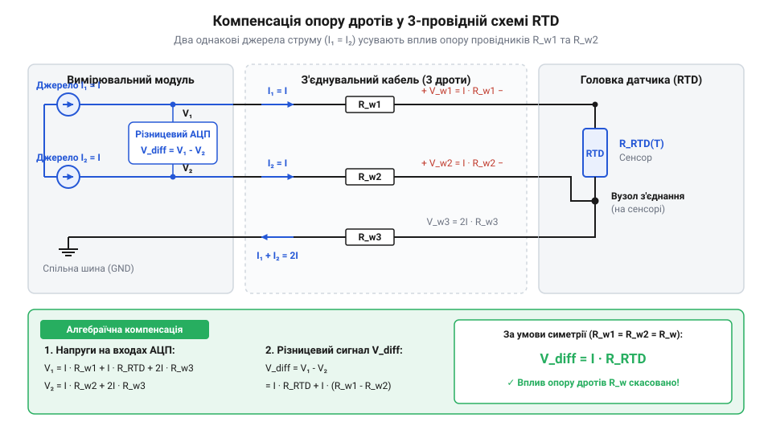
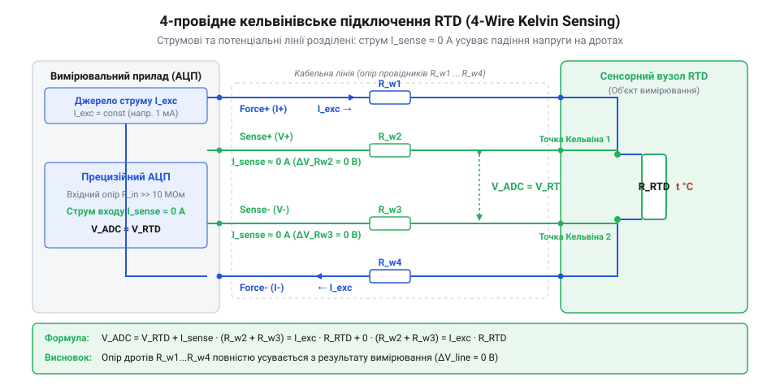

# Математичний розрахунок ефекту самонагрівання та компенсації опору дротів у 2-, 3- та 4-провідних схемах

<preknowlist>
- [PT100 — платиновий термоопір](root:cat-hw-sensors/pt100-rtd) — знати номінальний опір 100 Ом при 0°C та базовий температурний коефіцієнт платини (TCR α ≈ 0.00385 Ом/Ом/°C).
- [Стандарт IEC 60751 для платинових термоопорів](root:cat-hw-sensors/iec-60751-standard-for-rtd) — знати класи точності RTD (Class A, Class B) та нормовані границі допускових похибок.
- [MAX31865 — перетворювач опору платинових датчиків PT100/PT1000](root:cat-hw-sensors/max31865-rtd-converter) — знати принципи логометричного вимірювання опору RTD відносно опорного резистора R_ref.
</preknowlist>

## Паразитні похибки термоопору у реальному вимірюванні

Високоточний терморезистивний датчик опору (англ. @@en|Resistance Temperature Detector@@, RTD, від лат. @@la|resistere@@ — чинити опір) класу точності @@en|Class A@@ за [стандартом IEC 60751](root:cat-hw-sensors/iec-60751-standard-for-rtd) гарантує допускову похибку вимірювання не більше `±0.15 °C` при температурі `0 °C`. Однак після підключення такого сенсора [платиновий термоопір PT100](root:cat-hw-sensors/pt100-rtd) через 15-метровий з'єднувальний кабель до аналогово-цифрового перетворювача та подачі стандартного струму збудження величиною `2 mA` вимірювальна система показує `+2.8 °C` у таючому льоду замість очікуваних `0.00 °C`. Використання прецизійного датчика не захищає від систематичного зсуву, оскільки на клемах вимірювача фіксується опір, який суттєво відрізняється від справжнього опору платинового спірального чутливого елемента.

Наївний підхід до вимірювання припускає, що падіння напруги `V_adc` на вхідних клемах АЦП визначається виключно опором датчика `R_rtd` при поточній температурі навколишнього середовища `T_env`. У реальному фізичному колі виміряна величина є сумою трьох незалежних джерел похибки:
`R_meas = R_rtd(T_env + ΔT_sh) + 2 · R_w + V_seebeck / I_exc`

Першим джерелом викривлення є паразитне самонагрівання (англ. @@en|self-heating@@) чутливого елемента. Струм збудження `I_exc`, що протікає через опір датчика `R_rtd`, виділяє Джоулеву теплову потужність `P = I_exc² · R_rtd`. Це тепло має розсіятися у навколишнє середовище через захисну гільзу та ізоляцію, через що температура самого чутливого елемента підвищується на величину `ΔT_sh` відносно реальної температури середовища `T_env`. Вимірювач фіксує гарячіший датчик, ніж об'єкт вимірювання.

Другим чинником є паразитний опір з'єднувальних дротів `R_w`. Струм збудження проходить не лише через чутливий елемент, а й через два провідники лінії зв'язку від вимірювального приладу до датчика та назад. Оскільки аналогово-цифровий перетворювач вимірює сумарне падіння напруги на всій ділянці кола між своїми клемами, додатковий опір кабелю `2 · R_w` безпосередньо додається до опору @@en|RTD@@. Для датчика @@en|PT100@@ опір дротів усередині 15-метрового кабелю перерізом `0.2 mm²` становить приблизно `2.6 Ω`, що вимірювальна система помилково трактує як додатковий температурний зсув понад `+6.7 °C`.

Третім, більш прихованим джерелом похибки є паразитні термоЕРС (англ. @@en|thermoelectric EMF@@), що виникають у місцях контакту різнорідних металів через ефект Зеєбека (англ. @@en|Seebeck effect@@, на честь німецького фізика Томаса Зеєбека). З'єднання мідних дротів кабелю з платиновими виводами чутливого елемента або з латунними клемами приладу утворюють термопари. Якщо уздовж провідника чи на клемах існує градієнт температур, у колі виникає постійна паразитна напруга `V_seebeck` у кілька мікровольт. При подачі постійного струму збудження `I_exc` ця напруга додається до корисного сигналу, створюючи еквівалентний зміщення опору `ΔR = V_seebeck / I_exc`. Докладніший аналіз виникнення термоЕРС на стиках мідних дротів та платинових виводів викладено у матеріалі про [паразитний ефект Зеєбека у вимірювальних кола термоопорів](root:hw-sensing/seebeck-effect-rtd-junctions).

Сумарна похибка вимірювального тракту перевищує паспортний допуск датчика у десятки разів. Щоб зберегти високу точність вимірювання, необхідно розкласти загальну похибку на окремі компоненти та застосувати до кожного чинника відповідний математичний розрахунок і спосіб компенсації.

## Математика самонагрівання та обмеження струму збудження

Рівноважна температура чутливого елемента датчика визначається балансом між електричною потужністю, яка виділяється у вигляді тепла, та швидкістю відведення цього тепла у навколишнє середовище. Теплова потужність `P`, що виділяється на платиновому опорі `R_rtd` під дією струму збудження `I_exc`, описується класичним законом Джоуля-Ленца:
`P = I_exc² · R_rtd`

Здатність датчика віддавати тепло у навколишнє середовище описується через коефіцієнт розсіювання потужності (англ. @@en|dissipation constant@@, `E_d`, від лат. @@la|dissipare@@ — розсіювати). Коефіцієнт розсіювання `E_d` визначає потужність у міліватах (або ватах), яку повинен виділити датчик для підвищення власної температури на `1 °C` (або `1 K`) відносно навколишнього середовища. Фізична модель температурного зсуву `ΔT_sh` від самонагрівання описується співвідношенням:
```
ΔT_sh = P / E_d
```

Коефіцієнт `E_d` не є постійною величиною самого датчика — він критично залежить від теплопровідності та швидкості руху середовища, у яке занурено чутливий елемент. Для тонкоплівкового датчика @@en|PT100@@ у нерухомому повітрі коефіцієнт розсіювання становить приблизно `E_d ≈ 2 .. 5 mW/°C`. У рухомому повітрі зі швидкістю `1 m/s` відведення тепла покращується, і `E_d` зростає до `10 .. 20 mW/°C`. У проточній воді або рідинному термостаті через високу теплоємність та теплопровідність рідини коефіцієнт досягає `E_d ≈ 40 .. 100 mW/°C`.

Щоб встановити допустиму межу струму збудження `I_exc`, необхідно виходити з виділеного бюджету похибки `ΔT_max_sh`. Виразимо максимальну дозволену електричну потужність `P_max` через коефіцієнт розсіювання `E_d`:
```
P_max = ΔT_max_sh · E_d
```

Підставивши значення потужності `P_max` у закон Джоуля-Ленца, отримаємо алгебраїчне виведення гранично припустимого струму збудження `I_exc_max`:
```
I_exc_max² · R_rtd = ΔT_max_sh · E_d      [рівність теплової та електричної потужностей]
I_exc_max² = (ΔT_max_sh · E_d) / R_rtd    [ділення двох частин на R_rtd]
I_exc_max = √((ΔT_max_sh · E_d) / R_rtd)   [добування квадратного кореня]
```

Перед обчисленням визначимо всі параметри: `I_exc_max` — граничний струм збудження (в амперах), `ΔT_max_sh` — допустимий температурний зсув від самонагрівання (у градусах Цельсія), `E_d` — коефіцієнт розсіювання (у ватах на градус Цельсія), `R_rtd` — опір датчика при робочій температурі (у омах).

**Розрахунок граничного струму збудження для PT100 у нерухомому повітрі**
Приймемо опір датчика `R_rtd = 100 Ω` при `0 °C`. Давач розміщено у нерухомому повітрі з коефіцієнтом розсіювання `E_d = 3 mW/°C = 0.003 W/°C`. Допустима похибка самонагрівання встановлена на рівні `ΔT_max_sh = 0.05 °C`. ```
P_max = 0.05 °C × 0.003 W/°C
      = 0.00015 W                       [обчислення максимальної потужності P_max]
I_exc_max = √(0.00015 W / 100 Ω)
          = √(0.0000015 A²)
          ≈ 0.00122 A                   [добування квадратного кореня]
          = 1.22 mA                     [переведення в міліампери]
```
Для дотримання бюджету точності `0.05 °C` струм збудження датчика @@en|PT100@@ у нерухомому повітрі не повинен перевищувати `1.22 mA`.

Якщо у цій самій системі подати струм `I_exc = 5 mA`, який часто є стандартним для вимірювальних мостів, розсіювана потужність зросте до `P = (0.005 A)² · 100 Ω = 2.5 mW`. Абсолютний температурний зсув становитиме `ΔT_sh = 2.5 mW / 3 mW/°C ≈ 0.833 °C`, що повністю знецінює використання прецизійного датчика класу @@en|Class A@@.

Зменшення струму збудження до `100 µA` або `500 µA` майже повністю усуває похибку самонагрівання (`ΔT_sh < 0.005 °C`), однак зменшує рівень вихідного сигналу напруги `V_rtd = I_exc · R_rtd` до кількох десятків мілівольт. Це вимагає застосування малошумних підсилювачів або логометричних перетворювачів на кшталт [модуля MAX31865](root:cat-hw-sensors/max31865-rtd-converter), які забезпечують високе співвідношення сигнал/шум при малих струмах збудження.

## Паразитний опір ліній у дводротовій схемі

У найпростішій дводротовій конфігурації датчик підключається до вимірювача двома провідниками, кожен з яких має опір `R_w`. Виміряний приладом загальний опір `R_meas` описується математичною моделлю:
`R_meas = R_rtd + 2 · R_w`

Залежність опору платинового чутливого елемента від температури описується температурним коефіцієнтом опору (англ. @@en|Temperature Coefficient of Resistance@@, TCR, позначуваним грецькою літерою `α`). Відповідно до [стандарту IEC 60751](root:cat-hw-sensors/iec-60751-standard-for-rtd), для промислових платинових терморезисторів значення коефіцієнта становить `α ≈ 0.00385 Ω/Ω/°C`. У лінійному наближенні опір `R_rtd(T)` при температурі `T` виражається через номінальний опір `R_0` при `0 °C`:
`R_rtd(T) = R_0 · (1 + α · T)`

Чутливість датчика `S` визначається як похідна опору за температурою:
`S = dR_rtd / dT = R_0 · α`

Для датчика [платиновий термоопір PT100](root:cat-hw-sensors/pt100-rtd) з `R_0 = 100 Ω` чутливість дорівнює `S = 100 Ω · 0.00385 °C⁻¹ = 0.385 Ω/°C`. Для датчика @@en|PT1000@@ з `R_0 = 1000 Ω` чутливість у десять разів вища і становить `S = 1000 Ω · 0.00385 °C⁻¹ = 3.85 Ω/°C`.

Еквівалентний температурний зсув `ΔT_w`, викликаний сумарним опором дротів `2 · R_w`, обчислюється шляхом ділення опору ліній на чутливість датчика `S`:
```
ΔT_w = (2 · R_w) / (R_0 · α)
```

Опір одного мідного провідника `R_w` визначається його довжиною `L` (у метрах), площею перерізу `A` (у квадратних міліметрах) та питомим опором міді `ρ` (при `20 °C` для електротехнічної міді `ρ ≈ 0.0175 Ω·mm²/m`):
`R_w = (ρ · L) / A`

Сумарний опір обох дротів лінії зв'язку `2 · R_w` виражається формулою:
```
2 · R_w = (2 · ρ · L) / A
```

**Розрахунок температурного зсуву лінії зв'язку для PT100 та PT1000**
Приймемо довжину кабелю `L = 10 m`, переріз мідної жили `A = 0.25 mm²` (стандартний кабель калібру @@en|AWG@@ 23), питомий опір міді `ρ = 0.0175 Ω·mm²/m`. ```
R_w = (0.0175 Ω·mm²/m × 10 m) / 0.25 mm²
    = 0.70 Ω                            [опір одного провідника довжиною 10 м]
2 · R_w = 2 × 0.70 Ω
        = 1.40 Ω                        [сумарний опір двох дротів у колі]
ΔT_w(PT100) = 1.40 Ω / 0.385 Ω/°C
            ≈ 3.636 °C                  [температурний зсув для PT100]
ΔT_w(PT1000) = 1.40 Ω / 3.85 Ω/°C
             ≈ 0.364 °C                 [температурний зсув для PT1000]
```
Для датчика @@en|PT100@@ 10 метрів звичайного кабелю створюють величезну систематичну похибку `+3.64 °C`. Перехід на @@en|PT1000@@ зменшує цей зсув у 10 разів (до `+0.36 °C`), оскільки відносне співвідношення `(2 · R_w) / R_0` зменшується вдесятеро.

Виведемо формулу для обчислення гранично припустимої довжини кабелю `L_max` у дводротовій схемі для заданого допустимого зсуву `ΔT_max_wire`:
```
(2 · ρ · L_max) / A = ΔT_max_wire · R_0 · α    [рівність опору ліній граничному значенню]
L_max = (ΔT_max_wire · R_0 · α · A) / (2 · ρ)  [вираження довжини L_max]
```

Для датчика @@en|PT100@@ з перерізом дротів `A = 0.5 mm²` та заданою межею похибки дротів `ΔT_max_wire = 0.1 °C` гранична довжина кабелю становить:
```
L_max = (0.1 °C × 100 Ω × 0.00385 °C⁻¹ × 0.5 mm²) / (2 × 0.0175 Ω·mm²/m)
      = 0.01925 / 0.035
      = 0.55 m                          [обчислення максимальної довжини кабелю]
```

Дводротова схема здатна забезпечити точність класу @@en|Class A@@ для датчика @@en|PT100@@ лише при довжині кабелю менше `55 cm`. Просте ручне калібрування (нулювання опору `2 · R_w` при фіксованій температурі) не вирішує проблему повністю, оскільки мідні дроти мають власний температурний коефіцієнт опору `α_Cu ≈ 0.00393 °C⁻¹`. При зміні температури навколишнього середовища вздовж траси кабелю опір дротів змінюється, створюючи вторинний дрейф, який неможливо компенсувати у дводротовій конфігурації. Для віддалених датчиків неминучим стає перехід до багатопровідних схем підключення.

## Алгебраїчна компенсація у трипровідних вимірювальних колах

Підключення датчика @@en|RTD@@ (від англ. *Resistance Temperature Detector*) віддаленого на десятки метрів від вимірювального приладу через дводротову лінію створює значний температурний зсув. Додавання третього з'єднувального провідника дозволяє алгебраїчно віднімати паразитне падіння напруги на кабелі без потреби вимірювати опір дротів окремо.

Топологія трипровідного підключення (@@en|3-wire connection@@, від англ. *three-wire connection*) базується на прокладанні трьох однакових жил кабелю з опорами `R_w1`, `R_w2` та `R_w3`. Для збудження датчика використовують два узгоджені джерела струму (@@en|matched current sources@@) однакового номіналу `I_1 = I_2 = I_exc`. Перше джерело струму `I_1` подається через лінію 1 (`R_w1`), проходить крізь терморезистор `R_rtd` і повертається через спільну лінію 3 (`R_w3`). Друге джерело струму `I_2` подається в лінію 2 (`R_w2`) і також повертається через лінію 3 (`R_w3`).

Вимірювання потенціалів відбувається відносно спільної точки на виході лінії 3. Потенціал першого провідника `V_1` та потенціал другого провідника `V_2` описуються рівняннями:

V_1 = I_1 × (R_rtd + R_w1) + (I_1 + I_2) × R_w3    [потенціал першої вимірювальної гілки]
V_2 = I_2 × R_w2 + (I_1 + I_2) × R_w3              [потенціал другої вимірювальної гілки]

Різницевий підсилювач або диференціальний АЦП визначає напругу `V_diff = V_1 - V_2`. Для ідеально симетричного кабелю (`R_w1 = R_w2 = R_w`) та точно ідентичних джерел струму (`I_1 = I_2 = I_exc`) алгебраїчне перетворення диференціальної напруги набуває вигляду:

```
V_diff = I_exc × (R_rtd + R_w1) - I_exc × R_w2    [різниця потенціалів між гілками]
= I_exc × R_rtd + I_exc × R_w - I_exc × R_w        [підстановка однакових опорів дротів]
= I_exc × R_rtd                                    [алгебраїчне віднімання однакових падінь напруги]
```


*Схема трипровідного підключення RTD з двома тотожними джерелами струму, яка показує алгебраїчне віднімання однакових падінь напруги на опорах з'єднувальних дротів.*

Аналогічний принцип компенсації працює у мостовій схемі (@@en|bridge circuit@@), де лінія 1 увімкнена у плече моста з датчиком, лінія 2 — у суміжне плече порівняння, а лінія 3 слугує потенціальним провідником для зняття сигнальної діагоналі. За умови рівності `R_w1 = R_w2` падіння напруги на двох лініях взаємно компенсуються у мостовому балансі.

Проте компенсація є повністю ефективною лише за абсолютної симетрії контуру. Реальна залишкова похибка виникає через дві причини: опірну асиметрію дротів `ΔR_w = R_w1 - R_w2` та неузгодженість джерел струму `ΔI = I_1 - I_2`. Сумарний паразитний зсув напруги `V_err` визначається виразом:

V_err = I_exc × ΔR_w + ΔI × R_w                   [залишкова похибка несиметрії]

Для оцінки чутливості розглянемо [платиновий термоопір PT100](root:cat-hw-sensors/pt100-rtd) з номіналом `R_0 = 100 Ом` та температурним коефіцієнтом `α = 0.00385 1/°C`, підключений струмом `I_exc = 1 мА`.

**Обчислення залишкової похибки трипровідної схеми:**

Розрахуємо температурний зсув при технологічному розкиді опору дротів `ΔR_w = 0.05 Ом` і відносній неузгодженості струмів `ΔI / I_exc = 0.1%` (`ΔI = 1 мкА`) на лінії з опором `R_w = 10 Ом`:

```
V_err = (1 мА × 0.05 Ом) + (1 мкА × 10 Ом)        [підстановка параметрів у формулу похибки]
= 50 мкВ + 10 мкВ                                [обчислення падінь напруги]
= 60 мкВ                                         [сумарний зсув напруги]
```

Зсув виміряного опору `ΔR_err`:

```
ΔR_err = V_err ÷ I_exc                            [визначення помилки опору]
= 60 мкВ ÷ 1 мА                                  [підстановка напруги та струму]
= 0.06 Ом                                        [абсолютна похибка опору]
```

Відповідний температурний зсув `ΔT_err`:

```
ΔT_err = ΔR_err ÷ (R_0 × α)                       [переведення опору в температуру]
= 0.06 ÷ (100 × 0.00385)                         [підстановка характеристик PT100]
= 0.06 ÷ 0.385                                   [обчислення знаменника]
= 0.156 °C                                       [підсумкова температурна похибка]
```

У промислових вимірювачах, таких як [спеціалізований конвертер MAX31865](root:cat-hw-sensors/max31865-rtd-converter), для зняття вимог до симетрії джерел застосовують одне джерело струму з внутрішньою комутацією між лініями або логометричне зчитування відносно еталонного резистора. Це забезпечує відповідність вимогам високих класів точності згідно зі [стандартом IEC 60751](root:cat-hw-sensors/iec-60751-standard-for-rtd).

## Повне кельвінівське розділення у чотирипровідній конфігурації

Хоча трипровідна схема значно зменшує вплив кабелю, вона залишається чутливою до асиметрії опору дротів та некоректності збалансування джерел струму. На довготривалих промислових трасах або при температурних градієнтах уздовж траси кабелю опір жил змінюється нерівномірно. Для повного усунення впливу ліній зв'язку без будь-яких припущень про їхню симетрію використовують чотирипровідну кельвінівську топологію.

Сутність чотирипровідного підключення (@@en|4-wire connection@@, також @@en|Kelvin connection@@, від прізвища фізика Лорда Кельвіна) полягає в принциповому розділенні силового струмового контуру й вимірювального потенціального контуру. Чотири провідники розбиваються на дві пари: силові лінії `Force+` (опір `R_w1`) та `Force-` (опір `R_w4`), через які протікає струм збудження `I_exc`, а також потенціальні лінії `Sense+` (опір `R_w2`) та `Sense-` (опір `R_w3`), підключені безпосередньо до виводів чутливого елемента @@en|RTD@@.

Потенціальні лінії `Sense+` та `Sense-` підключаються до аналогово-цифрового перетворювача з високоімпедансним вхідним каскадом (@@en|high-impedance input@@), вхідний опір якого `R_in` становить від сотень мегаом до ґіґаом (`R_in ≥ 10⁸ Ом`).

Струм у потенціальних лініях `I_sense` обчислюється за законом Ома:

```
I_sense = V_rtd ÷ (R_in + R_w2 + R_w3)            [струм вимірювальної гілки]
≈ 0                                               [оскільки R_in прямує до нескінченності]
```

Падіння напруги на опорах потенціальних дротів `R_w2` та `R_w3` становить:

```
V_w2 = I_sense × R_w2 = 0                         [падіння напруги на лінії Sense+]
V_w3 = I_sense × R_w3 = 0                         [падіння напруги на лінії Sense-]
```

Напруга на вхідних клемах АЦП `V_meas` дорівнює падінню напруги безпосередньо на платиновому елементі:

```
V_meas = V_rtd + V_w2 + V_w3                      [сума потенціалів вимірювального кола]
= V_rtd + 0 + 0                                   [підстановка нульових втрат на дровах]
= I_exc × R_rtd                                   [закон Ома для терморезистора]
```

Вираховуючи опір датчика через виміряну напругу та відомий струм збудження:

```
R_meas = V_meas ÷ I_exc                           [визначення обчисленого опору]
= (I_exc × R_rtd) ÷ I_exc                         [підстановка напруги]
= R_rtd                                           [абсолютне скорочення струму]
```

Опори усіх чотирьох дротів `R_w1`, `R_w2`, `R_w3`, `R_w4` повністю випадають із розрахункового рівняння. Схема є абсолютно байдужою до розкиду опорів дротів, їхньої асиметрії, довжини чи температурного розширення.


*Схема чотирипровідного кельвінівського підключення RTD з виділеними струмовими й високоімпедансними вимірювальними магістралями, яка повністю усуває похибку від опору дротів.*

Єдиним джерелом паразитної напруги безпосередньо у вимірювальному контурі чотирипровідної схеми залишається термоЕРС (@@en|thermoelectric EMF@@, від англ. *thermoelectric electromotive force*), викликувана ефектом Зеєбека (@@en|Seebeck effect@@, від прізвища фізика Томаса Зеєбека). У місцях з'єднання різнорідних металів (наприклад, мідної жили кабелю та платинових або нікелевих виводів датчика) виникають паразитичні термопари.

Якщо між двома контактними вузлами датчика існує температурний градієнт `ΔT_j = T_j1 - T_j2`, контактами генерується паразитний зсув напруги (@@en|parasitic offset@@) `V_seebeck`:

V_seebeck = S_ab × ΔT_j                           [напруга Зеєбека на межі металів]

де `S_ab` — коефіцієнт Зеєбека для пари металів (для з'єднання мідь-платина `S_ab ≈ 7.5 мкВ/°C`).

**Обчислення впливу ефекту Зеєбека на похибку вимірювання:**

Розглянемо вимірювальний тракт із датчиком PT100 (`R_0 = 100 Ом`, `α = 0.00385 1/°C`), струмом збудження `I_exc = 1 мА` та локальним температурним перепадом на клемах `ΔT_j = 2 °C`:

```
V_seebeck = 7.5 мкВ/°C × 2 °C                    [обчислення паразитної термоЕРС]
= 15 мкВ                                          [значення термоЕРС]
```

Паразитний зсув обчисленого опору `R_err`:

```
R_err = V_seebeck ÷ I_exc                         [еквівалентна похибка опору]
= 15 мкВ ÷ 1 мА                                   [підстановка параметрів]
= 0.015 Ом                                        [зсув опору]
```

Температурна похибка `ΔT_err`:

```
ΔT_err = R_err ÷ (R_0 × α)                        [переведення у температурний зсув]
= 0.015 ÷ (100 × 0.00385)                         [підстановка характеристик PT100]
= 0.015 ÷ 0.385                                   [обчислення]
= 0.039 °C                                        [системна похибка від ефекту Зеєбека]
```

Для усунення зсуву від ефекту Зеєбека у прецизійних приладах застосовують [метод реверсу струму](root:hw-sensing/rtd-current-reversal-technique) або знакозмінне збудження: вимірювання виконують двічі з протилежним напрямком `I_exc`, що дозволяє алгебраїчно відфільтрувати постійну складову `V_seebeck`.

Вибір конфігурації підключення визначається вимогами до точності й довжиною лінії:
- **Дводротова схема:** застосовується лише для коротких ліній (менше 1 м) або високоомних датчиків PT1000 при допустимій похибці > 1 °C. - **Трипровідна схема:** є промисловим стандартом середньої дальності (до 100 м) при використанні симетричних кабелів і таких АЦП, як [конвертер MAX31865](root:cat-hw-sensors/max31865-rtd-converter). - **Чотирипровідна схема:** обирається для еталонних вимірювань, метрологічного калібрування, довгих або асиметричних ліній та суворого дотримання Класу AA за [стандартом IEC 60751](root:cat-hw-sensors/iec-60751-standard-for-rtd).