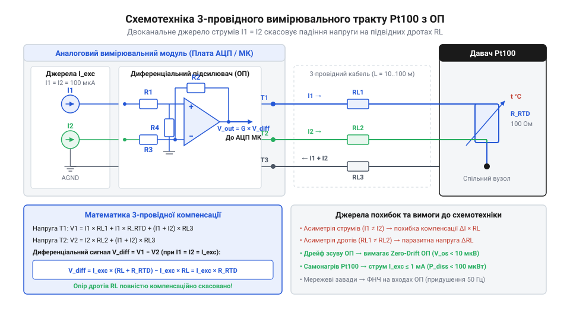
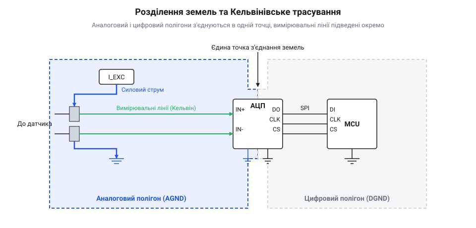

# Аналоговий вимірювальний тракт для 3-провідного Pt100 на операційному підсилювачі та генераторі струму

<preknowlist>
- [PT100 — платиновий термоопір](root:cat-hw-sensors/pt100-rtd) — залежність опору платини від температури (100 Ом при 0°C), температурний коефіцієнт та принципи фізичної зміни опору
- [Стандарт IEC 60751 для платинових термоопорів](root:cat-hw-sensors/iec-60751-standard-for-rtd) — класи точності термодетекторів та формула Каллендара-Ван Дюзена для лінеаризації
</preknowlist>

## Паразитний опір кабелю та компенсація

Під час вимірювання температури за допомогою платинових термоопорів (наприклад, Pt100) одним із головних джерел похибки є паразитний опір підвідних дротів. Оскільки номінальний опір Pt100 становить лише `100 Ом` при `0 °C`, а його зміна становить близько `0.385 Ом` на `1 °C`, навіть невеликий опір кабелю (наприклад, `1 Ом`) може спричинити значну похибку вимірювання (понад `2.5 °C`). Чим довший кабель, тим більшим буде цей паразитний опір і, відповідно, спотворення показань.

Для усунення цієї проблеми широко застосовується 3-провідне підключення. Математичний принцип 3-провідної компенсації полягає у використанні додаткового провідника для вимірювання падіння напруги безпосередньо на лініях підключення. Два струми збудження однакової величини (`I`) пропускаються через вимірювальні провідники, завдяки чому падіння напруги на них взаємно компенсується у диференціальному підсилювачі. Якщо опір кожного підвідного дроту дорівнює `R_lead`, то напруга на одному вході підсилювача становить:

```
V_1 = I * R_Pt100 + I * R_lead
```

а на іншому:

```
V_2 = I * R_lead
```

Диференціальний підсилювач вимірює різницю цих напруг:

```
V_diff = V_1 - V_2 = I * R_Pt100
```

Таким чином, вплив опору дротів повністю усувається. Важливою умовою для правильної компенсації є ідентичність опорів усіх трьох провідників. На виході формується сигнал, який залежить виключно від опору самого термодетектора. Загальна топологія аналогового фронтенду передбачає симетричне підключення ліній до прецизійних джерел струму.



## Схемотехніка генератора струму та підсилювача

Основою прецизійного вимірювального тракту є генератор струму збудження, побудований на базі операційного підсилювача з нульовим дрейфом (Zero-Drift) та прецизійного джерела опорної напруги. Такий генератор забезпечує стабільний струм, як правило 1 мА або 500 мкА, що пропускається через Pt100. Вибір операційного підсилювача архітектури Zero-Drift дозволяє мінімізувати вплив температурного дрейфу напруги зсуву на точність генерації струму.

Спад напруги на терморезисторі знімається за допомогою диференціального підсилювача, який масштабує корисний сигнал під робочий діапазон АЦП мікроконтролера. Під час розрахунку диференціального підсилювача слід враховувати коефіцієнт підсилення, необхідний для отримання максимальної роздільної здатності. Особливу увагу варто приділяти вибору прецизійних резисторів з низьким температурним коефіцієнтом опору (ТКО), щоб уникнути додаткових похибок. Також необхідно контролювати похибку від самонагріву давача, оскільки надмірний струм збудження спричиняє виділення тепла на Pt100.



## Аналогова фільтрація та топологія плати

Вимірювання сигналів Pt100 вимагає роботи з напругами порядку мілівольтів. У таких умовах мережеві завади з частотою 50 Гц стають серйозною проблемою, адже довгі кабелі працюють як антени. Для придушення цих завад використовують активні аналогові фільтри низьких частот (ФНЧ) другого або вищого порядку. Вони розміщуються безпосередньо перед входом АЦП. Зазвичай використовують топологію Саллена — Кі (Sallen-Key) або фільтри з багатопетлевим зворотним зв'язком (Multiple Feedback, MFB). Частоту зрізу обирають значно нижчою за 50 Гц, зазвичай у діапазоні 2–10 Гц, оскільки температура — це інерційний параметр, який не змінюється миттєво.

Активна фільтрація не лише прибирає високочастотний шум, але й виступає як антиаліасинговий фільтр перед оцифруванням. Важливою деталлю є вибір конденсаторів: для прецизійних кіл слід використовувати конденсатори з діелектриком C0G/NP0, оскільки вони мають мінімальний температурний дрейф і низький п'єзоелектричний ефект.

Топологія друкованої плати (PCB) відіграє критичну роль у збереженні точності тракту. Аналогова й цифрова «землі» повинні бути розділені й з'єднуватися лише в одній точці, зазвичай під самою мікросхемою АЦП (правило «зірки»). Це усуває паразитні контури заземлення, через які імпульсні струми цифрової частини можуть створювати падіння напруги в аналогових колах.

Для підключення терморезистора застосовують Кельвінівське підключення (чотириточкове) безпосередньо до клемника плати, де струмові (Excitation) та вимірювальні (Sense) провідники йдуть окремими трасами до операційного підсилювача. Також необхідно звернути увагу на паразитну термо-ЕРС. Будь-яке паяне з'єднання або контакт різнорідних металів діє як термопара, генеруючи мікровольти напруги під впливом градієнта температур. Щоб мінімізувати цей ефект, елементи диференціального підсилювача розміщують близько один до одного в зоні з рівномірним температурним полем, ізолюючи від джерел тепла (стабілізаторів, силових ключів).

## Оцифрування сигналу та двоточкове калібрування

Після підсилення та фільтрації сигнал надходить на аналого-цифровий перетворювач (АЦП) мікроконтролера або на зовнішній прецизійний АЦП. Для Pt100 роздільна здатність у 12 біт мікроконтролерів базового рівня дає точність близько 0.2–0.5 °C. Для більш точних вимірювань використовують 16- або 24-бітні дельта-сігма АЦП.

Перерахунок виміряного опору в температуру виконується за стандартизованою формулою Каллендара — Ван Дюзена. Оскільки математична модель має поліномінальний характер, на слабких мікроконтролерах її обчислюють за допомогою статичних таблиць Look-Up Table (LUT) з подальшою лінійною інтерполяцією.

Реальний апаратний тракт завжди має похибки: зміщення нуля операційних підсилювачів, неточність резисторів обв'язки та відхилення опорної напруги. Для їх усунення застосовують алгоритм двоточкового калібрування. За допомогою прецизійного магазину опорів задають два контрольних значення (наприклад, 100.0 Ом для 0 °C та 138.5 Ом для 100 °C) і обчислюють коефіцієнти корекції: адитивний зсув нуля (Zero Offset) та мультиплікативний масштаб (Gain Span).

## Повний вихідний код реалізації

Нижче наведено модульну реалізацію обробки та двоточкового калібрування сенсора Pt100 мовами C та C++.

:::tabs
@tab C (main.c)
:::code proj-rtd-3wire-opamp-signal-conditioner/c/src/main.c
@tab C (rtd_sensor.c)
:::code proj-rtd-3wire-opamp-signal-conditioner/c/src/rtd_sensor.c
@tab C++ (main.cpp)
:::code proj-rtd-3wire-opamp-signal-conditioner/cpp/src/main.cpp
@tab C++ (rtd_sensor.cpp)
:::code proj-rtd-3wire-opamp-signal-conditioner/cpp/src/rtd_sensor.cpp
:::

## Висновки

Створений 3-провідний аналоговий тракт забезпечує надійну компенсацію омічного опору сполучних дротів та високу точність зчитування платинового терморезистора Pt100. Застосування джерел струму на прецизійних ОП з нульовим дрейфом, активної аналогової фільтрації низьких частот, кельвінівського розведення провідників на друкованій платі та двоточкового калібрування дозволяє досягти стабільності вимірювань, необхідної для промислових систем термометрії.