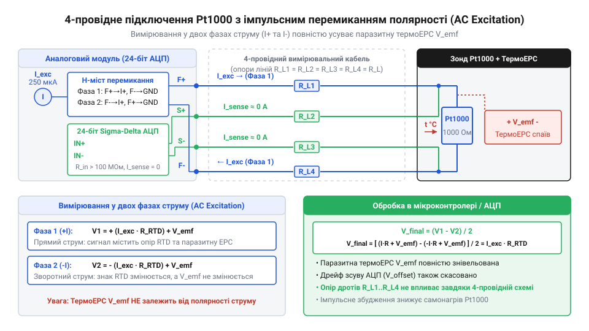
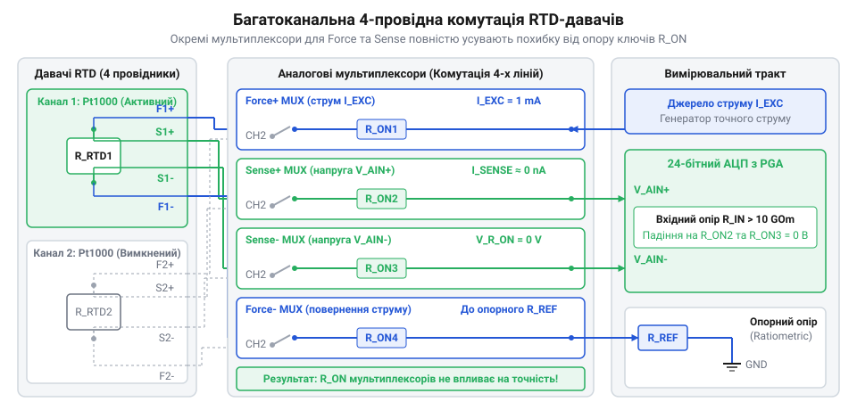

# Прецизійний багатоканальний термометричний логер на 4-провідних Pt1000 з імпульсним збудженням

<preknowlist>
- [PT100 — платиновий термоопір](root:cat-hw-sensors/pt100-rtd) — Принцип зміни опору платини від температури та поняття номінального опору R0.
- [MAX31865 — перетворювач опору платинових датчиків PT100/PT1000](root:cat-hw-sensors/max31865-rtd-converter) — Архітектура типових перетворювачів опору RTD та методи побудови відноснометричних вимірювальних кіл.
- [Стандарт IEC 60751 для платинових термоопорів](root:cat-hw-sensors/iec-60751-standard-for-rtd) — Допуски класів точності платинових опорів та температурний коефіцієнт альфа.
</preknowlist>

## Джерела похибок прецизійного вимірювання температури

Коли потрібна точність вимірювання температури на рівні мілікельвінів, пряме підключення платинового термоопору Pt1000 до вимірювального приладу дає похибку, яка робить таку точність недосяжною. Ця похибка виникає через три основні фізичні явища: опір з'єднувальних дротів, самонагрів сенсора вимірювальним струмом та паразитну термоЕРС у контактах.

Опір з'єднувальних дротів додається до опору самого сенсора. Мідний дріт довжиною кілька метрів має опір в одиниці омів, що для Pt1000 еквівалентно похибці в десяті частки градуса. Щоб усунути цей вплив, застосовують 4-провідну кельвінівську схему підключення. У цій схемі дві лінії (Force) використовуються лише для пропускання стабільного вимірювального струму через сенсор, а дві інші лінії (Sense) — лише для вимірювання падіння напруги безпосередньо на сенсорі. Фізично це реалізується так, що до кожного з двох виводів самого платиново-резистивного елемента ще всередині корпусу давача приварюють по два дроти — один струмовий і один вимірювальний. Оскільки вхідний опір вимірювача (наприклад, [АЦП](root:cat-hw-sensors/max31865-rtd-converter)) дуже великий, струм у лініях Sense практично відсутній, отже, немає і падіння напруги на них. Таким чином, вимірюється лише опір самого сенсора, і довжина дротів перестає впливати на результат.

Самонагрів виникає через те, що вимірювальний струм, протікаючи через Pt1000, виділяє тепло потужністю `I²·R`. Це тепло нагріває сенсор вище температури середовища. Щоб зменшити самонагрів, струм збудження вибирають якомога меншим, зазвичай не більше 1 мА, а краще близько 100-250 мкА. Менший струм зменшує нагрів у квадраті, але водночас зменшує корисний сигнал, тому вимагає застосування прецизійних АЦП з низьким рівнем шуму.

Паразитна термоЕРС (електрорушійна сила) виникає в місцях з'єднання різних металів — наприклад, мідного дроту з клемами приладу чи виводами самого сенсора, через ефект Зеєбека. Будь-який градієнт температури на цих контактах генерує постійну напругу, яка додається до корисного сигналу падіння напруги на сенсорі. При мікровольтових рівнях корисного сигналу паразитні термоЕРС стають головною перешкодою для досягнення мілікельвінової точності, оскільки вони дрейфують від найменшого подуву повітря чи нагріву плати.

## Компенсація термоЕРС струмом змінної полярності

Для усунення впливу постійної термоЕРС застосовують метод двонаправленого імпульсного збудження. Ідея полягає в тому, щоб виміряти напругу на сенсорі двічі, пропускаючи струм спочатку в одному напрямку, а потім — у протилежному, і відняти ці результати. Апаратно таку зміну напрямку струму забезпечує інтегрований H-міст: транзисторні ключі діагоналей моста синхронно перемикаються, інвертуючи потік вимірювального струму через сенсор без зміни його абсолютної величини.

*Схема 4-провідного підключення Pt1000 до АЦП із мостовим перемикачем полярності струму збудження, де показано шляхи струму та віднімання термоЕРС.*

Нехай напруга на сенсорі при прямому напрямку струму складається з корисного падіння напруги `V_rtd` та паразитної термоЕРС `V_tc`. Тоді перше вимірювання дасть результат `V_1 = V_rtd + V_tc`. При зміні полярності струму на протилежну корисне падіння напруги змінить знак, а полярність контактної термоЕРС залишиться незмінною, оскільки напрямок струму не впливає на ефект Зеєбека. Друге вимірювання дасть `V_2 = -V_rtd + V_tc`. Якщо тепер відняти друге вимірювання від першого, отримаємо `V_1 - V_2 = (V_rtd + V_tc) - (-V_rtd + V_tc) = 2·V_rtd`. 

Як бачимо, термоЕРС повністю знищується, а корисний сигнал подвоюється. Цей метод ефективно працює за умови, що термоЕРС не встигає суттєво змінитися за час між двома вимірюваннями. Тому перемикання та оцифровування виконують досить швидко. У поєднанні з 24-бітним дельта-сигма АЦП, який забезпечує високу роздільну здатність, такий підхід дозволяє отримати чистий відноснометричний опір, вільний від контактних зміщень. Розрахунок опорних резисторів та таймінгів перемикання спирається на час встановлення фільтрів АЦП та паразитних ємностей ліній.

## Багатоканальна аналогова комутація 4-провідних давачів

Коли логер має опитувати масив сенсорів, необхідно організувати комутацію всіх чотирьох ліній кожного давача. Це завдання ускладнюється тим, що будь-які додаткові ключі в колі вимірювання вносять свій опір і свої термоЕРС.

*Схема комутації струмових і вимірювальних ліній декількох 4-провідних давачів через аналогові мультиплексори з узгодженням каналів Force та Sense.*

Для комутації використовують прецизійні аналогові мультиплексори. Лінії струму збудження (Force) комутуються однією парою мультиплексорів, а лінії вимірювання напруги (Sense) — іншою. Оскільки лінії Sense працюють у режимі мікрострумів (через високий вхідний опір АЦП), опір відкритого каналу мультиплексора в цих лініях не викликає помітного падіння напруги і не впливає на результат. Проте опір каналу в лініях Force додається до опору дротів, що вимагає достатнього запасу напруги джерела збудження. 

Головним джерелом похибок у такій схемі є струми витоку закритих каналів мультиплексора та залишкові заряди на паразитних ємностях. Щоб уникнути похибок від перехідних процесів, алгоритм опитування організовують із часовим розподілом: після перемикання каналу система витримує паузу для встановлення напруги, потім генерує імпульс прямого струму, вимірює, перемикає полярність, знову чекає на встановлення і робить друге вимірювання. Тільки після завершення цього циклу для одного давача комутатор переходить до наступного.

## Лінеаризація Каллендара — Ван Дюзена та діагностика

Отриманий після компенсації зміщень та оцифрування опір платинового давача ще не є температурою. Залежність опору платини від температури лише наближено лінійна. Для досягнення високої точності в широкому діапазоні температур застосовують рівняння Каллендара — Ван Дюзена. Воно описує поведінку металу і має дві гілки: для додатних і для від'ємних температур. 

Для температур вище 0 °C характеристика описується квадратним рівнянням `R(t) = R0 · (1 + A·t + B·t²)`, де `R0` — опір при нулі градусів, а коефіцієнти `A` та `B` стандартизовані [стандартом IEC 60751](root:cat-hw-sensors/iec-60751-standard-for-rtd). Щоб знайти температуру `t` за виміряним опором `R`, достатньо розв'язати це квадратне рівняння відносно `t`. Оскільки мікроконтролери мають вбудовану або оптимізовану бібліотеку обчислення квадратного кореня, цей прямий метод працює швидко і забезпечує математично точний результат без наближень. Формула набуває вигляду `t = (-A + √(A² - 4·B·(1 - R/R0))) / (2·B)`.

Для температур нижче 0 °C рівняння ускладнюється і набуває вигляду `R(t) = R0 · (1 + A·t + B·t² + C·(t - 100)·t³)`, де з'являється поліном четвертого степеня з додатковим коефіцієнтом `C`. Аналітичний розв'язок рівняння четвертого степеня є занадто громіздким для мікроконтролера, тому температуру шукають чисельними методами. Найчастіше застосовують метод Ньютона — Рафсона. Починаючи з лінійного наближення `t0 = (R/R0 - 1) / A`, алгоритм обчислює значення опору за повним рівнянням. Знайдена різниця між розрахунковим та виміряним опором коригує наступну оцінку `t`. Зазвичай трьох-чотирьох ітерацій достатньо, щоб звести похибку до рівня менше ніж 0.001 °C.

Окрім перерахунку в градуси, програмна обробка відповідає за апаратну діагностику стану вимірювальних ліній. При безпосередній оцифровці 24-бітним АЦП діагностика лягає на програмне забезпечення, на відміну від готових рішень на кшталт [мікросхеми MAX31865](root:cat-hw-sensors/max31865-rtd-converter). Якщо обчислений опір виявляється близьким до нуля, це свідчить про коротке замикання ліній збудження або вимірювання. Навпаки, якщо опір прямує до нескінченності (код АЦП досягає максимуму), система фіксує обрив ланцюга. Такі аварійні стани повинні негайно блокувати обчислення температури, генеруючи спеціальний код помилки для цього каналу, щоб запобігти використанню хибних даних у контурах керування.

## Автономне логування та інтерфейс Modbus RTU

Лінеаризовані температури та статуси помилок з кожного каналу формують єдиний масив даних. У системах промислового моніторингу ці дані повинні одночасно зберігатися локально для страховки і передаватися до центрального диспетчерського пульта.

Для забезпечення автономності логер оснащується слотом для SD-карти, з якою мікроконтролер спілкується через інтерфейс SPI. Кожен запис супроводжується точною міткою часу від незалежного годинника реального часу (RTC). Дані пишуться на карту у форматі CSV, де один рядок відповідає одному зрізу часу для всіх каналів. Оскільки SD-карта споживає значний струм під час запису сектору і може вносити імпульсні завади в лінії живлення аналогової частини, операцію скидання буфера на карту (синхронізацію) узгоджують із циклами вимірювання АЦП, записуючи дані в моменти пауз між перетвореннями. Також запис часто виноситься в окремий потік операційної системи реального часу (RTOS), щоб повільне стирання блоків карти не зупиняло цикл вимірювання.

Для передачі даних у промислову мережу логер підключається до шини RS-485, поверх якого працює протокол Modbus RTU. Логер реалізує логіку підпорядкованого пристрою (@@en|slave@@) і відповідає лише на запити майстра. Карта регістрів Modbus проєктується так, щоб температура передавалася у форматі числа з рухомою комою або як ціле число з фіксованою комою. Поруч із температурою розміщується регістр статусу, що містить прапорці помилок.

Головна складність програмної реалізації Modbus RTU полягає в керуванні напрямком передачі трансивера RS-485. Мікроконтролер використовує пін для перемикання мікросхеми між режимами слухання та передачі. Перемикання на передачу має відбуватися рівно перед початком відправки, а повернення в режим прийому — відразу після фізичного завершення відправки останнього біта контрольної суми CRC. Управління цим таймінгом найчастіше реалізують апаратно, через переривання UART по завершенню передачі. Кожен фрейм Modbus захищений сумою CRC-16, що дозволяє відкинути спотворені завадами дані.