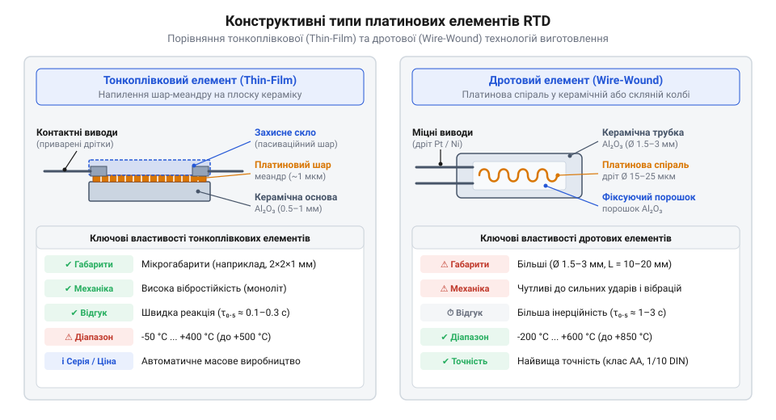
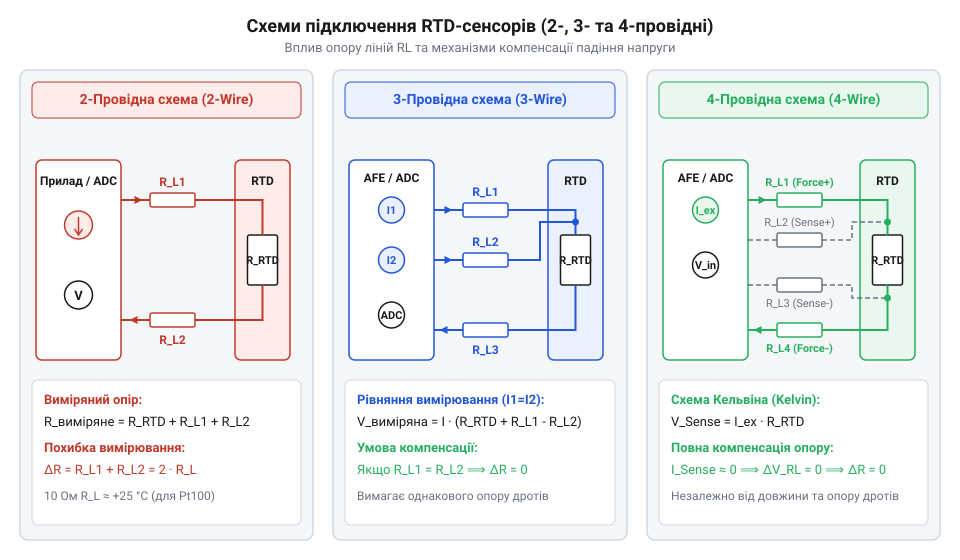
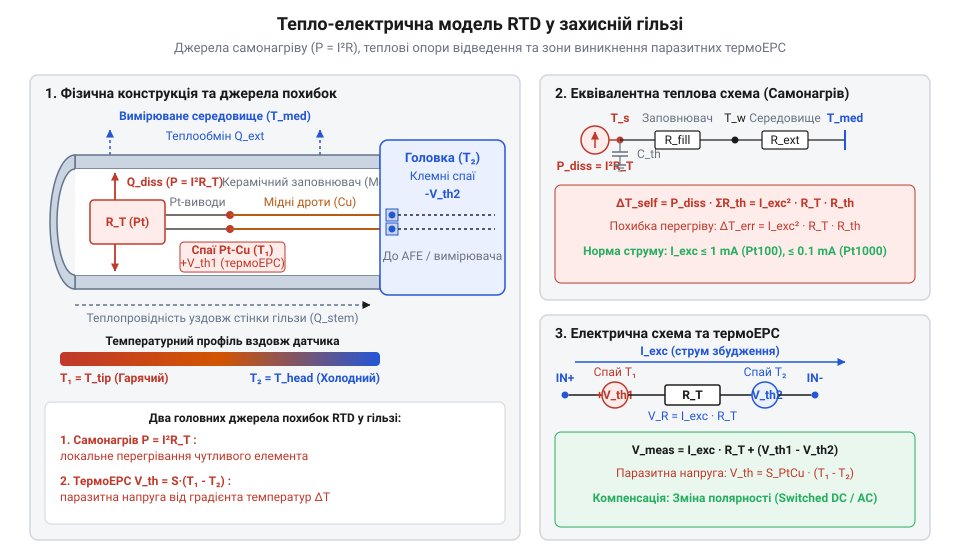
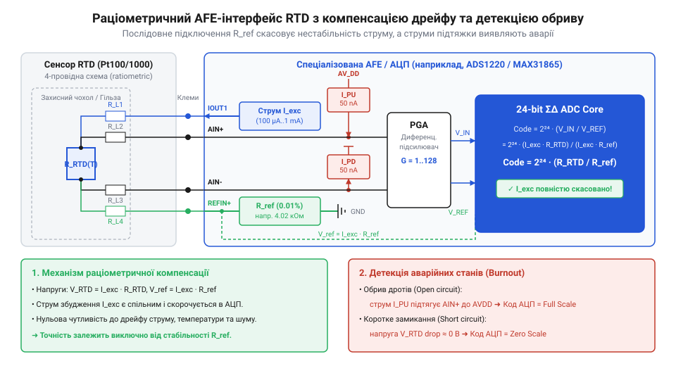

# Огляд родини резистивних перетворювачів температури RTD

<preknowlist>
- [KY-013 — аналоговий давач температури (термістор)](root:cat-hw-sensors/ky-013-thermistor) — Принципи вимірювання опору термісторів NTC та їхні обмеження щодо лінійності й температурного діапазону.
- [LM35DZ — аналоговий давач температури (10 мВ/°C)](root:cat-hw-sensors/lm35) — Особливості напівпровідникових аналогових сенсорів та межі їх використання у промислових середовищах.
- [Стандарт IEC 60751 для платинових термоопорів](root:cat-hw-sensors/iec-60751-standard-for-rtd) — Базові визначення температурних класів точності та допусків для платинових вимірювальних резисторів.
</preknowlist>

## Втрата точності у промислових вимірюваннях

У сучасних автоматизованих системах вимірювання температури є базовою операцією, від якої залежить безпека технологічних процесів, якість продукції та енергоефективність підприємства. Проте спроба використати у критичних вузлах прості та дешеві давачі швидко призводить до деградації точності та системних збоїв. Поширені напівпровідникові інтегральні сенсори, такі як @@en|LM35DZ@@ (з англ. *semiconductor* — напівпровідник) або цифрові мікросхеми серій @@en|DS18B20@@ та @@en|DHT11@@, чудово працюють у побутовій електроніці чи кімнатних термостатах, але абсолютно не пристосовані до важких промислових умов. При виході за межі вузького температурного діапазону від -55 °C до +125 °C їхні корпуси втрачають герметичність, кристали кремнію зазнають прискореного деградаційного дрейфу, а внутрішня активна схемотехніка зупиняється через тепловий пробій p-n переходів.

Застосування аналогових термісторів типу @@en|NTC@@ (з англ. @@en|Negative Temperature Coefficient@@ — негативний температурний коефіцієнт), таких як модуль @@en|KY-013@@, стикається з іншою фізичною перешкодою. Керамічні матеріали на основі оксидів перехідних металів (марганцю, нікелю, кобальту), з яких виготовляють @@en|NTC@@-резистори, мають експоненційну залежність опору від температури. Поряд із кімнатною температурою чутливість таких сенсорів висока, але при нагріванні понад +150 °C похідна опору за температурою стрімко падає до нуля, втрачаючи роздільну здатність. Крім того, під дією тривалого теплового навантаження в напівпровідниковій кераміці виникає міграція іонів та структурна релаксація кристалічної ґратки. Це спричиняє незворотний часовий дрейф градуювальної характеристики — опір сенсора змінюється сам по собі навіть за незмінної температури довкілля, що вимагає постійного повторного калібрування системи. Принципи роботи, математичну модель Стейнхарта — Харта та практичні схеми застосування напівпровідникових терморезисторів висвітлено в [огляді напівпровідникових терморезисторів NTC та PTC](root:cat-hw-sensors/thermistor-ntc-ptc-sensors-overview).

Коли вимірювальну трасу необхідно прокласти на десятки або сотні метрів від шафи управління до технологічного резервуара, виникає цілий комплекс додаткових деструктивних чинників:

- **Опір з'єднувальних ліній:** Електричний опір довгих мідних дротів додається послідовно до опору первинного перетворювача. У випадку низькоомних або нелінійних сенсорів цей додатковий опір створює постійний температурний зсув (офсет), який до того ж змінюється при коливаннях температури самого кабельного каналу. - **Ефект самонагрівання:** Проходження струму збудження через вимірювальний резистор виділяє джоулеву потужність. Якщо теплова потужність перевищує здатність сенсора розсіювати тепло в довкілля, давач нагріває сам себе, викривляючи реальні показники середовища. - **Паразитні термоЕРС (Ефект Зеєбека):** У місцях з'єднання різнорідних провідників (наприклад, мідної жили кабелю та виводів давача) при наявності градієнта температур виникає термоелектричний потенціал. Ця паразитна напруга накладається на корисний сигнал аналогово-цифрового перетворювача (АЦП), створюючи невиправні похибки в мікровольтній області.

Промисловий контроль вимагає первинного перетворювача абсолютно іншого класу — пристрою, який поєднує високу хімічну інертність, механічну стабільність, сувору відтворюваність характеристик та передбачуваний, монотонний зв'язок між температурою й опором у гігантському діапазоні від кріогенних -200 °C до екстремальних +850 °C. Цим вимогам ідеально відповідає резистивний перетворювач температури — @@en|RTD@@ (з англ. @@en|Resistance Temperature Detector@@: *resist* — опір, *temperature* — температура, *detect* — виявляти).

Еталонним матеріалом для виготовлення @@en|RTD@@ стала платина (`Pt`). Будучи благородним металом, вона не окислюється при високих температурах, має надзвичайно високий ступінь очищення (до 99.999%) і демонструє суворо позитивний та стабільний температурний коефіцієнт опору (@@en|TCR@@ / @@en|TKO@@). На відміну від складних напівпровідникових структур, платиновий дріт або плівка зберігає атомну структуру недоторканою впродовж десятиліть експлуатації. Тривалий процес вивчення теплофізичних властивостей металів та формування стандартів підтверджує, що [історичний шлях створення платинових сенсорів](root:cat-hw-sensors/rtd-resistance-temperature-detectors-family-overview/hist-rtd-evolution-and-standards.md) заклав основу для сучасної прецизійної термометрії, стандартизованої міжнародними нормами.

## Фізичні принципи та конструкція RTD

В основі роботи платинових перетворювачів @@en|RTD@@ лежить фундаментальне явище розсіяння носіїв електричного заряду на фононах (теплових коливаннях кристалічної ґратки металу). У металевому провіднику густина вільних електронів провідності залишається практично сталою при зміні температури. Проте при нагріванні атоми платини в вузлах кристалічної ґратки починають здійснювати теплові коливання з більшою амплітудою. Вільні електрони, що рухаються під дією зовнішнього електричного поля, частіше зіштовхуються з цими коливними вузлами (фононами), що зменшує середню довжину вільного пробігу електронів та їхню рухливість. У результаті питомий електричний опір металу зростає зі збільшенням температури. Ця властивість називається позитивним температурним коефіцієнтом опору — @@en|PTCR@@ (з англ. @@en|Positive Temperature Coefficient of Resistance@@).

У помірному температурному діапазоні (від 0 °C до +100 °C) залежність опору платини від температури з високою точністю описується лінійним рівнянням:

```
R(T) = R₀ × (1 + α × T)
```

де `R₀` — електричний опір сенсора при температурі 0 °C (номінальний опір), `T` — температура середовища у градусах Цельсія (°C), а `α` — температурний коефіцієнт опору (@@en|TCR@@), який для промислової платини чистоти `3851` за стандартом @@en|IEC 60751@@ становить суворо визначену константу:

```
α = 0.003851 °C⁻¹
```

Розглянемо практичний розрахунок опору класичного платинового сенсора @@en|Pt100@@ (номінальний опір `R₀ = 100 Ω` при 0 °C) при нагріванні довкілля до температури `T = 100 °C`:

```
R(100) = R₀ × (1 + α × T)
       = 100 × (1 + 0.003851 × 100)      [підстановка параметрів Pt100 при 100 °C]
       = 100 × (1 + 0.3851)              [перемноження коефіцієнта на температуру]
       = 138.51 Ω                        [підсумковий опір при 100 °C]
```

З розрахунку видно, що чутливість сенсора @@en|Pt100@@ становить:

```
ΔR / ΔT = (138.51 - 100) / 100 = 0.3851 Ω/°C
```

При виході за межі вузького діапазону (наприклад, при від'ємних температурах до -200 °C або при високому нагріві до +850 °C) крива опору платини виявляє слабку нелінійність, зумовлену вищими порядками електрон-фононного взаємозв'язку. Для компенсації цієї нелінійності у вимірювальних контролерах застосовують поліноміальне виведення, де детальний [математичний апарат рівняння Каллендара — Ван Дюзена](root:cat-hw-sensors/rtd-resistance-temperature-detectors-family-overview/math-callendar-van-dusen-and-rtd-linearization.md) описує додаткові коефіцієнти `β` та `γ` для точного перерахунку опору в температуру.

Фізична реалізація платинового вимірювального резистора суттєво впливає на його динамічні, механічні та температурні характеристики. У сучасній приладобудівній галузі домінують два основні конструктивні типи сенсорів.


*Конструктивні відмінності між дротовими (wire-wound) та тонкоплівковими (thin-film) термоопорами RTD.*

**Дротові елементи (@@en|wire-wound@@):**
Дротовий перетворювач виготовляють шляхом намотування мікроскопічної платинової нитки (діаметром від 10 до 50 мікрометрів) на керамічний каркас із оксиду алюмінію (`Al₂O₃`) або укладання спіралі всередину керамічних капілярів з наступною герметизацією високотемпературним склом чи керамічним цементом. - *Переваги:* Найвища часова стабільність, відсутність внутрішніх механічних напружень при розширенні, широкий робочий діапазон від -200 °C до +850 °C та максимальна точність (еталонні термометри). - *Недоліки:* висока вартість через трудомістке ручне виготовлення, велика теплова інерційність (значна маса та габарити) та чутливість до сильної вібрації, яка може викликати обрив або міжвиткове коротке замикання тонкого дроту.

**Тонкоплівкові елементи (@@en|thin-film@@):**
Тонкоплівковий сенсор створюють методом вакуумного магнетронного розпилення (@@en|sputtering@@, з англ. *sputter* — розпилювати), при якому шар чистої платини товщиною близько 1 мікрометра наноситься на плоску керамічну підкладку. За допомогою підгонки лазером у плівці формують зигзагоподібну струмопровідну доріжку з точним номінальним опором, після чого поверхню покривають захисним шаром скла. - *Переваги:* Низька собівартість при масовому автоматизованому виробництві, мініатюрні розміри (до 1.2 × 1.6 мм), висока швидкість теплової відповіді (мала теплова маса) та виняткова стійкість до ударів і вібрацій. - *Недоліки:* Обмежений верхній температурний поріг (зазвичай до +500 °C ... +600 °C) через різницю коефіцієнтів теплового розширення підкладки та плівки, а також трохи вищий долгостроковий дрейф порівняно з найкращими дротовими зразками.

При проєктуванні вимірювального тракту інженер стикається з вибором номінального опору первинного перетворювача при 0 °C. Найпоширенішими стандартними номіналами є @@en|Pt100@@ (`100 Ω`) та @@en|Pt1000@@ (`1000 Ω`).

- **Особливості @@en|Pt100@@:** Історичний стандарт промисловості. Малий номінальний опір забезпечує низький імпеданс вимірювального кола, що робить його менш чутливим до наведених ємнісних наводок у довгих кабелях. Проте низька чутливість (`0.3851 Ω/°C`) створює жорсткі вимоги до компенсації опору ліній. Наприклад, додатковий опір мідного кабелю всього в `1 Ω` внесе велетенську похибку вимірювання:

```
Error = 1 Ω / 0.3851 (Ω/°C) ≈ 2.6 °C
```

Це робить двопровідне підключення @@en|Pt100@@ непридатним для точних вимірювань і вимагає застосування 3- або 4-провідних схем.

- **Особливості @@en|Pt1000@@:** Сучасний вибір для малопотужних пристроїв та мікроконтролерних систем. При `R₀ = 1000 Ω` чутливість зростає вдесятеро і становить `3.851 Ω/°C`. Завдяки цьому той самий паразитний опір кабелю в `1 Ω` створює похибку лише:

```
Error = 1 Ω / 3.851 (Ω/°C) ≈ 0.26 °C
```

Крім того, для досягнення однакового рівня напруги сигналу через @@en|Pt1000@@ можна пропускати значно менший струм збудження (наприклад, `100 мкА` замість `1 мА` для `Pt100`), що в 10 разів зменшує виділення джоулевого тепла і знижує ефект самонагрівання сенсора. Детальна [апаратна довідка інтерфейсів підключення](root:cat-hw-sensors/rtd-resistance-temperature-detectors-family-overview/api-rtd-wiring-and-hardware-interface.md) визначає узгодження таких електричних параметрів для різних кабельних трас.

Стандарт @@en|IEC 60751@@ класифікує платинові перетворювачі за допусками точності. Гранично допустима похибка (у градусах Цельсія) розраховується для кожного класу залежно від абсолютного значення температури `|t|`:

- **Клас AA (1/3 DIN):** `ΔT = ±(0.10 + 0.0017 × |t|) °C` (робочий діапазон зазвичай -50 ... +250 °C)
- **Клас A:** `ΔT = ±(0.15 + 0.0020 × |t|) °C` (робочий діапазон -100 ... +450 °C)
- **Клас B:** `ΔT = ±(0.30 + 0.0050 × |t|) °C` (робочий діапазон -196 ... +600 °C)
- **Клас C:** `ΔT = ±(0.60 + 0.0100 × |t|) °C` (робочий діапазон -196 ... +600 °C)

Обчислимо для порівняння припустиму похибку вимірювання при температурі `t = 100 °C` для класів B та A:

```
ΔT_Class_B = ±(0.30 + 0.0050 × 100)
           = ±(0.30 + 0.50)
           = ±0.80 °C                    [допустима похибка класу B при 100 °C]
```

```
ΔT_Class_A = ±(0.15 + 0.0020 × 100)
           = ±(0.15 + 0.20)
           = ±0.35 °C                    [допустима похибка класу A при 100 °C]
```

Вимоги до відповідності класу точності та тестові випробування регламентовані у [міжнародному стандарті IEC 60751](root:cat-hw-sensors/iec-60751-standard-for-rtd), який є вихідним документом для сертифікації термометрів опору.

Отже, навіть при використанні прецизійного платинового сенсора класу A підключення його звичайним двопровідним кабелем може повністю знівелювати точність вимірювального тракту через опір дротів. Щоб усунути цей паразитний опір і розкрити потенціал @@en|RTD@@, у схемотехніці застосовують спеціалізовані трипровідні та чотирипровідні топології підключення.

H2: Схеми компенсації паразитного опору дротів

Під час вимірювання температури на промислових об'єктах сенсор часто розташовують на відстані десятків або сотень метрів від вимірювального приладу. Вимірювальний струм тече від підсилювача крізь з'єднувальні мідні дроти, проходить через платиновий резистивний давач @@en|Pt100@@ (англ. *platinum*, від іспанського *platina* — маленьке срібло, та 100 Ом при 0 °C) і повертається назад. Мідний провідник володіє власним електричним опором: пара дротів перерізом 0.5 мм² завдовжки 50 метрів має сумарний опір петлі близько 3.6 Ом. Для давача @@en|Pt100@@ із номінальним опором 100 Ом при 0 °C та чутливістю близько `0.385 Ом/°C` такий неврахований опір лінії створює колосальний зсув вимірювань:

```
ΔT = R_w / S_RTD
   = 3.6 / 0.385
   ≈ 9.35 °C
```

Ця похибка не є статичним зсувом, який можна один раз компенсувати під час калібрування. Опір мідного кабелю динамічно змінюється разом із коливаннями температури навколишнього середовища вздовж усієї траси. Оскільки температурний коефіцієнт опору міді (`α_Cu ≈ +0.00393 1/°C`) майже збігається з коефіцієнтом платини (`α_Pt ≈ +0.00385 1/°C`), сезонний або добовий прогрів кабельного каналу фізично невідрізними від нагріву самого сенсора в найпростішому вимірювальному колі.

У двопровідній топології струм збудження та вимірювання падіння напруги здійснюються через одну й ту саму пару провідників. Напруга, знята на клемнику приладу, складається з корисної напруги сенсора та втрат у лінії:

```
V_meas = I_exc · (R_T + R_w1 + R_w2)
       = I_exc · (R_T + 2 · R_w)            [припускаючи симетрію R_w1 = R_w2 = R_w]
```

Розрахований приладом еквівалентний опір становить:

```
R_meas = V_meas / I_exc
       = R_T + 2 · R_w
```

Така двопровідна схема допустима лише у двох випадках: коли довжина кабелю не перевищує 1–2 метри або коли застосовують високоомні давачі, такі як @@en|Pt1000@@. Для @@en|Pt1000@@ із номінальним опором 1000 Ом та чутливістю `3.85 Ом/°C` той самий опір лінії 3.6 Ом викликає похибку лише `3.6 / 3.85 ≈ 0.935 °C` — відносна чутливість до кабельного опору зменшується вдесятеро. Втім, для прецизійних вимірювань двох дротів недостатньо. Детальний математичний аналіз межевих похибок ліній розглянуто у [розрахунку кабельних втрат](root:cat-hw-sensors/rtd-resistance-temperature-detectors-family-overview/math-rtd-self-heating-and-wire-resistance-error.md), де виведено рівняння деградації сигналу.


*Принципові схеми 2-, 3- та 4-провідного підключення RTD із позначенням паразитного опору з'єднувальних дротів R_w.*

Щоб усунути кабельну похибку без прокладання зайвих ліній, розробили трипровідну схему. Її ідея полягає в додаванні третього провідника, який використовується як потенційне плече вимірювання або для балансування вимірювального моста. У сучасних активних аналогових фронтендах трипровідне підключення реалізують за допомогою двох узгоджених джерел струму `I1 = I2 = I`. Струм `I1` подається через провідник 1 та сенсор `R_T` до спільної шини через провідник 3. Струм `I2` подається через провідник 2 безпосередньо до провідника 3.

Аналізуємо різницю потенціалів між вхідними клемами провідників 1 та 2 на боці вимірювача:

```
V_1 = I1 · (R_w1 + R_T) + (I1 + I2) · R_w3
V_2 = I2 · R_w2 + (I1 + I2) · R_w3
V_diff = V_1 - V_2
       = I1 · R_w1 + I1 · R_T + (I1 + I2) · R_w3 - I2 · R_w2 - (I1 + I2) · R_w3
       = I · (R_w1 + R_T - R_w2)             [за умови I1 = I2 = I]
       = I · R_T                             [за умови симетрії дротів R_w1 = R_w2]
```

Падіння напруги на третьому провіднику `R_w3` є спільним для обох вимірювальних каналів і повністю знищується під час диференціального віднімання. Якщо провідники 1 та 2 мають однаковий електричний опір (`R_w1 = R_w2`), їхні опори повністю компенсують один одного. У класичних мостових схемах, таких як місток Вітстона (англ. *Wheatstone bridge*, від імені винахідника Чарльза Вітстона), провідник 1 вмикають послідовно із давачем `R_T` в одне плече моста, а провідник 2 — послідовно з опорним резистором у суміжне плече, тоді як провідник 3 підключають до високовольтного входу підсилювача, де струм практично відсутній. Практичні аспекти розробки аналогових кондиціонерів сигналу на операційних підсилювачах детально описано у [схемотехнічному проєкті кондиціонера](root:cat-hw-sensors/rtd-resistance-temperature-detectors-family-overview/proj-rtd-3wire-opamp-signal-conditioner.md), де побудовано генератори струму та підсилювачі.

Попри ефективність, трипровідна схема має фундаментальне обмеження: вона спирається на припущення про сувору симетрію дротів (`R_w1 = R_w2`). Якщо провідники в багатожильному кабелі мають технологічний розкид товщини, різний опір обтискання в клемниках або піддаються нерівномірному температурному градієнту, виникає некомпенсована залишкова похибка `ΔR_w = R_w1 - R_w2`:

```
V_diff = I · (R_T + ΔR_w)
```

Для досягнення абсолютної незалежності від опору дротів та їхньої асиметрії застосовують чотирипровідне підключення. У цій архітектурі реалізовано чотирипровідну схему Кельвіна (англ. *Kelvin connection*, від імені лорда Кельвіна, Вільяма Томсона). Схема повністю розділяє коло проходження струму збудження (`Force+` та `Force-`) та коло вимірювання напруги (`Sense+` та `Sense-`).

Струм збудження `I_exc` тече виключно через силову пару `Force` та платиновий елемент `R_T`. Потенційні дроти `Sense` підключаються безпосередньо до виводів платинового елемента й ведуть до диференціального входу АЦП або операційного підсилювача з високим вхідним опором (`R_in > 10¹⁰ Ом`). Оскільки струм у потенційних провідниках практично дорівнює нулю (`I_sense ≈ 0`), падіння напруги на них відсутнє:

```
V_Sense+ = V_RTD_top + I_sense · R_w_sense1
         = V_RTD_top                         [оскільки I_sense ≈ 0]

V_Sense- = V_RTD_bottom - I_sense · R_w_sense2
         = V_RTD_bottom                      [оскільки I_sense ≈ 0]

V_meas = V_Sense+ - V_Sense-
       = V_RTD_top - V_RTD_bottom
       = I_exc · R_T
```

Ані опір силових дротів `Force`, ані опір потенційних дротів `Sense` не входять до підсумкового рівняння. Навіть якщо силові лінії мають опір 50 Ом, це лише зменшує запас напруги джерела струму, але ніяк не спотворює результат вимірювання `V_meas`. Детальніше розрахунок вимірювальних мостків та джерел струму Кельвіна викладено у статті про [схемотехніку компенсації опору з'єднувальних дротів у вимірювальних трасах](root:cat-hw-sensors/rtd-resistance-temperature-detectors-family-overview/math-rtd-self-heating-and-wire-resistance-error.md).

Найвищу точність у чотирипровідних системах забезпечує раціометричне вимірювання (лат. *ratio* — відношення, та грец. *metron* — міра). У звичайних схемах будь-яка нестабільність чи шум струму збудження `I_exc` прямо транслюються в похибку температури. У раціометричній архітектурі струм `I_exc` пропускають послідовно через давач `R_T` та високостабільний опорний резистор `R_ref`. Напруга на сенсорі становить `V_RTD = I_exc · R_T`, а падіння напруги на `R_ref` подається як опорна напруга АЦП: `V_ref = I_exc · R_ref`.

Вихідний цифровий код АЦП розраховується за формулою:

```
Code = (V_RTD / V_ref) · (2ⁿ - 1)
     = (I_exc · R_T) / (I_exc · R_ref) · (2ⁿ - 1)
     = (R_T / R_ref) · (2ⁿ - 1)              [струм I_exc повністю скорочується]
```

Струм збудження `I_exc` повністю скорочується з підсумкового виразу. Вимірювальний тракт стає повністю нечутливим до дрейфу струму, пульсацій живлення та теплового шуму джерела. Точність визначається виключно стабільністю `R_ref` та лінійністю АЦП. Фізичні роз'єми, типи кабелів та класи точності наведено в [апаратній довідці інтерфейсів](root:cat-hw-sensors/rtd-resistance-temperature-detectors-family-overview/api-rtd-wiring-and-hardware-interface.md). Практичну побудову прецизійної багатоканальної системи висвітлено в [архітектурі прецизійного логера](root:cat-hw-sensors/rtd-resistance-temperature-detectors-family-overview/proj-rtd-4wire-pt1000-high-precision-logger.md), де застосовано 24-бітний АЦП із раціометричним зчитуванням @@en|Pt1000@@. Для швидкої інтеграції застосовують [спеціалізовані мікросхеми перетворювачів](root:cat-hw-sensors/max31865-rtd-converter), такі як @@en|MAX31865@@, що містять інтегрований аналоговий фронтенд (англ. *Analog Front-End*, @@en|AFE@@).

H2: Механізми теплових і термоелектричних завад

Після усунення паразитного опору кабельних ліній за допомогою трипровідної або чотирипровідної топології точність вимірювання більше не обмежується електричним опором міді. Проте виникають два неелектричні фізичні явища, що спотворюють сигнал безпосередньо у вимірювальному вузлі: внутрішній джоулів нагрів сенсора струмом збудження та паразитні постійні напруги, що виникають на стиках різнорідних металів під дією температурного градієнта.

Для вимірювання опору `R_T` крізь платиновий елемент необхідно пропустити струм збудження `I_exc`. За законом Джоуля — Ленца це викликає виділення теплової потужності всередині тонкоплівкової або дротової структури:

```
P_joule = I_exc² · R_T
```

Виділене тепло має передатися від платинової спіралі або плівки через керамічну підкладку, термопасту й металевий корпус давача до вимірювального середовища (газу, рідини або твердого тіла). Ефективність теплообміну описується коефіцієнтом теплового розсіювання `E_th` (вимірюється в мВт/°C). Перевищення температури сенсора над фактичною температурою середовища становить:

```
ΔT_self = P_joule / E_th
        = (I_exc² · R_T) / E_th
```

Якщо давач @@en|Pt100@@ (`R_T ≈ 100 Ом`) живиться струмом `5 мА` у нерухомому повітрі, де `E_th ≈ 2.0 мВт/°C`, розраховуємо паразитна самонагрівання:

```
P_joule = (0.005)² · 100
        = 0.0025 Вт
        = 2.5 мВт

ΔT_self = 2.5 / 2.0
        = 1.25 °C
```

Похибка у 1.25 °C перевищує весь допуск точності класу A за стандартом @@en|IEC 60751@@! Коефіцієнт `E_th` суттєво залежить від середовища: у проточній воді він сягає 50–100 мВт/°C (`ΔT_self < 0.05 °C`), а у вакуумі чи повітрі відведення тепла вкрай ускладнене. Щоб уникнути цього ефекту, струм збудження жорстко обмежують: для @@en|Pt100@@ обирають струм від `0.1 мА` до `1.0 мА` (потужність 1 мкВт — 100 мкВт), а для @@en|Pt1000@@ — від `50 мкА` до `200 мкА`. Додатково застосовують імпульсне збудження (англ. *pulsed excitation*), за якого струм подається лише на час вибірки АЦП (наприклад, на 10 мс один раз на секунду), що знижує середню потужність у сотні разів.

Другим прихованим джерелом похибок є термоелектрорушійна сила (нім. *Seebeck-Effekt*, від імені фізика Томаса Зеєбека, та грец. *therme* — тепло). У вимірювальному зонді RTD присутні кілька з'єднань різнорідних металів: платинові виводи зварюються зі срібними або нікелевими дрітками, які з'єднуються з мідним кабелем і далі — з латунними клемниками. Коли між робочим кінцем зонда та сполучною головкою існує градієнт температур (наприклад, зонд занурено в середовище +200 °C, а клемник перебуває при +30 °C), кожна пара різнорідних металів працює як термопара, генеруючи паразитну постійну напругу за @@de|ефектом Зеєбека@@:

```
V_th = S_ab · (T_junction1 - T_junction2)    [де S_ab — відносний коефіцієнт Зеєбека]
```

Пара Pt-Cu або Ni-Cu генерує паразитну @@de|термоЕРС@@ величиною від `5` до `20 мкВ` на кожен градус різниці температур між спаями. У колі постійного струму з давачем @@en|Pt100@@ при струмі `1 мА` корисний сигнал при 0 °C становить `100 мВ`, а чутливість — `385 мкВ/°C`. Паразитна напруга `V_th = 38.5 мкВ` додається до виміряного сигналу:

```
V_meas = I_exc · R_T + V_th
```

Це викликає некомпенсований температурний зсув:

```
ΔT_err = V_th / (I_exc · S_RTD)
       = 38.5 мкВ / 385 мкВ/°C
       = 0.1 °C
```


*Еквівалентна схема поширення тепла та формування паразитних термоелектричних напруг у вимірювальному вузлі RTD.*

Для повного усунення постійної @@de|термоЕРС@@ у прецизійних приладах застосовують методику переполюсовки струму (англ. *current reversal* або *chopper stabilization*, @@en|chopper stabilization@@). Цикл вимірювання складається з двох послідовних вибірок АЦП:

1. Подається прямий струм `+I_exc` і вимірюється напруга:
   `V_pos = +I_exc · R_T + V_th`
2. Подається зворотний струм `-I_exc` і вимірюється напруга:
   `V_neg = -I_exc · R_T + V_th`
3. Розраховується різниця вибірок:
   `V_clean = (V_pos - V_neg) / 2`
   `        = ((+I_exc · R_T + V_th) - (-I_exc · R_T + V_th)) / 2`
   `        = (2 · I_exc · R_T) / 2`
   `        = I_exc · R_T`

Статична складова @@de|термоЕРС@@ `V_th` повністю віднімається. Іншим ефективним заходом є перехід на давачі @@en|Pt1000@@: оскільки при тому самому струмі сигнал @@en|Pt1000@@ у 10 разів більший (`3.85 мВ/°C`), відносний вплив мікровольтних паразитних напруг стає знехтувно малим. Фізичні принципи функціонування, класифікацію типів термопар та методи компенсації холодного спаю детально висвітлено в [огляді термопар та термоелектричних перетворювачів температури](root:cat-hw-sensors/thermocouple-temperature-sensors-overview).

У промисловості давачі RTD поміщають у захисна гільза (нім. *Thermowell*, від грец. *therme* — тепло, та англ. *well* — колодязь/захисна шахта). Гільза захищає чутливий елемент від високого тиску та агресивних середовищ, проте створює додатковий тепловий опір і похибку відведення тепла по корпусу (англ. *stem conduction error*, @@en|stem conduction error@@). Тепло витікає від гарячого середовища по металевому корпусу гільзи до холодного зовнішнього трубопроводу. Якщо глибина занурення недостатня, температура вимірювальної головки виявляється заниженою. Для запобігання цій похибці дотримуються правил вибору глибини занурення:

- У рідких середовищах глибина занурення має становити не менше 10–15 зовнішніх діаметрів захисної гільзи. - У газових та парових середовищах — не менше 15–20 діаметрів. - Простір між первинним капсульованим давачем та внутрішньою стінкою гільзи заповнюють теплопровідною пастою або порошком оксиду магнію.

Конструктивні виконання та вимоги до монтажу гілоз детально описано в [огляді захисної арматури](root:cat-hw-sensors/thermowell-and-industrial-rtd-protection), що розглядає промислове застосування термометрії.


*Схема аналогового фронтенду (AFE) з раціометричним зніманням сигналу та детекторами нештатних режимів.*

Крім обробки корисного сигналу, аналоговий трак має забезпечувати апаратну діагностику несправностей кабельної лінії. У разі механічного обриву провідника (англ. *open-circuit fault*) або короткого замикання (англ. *short-circuit fault*) некоректна програма може зчитати екстремальне значення температури й спровокувати хибне аварійне відключення. Спеціалізовані мікросхеми @@en|AFE@@ (зокрема @@en|MAX31865@@) містять джерела зсуву та віконні компаратори:

- Під час обриву лінії джерело підтяжки виводить напругу входу до рівня `VDD`, і АЦП фіксує перевищення верхньої межі діапазону. - Під час короткого замикання давача напруга падає до 0 В, що нижче мінімально припустимого порогу.

Алгоритми обчислення температури, програмної лінеаризації та опитування регістрів діагностики висвітлено у [програмній бібліотеці обробки](root:cat-hw-sensors/rtd-resistance-temperature-detectors-family-overview/api-rtd-software-processing-library.md).

Нижче наведено практичні приклади програмної обробки раціометричного зчитування RTD та діагностики нештатних режимів для мікроконтролерних систем.

:::tabs
:::code rtd-resistance-temperature-detectors-family-overview-d/c/esp-idf/rtd-process-code.c

:::code rtd-resistance-temperature-detectors-family-overview-d/cpp/arduino/rtdsensorreader.cpp
:::

H2: Апаратні інтерфейси та діагностика несправностей

Передавання аналогового сигналу від платинового давача @@en|Pt100@@ або @@en|Pt1000@@ до цифрово-процесорного вузла вимагає високої точності обробки мікровольтних напруг. Оскільки зміна температури платинового резистора на 1 °C спричиняє зміну опору всього на `0.385 Ом` (що при стандартному струмі збудження `1 мА` відповідає приросту напруги `385 мкВ`), пряме підключення RTD до звичайного аналого-цифрового перетворювача мікроконтролера призводить до високого рівня шумів та температурного дрейфу. Для побудови промислових систем термометрії застосовують спеціалізовані інтегровані мікросхеми аналогового фронтенду (англ. *Analog Front-End*, @@en|AFE@@), такі як @@en|MAX31865@@ або прецизійні 24-бітні дельта-сигма АЦП (англ. *delta-sigma*, @@en|Delta-Sigma ADC@@) зі вбудованими джерелами струму.

Під час розробки аналогового тракту ключовим завданням є забезпечення правильної спільної напруги сигнальних входів (англ. *common-mode voltage*). Більшість малошумних програмованих підсилювачів (англ. *Programmable Gain Amplifier*, @@en|PGA@@), що входять до складу @@en|Delta-Sigma ADC@@, вимагають, щоб потенціал на диференціальних входах перебував у межах лінійного діапазону живлення (`V_GND + V_margin ≤ V_CM ≤ V_DD - V_margin`). Якщо підключити нижній вивід RTD безпосередньо до спільної шини `GND`, вхідний підсилювач входить у насичення. Для зміщення потенціалу у робочу зону послідовно із сенсором вмикають високостабільний прецизійний резистор `R_ref`, який одночасно створює опорну напругу та формує необхідний рівень спільної напруги.

Архітектура сучасного аналогового фронтенду об'єднує парні програмовані генератори струму (англ. *Integrated Current DAC*, @@en|IDAC@@), які можна програмно комутувати між виводами сенсора. У раціометричній схемі (лат. *ratio* — відношення) струм збудження `I_exc` від генератора @@en|IDAC@@ одночасно протікає через платиновий елемент `R_RTD` та зовнішній опорний резистор `R_ref`. Напруга з давача `V_RTD = I_exc · R_RTD` подається на диференціальний вхід АЦП, а напруга з опорного резистора `V_ref = I_exc · R_ref` подається безпосередньо на входи опорної напруги `REFP` та `REFN`.

Вихідний цифровий код АЦП описується відношенням спадів напруг:

Code = (V_RTD / V_ref) · (2ⁿ - 1)
     = (I_exc · R_RTD) / (I_exc · R_ref) · (2ⁿ - 1)
     = (R_RTD / R_ref) · (2ⁿ - 1)                [скасування дрейфу струму збудження]

Завдяки скасуванню величини `I_exc` підсумковий цифровий код повністю незалежний від абсолютного значення та температурної нестабільності струму збудження. Точність вимірювання визначається виключно стабільністю резистора `R_ref` та лінійністю АЦП. Механічні параметри клемників, типи з'єднувальних ліній та класи точності сенсорів описано в [довіднику апаратних інтерфейсів](root:cat-hw-sensors/rtd-resistance-temperature-detectors-family-overview/api-rtd-wiring-and-hardware-interface.md), а історичні передумови впровадження стандарту @@en|IEC 60751@@ висвітлено в [історії розвитку платинових термометрів](root:cat-hw-sensors/rtd-resistance-temperature-detectors-family-overview/hist-rtd-evolution-and-standards.md).

Крім вимірювання напруги, аналоговий фронтенд виконує задачу неперервного контролю цілісності вимірювальної траси. У промислових умовах кабель піддається вібраціям, механічним пошкодженням та корозії контактів. Механічний обрив провідника (англ. *open-circuit fault*, @@en|open-circuit fault@@) або коротке замикання ліній (англ. *short-circuit fault*, @@en|short-circuit fault@@) без апаратної діагностики сприймаються програмою як гранично висока або гранично низька температура, що може викликати аварійне вимкнення обладнання.

Для автоматичного виявлення несправностей у вимірювальний тракт впроваджують три рівні апаратного захисту:

1. Джерела струму виявлення обриву (англ. *burnout current sources*, @@en|burnout current@@). Малопотужні мікроамперні джерела підтягують вхідні лінії до шин живлення `VDD` та `GND`. Під час обриву будь-якого з дротів диференціальна напруга на вході АЦП негайно виходить за межі допустимого діапазону, викликаючи переповнення регістра коду. 2. Віконні компаратори (англ. *window comparators*). Апаратні аналогові схеми порівнюють потенціали виводів із верхнім порогом (наприклад, `95% VDD`) та нижнім порогом (наприклад, `5% VDD`). Якщо напруга виходить за межі вікна, компаратор миттєво встановлює прапорець помилки в інтерфейсному регістрі. 3. Контроль опору опорного резистора та кабельних петель. Спеціалізовані мікросхеми, зокрема [спеціалізовані мікросхеми MAX31865](root:cat-hw-sensors/max31865-rtd-converter), містять внутрішні регістри порогових значень, які дають змогу налаштувати точні межі опору для фіксації виходу сенсора за робочий діапазон.

Після зчитування валідного цифрового коду мікроконтролер перераховує код у значення опору `R_RTD`, після чого виконує програмну лінеаризацію. У широкому температурному діапазоні (від -200 °C до +850 °C) залежність опору платини від температури є нелінійною і описується [рівнянням Каллендара — Ван Дюзена](root:cat-hw-sensors/rtd-resistance-temperature-detectors-family-overview/math-callendar-van-dusen-and-rtd-linearization.md) (англ. *Callendar-Van Dusen equation*, @@en|Callendar-Van Dusen equation@@). Для додатних температур (T ≥ 0 °C) рівняння має квадратичний вигляд:

R(T) = R0 · (1 + A · T + B · T²)

де `R0` — номінальний опір при 0 °C (100 Ом для @@en|Pt100@@ або 1000 Ом для @@en|Pt1000@@), а `A ≈ 3.9083 × 10⁻³ 1/°C` та `B ≈ -5.775 × 10⁻⁷ 1/°C²` — коефіцієнти стандарту @@en|IEC 60751@@. Для розрахунку температури за відомим опором `R_RTD` розв'язуємо квадратне рівняння щодо `T`:

R(T) = R0 · (1 + A · T + B · T²)                 [вихідна квадратична модель]
B · T² + A · T + (1 - R_RTD / R0) = 0             [зведення до канонічної форми]
T = (-A + √(A² - 4 · B · (1 - R_RTD / R0))) / (2 · B) [розв'язок квадратного рівняння]

Для від'ємних температур (T < 0 °C) у рівняння додається кубічний член `C · (T - 100) · T³`, що вимагає застосування ітераційних чисельних методів (наприклад, методу Ньютона — Рафсона) або використання заздалегідь обчислених таблиць пошуку (англ. *Look-Up Table*, @@en|LUT@@) із лінійною інтерполяцією. Повний алгоритм обробки сигналу та програмну реалізацію лінеаризації висвітлено у [бібліотеці обробки сигналів](root:cat-hw-sensors/rtd-resistance-temperature-detectors-family-overview/api-rtd-software-processing-library.md).

Нижче наведено приклади прошивок для системи збирання даних із давачів @@en|Pt100@@/@@en|Pt1000@@, що ілюструють апаратну діагностику нештатних режимів та точний розрахунок температури.

:::tabs
:::code rtd-resistance-temperature-detectors-family-overview-d/c/esp-idf/rtd-afe-read-temperature.c

:::code rtd-resistance-temperature-detectors-family-overview-d/cpp/arduino/rtdafereader.cpp
:::