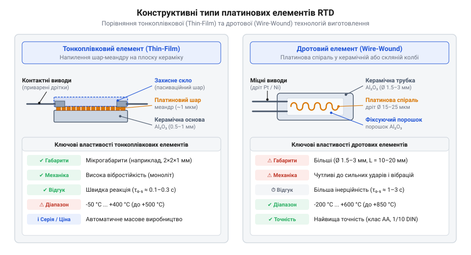
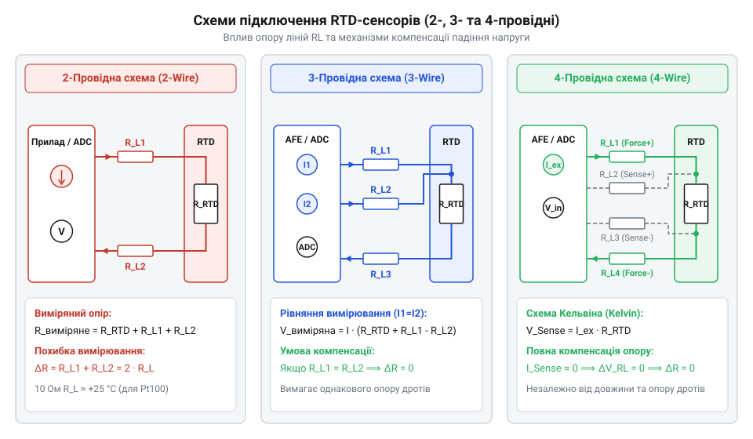

# Огляд родини резистивних перетворювачів температури RTD

<preknowlist>
- [KY-013 — аналоговий давач температури (термістор)](root:cat-hw-sensors/ky-013-thermistor) — Принципи вимірювання опору термісторів NTC та їхні обмеження щодо лінійності й температурного діапазону.
- [LM35DZ — аналоговий давач температури (10 мВ/°C)](root:cat-hw-sensors/lm35) — Особливості напівпровідникових аналогових сенсорів та межі їх використання у промислових середовищах.
- [Стандарт IEC 60751 для платинових термоопорів](root:cat-hw-sensors/iec-60751-standard-for-rtd) — Базові визначення температурних класів точності та допусків для платинових вимірювальних резисторів.
</preknowlist>

## Обмеження побутових сенсорів у промисловості

У промислових технологічних процесах — від випалювальних печей до кріогенних установок — точний контроль температури визначає безпеку та якість продукції. Побутові вимірювальні елементи у таких умовах швидко виходять з ладу. Сенсори на основі [напівпровідникових аналогових давачів](root:cat-hw-sensors/lm35) обмежені фізикою кремнієвого p-n переходу, який втрачає працездатність за температур понад 150 °C. Водночас [аналогові термістори NTC](root:cat-hw-sensors/ky-013-thermistor) мають нелінійну експоненційну характеристику й схильні до часового дрейфу через деградацію оксидної кераміки.

Окрім обмежень самих елементів, у реальних вимірювальних кола виникають три фізичні джерела похибок. Перше — паразитичний опір з'єднувальних дротів, який додається до опору сенсора. Друге — самонагрівання вимірювальним струмом, що підвищує температуру елемента відносно середовища. Третє — паразитні термоелектрорушійні сили на стиках різнорідних металів.

Для усунення цих похибок застосовують @@en|RTD@@ (від англ. *Resistance Temperature Detector* — резистивний перетворювач температури) на основі благородних металів. Платинові термоопори забезпечують високу лінійність, часову стабільність та широкий робочий діапазон, стаючи основою прецизійної промислової термометрії.

## Фізичні принципи та конструкція RTD

Принцип роботи @@en|RTD@@ спирається на залежність електричного опору металів від температури. При нагріванні зростає амплітуда коливань кристалічної ґратки, що збільшує розсіювання електронів провідності на фононах і підвищує опір. Платина є еталонним матеріалом завдяки хімічній інертності, стійкості до окиснення та стабільному температурному коефіцієнту опору.

Залежність опору платини від температури описується лінійною моделлю. Розрахунок опору `R_T` за температури `T` виконується за формулою:

```
R_T = R₀ × (1 + α × T)    [лінійна залежність опору платини від температури]
```

Тут `R₀` — номінальний опір за 0 °C, `α` — температурний коефіцієнт (за [промисловим стандартом IEC 60751](root:cat-hw-sensors/iec-60751-standard-for-rtd) становить 0.003851 °C⁻¹), `T` — температура у градусах Цельсія.

За конструкцією платинові сенсори поділяють на дротові та тонкоплівкові.


*Конструктивні типи платинових сенсорів: дротова спіраль у кераміці проти тонкоплівкової платинової структури на підкладці.*

Дротові сенсори (@@en|wire-wound@@) містять платинову спіраль у керамічній трупці. Вони працюють від -200 °C до +850 °C і мають найвищу стабільність, але чутливі до вібрацій. Тонкоплівкові елементи (@@en|thin-film@@) створюються напиленням платини на кераміку з лазерною підгонкою. Вони дешевші та вібростійкі, але обмежені температурою ~500 °C.

Стандартизованими номіналами є @@en|Pt100@@ (100 Ом при 0 °C) та @@en|Pt1000@@ (1000 Ом при 0 °C). У сенсорі @@en|Pt1000@@ опір у 10 разів більший, тому паразитна зміна опору кабелю справляє на порядок менший відносний вплив, ніж у [платинових термоопорах Pt100](root:cat-hw-sensors/pt100-rtd). Стандарт IEC 60751 регламентує класи точності (AA, A, B), що визначають допуск похибки.

## Топології компенсації опору кабельних ліній

Коли сенсор віддалений від приладу, опір мідних дротів `R_L` додається до опору сенсора. Оскільки опір міді змінюється від температури довкілля, виникає динамічний зсув показів.

Для мінімізації або компенсації цього ефекту застосовують три топології підключення.


*Топології вимірювальних кіл: від двопровідної схеми до чотирипровідного підключення Кельвіна для компенсації опору кабелю.*

У двопровідній схемі опір дротів послідовно додається до сенсора: `R_meas = R_RTD + 2 × R_L`. Вона придатна лише для коротких ліній або номіналу @@en|Pt1000@@.

Трипровідна схема додає третю лінію. За умови однаковості дротів (`R_L1 = R_L2 = R_L3`), вимірювальний міст віднімає опір кабелю, компенсуючи похибку.

Чотирипровідне підключення (схема @@en|Kelvin@@) розділяє струмові та потенціальні лінії. Оскільки аналогово-цифровий перетворювач (@@en|ADC@@) має високий вхідний опір, струм через вимірювальні дроти не тече, що повністю усуває вплив їхнього опору.

Для нівелювання дрейфу струму збудження застосовують раціометричне (@@en|ratiometric@@) зчитування. Струм збудження послідовно проходить через @@en|RTD@@ та опорний резистор `R_ref`. Відношення виміряних напруг `V_RTD / V_ref` дорівнює відношенню опорів `R_RTD / R_ref` і не залежить від нестабільності джерела струму.

## Механізми теплових і термоелектричних завад

Проходження струму `I_ex` через @@en|RTD@@ викликає розсіювання потужності `P = I_ex² × R_RTD`. Це самонагрівання підвищує температуру сенсора відносно середовища. Для його обмеження струм зменшують до 100–500 мкА для @@en|Pt100@@ або використовують імпульсне збудження.

На стиках різнорідних металів через ефект Зеєбека (@@en|Seebeck effect@@) виникає паразитна термоЕРС `V_EMF` при градієнті температур у клемній коробці.

Для її придушення застосовують переполюсовку струму збудження: вимірюють напругу при прямому струмі `V₁ = I_ex × R + V_EMF` та при зворотному `V₂ = -I_ex × R + V_EMF`. Піврізниця `(V₁ - V₂) / 2 = I_ex × R` усуває `V_EMF`.

У сучасних системах ці функції виконують [мікросхеми аналогового фронтенду](root:cat-hw-sensors/max31865-rtd-converter) (@@en|AFE@@, від англ. *Analog Front-End* — аналоговий фронтенд). Вони забезпечують раціометричне зчитування та апаратну діагностику обриву й короткого замикання ліній.