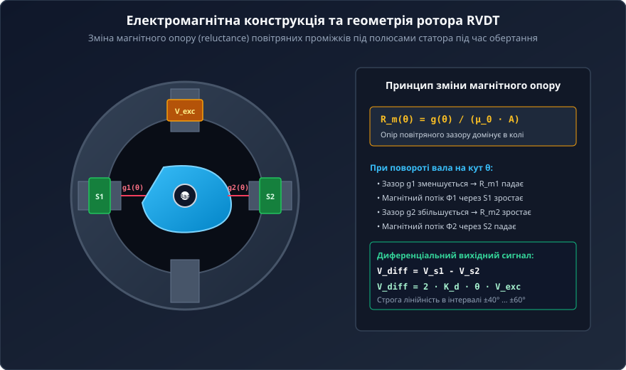
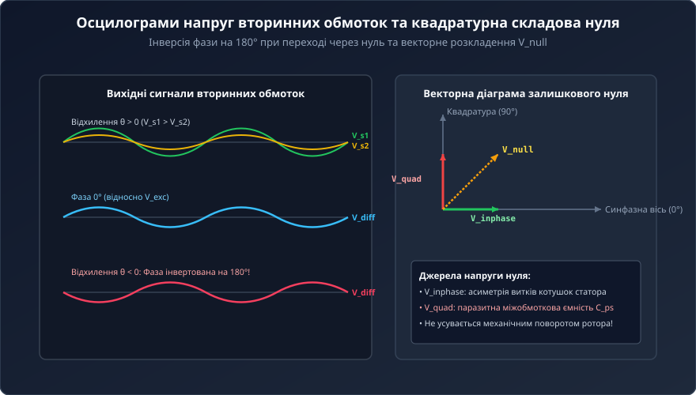
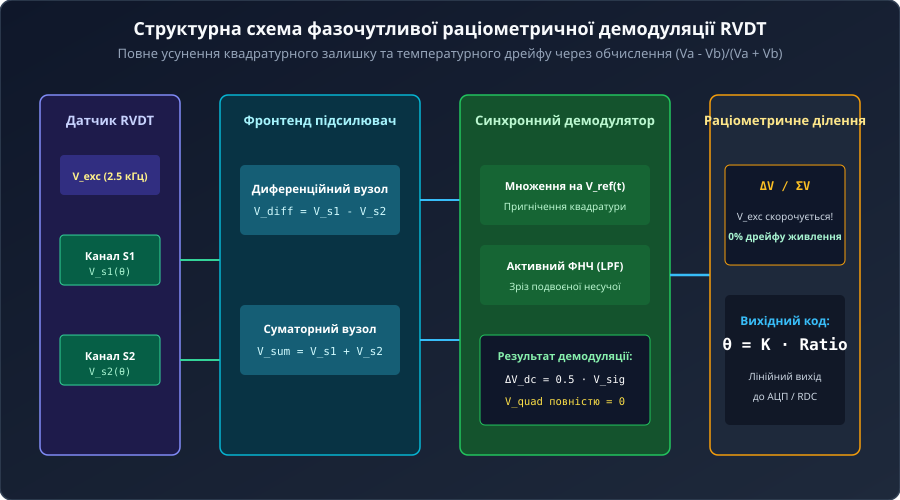
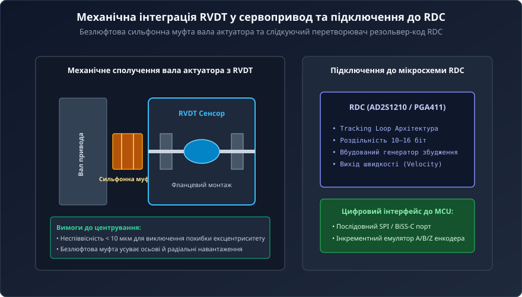
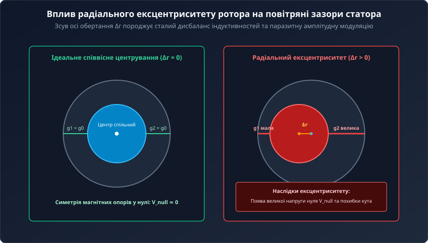

# Обертові змінні диференціальні трансформатори RVDT

<preknowlist>
- [Лінійні змінні диференціальні трансформатори LVDT](root:cat-hw-sensors/lvdt-linear-variable-differential-transformers) — загальні принципи взаємної індукції, виділення диференційного вихідного сигналу та формування електричного нуля
- [Синхронне детектування та фазочутлива демодуляція давачів положення](root:cat-hw-sensors/synchronous-demodulation-for-inductive-transducers) — фізику фазочутливого детектування амплітудно-модульованих індуктивних сигналів та принципи фільтрації несучої частоти
- [Перетворювачі «резольвер-код» (RDC)](root:cat-hw-sensors/resolver-to-digital-converters) — принципи оцифрування квадратурних аналогових сигналів трансформаторних датчиків у кутовий цифровий код
</preknowlist>

## Чому контактні та оптичні кутоміри відмовляють

У сервоприводах аерокосмічних систем, авіаційних виконавчих механізмах керування елеронами та рулями висоти, дозаторах палива турбореактивних двигунів, а також у важкій промисловій робототехніці вимірювання кутового положення вала з точністю до часток градуса є критично важливою задачею зворотного зв'язку. Уповільнення або спотворення сигналу кута у замкненому контурі керування призводить до автоколивань, втрати стійкості й катастрофічних аварій. Проєктуючи такі системи, інженер природно намагається використати звичні датчики кута — потенціометри або оптичні енкодери. Однак у жорстких умовах реальної експлуатації ці традиційні прилади швидко та неминуче відмовляють.

Класичні [потенціометричні датчики положення](root:cat-hw-sensors/servo-feedback-potentiometers-and-magnetic-encoders) спираються на механічний контакт: рухомий струмознімач (англ. @@en|wiper@@, від англ. *wipe* — витирати, ковзати) ковзає по резистивному треку з провідного пластику чи графіту. У критичних вузлах вал датчика зазнає постійної високочастотної мікровібрації (дизерингу) від гідравлічних пульсацій чи аеродинамічних навантажень. Струмознімач мільйони разів треться об один і той самий мікросегмент треку. Механічне тертя швидко протирає струмопровідне покриття, викликаючи відскок контакту (англ. @@en|contact bounce@@, від англ. *bounce* — відскок), електричні завади, мікрообриви та накопичення струмопровідного пилу. Коли опір у точці контакту стрибкоподібно зростає або зникає повністю, контур зворотного зв'язку сприймає це як хибний поворот вала, що викликає ривок сервопривода до крайнього положення (ударне відпрацювання).

Спроба замінити потенціометри на цифрові [оптичні енкодери](root:cat-hw-sensors/optical-and-magnetic-encoders) вирішує проблему механічного тертя, але створює нові вразливості. Оптичний енкодер формує кутовий код за допомогою прозорого скляного чи полімерного диска з нанесеними прорізами, світлодіодного випромінювача та масиву фотоприймачів. В умовах екстремальних механічних ударів (до 50–100 g), сильної вібрації та температурних перепадів від -55 °C до +150 °C крихкі скляні диски тріскаються або зміщуються відносно оптичної осі. Конденсація вологи, масляний туман або пил, потрапляючи у корпус датчика, повністю перекривають світловий промінь. Крім того, передача високошвидкісних цифрових сигналів, закодованих [кодом Ґрея](root:cat-hw-sensors/gray-code) через [інтерфейси SSI та BiSS-C](root:cat-hw-sensors/ssi-bissc-digital-interfaces), вимагає наявності активних напівпровідникових мікросхем безпосередньо в корпусі датчика. Напівпровідники деградують від високих температур, викликаючи тепловий шум напівпровідникового переходу, та є чутливими до іонізуючого випромінювання у висотній авіації й космонавтиці.

Сучасні безконтактні [магнітні енкодери](root:cat-hw-sensors/as5048-magnetic-encoder) та [магніторезистивні сенсори](root:cat-hw-sensors/amr-gmr-tmr-magnetic-sensors) вимірюють орієнтацію векторів магнітного поля постійного магніту на валу. Вони позбавлені механічного зносу, проте містять напівпровідникові кристали Холла чи AMR/GMR мікросхеми з [програмуванням OTP-пам'яті](root:cat-hw-sensors/as5048-otp-programming-guide). Допустимий температурний діапазон таких чипів рідко перевищує +125 °C, а сильні зовнішні завадові магнітні поля від потужних електродвигунів або силових соленоїдів викривляють вимірювальний вектор, вимагаючи важкого екранування.

Історично виклики зношування ковзних контактів у потенціометрах та крихкості оптичних дисків у першій половині XX століття спонукали авіакосмічну галузь шукати принципово нові шляхи вимірювання кута. Із появою надійних [трансформаторів LVDT](root:cat-hw-sensors/lvdt-linear-variable-differential-transformers) для вимірювання лінійних переміщень виникла природна ідея адаптувати їхній безконтактний індуктивний принцип для обертового руху. Так з'явилися обертові змінні диференціальні трансформатори RVDT (англ. @@en|Rotary Variable Differential Transformer@@, від лат. *rotare* — обертатися, *variabilis* — змінний, *differentia* — різниця та *transformare* — перетворювати). Перші конструкції RVDT мали кулачкові або серпоподібні ротори з суцільного заліза, але високі вихрові струми (англ. @@en|eddy currents@@, від давньосканд. *iða* — вихор) викликали значне самонагрівання та спотворення сигналу на несучих частотах. Еволюція матеріалів привела до застосування симетричних профільованих роторів із шихтованої електротехнічної сталі з ізольованими пластинами, що кардинально зменшило магнітні втрати. Впровадження RVDT у перші електродистанційні системи керування польотом (англ. @@en|Fly-by-Wire@@) та сервоприводи паливних клапанів авіадвигунів довело їхню здатність працювати понад 100 000 годин без жодного механічного зношування, зробивши трансформаторні кутоміри світовим стандартом для критично важливих вузлів.

Розв'язанням проблеми крихкості та зносу став пристрій, який взагалі не має ковзних контактів, не містить крихкого скла та позбавлений будь-якої активної напівпровідникової електроніки всередині корпусу. Тільки суцільне електромагнітне сполучення між мідними котушками статора та феромагнітним ротором. Завдяки високотемпературній поліімідній або керамічній ізоляції обмоток RVDT здатний працювати при температурах від кріогенних -200 °C до +200 °C і вище. Його суцільна металева конструкція забезпечує практично нескінченну роздільну здатність, абсолютну стійкість до мастила, диму, бруду й інтенсивних ударних навантажень.

## Електромагнітна конструкція та зміна магнітного опору

Фізична будова RVDT нагадує спеціалізований малогабаритний електричний двигун або трансформатор із рухомим магнітопроводом. Пристрій складається з нерухомого статора (англ. @@en|stator@@, від лат. *stare* — стояти) та феромагнітного ротора (англ. @@en|rotor@@, від лат. *rotare* — обертатися), закріпленого на центральному валу вимірюваного об'єкта. На полюсах статора, виготовленого з шихтованої електротехнічної сталі з високою магнітною проникністю, розміщено первинну обмотку збудження (англ. @@en|primary excitation winding@@) та дві симетричні вторинні вихідні обмотки (англ. @@en|secondary output windings@@).

На відміну від систем із [сельсинами та резольверами](root:cat-hw-sensors/synchro-and-resolver-transducers), які використовують розподілені багатофазні обмотки й обертові котушки збудження зі струмознімальними кільцями або безщітковими трансформаторами, в RVDT абсолютно всі електричні котушки є нерухомими й розміщені виключно на статорі. Ротор не має жодної обмотки, жодного електричного з'єднання чи провідника. Він являє собою суцільний або шихтований феромагнітний сердечник спеціального профільованого перерізу (у формі кулачка, подвійної кардіоїди або серпа).


*Геометрія ротора RVDT та розподіл магнітного потоку між полями статора залежно від кута повертання.*

Фундаментом роботи RVDT є вимірювання зміни магнітного опору (англ. @@en|reluctance@@, від лат. *reluctari* — чинити опір) повітряних проміжків між полюсами статора та поверхнею ротора під час його обертання. Магнітний опір `R_m` повітряного проміжку довжиною `g` та площею перерізу `A` описується базовим співвідношенням:

```
R_m = g / (μ_0 · A)
```

де `μ_0 = 4 · π · 10⁻⁷ H/m` — магнітна стала вакууму. Оскільки магнітна проникність повітря у тисячі разів менша за проникність електротехнічної сталі, саме повітряні проміжки визначають загальний магнітний опір усього магнітного кола RVDT.

Коли ротор перебуває у точці електричного нуля (кут повертання `θ = 0`), геометричний профіль ротора розташований строго симетрично відносно двох вторинних полюсів статора. Повітряні проміжки під першим і другим полюсами є однаковими (`g_1 = g_2`), тому магнітні опори двох гілок однакові (`R_m1 = R_m2`). Згенерований первинною обмоткою магнітний потік `Φ_exc` рівномірно ділиться навпіл між двома вторинними полюсами, наводячи у вторинних котушках однакові за амплітудою змінні напруги.

Під час повертання вала на кут `θ` кулачковий профіль ротора наближається до одного з вторинних полюсів і віддаляється від іншого. Повітряний проміжок `g_1(θ)` під першим полюсом зменшується, що зменшує його магнітний опір `R_m1(θ)`. Відповідно, магнітний потік `Φ_1(θ)` через першу вторинну обмотку зростає. Одночасно повітряний проміжок `g_2(θ)` під другим полюсом збільшується, магнітний опір `R_m2(θ)` зростає, а потік `Φ_2(θ)` через другу вторинну обмотку зменшується.

На первинну обмотку RVDT подається синусоїдальна напруга збудження від зовнішнього генератора несучої частоти (англ. @@en|carrier frequency@@):

```
V_exc(t) = V_p · sin(ω_c · t)
```

де `V_p` — пікова амплітуда напруги (типово від 3 V до 7 V RMS), а `ω_c = 2 · π · f_c` — кутова несуча частота (значення `f_c` зазвичай лежить у межах від 400 Hz до 10 kHz, найчастіше 2.5 kHz або 5 kHz). За законом електромагнітної індукції Фарадея, напруги, індуковані у двох вторинних обмотках, є амплітудно-модульованими синусоїдними сигналами несучої частоти:

```
V_s1(t) = K_1(θ) · V_p · sin(ω_c · t + φ)
V_s2(t) = K_2(θ) · V_p · sin(ω_c · t + φ)
```

де `K_1(θ)` та `K_2(θ)` — коефіцієнти трансформації відповідних вторинних каналів, залежні від кута `θ`, а `φ` — внутрішній кут фазового зсуву між напругою збудження та вихідною напругою, зумовлений активним опором та індуктивністю обмоток. У лінійній зоні навколо електричного нуля коефіцієнти трансформації змінюються симетрично:

```
K_1(θ) = K_0 + K_d · θ
K_2(θ) = K_0 - K_d · θ
```

де `K_0` — базовий коефіцієнт трансформації у точці нуля, а `K_d` — диференціальна чутливість RVDT (вимірюється у mV/V/градус).

Вторинні обмотки RVDT з'єднують послідовно-зустрічно (диференційно). Результуючий диференціальний вихідний сигнал `V_diff(t)` обчислюється як різниця напруг двох каналів:

```
V_diff(t) = V_s1(t) - V_s2(t)
          = (K_0 + K_d · θ) · V_p · sin(ω_c · t + φ) - (K_0 - K_d · θ) · V_p · sin(ω_c · t + φ)   [підстановка виразів вторинних напруг]
          = 2 · K_d · θ · V_p · sin(ω_c · t + φ)                                                  [зведення подібних членів]
```

З отриманого математичного виразу чітко видно фізичні властивості вихідного сигналу RVDT:

1. Амплітуда диференціальної напруги `|V_diff| = 2 · K_d · |θ| · V_p` строго пропорційна модулю кута повертання вала `|θ|`. 2. У точці електричного нуля (`θ = 0`) амплітуда ідеального диференціального сигналу дорівнює нулю. 3. При позитивному відхиленні (`θ > 0`) вихідний сигнал `V_diff(t)` перебуває у фазі з опорним сигналом (із урахуванням зсуву `φ`). 4. При негативному відхиленні (`θ < 0`) множник `θ` змінює знак, що еквівалентно інверсії фази вихідного сигналу на 180° відносно напруги збудження.

Детальні виведення рівнянь індуктивності та трансформованих потоків наведено у [математичною моделлю RVDT](root:cat-hw-sensors/rvdt-rotary-variable-differential-transformers/math-rvdt-electromagnetics-and-output-equations.md).


*Осцилограми вихідних сигналів вторинних обмоток RVDT, різницева напруга та векторне розкладання квадратурної складової у точці нуля.*

Робочий кутовий діапазон датчика RVDT обмежений межами лінійної характеристики, які для більшості стандартних конструкцій становлять від ±40° до ±60° (у спеціальних високомодифікованих роторах — до ±70°). За межами цього діапазону лінійна залежність порушується і вихідний сигнал набуває синусоїдальної нелінійності. Причини виникнення цієї нелінійності полягають у наступному:

- **Крайові геометричні ефекти (англ. @@en|fringing fields@@):** При великих кутах повороту краї кулачкового ротора виходять за межі полюсних наконечників статора, через що площа перекриття `A(θ)` перестає змінюватися лінійно, а магнітний потік розсіювання в повітрі навколо полюсів стрімко зростає. - **Магнітне насичення сталі:** У вузьких ділянках ротора та полюсів локальна індукція магнітного поля досягає насичення кривої `B-H`, що порушує пропорційність між магніторушійною силою та магнітним потоком. - **Тригонометрична природа зміни проміжку:** Геометрична відстань від центру обертання до криволінійної поверхні ротора математично описується тригонометричними функціями кута `sin(θ)` та `cos(θ)`, лінійна апроксимація яких `sin(θ) ≈ θ` справедлива лише для малих кутів.

Теоретична модель передбачає, що у точці електричного нуля (`θ = 0`) різницевий сигнал `V_diff` має дорівнювати точно 0 V. Однак реальні осцилографічні вимірювання показують наявність ненульової залишкової напруги, яка називається залишковою напругою нуля (англ. @@en|null voltage@@, від лат. *nullus* — ніякий). Ця напруга є комплексною і складається з трьох фізично різних компонентів:

1. **Синфазна складова основної частоти:** Невеликий залишковий синусоїдальний сигнал несучої частоти, що збігається за фазою з основною напругою збудження. Вона виникає через невелику технологічну несиметрію кількості витків вторинних обмоток або асиметрію зазору й легко компенсується точним механічним виставленням ротора в нуль. 2. **Квадратурна складова (англ. @@en|quadrature component@@, від лат. *quadratura* — надання квадратної форми, у значенні зсуву на 90°):** Синусоїдальний сигнал несучої частоти, зсунутий за фазою відносно напруги збудження строго на 90°. Фізичний механізм її виникнення пов'язаний із міжобмотковою паразитною ємністю (англ. @@en|parasitic capacitance@@) `C_ps` між первинною та вторинними котушками. Напруга збудження `V_exc(t) = V_p · sin(ω_c · t)` викликає ємнісний струм витоку:

```
I_c(t) = C_ps · (d V_exc / dt)
       = C_ps · (d (V_p · sin(ω_c · t)) / dt)    [диференціювання синусоїдальної напруги збудження]
       = C_ps · ω_c · V_p · cos(ω_c · t)         [отримання квадратурного струму зі зсувом 90°]
```

Цей ємнісний струм протікає через комплексний опір вторинних обмоток і створює спад напруги, пропорційний `cos(ω_c · t)`. Оскільки квадратурна складова перебуває під кутом 90° відносно корисного синфазного сигналу, її неможливо усунути жодним механічним поворотом ротора. Крім ємності, свій внесок додають реактивні струми вихрових втрат (англ. @@en|eddy currents@@) у сталевому сердечнику. 3. **Вищі гармонійні складові:** Сигнали на кратних частотах (`3 · f_c`, `5 · f_c`), утворені нелінійністю петлі гістерезису феромагнітного сердечника статора при циклічному перемагнічуванні.

Повний математичний аналіз гармонік та методів пригнічення квадратурної складової розкрито в [аналізом напруги нуля](root:cat-hw-sensors/rvdt-rotary-variable-differential-transformers/math-rvdt-null-voltage-and-quadrature-error.md).

На точність вимірювання кута за допомогою RVDT суттєво впливають температурні й частотні нестабільності. Мідний дріт, яким вимотано котушки статора, має температурний коефіцієнт опору близько `+0.393%/°C`. При зміні температури навколишнього середовища активний опір первинної обмотки `R_p` змінюється, що при стабільній напрузі збудження змінює амплітуду струму збудження `I_p = V_p / Z_p` та величину створюваного магнітного потоку. Це призводить до температурного дрейфу коефіцієнта передачі (чутливості) `K_d`. Крім того, зміна співвідношення між активним опором `R_p` та індуктивним опором `ω_c · L_p` зміщує кут фазового зсуву `φ`. Якщо схема обробки сигналу не компенсує фазовий зсув, температурне відхилення фази трансформується у похибку вимірювання кута. Зміна несучої частоти `f_c` генератора збудження аналогічно змінює індуктивний опір обмоток `X_L = 2 · π · f_c · L`, викликаючи додатковий дрейф амплітуди й фази. Схеми підключення обмоток та способи мінімізації цих похибок висвітлено в [апаратним інтерфейсом RVDT](root:cat-hw-sensors/rvdt-rotary-variable-differential-transformers/api-rvdt-hardware-interface.md).

## Фізичні джерела неідеальностей та залишковий нуль

Спрощена теоретична модель RVDT припускає, що у точці геометричної симетрії ротора вихідна диференціальна напруга перетворюється на чистий нуль. Однак на практиці під час підключення осцилографа до вихідних обмоток реального датчика у стані електричного нуля спостерігається залишковий змінний сигнал, амплітуда якого зазвичай становить від 0.1% до 1% від повної шкали вихідної напруги. Якщо система автоматичного керування сприйме цей за залишковий сигнал як корисний кутовий зсув, сервопривод постійно здійснюватиме дрейф та мікроколивання навколо нульового положення. Для проєктування прецизійного аналогового тракту обробки необхідно розкласти залишкову напругу нуля (англ. @@en|null voltage@@) на фізичні першопричини.

Повний вираз залишкової напруги нуля у часовій області описується сумою трьох ортогональних та гармонійних компонентів:

```
V_null(t) = V_inphase · sin(ω_c · t + φ) + V_quad · cos(ω_c · t + φ) + V_harm(t)
```

де `V_inphase` — синфазна складова основної частоти, `V_quad` — квадратурна складова основної частоти, зсунута на 90°, а `V_harm(t)` — сума вищих гармонійних складових несучої частоти.

Через ортогональність та частотну рознесеність результуюче середньоквадратичне значення (RMS) залишкової напруги нуля визначається як квадратний корінь із суми квадратів її складових:

```
V_null_rms = √(V_inphase² + V_quad² + V_harm_rms²)
```

Перша складова — синфазний залишок `V_inphase` — має ту саму фазу, що й корисний вихідний сигнал при кутовому відхиленні вала. Головною причиною її виникнення є технологічна асиметрія вторинних обмоток: незначна різниця у кількості витків (`ΔN_s = N_s1 - N_s2`), нерівномірність намотування або технологічні допуски при виготовленні магнітопроводу статора. Навіть при ідеально симетричному положенні ротора нерівність індуктивностей викликає різницю амплітуд індукованих напруг. Оскільки синфазний залишок перебуває в однаковій фазі з корисним сигналом, його можна повністю компенсувати механічним юстуванням статора (повертанням корпусу датчика відносно вала до мінімізації напруги) або введенням резистивної балансувальної схеми.

Натомість друга складова — квадратурна складова (англ. @@en|quadrature component@@, від лат. *quadratura* — надання квадратної форми, у значенні зсуву на 90°) `V_quad` — виникає через міжкатушкову паразитну ємність (англ. @@en|parasitic capacitance@@) `C_ps` між первинною обмоткою збудження та вторинними вихідними котушками, а також через вихрові струми (англ. @@en|eddy currents@@) у сталевому магнітопроводі. Змінна напруга збудження `V_exc(t) = V_p · sin(ω_c · t)` діє на паразитну ємність `C_ps`, викликаючи ємнісний струм витоку:

```
I_c(t) = C_ps · (d V_exc / dt)
       = C_ps · (d (V_p · sin(ω_c · t)) / dt)    [диференціювання синусоїдальної напруги збудження]
       = C_ps · ω_c · V_p · cos(ω_c · t)         [струм із фазовим зсувом +90°]
```

Цей ємнісний струм протікає через комплексний опір вторинних обмоток `Z_sec`, створюючи спад напруги `V_quad(t) = I_c(t) · Z_sec`, амплітуда якого прямо пропорційна несучій частоті (англ. @@en|carrier frequency@@) `ω_c` та амплітуді збудження `V_p`. Оскільки квадратурна напруга описується косинусоїдою `cos(ω_c · t)`, її вектор у комплексному просторі розташований строго під кутом 90° до синфазного корисного сигналу `sin(ω_c · t)`. Жодним механічним повертанням ротора або статора квадратурну складову неможливо зменшити до нуля, адже при механічному зсуві ротора змінюється лише синфазний вектор, тоді як квадратурний вектор залишається нерухомим.

Третя складова — вищі гармонійні спотворення (англ. @@en|harmonic distortion@@, від грец. *harmonia* — співзвуччя та лат. *distortio* — викривлення) `V_harm(t)` — породжується нелінійністю петлі гістерезису (англ. @@en|hysteresis loop@@) феромагнітного матеріалу статора та ротора. При синусоїдальній напрузі збудження магнітна індукція `B` у сталі змінюється нелінійно через насичення, що викликає появу непарних гармонік (переважно 3-ї та 5-ї гармонік: `3 · f_c` та `5 · f_c`) у складі вторинних напруг.

Окрім залишкового нуля у точці симетрії, реальними неідеальностями RVDT є синусоїдальна нелінійність на краях робочого діапазону та температурний дрейф параметрів. Робочий діапазон RVDT обмежується кутами від ±40° до ±60°. При наближенні до ±60° крайові магнітні поля розсіювання (англ. @@en|fringing fields@@) навколо полюсів статора зростають, а геометричне перекриття ротора перестає змінюватися лінійно, що спричиняє відхилення вихідної характеристики від прямої лінії.

Температурні нестабільності зумовлені високим температурним коефіцієнтом опору (англ. @@en|temperature coefficient of resistance@@) мідного дроту обмоток, який становить близько `α = +0.393%/°C`. При зміні температури навколишнього середовища `T` активний опір первинної обмотки `R_p` змінюється за законом:

```
R_p(T) = R_p0 · [1 + α · (T - T_0)]
```

Підвищення температури збільшує опір `R_p(T)`, що при фіксованій напрузі збудження `V_p` зменшує модуль струму первинної обмотки `I_p(T)`:

```
I_p(T) = V_p / √(R_p(T)² + (ω_c · L_p)²)         [зменшення струму збудження через нагрівання]
```

Зменшення струму `I_p` послаблює створюваний магнітний потік, що призводить до прямого спаду чутливості RVDT (зсув масштабу вимірювання). Водночас зміна співвідношення між активним опором `R_p` та індуктивним опором `ω_c · L_p` змінює фазовий зсув (англ. @@en|phase shift@@) `φ` між первинною та вторинною напругами. Якщо фазовий зсув змінюється від температури, то фазочутливий демодулятор починає сприймати частину синфазного корисного сигналу як квадратурний і навпаки, генеруючи додаткову температурну похибку кута.

Аналогічно, флуктуації амплітуди `V_p` або частоти `f_c` генератора збудження викликають пропорційний дрейф вихідної напруги RVDT, оскільки вихідна амплітуда є прямою добутком `K_d · θ · V_p`. Без спеціальних схемотехнічних заходів це вимагало б застосування лабораторних генераторів збудження з нестабільністю менше 0.01%. Математичний апарат для детального розрахунку гармонік та квадратури наведено в [аналізі залишкового нуля](root:cat-hw-sensors/rvdt-rotary-variable-differential-transformers/math-rvdt-null-voltage-and-quadrature-error.md), а вимоги до схем живлення й екранування деталізовано в [залізному інтерфейсі RVDT](root:cat-hw-sensors/rvdt-rotary-variable-differential-transformers/api-rvdt-hardware-interface.md).

## Синхронна демодуляція та раціометричне нормування

Для виділення інформації про величину та знак кута повертання із диференціального сигналу RVDT звичайного амплітудного детектора (діодного містка) недостатньо. Звичайний випрямляч вимірює лише модуль напруги `|V_diff|`, втрачаючи інформацію про фазу, і повністю інтегрує шкідливу квадратурну складову та вищі гармоніки в постійну напругу, що створює величезну похибку навколо нуля. Вирішенням цієї проблеми є застосування фазочутливого синхронного демодулятора (англ. @@en|phase-sensitive demodulator@@, від грец. *phasis* — поява, грец. *synchronos* — одночасний та *demodulatio* — розгортання).

Принцип дії фазочутливого демодулятора полягає у множенні вхідного диференціального сигналу `V_diff(t)` на опорний синусоїдальний чи прямокутний сигнал `V_ref(t)`, що перебуває у строгій фазі з напругою збудження первинної обмотки. Вхідний сигнал RVDT, який містить корисну синфазну складову та паразитна квадратуру, описується виразом:

```
V_diff(t) = V_sig · sin(ω_c · t + φ) + V_quad · cos(ω_c · t + φ)
```

При множенні на опорний сигнал `V_ref(t) = sin(ω_c · t + φ)` отримуємо перемножений сигнал:

```
V_demod(t) = V_diff(t) · sin(ω_c · t + φ)
           = V_sig · sin²(ω_c · t + φ) + V_quad · sin(ω_c · t + φ) · cos(ω_c · t + φ)               [розкриття дужок]
           = 0.5 · V_sig · [1 - cos(2 · ω_c · t + 2 · φ)] + 0.5 · V_quad · sin(2 · ω_c · t + 2 · φ)  [застосування тригонометричних тотожностей]
```

Після проходження перемноженого сигналу через активний фільтр нижніх частот (англ. @@en|low-pass filter@@) із частотою зрізу набагато меншою за несучу (`f_cut ≪ f_c`), усі високочастотні складові на подвоєній несучій частоті `2 · ω_c` повністю відфільтровуються. Постійна складова на виході ФНЧ становить:

```
V_out_dc = LPF{V_demod(t)}
         = 0.5 · V_sig + 0                                                                          [квадратурний член інтегрується у нуль]
```

Цей результат висвітлює фундаментальну перевагу фазочутливої демодуляції: квадратурна складова `V_quad` після множення на синфазну косинусоїду перетворюється на чисту високочастотну гармоніку `sin(2 · ω_c · t)`, інтеграл якої за період дорівнює точно нулю. Таким чином, фазочутливий демодулятор повністю пригнічує паразитну квадратурну напругу нуля, виділяючи виключно корисний синфазний сигнал `V_sig`, знак якого визначається фазою (0° дає позитивну напругу, 180° — негативну).


*Структурна схема аналогового тракту нормування сигналу RVDT з фазочутливим синхронним демодулятором, фільтром нижніх частот та блоком раціометричного ділення.*

Незважаючи на ефективність синхронної демодуляції, вихідна напруга `V_out_dc = K · θ · V_p` залишається прямо пропорційною амплітуді збудження `V_p`. Будь-які дрейфи напруги живлення генератора або зміна опору обмоток від температури безпосередньо спотворюють результат вимірювання.

Для досягнення абсолютної незалежності від дрейфу живлення й температури застосовується раціометрична обробка (англ. @@en|ratiometric architecture@@, від лат. *ratio* — відношення, пропорція та грец. *metron* — вимірювання). Замість вимірювання лише різницевого сигналу `V_s1 - V_s2`, аналоговий тракт або мікроконтролер вимірює амплітуди обох вторинних каналів `V_s1` та `V_s2` окремо й обчислює відношення різниці амплітуд до їхньої суми:

```
V_s1_amp = (K_0 + K_d · θ) · V_p · A_gain
V_s2_amp = (K_0 - K_d · θ) · V_p · A_gain
Ratio = (V_s1_amp - V_s2_amp) / (V_s1_amp + V_s2_amp)
      = [(K_0 + K_d · θ - K_0 + K_d · θ) · V_p · A_gain] / [(K_0 + K_d · θ + K_0 - K_d · θ) · V_p · A_gain] [підстановка виразів амплітуд]
      = (2 · K_d · θ · V_p · A_gain) / (2 · K_0 · V_p · A_gain)                                              [зведення подібних членів]
      = (K_d / K_0) · θ                                                                                      [повне скорочення V_p та A_gain]
```

Як видно з математичного виведення, змінний коефіцієнт амплітуди збудження `V_p` та коефіцієнт підсилення тракту `A_gain` присутні як у чисельнику, так і в знаменнику дробу. Вони повністю скорочуються! Завдяки цьому підсумковий раціометричний сигнал `Ratio` залежить виключно від конструктивного відношення `K_d / K_0` та кута повертання `θ`. Якщо напруга збудження просідає на 10% або опір котушок зростає від нагріву, амплітуди обох каналів `V_s1` та `V_s2` зменшуються пропорційно на ті ж 10%, а їхнє відношення залишається незмінним із точністю до часток відсотка. Подібний підхід активно застосовується в [аналогових фронтендах LVDT](root:cat-hw-sensors/lvdt-analog-front-end) та спеціалізованих [кондиціонерах сигналу AD698](root:cat-hw-sensors/ad698-signal-conditioner).

Практична схемотехнічна реалізація аналогового тракту будується на базі прецизійних операційних підсилювачів (англ. @@en|operational amplifier@@) з високим коефіцієнтом пригнічення синфазного сигналу (англ. @@en|common-mode rejection ratio@@) для усунення синфазних завад (англ. @@en|common-mode noise@@) у довгому кабельному шлейфі датчика. Практичну розробку такої плати розкрито у [модулі синхронної демодуляції](root:cat-hw-sensors/rvdt-rotary-variable-differential-transformers/proj-rvdt-analog-demodulator-board.md).


*Ілюстрація механічного з'єднання ротора RVDT з валом сервопривода, вплив ексцентриситету та схема підключення до перетворювача резольвер-код RDC.*

Для цифрових систем керування політом та робототехніки оцифрування вихідних сигналів RVDT здійснюється двома основними шляхами:
1. **Застосування перетворювачів резольвер-код RDC:** Спеціалізовані мікросхеми RDC (англ. @@en|resolver-to-digital converter@@) реалізують замкнену слідкуючу систему (англ. @@en|tracking loop@@), яка порівнює вихідні напруги RVDT із внутрішнім цифровим кутом і безпосередньо видає абсолютний цифровий код кута без затримки та з високим пригніченням завад. Детально архітектуру оцифрування висвітлено у [перетворювачах резольвер-код RDC](root:cat-hw-sensors/resolver-to-digital-converters). 2. **Пряме оцифрування АЦП мікроконтролера:** Двоканальний симетричний АЦП оцифровує амплітуди вторинних обмоток, після чого програма виконує цифрове фазочутливе детектування та раціометричне ділення за [алгоритмах оцифрування RVDT](root:cat-hw-sensors/rvdt-rotary-variable-differential-transformers/api-rvdt-signal-processing-software-interface.md).

Механічний монтаж ротора RVDT вимагає суворого дотримання співвісності. Наявність радіального ексцентриситету вала створює додаткову похибку ексцентриситету (англ. @@en|eccentricity error@@), яка призводить до несиметричної зміни магнітних проміжків під полюсами статора навіть при відсутності кутового повороту, виникаючи як паразитна амплітудна модуляція першої гармоніки. Використання гнучких безлюфтових муфт або жорсткого центрування вала в кулькопідшипниках є обов'язковою умовою для інтеграції RVDT у прецизійний [контур керування сервоприводом](root:cat-hw-sensors/rvdt-rotary-variable-differential-transformers/proj-rvdt-actuator-closed-loop-control.md).

## Оцифрування RDC та механічний монтаж

Амплітудно-модульований сигнал змінної напруги з двох вторинних обмоток RVDT неможливо безпосередньо подати на стандартний аналого-цифровий перетворювач мікроконтролера. Вихідні напруги вторинних каналів зміщені за фазою відносно первинної обмотки збудження (@@en|primary excitation winding@@), а їхня амплітуда визначається кутом відхилення ротора від електричного нуля. Для перетворення цих сигналів у цифровий код застосовують [перетворювач резольвер-код RDC](root:cat-hw-sensors/resolver-to-digital-converters) (англ. @@en|resolver-to-digital converter@@). Сучасні мікросхеми RDC будують на основі слідкуючих контурів замкненого типу (англ. @@en|tracking loop@@). Перетворювач синтезує внутрішнє значення кута, множить вхідні напруги вторинних обмоток на синусну та косинусну складові поточного цифрового значення, а розбіжність подає на фазочутливий детектор. Помилка неузгодження інтегрується слідкуючим генератором, керованим напругою, що змушує внутрішній реверсивний лічильник точно відстежувати кутове положення вала без затримок і втрати швидкодії.

Головна перевага оцифрування за допомогою RDC або [мікросхеми кондиціонування сигналу LVDT](root:cat-hw-sensors/ad698-signal-conditioner) полягає у реалізації раціометричної обробки. Перетворювач обчислює не абсолютні амплітуди вторинних напруг, а їхнє відношення.

```
R_ratio = (V_S1 - V_S2) / (V_S1 + V_S2)      [обчислення раціометричного відношення]
= K_sens × θ                                 [лінійна залежність у робочому діапазоні]
```

Оскільки амплітудні флуктуації джерела збудження (несуча частота @@en|carrier frequency@@) та температурна зміна опору мідного дроту статора (@@en|stator@@) однаково змінюють напруги двох вторинних обмоток (@@en|secondary output windings@@), їхня сума у знаменнику пропорційно компенсує зміни у чисельнику. Це забезпечує високу інваріантність цифрового коду до нестабільності живлення й температурних коливань у широкому діапазоні довкілля.

При відсутності спеціалізованого RDC оцифрування виконують за допомогою звичайного АЦП мікроконтролера. Для цього аналоговий сигнал попередньо пропускають через [аналоговий фронтенд підготовки](root:cat-hw-sensors/lvdt-analog-front-end), де відбувається [фазочутливе детектування сигналів](root:cat-hw-sensors/synchronous-demodulation-for-inductive-transducers) та виділення постійних напруг за допомогою фільтрів нижніх частот (@@en|low-pass filter@@). Оцифровані значення каналів проходять програмний розрахунок раціометричного відношення. Для розширення лінійного діапазону за межі стандартних кутів від ±40° до ±60°, де проявляється синусоїдальна нелінійність через крайові магнітні поля (@@en|fringing fields@@), у програмі застосовують табличну корекцію (@@en|lookup table@@) або поліноміальне сплайнове лінійнування. Передача підсумкового цифрового коду кута у центральний процесор здійснюється через [послідовні інтерфейси SSI](root:cat-hw-sensors/ssi-bissc-digital-interfaces) або SPI. Повний алгоритмічний цикл обробки даних наведено у довіднику [Програмний інтерфейс оцифрування](root:cat-hw-sensors/rvdt-rotary-variable-differential-transformers/api-rvdt-signal-processing-software-interface.md).

:::tabs
@tab C
:::code rvdt-rotary-variable-differential-transformers-d/c/rvdt-process-adc-reading.c
@tab C++
:::code rvdt-rotary-variable-differential-transformers-d/cpp/rvdtsignalprocessor.cpp
:::

Висока точність перетворення кутового переміщення у змінний магнітний опір (@@en|reluctance@@) ставить жорсткі вимоги до механічного монтажу датчика. Оскільки ротор (@@en|rotor@@) RVDT обертається безмеханічно всередині статора без контактних щіток чи підшипників у базовому виконанні безкорпусного датчика (@@en|frameless RVDT@@), рівномірність двох опозиційних повітряних проміжків визначається точністю зовнішніх опор. Радіальний зсув осі обертання вала відносно геометричного центру статора призводить до похибки ексцентриситету (@@en|eccentricity error@@).


*Геометрія радіального ексцентриситету ротора RVDT та спричинена ним асиметрія магнітного опору.*

Радіальний ексцентриситет зменшує повітряний проміжок з одного боку статора й одночасно збільшує його з протилежного. Це створює постійний дисбаланс базових індуктивностей вторинних обмоток, порушує симетрію розподілу магнітного потоку первинного збудження та викликає появу значної квадратурної складової (@@en|quadrature component@@) залишкової напруги нуля (@@en|null voltage@@). Осьовий вибіг або люфт вала виводить кутовий профіль ротора з зони однорідного магнітного поля статора, що змінює крутизну перетворення (чутливість) і порушує повторюваність вимірювань. Щоб запобігти цим дефектам, корпус датчика монтують за допомогою прецизійних посадочних фасок із допуском співвісності не гірше 5-10 мкм, а з'єднання з робочим валом виконують через безлюфтові сильфонні або мембранні муфти. Детальні механічні допуска та варіанти монтажних фланців систематизовано у довіднику [Залізний інтерфейс RVDT](root:cat-hw-sensors/rvdt-rotary-variable-differential-transformers/api-rvdt-hardware-interface.md).

Монтаж датчика у сервосистему завершується процедурою виправлення електричного нуля та калібрування квадратурної похибки. Електричний нуль відповідає такому кутовому положенню ротора, за якого амплітуда основної гармоніки диференціального вихідного сигналу дорівнює нулю. При первинній установці корпус RVDT послаблюють у монтажному притискачі й плавно повертають відносно зафіксованого механічного нуля привода до мінімізації демодульованої вихідної напруги. Для компенсації залишкової квадратурної складової, викликаної паразитною міжкатушковою ємністю та вихровими струмами (@@en|eddy currents@@), виконують прецизійну синхронізацію фази джерела збудження з опорним сигналом синхронного демодулятора (@@en|phase-sensitive demodulator@@). Практична схема юстування та підключення фазозсувних кіл представлена у проєкті [Спроєктування аналогового тракту](root:cat-hw-sensors/rvdt-rotary-variable-differential-transformers/proj-rvdt-analog-demodulator-board.md), а теоретичне розкладення спектра залишкового сигналу викладено у матеріалі [Математичний аналіз нуля](root:cat-hw-sensors/rvdt-rotary-variable-differential-transformers/math-rvdt-null-voltage-and-quadrature-error.md).

Завдяки відсутності тертьових деталей і зношуваного контакту, притаманного традиційним [датчикам кутового положення](root:cat-hw-sensors/servo-feedback-potentiometers-and-magnetic-encoders), датчики RVDT демонструють практично безмежний механічний ресурс та стійкість до ударних навантажень. Повне підключення датчика у замкнений контур керування кутовим положенням (@@en|closed-loop control@@) актуатора забезпечує високу динамічну точність і стабільність сервопривода. Вибір несучої частоти збудження в діапазоні 2-10 кГц дозволяє встановити високу частоту зрізу фільтрів нижніх частот, усуваючи фазову затримку у контурі зворотного зв'язку. Алгоритми інтеграції RVDT у сервопетлю авіаційного актуатора з аналізом динамічних характеристик подано у проєкті [Інтеграція в контур](root:cat-hw-sensors/rvdt-rotary-variable-differential-transformers/proj-rvdt-actuator-closed-loop-control.md).