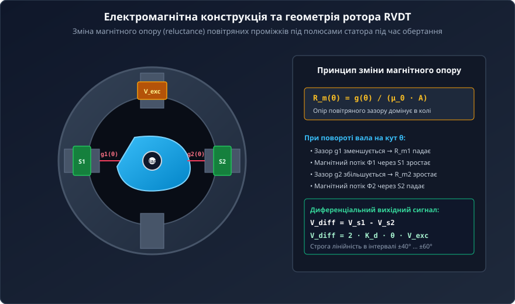
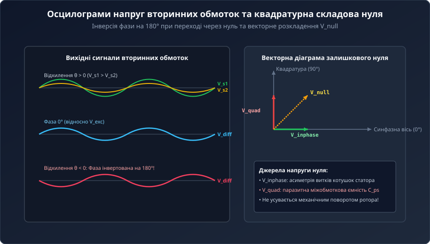
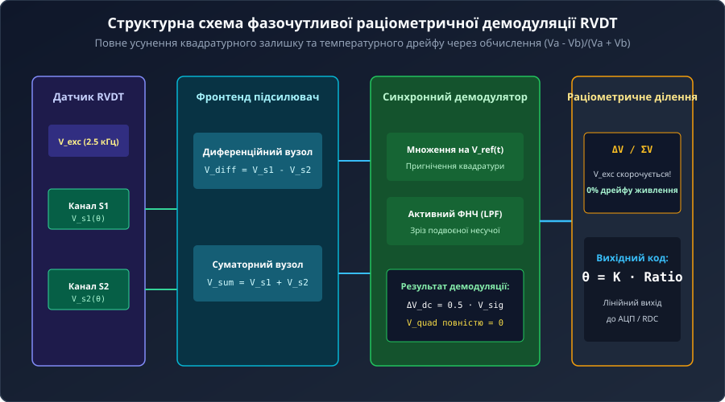
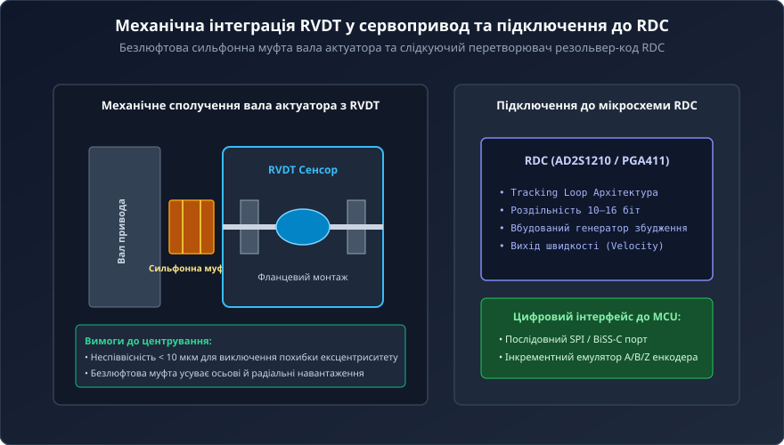
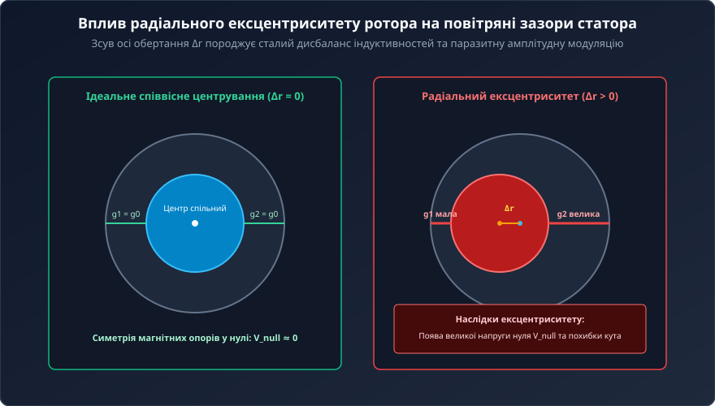

# Обертові змінні диференціальні трансформатори RVDT

Обертові змінні диференціальні трансформатори RVDT (Rotary Variable Differential Transformer) є прецизійними безконтактними електромеханічними перетворювачами кутового переміщення в аналогову напругу змінного струму. Завдяки повній відсутності ковзних контактів, крихких скляних елементів чи вбудованих напівпровідникових мікросхем RVDT забезпечують виняткову надійність (понад 100 000 годин безвідмовної роботи) в екстремальних умовах авіації, космонавтики та важкого машинобудування.

## 1. Фізична концепція RVDT та відмова традиційних кутомірів

У замкнених контурах керування авіаційними сервоприводами (керування елеронами, рулями висоти, дозаторами авіаційного палива) звичні сенсори кута зазнають швидкої відмови:
- **Потенціометри:** механічний контакт рухомого струмознімача швидко зношується під дією постійної вібрації та мікроколивань (дизерингу), викликаючи перебої, шум контакту та ривки привода.
- **Оптичні енкодери:** крихкі скляні диски тріскаються від ударних навантажень (до 50–100 g), лінзи замащуються конденсатом, а вбудовані напівпровідникові світлодіоди та фотодіоди деградують при підвищених температурах (понад +125 °C).



Трансформатор RVDT вирішує цю проблему: датчик містить виключно нерухомі мідні обмотки на статорі з високотемпературною ізоляцією та суцільний профільований феромагнітний ротор. Відсутність тертя гарантує практично нескінченний механічний ресурс та стійкість до температур від -200 °C до +200 °C.

## 2. Електромагнітна конструкція та принцип зміни магнітного опору

Статор RVDT виготовлено з шихтованої електротехнічної сталі з чотирма полюсами, на яких намотано первинну обмотку збудження та дві симетричні вторинні обмотки (S1 та S2).

Ротор не має жодних обмоток чи проводів і являє собою кулачковий феромагнітний сердечник на валу. Робота датчика базується на зміні магнітного опору (reluctance) повітряних проміжків:
```
R_m = g / (μ_0 * A)
```
- У нульовому положенні (`θ = 0`) повітряні проміжки `g_1` та `g_2` під вторинними полюсами однакові, магнітні опори рівні, і магнітний потік збудження ділиться порівну.
- При повороті вала на кут `θ` повітряний проміжок `g_1(θ)` зменшується, магнітний опір падає, а магнітний потік через котушку S1 зростає. Одночасно проміжок `g_2(θ)` збільшується, викликаючи спад потоку через котушку S2.

## 3. Формування вихідного сигналу та залишкова напруга нуля

На первинну обмотку подається змінна напруга несучої частоти `V_exc = V_p * sin(ω_c * t)` (зазвичай 400 Гц – 10 кГц, 3–7 В RMS). Вторинні котушки з'єднані послідовно-зустрічно (диференційно):
```
V_diff(t) = V_s1(t) - V_s2(t) = 2 * K_d * θ * V_p * sin(ω_c * t + φ)
```



Властивості сигналу:
1. Амплітуда диференціальної напруги строго лінійна відносно кута повороту `θ` в межах ±40° ... ±60°.
2. Знак кута визначається фазою: при `θ > 0` сигнал перебуває у фазі з опорною напругою (0°), а при `θ < 0` фаза інвертується на 180°.

У точці електричного нуля спостерігається залишкова напруга нуля (`V_null`), яка складається з синфазного залишку (асиметрія витків), квадратурної складової (фазовий зсув 90° через міжобмоткову паразитну ємність `C_ps` та вихрові струми) і вищих гармонік гістерезису сталі.

## 4. Фазочутлива синхронна демодуляція та раціометричне нормування

Для виділення величини та знака кута диференціальний сигнал подається на синхронний демодулятор:



1. **Синхронне множення:** вхідний сигнал множиться на синфазну несучу `sin(ω_c * t)`. Корисний сигнал перетворюється на постійну складову `0.5 * V_sig`, а квадратурний залишок переноситься на подвоєну частоту `2 * ω_c`.
2. **Фільтр нижніх частот (ФНЧ):** повністю зрізає подвоєну частоту несучої, ліквідуючи 100% квадратурної похибки нуля.
3. **Раціометричне нормування:** обчислення відношення різниці вторинних напруг до їхньої суми:
   ```
   Ratio = (V_s1 - V_s2) / (V_s1 + V_s2) = (K_d / K_0) * θ
   ```
   Амплітуда збудження `V_p` та температурна зміна опору мідних обмоток повністю скорочуються в чисельнику і знаменнику, усуваючи температурний дрейф.

## 5. Механічний монтаж, ексцентриситет та оцифрування через RDC

Висока точність перетворення RVDT ставить суворі вимоги до механічного з'єднання з валом актуатора.





Ключові інженерні правила:
- **Усунення ексцентриситету:** радіальне зміщення осі ротора відносно статора (`Δr`) створює дисбаланс повітряних зазорів та велику похибку нуля. Допуск співвісності повинен бути не гіршим за 5–10 мкм.
- **Безлюфтові муфти:** використання гнучких сильфонних або мембранних муфт ізолює ротор від осьових бить та вібрацій вала привода.
- **Оцифрування RDC:** спеціалізовані мікросхеми «резольвер-код» (RDC, наприклад AD2S1210) на основі слідкуючого контуру (Tracking Loop) синтезують цифровий кутовий код роздільністю 10–16 біт з миттєвим передаванням даних через шину SPI або емуляцією інкрементного енкодера.
