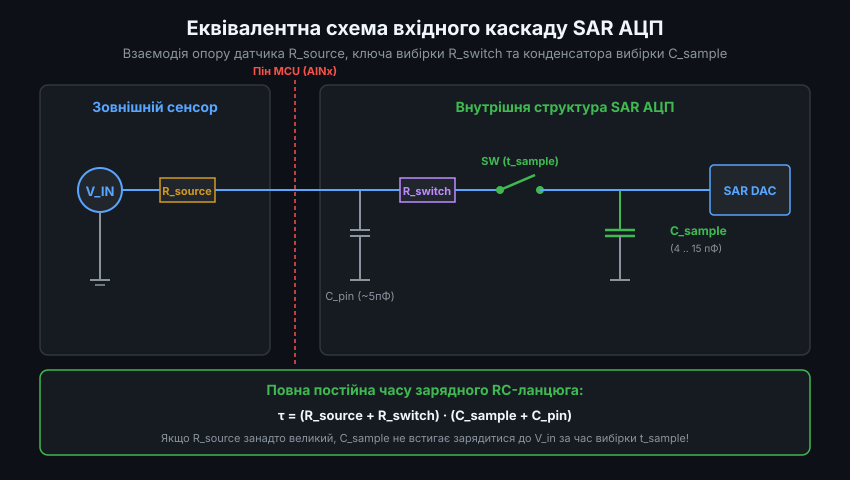
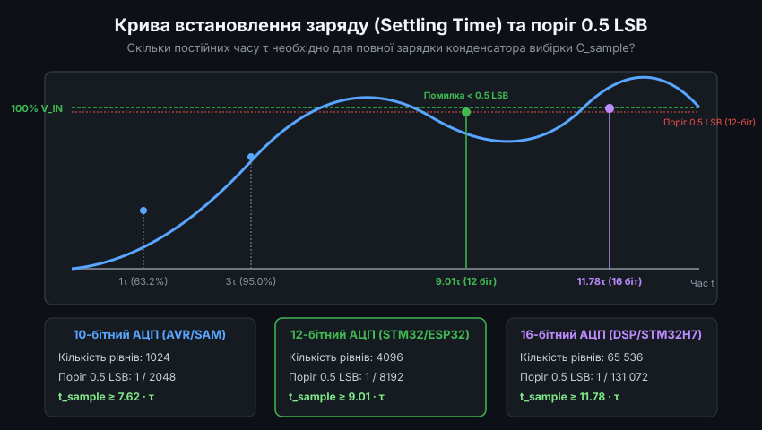
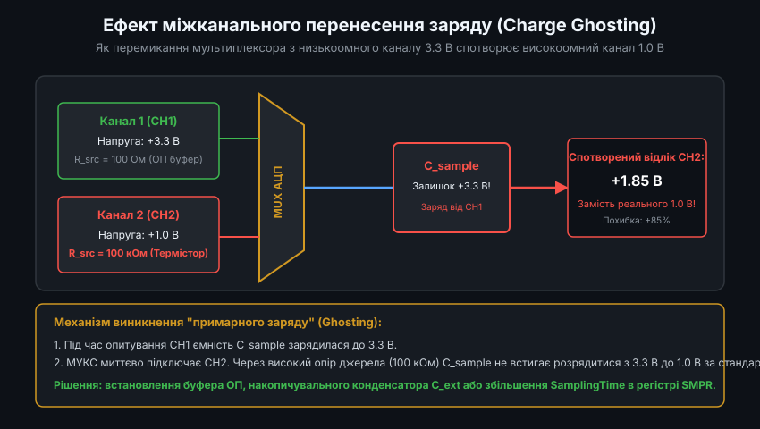
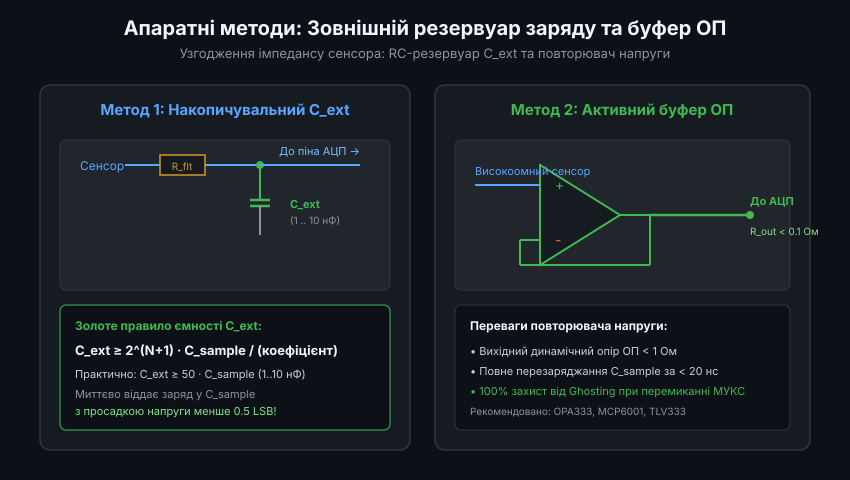
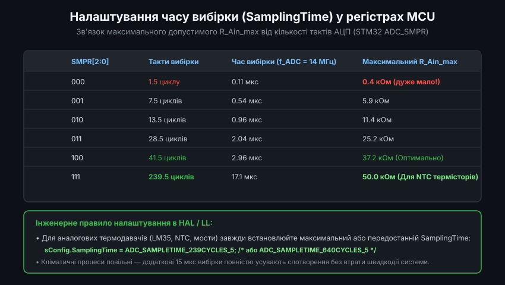

# Динаміка пристрою вибірки та зберігання SAR АЦП: Фізика перехідних процесів та схемотехнічне узгодження

Аналого-цифровий перетворювач послідовного наближення (Successive Approximation Register, SAR ADC) є невід'ємною частиною сучасної мікроконтролерної архітектури. Більшість помилок при зчитуванні показань аналогових кліматичних датчиків (термісторів, виходів напівпровідникових сенсорів типу LM35, мостових тензо- та п'єзорезистивних схем) пов'язані не з дефектами коду чи шумами живлення, а з динамічними явищами вхідного каскаду пристрою вибірки та зберігання (Sample-and-Hold / Track-and-Hold, S/H). Невідповідність між імпедансом джерела сигналу та тривалістю фази вибірки призводить до недозаряду конденсатора вибірки або виникнення перехресних паразитних завад (Ghosting).

---

### 1. Фізична модель комутаційного вузла S/H та імпульсний викид заряду (Charge Kickback)

Вхідна комірка SAR АЦП містить конденсаторний масив перерозподілу заряду (Capacitive DAC / Sampling Capacitor `C_sample`) та КМОН-ключ вибірки `SW`.



Параметри еквівалентної схеми типового 12-бітного SAR АЦП мікроконтролера (наприклад, серій STM32F4/STM32G4):
- **Внутрішня ємність вибірки `C_sample`**: становить від 4.0 до 12.0 пФ (у прецизійних 16-бітних SAR АЦП — до 15-25 пФ).
- **Опір аналогового ключа `R_switch`**: опір каналу транзистора, який залежить від напруги живлення ядра АЦП:
  - При `VDDA = 3.3 В`: `R_switch ≈ 500 .. 1000 Ом`
  - При зниженому `VDDA = 2.0 В`: `R_switch` зростає до `2.0 .. 3.5 кОм`
- **Паразитна ємність виводу `C_pin`**: ємність захисних ESD-діодів та контактної площадки (типово 5-7 пФ).

#### Явище інжекції заряду (Charge Kickback):
У фазі перетворення (Hold Phase) конденсатор `C_sample` від'єднується від вхідного піна та підключається до компаратора. На момент початку наступної фази вибірки (Tracking Phase) напруга на `C_sample` залишається рівною напрузі попереднього перетворення або опорному потенціалу (0 В чи VREF/2).

Коли ключ `SW` миттєво замикається, виникає стрибкоподібний перерозподіл заряду між вхідною паразитною ємністю піна `C_pin` та внутрішнім конденсатором `C_sample`. Це викликає різкий імпульс струму перезаряду (Charge Kickback) тривалістю кілька наносекунд:
`I_kickback = (V_sample_old - V_in) / R_switch`

Якщо вихідний опір датчика `R_source` є великим, цей імпульс спричиняє глибоку динамічну просадку напруги на вхідному піні, яка повинна повністю згаснути до моменту розмикання ключа.

---

### 2. Диференціальне рівняння встановлення заряду та критерій 0.5 LSB

Еквівалентна схема заряду являє собою лінійний послідовний RC-контур першого порядку, що живиться від напруги `V_in` через загальний опір `R_total = R_source + R_switch`.



Диференціальне рівняння балансу напруг у фазі вибірки:
`R_total * C_sample * (d(V_c)/dt) + V_c(t) = V_in`

Аналітичний розв'язок для перехідного процесу заряду:
`V_c(t) = V_in - (V_in - V_initial) * exp(-t / tau)`

де постійна часу контуру:
`tau = (R_source + R_switch) * C_sample`

Для найгіршого випадку, коли початкова напруга відрізняється на повну шкалу перетворення (`|V_in - V_initial| = V_FS`), абсолютна похибка напруги `epsilon(t)` на момент часу `t` становить:
`epsilon(t) = V_FS * exp(-t / tau)`

#### Умова квантування без втрати розрядності:
Для збереження ефективної роздільної здатності (ENOB) похибка встановлення наприкінці інтервалу вибірки `t_sample` має бути строго меншою за половину молодшого розряду (0.5 LSB):
`V_FS * exp(-t_sample / tau) < 0.5 * (V_FS / 2^N) = V_FS / 2^(N + 1)`

Логарифмуючи обидві частини нерівності:
`t_sample / tau >= ln(2^(N + 1)) = (N + 1) * ln(2)`

Розрахунок коефіцієнта заспокоєння:
- **Для 10-бітного АЦП**: `t_sample >= 11 * 0.6931 * tau = 7.62 * tau`
- **Для 12-бітного АЦП**: `t_sample >= 13 * 0.6931 * tau = 9.01 * tau`
- **Для 14-бітного АЦП**: `t_sample >= 15 * 0.6931 * tau = 10.40 * tau`
- **Для 16-бітного АЦП**: `t_sample >= 17 * 0.6931 * tau = 11.78 * tau`

Для 12-бітного АЦП тривалість вибірки повинна складати щонайменше 9.01 постійних часу RC-ланцюга. Якщо ця умова порушується, перетворювач страждає від диференціальної (DNL) та інтегральної (INL) нелінійності.

---

### 3. Механізм міжканального перенесення заряду (Charge Ghosting) у мультиплексорах

У переважній більшості мікроконтролерів один апаратний модуль SAR АЦП обслуговує від 8 до 24 зовнішніх аналогових входів через внутрішній КМОН-мультиплексор каналів (Channel Multiplexer).



Сценарій виникнення ефекту "примарного заряду" (Ghosting):
1. **Крок 1**: АЦП опитує канал CH1, підключений до низькоомного джерела опорної напруги (+3.300 В, опір < 10 Ом). Конденсатор `C_sample` ідеально заряджається до 3.300 В.
2. **Крок 2**: Мультиплексор миттєво відключає CH1 і підключає канал CH2, до якого приєднано високоомний датчик (наприклад, подільник NTC термістора 100 кОм, істинна напруга якого становить +1.000 В).
3. **Крок 3**: Конденсатор `C_sample` починає розряджатися з 3.300 В до 1.000 В через опір `R_source = 100 кОм`. Постійна часу розряду становить:
   `tau = (100 000 + 1 000) Ом * 10 пФ = 1.01 мкс`
4. **Крок 4**: Для коректного розряду до порогу 0.5 LSB потрібно `9.01 * 1.01 мкс ≈ 9.1 мкс`. Якщо в регістрі АЦП налаштовано стандартний час вибірки `1.5 циклу` при тактовій частоті 14 МГц (`t_sample = 107 нс`), конденсатор встигне розрядитися лише на частку від початкового перепаду.

У результаті АЦП фіксує на каналі CH2 напругу близько +2.8 В замість істинного +1.0 В. Похибка становить понад 180%! Чим вища напруга була на попередньому каналі мультиплексора, тим сильніше завищуються показання наступного високоомного каналу.

---

### 4. Апаратні схемотехнічні методи компенсації

Існує два стандартизованих інженерних методи узгодження вхідного імпедансу:



#### 4.1. Метод зовнішнього резервуара заряду (Charge-Reservoir Filter)
Між аналоговим піном АЦП та землею встановлюється високоякісний зовнішній керамічний конденсатор `C_ext` діелектричної групи C0G/NP0 (або прецизійний плівковий PPS).

Принцип дії полягає в перерозподілі заряду між двома паралельними ємностями:
`Delta_V_settling = V_in * (C_sample / (C_ext + C_sample))`

Щоб просадка напруги в момент замикання ключа вибірки не перевищувала 0.5 LSB:
`V_in * (C_sample / C_ext) < V_in / (2^(N + 1))`
`C_ext >= 2^(N + 1) * C_sample`

Для 12-бітного АЦП (`2^13 = 8192`) теоретично потрібна ємність у тисячі разів більша. Проте з урахуванням того, що датчик постійно підживлює зовнішню ємність, практичне інженерне правило обирає співвідношення:
`C_ext >= 50 .. 100 * C_sample`
Типовий номінал: **`C_ext = 1.0 .. 10 нФ`**. Послідовно з сенсором встановлюється резистор `R_flt = 100 .. 500 Ом` для демпфування резонансних дзвінків. Конденсатор `C_ext` миттєво віддає необхідний порційний заряд у `C_sample`, а повільний сенсор поступово підзаряджає `C_ext` між циклами вимірювань.

#### 4.2. Активний повторювач напруги (Unity-Gain Buffer)
Для динамічних сигналів або надвисокоомних датчиків (pH-електроди, п'єзоперетворювачі, резистивні мости 1 МОм) єдиним рішенням є встановлення Rail-to-Rail операційного підсилювача з польовими транзисторами на вході (JFET/CMOS Input):
- Вхідний струм зміщення: `I_bias < 1 пА` (нульове навантаження на сенсор).
- Вихідний опір у замкненій петлі зворотного зв'язку: `R_out_closed < 0.1 Ом`.
- Час встановлення імпульсного перепаду (Settling Time to 0.01%): менше 100 нс.

---

### 5. Програмний розрахунок R_Ain_max та конфігурація регістрів STM32

Виробник мікроконтролерів STMicroelectronics у документації (Application Note AN2834) наводить нормативну формулу розрахунку максимально допустимого вихідного опору джерела сигналу `R_Ain_max`:

`R_Ain_max = (t_sample / (k * C_sample)) - R_switch`

де `k = ln(2^(N+1))`:
- Для 12-бітного режиму: `k = ln(8192) ≈ 9.01`
- `t_sample = SamplingTime_Cycles / f_ADC`



#### Програмна реалізація розрахунку R_Ain_max мовою C:

```c
#include <stdint.h>
#include <math.h>

// Розрахунок максимального допустимого опору сенсора (Ом)
float calculate_max_source_impedance(float f_adc_hz, float sampling_cycles, uint8_t adc_resolution_bits)
{
    const float c_sample = 12.0e-12f; // 12 пФ типова ємність S/H STM32
    const float r_switch = 1000.0f;   // 1 кОм опір внутрішнього ключа при 3.3В

    float t_sample = sampling_cycles / f_adc_hz;
    float k_factor = (float)(adc_resolution_bits + 1) * 0.693147f; // (N+1) * ln(2)

    float r_max = (t_sample / (k_factor * c_sample)) - r_switch;
    return (r_max > 0.0f) ? r_max : 0.0f;
}
```

#### Програмна методика подвійного зчитування (Dummy Read / Ghosting Killer):
Якщо в проекті неможливо змінити апаратну схему, для усунення перенесення заряду застосовують програмний трюк: кожний високоомний канал оцифровується двічі поспіль, а перший відлік програмно відкидається!

```c
#include "stm32f4xx_hal.h"

extern ADC_HandleTypeDef hadc1;

uint16_t adc_read_high_z_channel_safe(uint32_t channel)
{
    ADC_ChannelConfTypeDef sConfig = {0};

    sConfig.Channel = channel;
    sConfig.Rank = 1;
    // Обов'язково встановлюємо максимальний час вибірки для високоомного сенсора!
    sConfig.SamplingTime = ADC_SAMPLETIME_480CYCLES; 
    HAL_ADC_ConfigChannel(&hadc1, &sConfig);

    // Перше фіктивне перетворення (Dummy conversion)
    // Конденсатор C_sample перезаряджається з чужого потенціалу до потенціалу нашого каналу
    HAL_ADC_Start(&hadc1);
    HAL_ADC_PollForConversion(&hadc1, 10);
    volatile uint16_t dummy = (uint16_t)HAL_ADC_GetValue(&hadc1);
    (void)dummy; // Відкидаємо спотворений відлік

    // Друге валідне перетворення (Valid conversion)
    // C_sample вже перебуває біля істинного значення, залишкова похибка < 0.5 LSB
    HAL_ADC_Start(&hadc1);
    HAL_ADC_PollForConversion(&hadc1, 10);
    uint16_t valid_sample = (uint16_t)HAL_ADC_GetValue(&hadc1);

    return valid_sample;
}
```

Грамотне поєднання апаратного узгодження імпедансів та конфігурації таймінгів `ADC_SMPR` гарантує абсолютну лінійність та повторюваність вимірювань кліматичних параметрів у вбудованих системах.
